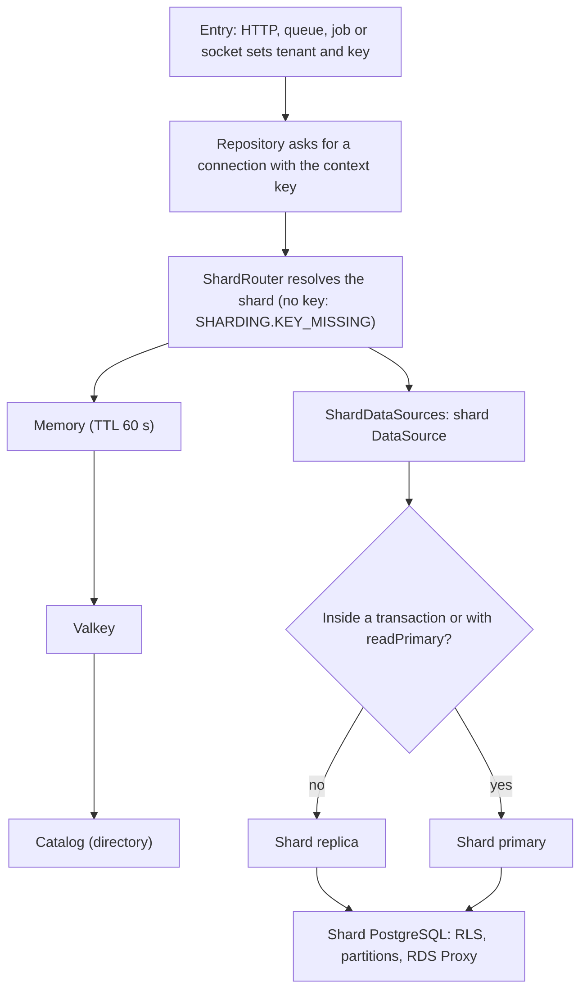
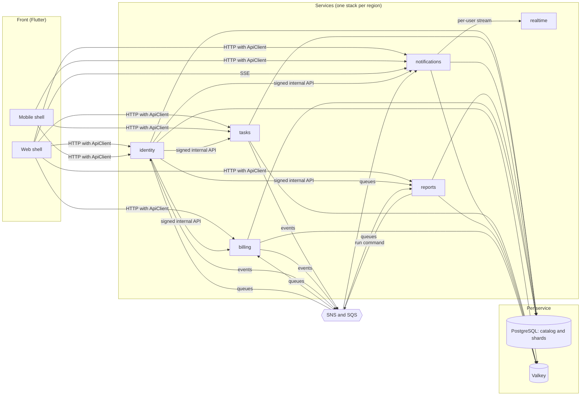
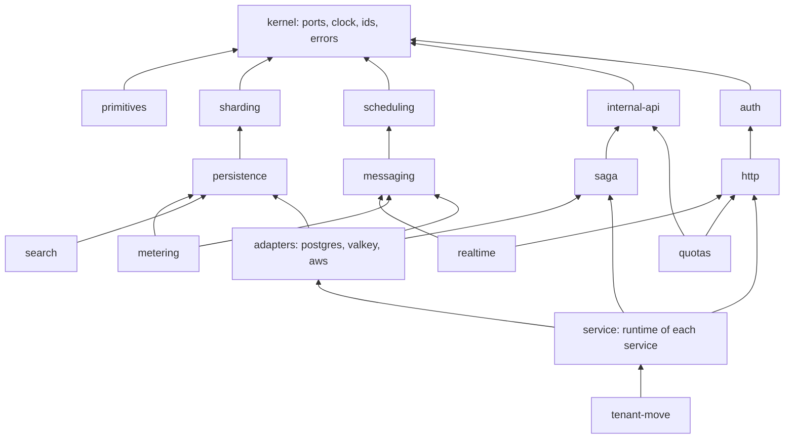
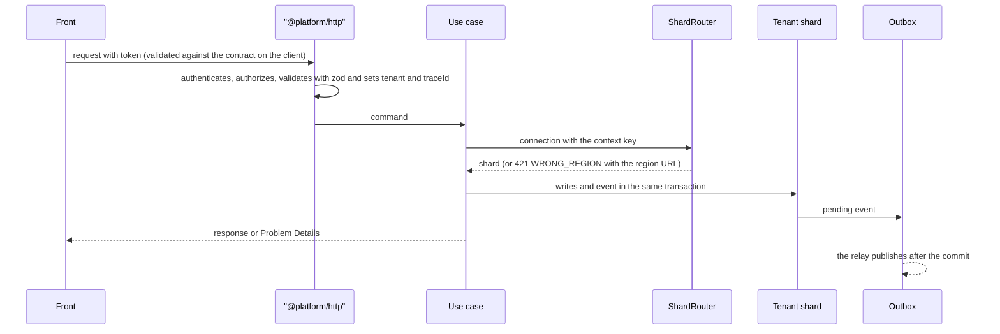
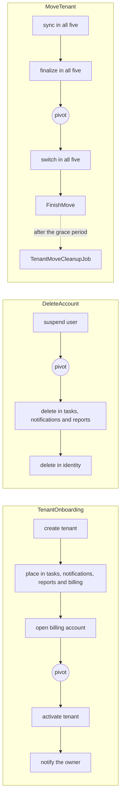

# Platform architecture

This document describes what the platform is and how it is built. The phases, their status, the execution order and the decision log are in the [plan](plan/README.md).

It describes what is built unless a section says **Planned, not built**. Decisions live in the [ADRs](adr/README.md); where a section and an ADR differ, the ADR wins.

## Summary

The platform is a reusable monorepo for building microservice backends in NestJS with TypeORM on PostgreSQL, hexagonal architecture and deployment on AWS. It replaces the `node_template` repository and serves as the starting point for any new product: you clone it, rename it and add services with a generator.

It comes with what every backend needs and is almost never done well from the start: identity with MFA, multitenancy, auditing, messaging with retries, recoverable sagas, files, notifications, usage-based billing and end-to-end traceability.

**Principles that guide every decision**

- **Strict hexagonal.** The domain and the use cases know nothing about NestJS, TypeORM or AWS. Everything external comes in through ports.
- **Platform agnostic.** Moving from AWS to another provider means rewriting adapters, never business logic.
- **Types before strings.** Operations, events, queues, permissions, errors and jobs are named with enums. The compiler catches a rename.
- **Explicit contracts.** Each service publishes what it exposes (operations, events, errors) with runtime validation on both sides.
- **Everything leaves a trace.** Every request, message, saga step and table change is tied to a `traceId` and an actor.
- **Secure by default.** Every endpoint requires authentication unless it is declared public, and every operation that changes data declares how it is reverted.

## Monorepo with Nx

The repository root is minimal ([ADR 0015](adr/0015-repository-structure-and-shared-code.md)). It holds two applications, `backend/` and `front/`, Nx as orchestrator and the repository tooling. Each application owns its libraries: nothing shared between backend and front lives at the root, and the front receives the contracts generated from the backend.

```text
backend/                       backend: all its external dependencies in backend/package.json
  package.json                 external dependencies with exact versions (the backend's only package.json)
  tsconfig.base.json           TypeScript options and library aliases (@platform/kernel...)
  dist/<app>/                  each app's bundle, built with esbuild (not committed)
  libs/
    contracts/platform/        @contracts/platform: contract kit and cross-cutting pieces
    contracts/<service>/       identity, tasks, notifications, reports and billing contracts
    platform/                  kernel, primitives, config, observability, persistence, criteria,
                               sharding, cache, bloom, resilience, rate-limit, messaging,
                               internal-api, saga, scheduling, auth, http, service, flags,
                               search, realtime, quotas, metering and tenant-move
    platform/adapters/         aws, postgres and valkey: one adapter per provider
  apps/<service>/              identity, tasks, notifications, reports, billing and realtime
  e2e/platform-flow/           the five services in one process (platform-flow:e2e)
  e2e/deploy-smoke/            HTTP smoke tests of a deployed environment (deploy-smoke:run, :local)
  tools/contracts-export/      exports the contracts to JSON (Nx project contracts-export)
  tools/app-bundler/           bundles the apps with esbuild into backend/dist/<app>/
  tools/generators/            service and module generators (ADR 0033)
  tools/platform-smoke/        smoke application of the platform libraries
  infra/terraform/             AWS modules, stacks and environments (ADR 0020)
  infra/scripts/               deploy-aws.sh, local.sh, tf-validate.mjs and utilities
  infra/local/                 startup of PostgreSQL, LocalStack and the OpenTelemetry Collector
  docker-compose.yml           local stack
front/                         Flutter pub workspace
  apps/{web,mobile}/           shells
  microfrontends/              account, assistant, backoffice, billing, notifications, reports, tasks, verifier
  packages/                    api, auth, contracts, i18n, shell_core, shell_host, test_utils, tokens, ui, utils
  tools/                       contracts_gen, new_microfrontend, nx-plugin, check_deferred_chunks.dart and check_microfrontend_boundaries.dart
docs/                          architecture, plan (plan/), ADRs, per-phase designs (design/) and audits (audits/)
.claude/                       backend and front skills, hooks and agents for the AI tools
nx.json  package.json  pnpm-workspace.yaml  pnpm-lock.yaml  .nvmrc  tsconfig.json
.github/  .husky/  commitlint.config.mjs  lint-staged.config.mjs  .prettierrc  renovate.json
```

**A single graph for backend and front**

- Each backend project is a `project.json` with its name and tags: `platform-saga`, `contracts-identity`, `shared-utils`. The libraries are not npm packages: they have no `package.json` or `node_modules`, and they are imported through the aliases in `backend/tsconfig.base.json`. Nx reads those aliases to build the graph and enforce the boundaries between projects.
- `nx.json` registers the plugins `@nx/jest/plugin` (`test`) and `@nx/eslint/plugin` (`lint`), limited to `backend/**`. `typecheck` and `build` come from `targetDefaults`: each project declares them empty in its `project.json`.
- `front/tools/nx-plugin/index.cjs` reads the `workspace:` list in `front/pubspec.yaml` and registers each member as a project `front-<pubspec name>`: `front-shell_core`, `front-mf_tasks`, `front-web_shell`. Each one has `analyze`, `format-check` and, if it has a `test/` folder, `test`, all cached. The dependencies between Dart packages come from their `pubspec.yaml`.
- `front-contracts` depends on the projects in `backend/libs/contracts`. A contract change marks the front packages and microfrontends that use it as affected.
- The libraries are not compiled separately. Their target is `typecheck`: `tsc` without emitting over `tsconfig.lib.json` (production code) and `tsconfig.spec.json` (code and tests). Jest and the tools read the libraries' TypeScript through their aliases.
- Only the apps are bundled. An app declares `"build": {}` in its `project.json` and inherits the target from `nx.json`, which runs `backend/tools/app-bundler` with esbuild and leaves the result in `backend/dist/<app>/`. The libraries go into the bundle; the `node_modules` dependencies stay external.
- `pnpm nx affected -t lint test test-int typecheck build analyze format-check` is the everyday command and the CI one: `test` runs the unit tests with parallel workers and `test-int` the container suites (`test-int:ci` runs both with coverage, as the CI `test-int` job does).

**Services**

Each microservice is an app in `backend/apps/<service>` (an Nx project with `project.json`, without `package.json`) with its domain, its database, its migrations and its deployment. Built: `identity`, `tasks`, `notifications`, `reports`, `billing` and `realtime`. Planned, not built: `files`, `agreements`, `assistant` and `backoffice-api`. The identity design is in [`docs/design/f4-identity.md`](design/f4-identity.md).

**Structure of each library**

```text
backend/libs/platform/kernel/
  project.json        name, tags and targets
  tsconfig.json       the one the editor uses (extends tsconfig.spec.json)
  tsconfig.lib.json   production code: src without __tests__
  tsconfig.spec.json  code and tests
  jest.config.cjs
  src/
    index.ts          entry point of the @platform/kernel alias
    id-generator.ts   IdGenerator port and UuidV7IdGenerator
    __tests__/
      id-generator.spec.ts
      utils/          FixedClock and SequentialIdGenerator, alias @platform/kernel/test-utils
```

Code goes directly in `src/`, without `src/lib/`. Each folder's tests go in its `__tests__/`, unit (`*.spec.ts`) and integration (`*.int-spec.ts`). Test doubles and support shared by several folders go in `src/__tests__/utils/`; if another library uses them, they are exported with the alias `@platform/<lib>/test-utils` (today `@platform/kernel/test-utils` and `@platform/rate-limit/test-utils`).

**Internal structure of each module**

```text
backend/apps/<service>/src/
  modules/<module>/
    domain/          pure entities, value objects, ports, errors
    application/     use cases
    infrastructure/  persistence/{entities,mappers} and TypeORM repositories, clients
    presentation/    controllers, gateways, message handlers
  shared/{enums,constants,types,utils}/   shared across the service's modules
  database/          reference DataSource for the shard and the catalog
backend/apps/<service>/migrations/{shard,catalog}/   TypeORM migrations
```

**Dependency rules**

- Between projects, the `@nx/enforce-module-boundaries` rule in `backend/eslint.config.mjs` rules, by tags: `type:contracts` depends only on `type:contracts`; `type:util` on `type:util` and `type:contracts`; `type:platform` on `type:platform`, `type:util` and `type:contracts`; `type:tool` on contracts, utilities and platform. `pnpm nx affected -t lint` checks it.
- A service app (`type:app`) imports from another service only its `@contracts/<service>` package, never its internal code.
- Inside a module, `domain` depends only on `kernel`; `application` depends on `domain`; `infrastructure` and `presentation` depend on both. These layers are checked by the backend `check-structure.mjs`, which runs in CI.
- `@aws-sdk/*` only appears in `backend/libs/platform/adapters/aws` (`@platform/adapters-aws`); a `no-restricted-imports` rule blocks it everywhere else. It provides `SnsSqsEnvelopePublisher` (used by the outbox relay), `SnsSqsMessageBus`, `SqsPoller` (long polling, inside `SqsConsumerModule`, which is not global so it closes before `AwsModule`) and `SqsLambdaHandler` (Lambda with partial batch failures). Both use `SqsDeliveryProcessor`, which applies `ChangeMessageVisibility` and sends permanent failures to the DLQ. The runtime topology comes from the contracts with `topologyFromContracts`.
- The transaction ports (`TransactionManager`, `UnitOfWork`) and the idempotency port (`IdempotencyStore`) live in `@platform/kernel`, so `messaging` and `internal-api` use the transaction without depending on `@platform/persistence`.
- The PostgreSQL adapters for other libraries' ports live in `backend/libs/platform/adapters/postgres` (`@platform/adapters-postgres`): `TypeOrmOutboxStore` writes the outbox in the same transaction as the business change and claims it with `FOR UPDATE SKIP LOCKED`, a lease with fencing and FIFO order per group; `TypeOrmProcessedMessageStore` stores consumer idempotency in `processed_messages`; `TypeOrmIdempotencyStore` stores the internal API's and `TypeOrmDirectoryStore` the shard directory. Their tables are TypeORM entities and migrations (`platformShardEntities`, `platformCatalogEntities` and their migrations), together with the saga log ([persistence design](design/typeorm-persistence-and-sagas.md)).

## Front: shells and microfrontends

`front/` gathers the whole client in a Flutter pub workspace ([ADR 0012](adr/0012-front-flutter-shells-microfrontends.md)). Two shells, `web` and `mobile`, compose the same microfrontends: a domain is written once and shows up on both platforms. Nx orchestrates the workspace with its own plugin `front/tools/nx-plugin/index.cjs`.

| Piece                    | What it is                                                                                                                                                                      |
| ------------------------ | ------------------------------------------------------------------------------------------------------------------------------------------------------------------------------- |
| `front/apps/web`         | Web shell (`web_shell`). `WebShell` registers the microfrontends, creates the `ShellRuntime` and builds the router with `ShellRouterFactory`, with a step-up page at `/step-up` |
| `front/apps/mobile`      | Shell for iOS and Android (`mobile_shell`), with its registry, its router and deep links                                                                                        |
| `front/microfrontends/*` | One package per domain (`mf_<domain>`) with its manifest, screens, data and texts                                                                                               |
| `front/packages/*`       | Pieces shared by the shells and the microfrontends                                                                                                                              |

| Microfrontend   | Web | Mobile | Content                                              |
| --------------- | --- | ------ | ---------------------------------------------------- |
| `account`       | Yes | Yes    | Overview, sessions, devices, security and agreements |
| `tasks`         | Yes | Yes    | Sample CRUD                                          |
| `notifications` | Yes | Yes    | Inbox and preferences                                |
| `assistant`     | Yes | Yes    | Conversation list and chat with the AI assistant     |
| `reports`       | Yes | Yes    | Report runs and their results                        |
| `billing`       | Yes | No     | Plan, invoices and invoice detail                    |
| `backoffice`    | Yes | No     | Tenants, sagas and DLQ                               |
| `verifier`      | No  | Yes    | Verification on the registered device                |

Each shell registers only the microfrontends that declare its platform in the manifest (`platforms`).

**Microfrontend contract**

Each microfrontend exports a `MicrofrontendManifest` from `shell_core` and follows the contract in [ADR 0018](adr/0018-microfrontend-contract.md). This is the one for `tasks`, trimmed:

```dart
final MicrofrontendManifest tasksManifest = MicrofrontendManifest(
  id: tasksId,
  platforms: {AppPlatform.web, AppPlatform.mobile},
  access: tasksReadRule,
  modes: const {ShellMode.demo},
  menu: const [
    MenuEntry(
      label: tasksMenuLabel,
      path: TasksPaths.list,
      order: 20,
      icon: Icons.check_circle_outline,
      selectedIcon: Icons.check_circle,
    ),
  ],
  deepLinks: _deepLink,
  screens: [
    ScreenRoute.deferred(
      TasksPaths.list,
      library: screens.loadLibrary,
      build: (scope, params) => screens.TasksScreens.list(scope),
      routes: [
        // `new` route and `:id` route with its `edit` child, trimmed.
        ScreenRoute.deferred(
          ':${TasksPaths.idParam}',
          library: screens.loadLibrary,
          build: (scope, params) => screens.TasksScreens.detail(
            scope,
            taskId: params.require(TasksPaths.idParam),
          ),
        ),
      ],
    ),
  ],
);
```

- **Screens:** `screens: [ScreenRoute.deferred(path, library: ..., build: (scope, params) => ...)]`. `library` is the `loadLibrary` of the deferred import and `build` receives the `MicrofrontendScope` and the `params`, which merge query and path (path wins). `TasksScreens` is a static class that builds each screen with its repository and with `DeferredLocalizations`. Subroutes go in `routes` and are protected with `access`.
- **Identity:** `ShellRuntime.identityEpoch` goes up with every change of user or tenant. `ShellRouterFactory` wraps each page in a `KeyedSubtree` with that value and the screen is rebuilt from scratch for the new identity.
- **Lifecycle:** `lifecycleFactory` creates one instance per activation. Events are sent with `ShellContext.emit` and listened to with `ShellContext.listen`; when the identity rotates, the context is cancelled.
- **Resources:** repositories implement `ScopedResource` and the scope closes them.
- **Access:** `AccessRule.mfa(maxAge)` requires a recent second factor. Actions are protected with `AccessGate` or `context.can(rule)`.
- **Layout:** each screen owns its single top bar with `AppPage` from `ui`. The shell uses `ShellChrome`.
- **States and errors:** each screen has a controller (`ChangeNotifier`) tested without widgets. Loading is composed by an `AsyncLoader` and actions by an `ActionRunner`; the screen is a `StatelessWidget` that creates the controller with `ControllerBuilder`. An action's errors are shown with `showActionResult`.

All eight manifests use `screens:`, and `notifications` creates its lifecycle with `lifecycleFactory`. The previous APIs (`routes:`, `lifecycle:`, `ShellContext.eventBus` and `AdaptiveScaffold.compactActions`) were removed.

**Deferred loading**

The manifest is imported eagerly: the shell reads it at startup to build routes, menu and visibility. Screens, data and texts live behind `deferred as` and are downloaded when someone navigates to them. `DeferredLibraryLoader` from `shell_core` loads each library once per instance and shows the page while it waits. This way the web app of a client without backoffice access never runs its code.

`front/tools/check_deferred_chunks.dart` checks this after `flutter build web --release --source-maps`, from `front/apps/web`. It fails if:

1. `main.dart.js.map` lists sources from `microfrontends/*/lib/src/{data,screens,l10n}`.
2. Any backoffice ARB text of 12 characters or more appears in `main.dart.js`.

The `notifications` lifecycle ships in the initial bundle with the manifest, so it loads `src/data` with `deferred as` through a bridge (`lifecycle/unread_counts.dart`). On the VM, tests load the manifests' deferred libraries once in `setUpAll` with `DeferredLibrariesPreloader` from the `test_utils` package.

**Rules**

- Microfrontends depend only on `front/packages` and never on each other. They communicate through shell events and routes.
- Adaptive screens: the `ui` widgets adjust to large and small screens. A screen with its own version per platform is declared with `PlatformScreen`.
- Visibility by permissions, plan and feature flag with the enums generated from the backend. The interface hides what the user cannot use; the API is the authority.
- Nothing in `front/` imports backend libraries; it only uses what is generated in `front/packages/contracts`.
- What is shared between screens of a microfrontend lives in its `lib/src/shared/{enums,constants,types,utils}`.

**Shared packages** (`front/packages`)

| Package      | What it contains                                                                                                                                                                                                                                                                                                                                            |
| ------------ | ----------------------------------------------------------------------------------------------------------------------------------------------------------------------------------------------------------------------------------------------------------------------------------------------------------------------------------------------------------- |
| `shell_host` | What both shells have in common: startup, session, login, step-up, access denied page and demo mode                                                                                                                                                                                                                                                         |
| `shell_core` | `MicrofrontendManifest`, `ScreenRoute` with `ScreenRoute.deferred`, registry, `ShellRuntime`, `ShellContext`, `ShellNavigator` and `ShellRouterFactory` (router), `DeferredLibraryLoader`, `RepositoryBinding`, `DemoBehavior`, `DeferredLocalizations` with `showLocalizedDialog` and access rules                                                         |
| `api`        | `ApiClient` with an injectable `HttpTransport`: validates the request against the contract before calling and decodes responses and errors                                                                                                                                                                                                                  |
| `contracts`  | `lib/src/core` written by hand and `lib/src/<service>` generated by `contracts_gen` from `backend/libs/contracts`                                                                                                                                                                                                                                           |
| `utils`      | `Clock` and `systemClock`, the only place with `DateTime.now()`; pure functions over the `contracts` types: amounts, dates and field errors                                                                                                                                                                                                                 |
| `auth`       | Session ports, models and `SessionManager`                                                                                                                                                                                                                                                                                                                  |
| `ui`         | Adaptive widgets, `AsyncValue`, `AsyncLoader`, `ActionRunner`, `ControllerBuilder`, `StatusColors` (`context.statusColors`), layout (`AppPage`, `ShellChrome`, `PlatformScreen`, `ContentColumn`) and theme                                                                                                                                                 |
| `test_utils` | `TestApp`, `SessionBuilder`, `ProblemFixtures`, `TestScope`, `FakeClock`, `ScriptedTransport` with `ScriptedApi`, `DeferredLibrariesPreloader`, `expectAccessible`, `pumpAtWidths` and `pumpAtTextScale`, the shells' shared scenarios and the `auth` test doubles. Only in `dev_dependencies`. What a single package's tests use goes in its `test/utils/` |
| `tokens`     | Design colors and scales in Dart                                                                                                                                                                                                                                                                                                                            |
| `i18n`       | Texts in Spanish and English (ARB), including the error catalog messages, and `ErrorPresenter` with `ErrorDetails` to describe an error                                                                                                                                                                                                                     |

**Creating a new microfrontend**

`dart run front/tools/new_microfrontend.dart reports --menu "Reportes"` creates `front/microfrontends/reports` with its manifest, its deferred screens, its demo repository and its tests, and adds the member to `front/pubspec.yaml`. It prints the lines each app needs. The manual steps and the list of what gets written are in the [front-new-microfrontend skill](../.claude/skills/front-new-microfrontend/SKILL.md).

**Real data.** Each business microfrontend (tasks, notifications, billing and reports) declares `RepositoryBinding(demo:, live:)`: in demo it uses its in-memory fake and in live an `Api<Name>Repository` on top of `ApiClient` and the generated routes, which validates each request against the contract. The contract enums are re-exported from the microfrontend's `shared/enums`. Live notifications and the unread count arrive through `SseNotificationsStream`, which reads `GET /v1/notifications/stream` with the session token and resumes with `Last-Event-ID` without losing or repeating notices. On `PLATFORM.SHARDING.WRONG_REGION`, `ApiClient` repeats the request once at `details.apiBaseUrl` and keeps that base. Tests use `ScriptedTransport` from `test_utils` and need no backend ([ADR 0034](adr/0034-live-front-repositories-sse-region.md)).

**Deployment.** The `cloudfront-waf` module creates the S3 bucket and the CloudFront distribution for the web app.

## Platform agnostic

Each external capability is a port in the platform library that uses it (for example `CachePort` in `@platform/cache` or `RateLimiter` in `@platform/rate-limit`), with one adapter per provider in `backend/libs/platform/adapters/<provider>` (today `aws`, `postgres` and `valkey`). Business code talks to the port; each service's module picks the adapter by configuration. Changing clouds means writing new adapters and different Terraform.

| Capability                 | Port                                | AWS adapter                                                  | Local adapter and alternatives                                         |
| -------------------------- | ----------------------------------- | ------------------------------------------------------------ | ---------------------------------------------------------------------- |
| Topics (pub/sub)           | `TopicPublisher`                    | SNS                                                          | In memory; Google Pub/Sub, Kafka                                       |
| Queues                     | `QueueSender`, `QueueConsumer`      | SQS                                                          | In memory, BullMQ on Valkey; RabbitMQ                                  |
| Files                      | `FileStorage`                       | S3                                                           | Local file system, MinIO; GCS, Azure Blob                              |
| Scheduled jobs             | `ScheduledJob`, `JobLock`           | `@platform/scheduling` in the Fargate worker, lock in Valkey | The same in any process; Kubernetes CronJob                            |
| Cache and short-lived data | `Cache`, `KeyValueStore`            | ElastiCache for Valkey                                       | Valkey in Docker; any Redis-compatible server                          |
| Email                      | `EmailSender`                       | SES                                                          | SMTP with Mailpit                                                      |
| Push                       | `PushSender`                        | APNs, FCM and Web Push directly                              | Same on any cloud                                                      |
| Secrets                    | `SecretSource`                      | Secrets Manager                                              | Environment variables; Vault                                           |
| Feature flags              | OpenFeature                         | Own provider on DB + Valkey                                  | flagd; AppConfig                                                       |
| Real time                  | `RealtimePublisher`                 | Socket.IO and SSE in NestJS on Fargate                       | The same gateways locally or on Kubernetes                             |
| Signatures and encryption  | `Signer`, `KeyManagement`           | KMS                                                          | Local keys                                                             |
| Compute entry point        | `main.ts`, `lambda.ts`, `worker.ts` | Lambda, Fargate                                              | Any container                                                          |
| Observability              | OpenTelemetry                       | Direct OTLP/HTTP export to OpenObserve on Fargate            | OpenObserve and a Collector in containers; any OTel-compatible backend |

The messaging topology, the jobs and the buckets are declared in code in an abstract way (topic, queue, job). The AWS Terraform reads those declarations; another provider would have its own module reading the same ones.

**Agnostic entry points**

Endpoints, event handlers, jobs, internal operations and real-time messages are written once with platform decorators (`@Endpoint`, `@Subscribe`, `@ScheduledJob`, `@InternalOperation`, `@RealtimeHandler`) and call use cases. An entry adapter translates each runtime into those declarations.

| Runtime                      | Entry adapter                                                                 |
| ---------------------------- | ----------------------------------------------------------------------------- |
| Lambda with HTTP API Gateway | `lambda.ts` turns the event into a NestJS request                             |
| Lambda with SQS              | Turns the batch into messages for `@Subscribe` and reports partial failures   |
| Real-time container          | NestJS `@WebSocketGateway` (Socket.IO) and `@Sse()` call `@RealtimeHandler`   |
| Fargate, Kubernetes or local | `main.ts` and `worker.ts`: HTTP server, long polling consumers, cron and `ws` |

Changing runtime means changing the entry adapter. Controllers, handlers and use cases stay the same.

## Identifiers, traceability and observability

**UUIDv7 identifiers**

- Every identifier is a UUIDv7: users, tenants, sessions, devices, events, sagas, jobs, files, invoices and the `traceId` itself.
- The app generates the ID with `UuidV7IdGenerator` (on `node:crypto`, port `IdGenerator`), so the entity has an identity before it is persisted. The column is `uuid` and it is the primary key.
- UUIDv7 values sort by time: Postgres indexes grow in order and serve as a pagination cursor (`?after=<id>`).
- Secrets use 256 random bits from `crypto.randomBytes`: refresh tokens, `mfaToken`, OTP, reset tokens and API keys.
- A UUIDv7 reveals its creation date to the millisecond. This is taken into account for public IDs where that date is sensitive.

**Traceability**

- The `traceId` is a UUIDv7 generated on entering the system. Its 128 bits without hyphens form a valid W3C trace-id inside `traceparent`, compatible with OpenTelemetry and X-Ray.
- It travels in HTTP headers, in each message's attributes, in saga steps, in auditing and as a comment on every SQL statement.
- The response returns `x-trace-id` so support can find the case in seconds.
- If an external client sends its own `traceparent`, it is stored as `externalTraceId`.

**Observability with OpenTelemetry**

OpenTelemetry (OTel) is the open instrumentation standard: it produces logs, traces and metrics linked by the same `traceId` and sends them to any backend. The backend is the tool where they are queried, in the style of Datadog.

- Automatic instrumentation of HTTP, NestJS, `pg`, the Valkey client, the AWS SDK and `fetch`. Custom spans in use cases, saga steps, message handlers and jobs.
- Logs: the `LoggerPort` writes JSON with `trace_id` and `span_id` and exports it as OTel logs, so each log opens its full trace. Fields such as `password`, `token` and `authorization` are hidden automatically.
- Metrics: latency per endpoint, errors per code, queue depth and age, retries, stalled sagas, cache hits and usage per tenant.
- In AWS each process exports OTLP/HTTP straight to OpenObserve, in Fargate and Lambda, with no Collector. Locally an OpenTelemetry Collector inside `docker-compose` receives everything and forwards it ([ADR 0046](adr/0046-providers-and-telemetry-per-environment.md)).

A single tool gathers logs, metrics, traces, dashboards and alerts in every environment: **OpenObserve**.

| Tool        | What it is                                                                                                                    | Use                                                                              |
| ----------- | ----------------------------------------------------------------------------------------------------------------------------- | -------------------------------------------------------------------------------- |
| OpenObserve | Open source and OTel native; logs, metrics, traces, dashboards and alerts in one interface; runs in a single Docker container | Every environment: a container locally and a Fargate task with S3 storage on AWS |
| SigNoz      | Open source with more complete APM views; runs with Docker Compose on ClickHouse                                              | Alternative if deeper trace analysis is needed                                   |

**Log volume control**

| Control                                        | Use                                                                          |
| ---------------------------------------------- | ---------------------------------------------------------------------------- |
| `LOG_LEVEL` (`debug`, `info`, `warn`, `error`) | Global level; in Lambda it also feeds `logging_config.application_log_level` |
| `LOG_SAMPLE_RATE`                              | Percentage of requests that log at debug (example: 0.01)                     |
| `LOG_DEBUG_CONTEXTS`                           | Debug only for specific modules (example: `auth,reports`)                    |
| `DB_LOG_QUERIES`, `DB_SLOW_QUERY_MS`           | SQL off by default, slow queries always logged                               |
| Feature flag `log-level`                       | Hot level change, without redeploy                                           |

In AWS traces use head sampling per environment (`OTEL_TRACES_SAMPLER_ARG`: 1.0 in dev, 0.2 in staging, 0.05 in prod); the local Collector keeps every trace with an error and a percentage of the rest. Retention is 14 days in dev and 30 in prod.

## Errors

Each error has a unique, readable code in the form `SERVICE.SUBMODULE.ERROR`. The client reacts to the code; the message is only for people and does not include input values.

**Codes as enums**

Codes are declared as enums, never as loose literals:

- Each library in `backend/libs/platform` declares its codes in its own enum, with the `PLATFORM.` prefix (for example `SagaErrorCode.UncertainOutcome = 'PLATFORM.SAGA.UNCERTAIN_OUTCOME'`) and its catalog with `defineErrorCatalog`. A code with internal audience never reaches the client: `toProblemDetails` responds `PLATFORM.INTERNAL.UNEXPECTED` with its `traceId`.
- `@contracts/platform` keeps in `PlatformErrorCode` only the public, cross-cutting codes, the ones the client sees and the front translates.
- Each service declares its own in its contracts package, like `IdentityErrorCode` in `backend/libs/contracts/identity/src/enums`.

`PlatformError` from `@platform/kernel` is the base of every error: it carries `code`, `retryable` and `details`. `DomainError` extends it for business rules and is not retryable by default. `ErrorCode.PATTERN` and `ErrorCode.isValid` validate the code format, and `PlatformError.is` recognizes a platform error.

**Catalogs**

`defineErrorCatalog` from `@contracts/platform` creates one entry for each enum value, with `httpStatus`, `retryable`, `audience` (`public` or `internal`), `description` and `messageKey`. `messageKey` is derived from the code with the same rule as the front: `PLATFORM.AUTH.FORBIDDEN` gives `error_platform_auth_forbidden`.

- `platformErrorCatalog` covers only the public, cross-cutting platform codes. Its test fails if a code repeats, if it does not match the format or if it declares an internal one. Each library in `backend/libs/platform` has its own catalog for its codes, and the service composes them with `ErrorCatalog.register`.
- `identityErrorCatalog` covers the identity codes.
- Public codes reach the front generated, with their `messageKey`. A test in `front/packages/contracts` requires the Spanish and English message for each one in the ARB files of `front/packages/i18n`. Internal ones never reach the client.

**Failure classification**

`FailureKind` lives in `@platform/kernel` and `FailureClassifier` in `@platform/primitives`. They are shared by resilience, cache, messaging, sharding, internal-api and saga:

| `FailureKind`       | Meaning                                                             |
| ------------------- | ------------------------------------------------------------------- |
| `Transient`         | Retrying the same call may work                                     |
| `Permanent`         | Repeating it gives the same result: business rule, 4xx, nonexistent |
| `ProtocolViolation` | Broken contract or implementation failure; never retried            |
| `Timeout`           | Time ran out; the effect may or may not have been applied           |
| `Cancelled`         | The caller aborted; the effect may or may not have been applied     |

`FailureClassifier.classify` walks the error and up to three levels of `cause`, and uses the first explicit signal, in this order:

1. A `failureKind` property. It is how each adapter translates its provider's errors (Postgres, AWS, Valkey), and the one declared by `DomainError` and the platform errors.
2. `name` equal to `AbortError` (cancelled) or `TimeoutError` (timed out).
3. `retryable: true`, like that of a retryable `PlatformError`.
4. A network code from Node or from its `fetch` (undici).
5. An HTTP status: 408, 425, 429, 502, 503 and 504 are transient; the rest of 4xx and 5xx, permanent.

Without a signal, a `TypeError`, `ReferenceError`, `SyntaxError`, `RangeError` or `ZodError` is a protocol violation, and anything else is permanent. The unknown is not retried.

`CallOutcome.fromError` translates that class into the result of a call between processes: a `DomainError` is `business-error`; `Transient`, `transient-failure`; `Timeout` and `Cancelled`, `uncertain`; the rest, `protocol-violation`.

**HTTP response** in RFC 9457 format (Problem Details). `toProblemDetails` from `@contracts/platform` builds the response from a catalog entry:

```json
{
  "type": "https://docs.<domain>/errors/IDENTITY.MFA.CODE_EXPIRED",
  "title": "The code expired",
  "status": 400,
  "code": "IDENTITY.MFA.CODE_EXPIRED",
  "detail": "Request a new code.",
  "traceId": "0193f1c2-...",
  "errors": [{ "field": "code", "code": "PLATFORM.VALIDATION.REQUIRED" }]
}
```

Field errors use the `PLATFORM.VALIDATION.*` codes and dotted paths (`items.0.name`), the same on the server and the client.

**Rules**

- Use cases only throw domain errors.
- Each internal operation declares the codes it can return. The client treats an undeclared code as a protocol violation.
- The global HTTP filter is `ProblemDetailsFilter` from `@platform/http`: it translates errors with the catalog and responds `PLATFORM.INTERNAL.UNEXPECTED` with its `traceId` and no internal details on an unexpected error.

## Endpoints

A single decorator, `@Endpoint`, takes the route from the contract and brings together authentication, authorization, MFA, rate limit, version and deprecation. The method, the path, the schemas, the error codes and the access come from the `RouteDefinition` in `@contracts/<service>`, so the server cannot diverge from the contract the front consumes (decision 3 of the [F4 design](design/f4-identity.md#11-decisions-that-require-the-user)).

```ts
@Resource(IdentityResource.Sessions)
export class SessionsController {
  constructor(
    private readonly runner: UseCaseRunner,
    private readonly refresh: RefreshSession,
  ) {}

  @Endpoint(RefreshSessionRoute, {
    rateLimit: RateLimitTier.Auth,
    sessionCookie: SessionCookieMode.Rotate,
  })
  refresh(
    @Input() input: RouteRequest<typeof RefreshSessionRoute>,
    @Exchange() http: HttpExchange,
  ) {
    return this.runner.run(this.refresh, { ...input, client: http.client });
  }
}
```

`@Endpoint` fails at startup if a public route declares `auth`, if a path is registered twice or if the service contract has a route without a handler.

**Pipeline of each request**

1. Middleware: `traceId` and request context with `AsyncLocalStorage` (`RequestContextStore`), security headers and the `Origin` policy, which sets the web or native channel.
2. Guard: authentication (JWT or API key), tenant, rate limit, access and the version's sunset date.
3. Interceptors: context with tenant and actor, timeout, `Api-Version`, deprecation headers and session cookie.
4. Pipe: validates the input against the route's zod schema (`PLATFORM.VALIDATION.INVALID_INPUT` with per-field errors).
5. Filter: errors in RFC 9457 format.

Use cases run inside a `UseCaseRunner` with chainable behaviors (transaction, auditing, metrics, retries). Those behaviors apply the same whether the use case is invoked over HTTP, through the internal API, from a queue or over WebSocket.

The database connection is defined in the module and stays outside the endpoint: `PersistenceModule.forFeature({ entities: [TaskEntity], sharding: { key: ShardKey.Tenant } })`.

**Access matrix.** CI generates the list of every endpoint with its authentication and permissions. A public endpoint shows up flagged and requires approval in the PR.

**Versioning**

- **Major version in the URL** (`/v1`, `/v2`) for complete redesigns, with NestJS's native versioning.
- **Per-request version within the major**: the client sends `Api-Version: 2026-11-01` (if omitted, the version pinned to its API key or tenant is used). Business logic lives only once in the current version; per-version transformers convert the old request to the current one and the current response to the old format. When a version really changes behavior, `@Endpoint({ versions: { [ApiVersion.V2026_06]: LegacyCreateTask } })` resolves a different use case through dependency injection. This keeps business code free of per-version conditionals.

**Deprecation**

- `@Endpoint({ deprecated: { since, sunset, replacement } })` adds the `Deprecation`, `Sunset` and `Link` headers.
- Usage is measured per version, tenant and API key, and `notifications` warns those who use it 90, 30 and 7 days before the sunset.
- After the `sunset`, the endpoint responds `410` with `PLATFORM.API.VERSION_SUNSET`.

**Generated documentation**

- OpenAPI generated from `contract.json`, without `@nestjs/swagger` (decision 4 of the F4 design), with a Scalar UI ([ADR 0033](adr/0033-generators-and-openapi.md)).
- AsyncAPI for events and queues, generated from the topology and the contracts.
- A portal that brings together every service, the error catalog and the access matrix. In prod it sits behind authentication.
- The front receives the contracts generated in Dart (`front/packages/contracts`) and calls the API with `ApiClient`.

## Persistence

TypeORM is the ORM, and `backend/libs/platform/persistence` wraps it and adds what is specific to the platform: picking the logical shard, reaching the physical instance, keeping a transaction on a single shard, reading from the replica and migrating every database ([ADR 0024](adr/0024-typeorm-persistence-sharding-persistent-sagas.md)). The domain sees only repository ports. The service writes entities, mappers, repositories and migrations, and routing is transparent. The details are in the [persistence design](design/typeorm-persistence-and-sagas.md).

```ts
@Module({
  imports: [
    PersistenceModule.forFeature({
      entities: [UserEntity],
      sharding: { key: ShardKey.User },
    }),
  ],
  providers: [
    UserMapper,
    { provide: UserRepository, useClass: TypeOrmUserRepository },
  ],
})
export class UsersModule {}

export class TypeOrmUserRepository
  extends UserShardRepository
  implements UserRepository
{
  constructor(kit: RepositoryKit) {
    super(kit);
  }

  async findById(userId: string): Promise<User | undefined> {
    const entity = await this.read((manager) =>
      manager.findOneBy(UserEntity, { id: userId }),
    );
    return entity === null ? undefined : UserMapper.toDomain(entity);
  }
}
```

Tenant tables extend `TenantIsolatedRepository` instead: each query filters by `this.tenantId()`, the tenant of the `ShardScope` the use case opened with `ShardScopes.inTenantShard`, and RLS fails closed without it ([ADR 0037](adr/0037-composition-shared-platform-pieces-and-domain-events.md)).

**Pieces of `@platform/persistence`**

| Class                       | Responsibility                                                                                                                                                                              |
| --------------------------- | ------------------------------------------------------------------------------------------------------------------------------------------------------------------------------------------- |
| `ShardDataSources`          | One TypeORM `DataSource` per physical database (instance plus logical shard), with primary and replicas. It creates them on first use and closes the old one when a shard changes instance  |
| `CatalogDataSource`         | The catalog's `DataSource`                                                                                                                                                                  |
| `ShardResolver`             | Takes the key from the context according to the module, calls `ShardRouter` and returns the shard's `DataSource`                                                                            |
| `TypeOrmTransactionManager` | Implements the `TransactionManager` port from `@platform/kernel` with a `QueryRunner` on the shard. Runs the `afterCommit` hooks and refuses to touch another shard in the same transaction |
| `EntityManagerProvider`     | The current transaction's `EntityManager` or, outside one, the replica's. `this.readPrimary(fn)` forces the primary                                                                         |
| `TenantIsolatedRepository`  | The only base of tenant repositories: tenant of the `ShardScope`, `app.tenant_id` set in every transaction for RLS, replica reads in read-only transactions and audited writes              |
| `ShardScopes`               | Opens a tenant's shard (with the tenant in the request context) or a user's shard for a block                                                                                               |
| `RepositoryKit`             | What a repository needs besides its mapper: the module's declaration, the manager provider, the optimistic writer, the context and the `ShardScope`. `forFeature` builds it                 |
| `PersistenceFeature`        | A module's already validated sharding declaration (`ShardKey`, strategy) with its entities. `forFeature` creates it                                                                         |
| `OptimisticWriter`          | `UPDATE` that only applies if the version is still current. If no row changes it throws `OptimisticLockError`                                                                               |
| `ShardLister`               | Port that lists the service's logical shards with their instance. The directory implements it and `forRoot` requires it                                                                     |
| `MigrationGenerator`        | Generates a migration by comparing the entities with a temporary database to which the existing migrations are applied                                                                      |
| `ShardScope`                | Runs a block on the shard of an explicit key, such as a user from another tenant ([ADR 0023](adr/0023-identity-data-routing.md))                                                            |
| `AcrossShards`              | Walks several shards for reports and maintenance, with a deadline and bounded concurrency                                                                                                   |
| `ShardedMigrationRunner`    | Runs the migrations of each logical shard and of the catalog, each one under `pg_advisory_lock`                                                                                             |
| `PersistenceModule`         | `forRoot(config)` sets everything up with defaults, and `forFeature({ entities, sharding })` registers a module's repositories with its key                                                 |

**Entities and migrations**

- The base entities (`AuditedEntity`, `VersionedEntity`) come with a uuid `id`, auditing, version and soft delete in `timestamptz`. The `id` is a UUIDv7 generated by the app.
- Each module's shard key is declared in `forFeature`, not in decorators on the entity.
- Each service keeps its migrations in `migrations/shard` and `migrations/catalog`. The library provides `pnpm nx run platform-persistence:migration-generate --name=<Name> --definition=<module> --out=<folder>`, which generates the migration by comparing the entities with a temporary database. Each service will have its own target on top of that CLI. `migration-run` and `migration-revert` use the same `DataSource` objects; `migration-revert` is for local work only, and no down migration runs in a deploy ([ADR 0043](adr/0043-deploy-migrations-and-rollback.md)). `synchronize` is always off.
- The platform tables (outbox, processed messages, idempotency, shard directory and saga log) bring their entities and migrations from `@platform/adapters-postgres`.

**Current code.** Persistence and the platform tables run on TypeORM; the old `pg` code is gone. ADR 0009 remains superseded.

**Partitioning**

- It is declared in the migration, by range, list or hash.
- Since the UUIDv7 contains the date, tables are partitioned by range of the `id` itself and the primary key remains just `id`.
- The migration creates the first partitions, and a scheduled job creates future ones and archives expired ones.
- In development, the layer warns when a query on a partitioned table omits the partition key.

**Sharding**: routing each query to the right shard is detailed in [Sharding and data routing](#sharding-and-data-routing).

**Query cache with Valkey**

- Cache-aside in the layer, enabled per repository or per module, with a short TTL (2 to 10 seconds) and random jitter.
- Invalidation by version: each tenant and entity has a counter that is part of the key. A write increments it and the previous keys become stale instantly.
- Single-flight: on an expired key, a single request queries the database and the rest wait for its result.
- Reads inside a transaction go straight to the database.

**Change auditing**

- `@Audited({ exclude: ['passwordHash'] })` on the entity generates, in the migration, a trigger that writes to `audit_log`.
- The layer runs `set_config('app.actor_id' | 'app.tenant_id' | 'app.trace_id', …, true)` in every transaction. That way the trigger knows who made the change, even in bulk updates or manual SQL.
- Each record stores table, id, operation, values before and after (only changed fields), actor, tenant, `traceId` and date.
- `audit_log` is partitioned by month, only allows inserts and has configurable retention.
- The backoffice shows the history of any record.

## Sharding and data routing

Each query reaches its shard without the business code asking for it: the repository takes the key from the context, the router resolves the shard and the layer picks primary or replica. The template starts with one shard and grows to N with the same code.

| Concept           | What it is                                                                                                                                                                                                                         |
| ----------------- | ---------------------------------------------------------------------------------------------------------------------------------------------------------------------------------------------------------------------------------- |
| Logical shard     | A PostgreSQL database with the service's complete schema. Several logical shards live together on one physical instance                                                                                                            |
| Physical instance | An RDS server with its RDS Proxy and its replicas; it hosts one or more logical shards                                                                                                                                             |
| Shard group       | The logical shards assigned to a tenant within its region: one for a small tenant, several for a large one                                                                                                                         |
| Shard key         | The value that picks the shard within the group. Each service or entity declares its own according to how its data is queried                                                                                                      |
| Region            | Country or region where the tenant's information lives, chosen by the tenant                                                                                                                                                       |
| Catalog           | One database per service and region (`<service>_catalog`) with its tenant → region → group directory and logical shard → instance map; identity's also holds the global indexes ([ADR 0042](adr/0042-region-and-catalog-model.md)) |

The routing chain is **tenant → region → shard group → logical shard → physical instance**. Tenants and shards are independent: growing means adding logical shards to a group or moving logical shards to new instances, without touching tenants one by one.

**Declaration in code**

Each module declares its key when it registers its entities. The repository and the entity are the same with any distribution.

```ts
// tasks distributes by tenant.
PersistenceModule.forFeature({
  entities: [TaskEntity],
  sharding: { key: ShardKey.Tenant },
});

// identity distributes user data by user (ADR 0023).
PersistenceModule.forFeature({
  entities: [UserEntity],
  sharding: { key: ShardKey.User },
});
```

**The key according to the need**

| Key               | When                                                | Examples                                               |
| ----------------- | --------------------------------------------------- | ------------------------------------------------------ |
| `ShardKey.Tenant` | Data is queried by tenant and fits in one shard     | tasks, billing, reports                                |
| `ShardKey.User`   | Data is queried by user or the tenant is very large | identity, preferences, notification inbox              |
| `ShardKey.Custom` | Another access pattern, with a `ShardKeyResolver`   | An entity distributed by account or by business region |

When the key is not the tenant, the router first locates the tenant's group and then picks the logical shard with consistent hashing over the key. This way a shared tenant with millions of customers is spread across several shards without creating a hot shard.

**Global indexes.** Queries that arrive without the key use an index in identity's catalog. Login by email queries `identity_lookup`, which stores the HMAC of the email with the `userId`, the region and the shard: routing data, with no personal data in clear text.

**First implementation: identity.** Sharding debuts in `identity` (users, credentials, sessions, devices) with one logical shard per region in production and two locally and in tests. The other services use the same code with a single shard and turn on more when their traffic calls for it, through configuration.

**How a query is routed**



The directory result is cached on three levels. Inside a transaction, reads go to the primary; outside one, to the replica. Code that needs to read what it just committed without a transaction uses `readPrimary()`, because the next request may land on another process.

If the context arrives without a shard key, the layer responds `PLATFORM.SHARDING.KEY_MISSING` and the query stops. There is never a default shard.

**Strategies** (`ShardingStrategy` interface, swappable per module)

| Strategy              | How it decides                        | When to use it                                              |
| --------------------- | ------------------------------------- | ----------------------------------------------------------- |
| `Directory` (default) | `tenant → shard` table in the catalog | Moving tenants and giving dedicated shards to large tenants |
| `ConsistentHash`      | Ring with virtual nodes               | Many small keys without a catalog                           |
| `Range`               | Ranges of the key                     | Keys with a natural order, such as dates                    |
| Custom                | Implementation of `ShardingStrategy`  | Specific business rules                                     |

New tenants get a shard through a `ShardPlacementPolicy` during the onboarding saga: the least loaded shard, the tenant's region or a dedicated shard for enterprise plans.

**Queries across shards**, always explicit: `AcrossShards` walks the service's shards in parallel, with a concurrency limit and a per-shard deadline, and indicates when a result arrives partial. It is used in the backoffice, reports and maintenance tasks such as saga recovery.

**Transactions.** A transaction lives inside one shard. Touching two shards in the same transaction responds `PLATFORM.SHARDING.CROSS_SHARD_TX`; that case is solved with a saga.

**Migrations.** Each app's `migrate` binary uses `ShardedMigrationRunner`: it migrates the catalog and each logical shard, each one under `pg_advisory_lock`, so two tasks that start at the same time do not apply the same migration. If a shard fails, the service deployment stops; migrations are expand-only, so the shards already migrated keep serving the old code ([ADR 0043](adr/0043-deploy-migrations-and-rollback.md)).

**Moving a tenant without downtime** (`SagaType.MoveTenant`, [ADR 0032](adr/0032-tenant-moves-and-regions.md))

1. **Copy**: `sync` rounds copy the tenant's rows to the target, by batches (default) or with logical replication filtered by tenant. The source keeps serving.
2. **Freeze**: `finalize` raises the shard fence and closes the write gate; the last round copies everything committed and verifies counts and checksums per table.
3. **Pivot and switch**: each of the five services points its own directory to the target with `switch`, then `FinishTenantMove` marks the move as switched.
4. **Cleanup**: `TenantMoveCleanupJob` deletes the source after `TENANT_MOVE_GRACE_DAYS`, never while the source is still routed.
5. **Rollback**: before the pivot, `abort` reopens the source; after it, another `MoveTenant` back.

Moving a whole logical shard to another instance (`MoveShard`) is planned, not built.

**Data residency by region**

- Each tenant chooses a country or region when it is created; the directory stores it and the onboarding saga places it in a shard group of that region.
- Each service has its own directory in its own catalog. Identity picks the tenant's region and shard group, and the onboarding saga records it in tasks, notifications, reports and billing with `<service>.tenant-directory.place.v1` before opening its billing account, with `<service>.tenant-directory.remove.v1` as the reverse; the identity seed does the same with the region's fixed tenants. A group is the one declared in `TENANT_MOVE_TARGETS` or, without it, the shard name without the service prefix ([ADR 0032](adr/0032-tenant-moves-and-regions.md)).
- Each region deploys its own stack: services, shards, Valkey, queues and file storage. The tenant's data stays in its region.
- Sign-in answers with the tenant's region and its `apiBaseUrl` (for example `co.api.<domain>`). The JWT carries the region (`rgn`) and the client uses that URL. A request that arrives at another region answers 421 `PLATFORM.SHARDING.WRONG_REGION` with `details.apiBaseUrl`, and the client repeats it once there ([ADR 0034](adr/0034-live-front-repositories-sse-region.md)).
- Changing region is a `MoveTenant` between regions.
- F12 deploys one region per environment. What a second region needs (global indexes across regions, cross-region writes, revocation and bus propagation) is decided when it is added ([ADR 0042](adr/0042-region-and-catalog-model.md)).

**Sharding operations as code.** Shards are declared once, in `db_services` of the `data` stack, and reach each service as `DB_DATABASES`. Adding a shard is a PR that the pipeline applies and migrates. Moving a tenant is an operator command (`nx run identity:tenant-move`, [runbook](runbooks/tenant-move.md)); the pipeline launches no saga.

**Operation.** Each span carries `db.shard`; there are per-shard metrics (connections, latency, size, tenants) and an imbalance alarm. Locally and in integration tests two shards run, so routing is exercised from day one.

## Vector and hybrid search

PostgreSQL handles semantic search with the pgvector extension, on the same shard and under the same tenant rules as the rest of the data. No separate search engine is needed.

```ts
@Searchable({
  text: [TaskField.Title, TaskField.Description],
  embedding: { fields: [TaskField.Title, TaskField.Description], model: EmbeddingModel.Default },
})
export class TaskEntity { ... }

const results = await this.taskSearch.search({
  query: 'facturas vencidas de proveedores',
  mode: SearchMode.Hybrid,
  filter: { status: TaskStatus.Open },
  limit: 20,
});
```

- **Storage**: one embeddings table per searchable entity (`entity_id`, `tenant_id`, model, model version, vector, `content_hash`), on the tenant's shard, with an HNSW index.
- **Asynchronous generation**: when the entity is saved, the outbox publishes the change and a consumer computes the embedding with the `EmbeddingProvider` port. The `content_hash` avoids recomputing when the text did not change.
- **Hybrid search**: Postgres full text (`tsvector` with Spanish configuration) and vector similarity, merged with Reciprocal Rank Fusion. Modes `SearchMode.Text`, `Vector` and `Hybrid`.
- **Filters**: RLS by tenant plus the query criteria; pgvector's iterative index scans keep the number of results when the filter is selective.
- **Model change**: each vector stores its model version; a job reindexes in the background and search uses the active version until it completes.
- **Embedding providers**: Voyage AI, Amazon Bedrock or a local model for development and tests, swappable by configuration.
- The AI module uses this same search to retrieve context (RAG).

## AI module

**Planned, not built.** `backend/libs/platform/ai` gives any service AI capabilities with the same rules as the rest of the platform: ports, tenant, permissions, auditing, costs and traces. The sample service `backend/apps/assistant` is an assistant with search over the tenant's data and tools that run use cases.

**Providers**

| Port                                                          | Default adapter                     | Alternatives                                                                                 |
| ------------------------------------------------------------- | ----------------------------------- | -------------------------------------------------------------------------------------------- |
| `LlmProvider` (messages, streaming, tools, structured output) | Claude API with `@anthropic-ai/sdk` | Claude on Amazon Bedrock (`AnthropicBedrockMantle`); local model with Ollama for development |
| `EmbeddingProvider`                                           | Voyage AI                           | Amazon Bedrock; local model                                                                  |

Models are chosen by enum, so changing model is configuration: `AiModel.Default` points to `claude-opus-5-5`; `AiModel.Fast` to `claude-haiku-5-5` for bulk classification and extraction.

**Prompts, outputs and tools**

```ts
@AiPrompt({
  id: PromptId.SummarizeTask,
  version: 3,
  model: AiModel.Default,
  effort: AiEffort.Medium,
})
export class SummarizeTaskPrompt extends PromptDefinition<
  SummarizeInput,
  TaskSummary
> {
  readonly output = TaskSummarySchema; // zod, validated on receipt
}

@AiTool({ description: 'Creates a task for the current user', confirm: true })
export class CreateTaskTool extends UseCaseTool<CreateTaskUseCase> {}
```

- Prompts as versioned classes, with their output schema and tests.
- Structured output with the provider's JSON format, validated with zod before reaching the use case.
- `@AiTool` exposes an existing use case as a tool. It runs with the `Actor`, the tenant and the permissions of the user in the conversation. Tools that change data ask the user for confirmation.
- The tool loop uses the Anthropic SDK's tool runner.
- Streaming responses to the client over SSE.

**RAG**: context comes from the tenant's hybrid search. Retrieved documents enter the model as data and never as instructions, with citations to their source.

**Costs and limits**

- Each call publishes `BillingEvent.UsageRecorded` with input and output tokens per tenant, user and model.
- Quotas per plan with entitlements (`Feature.AiAssistant`, `Quota.AiTokensMonthly`) and per-user limits.
- Provider prompt caching: stable tools and system prompt go first.
- Bulk jobs through a queue with the provider's Batches API, which costs half.

**Security and resilience**

- Redaction of personal data before sending, configurable per tenant.
- If the model refuses a request (`stop_reason: refusal`), the server fallback (`fallbacks: "default"`) is used and the case is recorded.
- Timeout, circuit breaker, bulkhead to respect the provider's rate limit and fallback to another adapter.
- Record of each interaction (prompt, version, response, tools used) with configurable retention and auditing.

**Observability and quality**

- OpenTelemetry spans per call with model, tokens, latency and cost, visible in OpenObserve alongside the rest of the trace.
- A set of evaluation cases per prompt. CI runs them when a prompt changes and compares against the previous version.

## Resilience and Bloom filters

`backend/libs/platform/resilience` applies named policies (`PolicyName`) to each outbound adapter. The library provides `PolicyName.Cache` and `PolicyName.Database`, and each service registers its own with `PolicyName.of` and `ResilienceModule.forFeature`. The circuit breaker and the bulkhead are in-house, on the `Clock` port, without external libraries.

```ts
export class VoyageEmbeddingAdapter implements EmbeddingProvider {
  static readonly POLICY = PolicyName.of('voyage');

  constructor(private readonly resilience: ResilienceRegistry) {}

  embed(texts: string[]): Promise<number[][]> {
    return this.resilience.execute(
      VoyageEmbeddingAdapter.POLICY,
      (signal) => this.callVoyage(texts, signal),
      { idempotent: true, dependencyKey: 'voyage' },
    );
  }
}
```

Retries only apply to operations marked as idempotent, and each dependency has its own circuit breaker and bulkhead. `execute` hands the operation an `AbortSignal` per attempt to cancel the work when the timeout or the caller's deadline expires.

| Pattern                                   | What it does                                                                 | Where it is used                 |
| ----------------------------------------- | ---------------------------------------------------------------------------- | -------------------------------- |
| Timeout                                   | Cuts off slow calls                                                          | Every network call               |
| Retry with exponential backoff and jitter | Retries only transient errors on idempotent operations                       | HTTP clients, Valkey, queues     |
| Circuit breaker                           | Stops calling a dependency that is down and tries it again after an interval | External APIs, AI, email         |
| Bulkhead                                  | Limits concurrent calls per dependency                                       | AI, queries across shards, files |
| Fallback                                  | Responds degraded: previous cache, alternate provider or default value       | Reads, AI, feature flags         |
| Load shedding                             | Responds 503 with `Retry-After` when load exceeds a threshold                | HTTP gateway and real time       |

- **Valkey failure**: caches, routing, Bloom filters, rate limiting and flags degrade (database reads, local limits, last known value); revocation, replay, lockout and the write gate fail closed with a retryable 503. Valkey is required outside `local` ([ADR 0044](adr/0044-valkey-failure-policy.md)).
- In-house liveness and readiness **health checks**, without `@nestjs/terminus` (F4 design, section 9); an instance without its critical dependencies leaves the load balancer. Valkey is not one of them ([ADR 0044](adr/0044-valkey-failure-policy.md)).
- **Infrastructure**: RDS and Valkey in Multi-AZ with automatic failover in staging and prod.
- Each policy emits metrics and spans (circuit state, retries, rejections).
- **Failure tests**: in integration, Toxiproxy injects latency and outages between the services and their dependencies.

**Bloom filters**

The `BloomFilter` port answers "definitely not" or "maybe yes" in microseconds and with very little memory. A "maybe" is always confirmed against the real source, because the filter allows false positives and never false negatives. Adapters: Valkey (`BF.*` commands of the Bloom module) and in memory.

| Use                | What for                                                                                                                          |
| ------------------ | --------------------------------------------------------------------------------------------------------------------------------- |
| Breached passwords | On sign-up or password change, rejects a password present in the public Have I Been Pwned list, without calling external services |
| Revoked tokens     | Discards healthy tokens in memory before querying Valkey                                                                          |
| Processed messages | Idempotency shortcut before querying `processed_messages`                                                                         |
| Cache protection   | Avoids going to the database for keys that do not exist                                                                           |
| Deduplication      | Repeated metering events and incoming webhooks                                                                                    |

Each filter declares its false positive rate (1 % by default) and its periodic rebuild with a scheduled job.

## Identity

The `identity` service issues and controls all identity: users, sessions, devices, MFA, API keys, tenants and groups. The other services only verify, with `@platform/auth`. The technical details are in its [design](design/f4-identity.md).

`backend/apps/identity` is organized in modules (`users`, `passwords`, `authentication`, `devices`, `mfa`, `passkeys`, `sessions`, `tokens`, `tenants`, `access`, `invitations`, `api-keys` and `alerts`), each with `domain`, `application`, `infrastructure` and `presentation`. A module only uses another through the facade in its `index.ts`. User data is routed by user within the group of their home tenant and tenant data by tenant, always inside a `ShardScope` ([ADR 0023](adr/0023-identity-data-routing.md)). Ephemeral tokens (MFA challenges, device approvals, email proofs, password reset, WebAuthn challenges and lockout counters) live in Valkey under the service prefix. Tenant tables have RLS by `tenant_id`, and `user_tenants` is a projection that the use case writes after the commit and that the `identity.membership.changed.v1` consumer repairs. `login_attempts` is partitioned by month and a job deletes anything older than 12 months. Breached passwords are looked up in a Bloom filter (`identity.breached-passwords`) rebuilt by its job. Nobody grants or removes a permission they do not have: the rule applies to roles, groups, members and invitations. End-to-end tests are in `backend/apps/identity/e2e`, the [access matrix](identity/access-matrix.md) is generated from the contract and key rotation follows its [runbook](runbooks/identity-key-rotation.md). Tenant onboarding through `POST /v1/tenants` runs the `TenantOnboarding` saga, account deletion runs `DeleteAccount` and moving a tenant runs `MoveTenant` ([ADR 0031](adr/0031-reports-billing-identity-sagas.md) and [ADR 0032](adr/0032-tenant-moves-and-regions.md)); the move is operated with its [runbook](runbooks/tenant-move.md).

**Sessions and JWT**

| Token                    | What it is                                                   | Lifetime                                                                                                                                      | Where it lives on the client                                                                        |
| ------------------------ | ------------------------------------------------------------ | --------------------------------------------------------------------------------------------------------------------------------------------- | --------------------------------------------------------------------------------------------------- |
| Access token (JWT ES256) | Stateless; each service verifies it with the JWKS public key | 10 to 15 min                                                                                                                                  | Memory                                                                                              |
| Session token (opaque)   | Points to a row in `sessions`; the database stores its hash  | Expires after 1 day without activity; each refresh while the app is in use extends the window by another day, with an absolute cap of 30 days | Web: `__Host-session` cookie, `HttpOnly`, `Secure`, `SameSite=Strict`. Mobile: Keychain or Keystore |

- Header `{ alg: 'ES256', typ: 'at+jwt', kid }`. Claims: `iss`, `aud`, `sub`, `tid` (active tenant), `htid` (home tenant), `sid` (session), `did` (device), `amr` (methods used), `auth_time`, `roles`, `proles` (platform roles), `pv` (permission version of the tenant and the user), `rgn` (region), `sxp` (absolute session cap), `iat`, `exp` and `jti` ([ADR 0022](adr/0022-token-verification-shared-revocation-state.md)).
- Web or native channel by header: the mobile app sends `Authorization: Bearer <session token>` on refresh and logout, and `X-Session-Transport: bearer` on login and MFA verification. With that it receives the token in the body. Without those headers the channel is web and the token travels only in the cookie. An `Origin` outside the allowlist responds `PLATFORM.AUTH.ORIGIN_REJECTED`.
- Each refresh rotates the session token. Reusing a previous one revokes the whole session.
- Revoking a session publishes `IdentityEvent.SessionRevoked` and adds the `sid` to a list in Valkey with a TTL equal to the remaining lifetime of the access token. The revocation state lives in the `auth:*` space in Valkey: identity writes it and the other services read it (ADR 0022).
- The signing key rotates with `kid` in the JWKS; the previous one coexists during the transition window.
- Passwords with argon2id from `node:crypto` (Node 24.22.2, pinned in `.nvmrc`), at least 12 characters. Changing the password revokes the other sessions.

**Token invalidation**

An access token is valid until its `exp`, so the platform invalidates it earlier with the mechanisms in this table. The guard checks, in order, the signature, the expiration, the session, the epochs and the permission version.

| Mechanism                    | What it invalidates             | How                                                                                                                                             |
| ---------------------------- | ------------------------------- | ----------------------------------------------------------------------------------------------------------------------------------------------- |
| Revoked session (`sid`)      | A session and all its tokens    | List in Valkey with a TTL equal to the remaining lifetime of the access token, with a Bloom filter in front to discard healthy tokens in memory |
| User epoch (`revokedBefore`) | All of a user's tokens          | Timestamp in Valkey; any token with an earlier `iat` is rejected                                                                                |
| Tenant epoch                 | All of a tenant's tokens        | The same mark at tenant level, for suspensions                                                                                                  |
| Permission version (`pv`)    | Tokens with old roles or groups | The token carries `pv`; if it does not match the current version, it responds `IDENTITY.TOKEN.STALE_PERMISSIONS` and the client refreshes       |
| Emergency key rotation       | All tokens signed with a `kid`  | The `kid` is removed from the JWKS                                                                                                              |

**What triggers each invalidation**: logout, closing all sessions, password or MFA change, deleted device, reuse of a session token, change of roles or groups, suspended user or tenant, an administrator action and a compromised key.

- `identity` publishes `IdentityEvent.TokensRevoked` with the scope (session, user or tenant). Each service updates its local cache within seconds.
- The real-time gateway immediately closes the Socket.IO and SSE connections of the affected sessions.
- Each invalidation is recorded in the audit with its reason and its actor.

**Devices**

- Each registered device stores an ES256 key. Login recognizes it only with a signature by that key over the route, the device's public id, the time, a single-use nonce and the email or the WebAuthn challenge (`device: DeviceSignatureFields`). A proof that does not verify leaves the device as unknown and asks for a second factor ([ADR 0036](adr/0036-identity-security-factors-access-lifecycle.md)).
- `devices` table: readable name ("iPhone · Safari"), platform, first and last seen, last IP, `trustedUntil`, push token.
- `login_attempts` table: each attempt with result, reason, IP, device and `traceId`. It feeds the audit and brute force lockout. An attempt with a nonexistent email is recorded without a user on the default tenant's shard, so a failure costs the same whether or not the account exists.
- The user sees their devices and sessions, closes remote sessions, closes all but the current one and removes trust from a device.
- Personal data under Law 1581: configurable retention and no invasive fingerprinting.

**Lockout after failed attempts**

| Level                             | Rule                                    | Effect                                                                                                   |
| --------------------------------- | --------------------------------------- | -------------------------------------------------------------------------------------------------------- |
| Account and origin (IP or device) | 5 failures in 15 min                    | That origin is locked for 15 min; each new lockout doubles the wait (15, 30, 60 min) up to a cap of 24 h |
| Account                           | 20 failures in 1 h from several origins | Protected mode: only registered devices and passkeys get in; any other origin also needs a code by email |
| IP                                | 50 failures in 15 min on any account    | IP lockout and a WAF rate limit rule against credential stuffing                                         |

- Counters in Valkey with TTL, on `@platform/rate-limit` and its `ValkeyRateLimiter` adapter (sliding window in a Lua script).
- Uniform response `IDENTITY.AUTH.INVALID_CREDENTIALS`, with `Retry-After` when there is a lockout. Nonexistent emails count the same, so the lockout never reveals whether an account exists.
- Protected mode prevents an attacker from locking out the owner: from their registered device or their passkey they still get in.
- When a lockout or protected mode kicks in, the user receives an alert by email and push. It unlocks when the wait expires, with a link by email or from the backoffice with auditing.
- Thresholds configurable per tenant within safe limits. A CAPTCHA challenge (Turnstile or hCaptcha) behind a port is optional from the third failure.
- The same rules apply to MFA attempts, password recovery and API key verification.

**MFA and registered devices**

MFA protects two moments: the registration of each new device, mandatory for every user, and every administrator login.

| Who                                  | When MFA is required                                                                                  |
| ------------------------------------ | ----------------------------------------------------------------------------------------------------- |
| Customers                            | When registering a device. From a registered device, login uses the code the app generates on its own |
| Tenant and backoffice administrators | On every login                                                                                        |

**Device registration.** The app generates a key pair in Secure Enclave, Android Keystore or WebCrypto (non-exportable) and sends the public key. From then on the device signs its requests and is bound to the user.

**Login from a registered device.** The verifier app gets the 8-digit code with a request signed with the device key and sends it without user intervention. For the customer, login is email and password, or just their passkey.

**Login from a new device** (ends up registering it)

1. `POST /v1/auth/sign-in` with email and password. Responds with the tokens or an MFA challenge with `mfaToken` and `methods`.
2. `POST /v1/auth/mfa/challenges { mfaToken, method }`.
   - If the user already has a registered device: an **8-digit** code (2 to 3 min) visible only in that device's app. A push opens it on the code screen with the context of the attempt (browser, system, approximate city, IP) and the "No fui yo" ("It wasn't me") button.
   - If it is their first device: a **6-digit** code to the verified email (5 min).
3. `POST /v1/auth/mfa/verify { mfaToken, challengeId, code, devicePublicKey }` creates the session and registers the new device.

**Passkeys from the first version** (WebAuthn with `@simplewebauthn/server`). They allow passwordless login; a passkey on a registered device satisfies both factors. In the backoffice it is the recommended method. The WebAuthn options and response travel as base64url inside the contract JSON (`optionsJson`, `credentialJson`), and the server validates them with zod before verifying them.

**Rules.** The code is bound to the `mfaToken` that requested it, is stored as an HMAC and is single use. At most 5 attempts per challenge and 3 challenges every 15 min. With a registered device, email is no longer offered. TOTP and recovery codes remain as backup.

**Recovery without a device.** By email, with an immediate alert to all of the user's channels. The wait grows exponentially with each recovery in the last 90 days: 24 h, 48 h, 96 h and so on (`MFA_RECOVERY_BASE_HOURS = 24`).

**Additional step (step-up).** A sensitive operation (changing email or password, disabling MFA, creating API keys) declares it in its contract route with `Access.authenticated({ mfaMaxAgeMinutes: 10 })`, and `@Endpoint` takes it from there like the rest of the access. The guard evaluates it with `evaluateAccess` ([F4 design, 3.2.4](design/f4-identity.md#324-authorization)): if the last MFA is old, it responds `IDENTITY.MFA.STEP_UP_REQUIRED` and the registered device resolves it with its automatic code.

**Security alerts** (always by email and push): login from a new device, verifier registration, password or verifier recovery, email change, MFA disabled, use of a recovery code, API key created or revoked.

**API keys**

- Format `sk_live_<prefix>_<secret>`. The prefix is stored in clear text to look up the key; the secret as an HMAC with a pepper. It is shown only once.
- They belong to a tenant service account, with scoped permissions, expiration, optional allowed IPs, last use and rate limit tier.
- Operations: create (with MFA step-up), list, rotate (the previous one stays valid for N hours) and revoke (an event that invalidates the cache in every service instantly).
- Use cases receive an `Actor` (user or service account) regardless of how it authenticated.

## Multitenancy, groups and backoffice

**Tenants**

- A tenant is an organization. Every user belongs to at least one; end customers can share a common tenant, such as the platform's customers tenant. A user can belong to several with different roles; the JWT carries the active tenant (`tid`) and switching tenant issues a new token.
- Isolation: shared tables with `tenant_id` and Postgres Row-Level Security as a second barrier. The persistence layer sets `app.tenant_id` in every transaction. The behavior of RDS Proxy with these variables is validated in the persistence phase.
- Each tenant has its region and its shard group. A large or shared tenant gets a group of several shards, and one that requires it gets dedicated shards (pool and silo model).
- The tenant is resolved from the JWT, the API key, or the subdomain and a header on public endpoints. It is propagated to logs, events, cache keys, rate limits, feature flags and billing metrics.
- Lifecycle: onboarding with a saga (`SagaType.TenantOnboarding`), suspension for billing, reactivation and deletion with a saga.

**Groups, roles and permissions**

- Within each tenant, users belong to groups; groups have roles; roles have permissions.
- The permission catalog is an enum in code (`Permission.TasksCreate`). Assignments live in the database and are edited without a deploy.
- Each user's effective permissions are cached in Valkey with a per-tenant version.
- Initial tenant roles: `Owner`, `Admin`, `Member`, `Billing`.

**Backoffice with profiles**

- Platform roles are independent of tenant roles: `PlatformRole.SuperAdmin`, `Support`, `Finance`, `ReadOnly`, extensible.
- Planned, not built: `backend/apps/backoffice-api` is a BFF with its own audience (`aud: backoffice`) that calls each service's internal API.
- Access with mandatory MFA (passkey recommended) and an optional IP list.
- Impersonation ("view as") with a reason, limited duration, full auditing and a notice to the user.
- Initial views: tenants and users, sessions and devices, audit history, sagas and DLQs, billing and usage, feature flags, deprecations.

## Agreements: terms, consents and signed documents

**Planned, not built.** The `backend/apps/agreements` service is generic: it handles any document that a user or a tenant must accept or sign, with versions, audiences, evidence and effects on permissions.

| Concept        | What it is                                                                                                                                   |
| -------------- | -------------------------------------------------------------------------------------------------------------------------------------------- |
| Agreement type | `AgreementType` enum, extensible: `TermsOfService`, `PrivacyPolicy`, `DataProcessingConsent`, `MarketingConsent`, `FeatureTerms`, `Contract` |
| Document       | Immutable version of an agreement: content stored in `files`, SHA-256 hash, language, effective date and change type (major or minor)        |
| Audience       | Who it applies to: everyone, a tenant, a plan, a role, a group, a feature or a country                                                       |
| Requirement    | Blocking (without accepting, what it protects cannot be used) or optional, with a grace period                                               |
| Acceptance     | Who, when, which version and hash, IP, device, `traceId` and method                                                                          |
| Revocation     | Withdrawal of a revocable consent, with date and immediate effect                                                                            |

**Acceptance methods, from least to most evidence**

1. Click on "Acepto" ("I accept").
2. Click plus a verification code (6 digits by email or the registered device's automatic code).
3. Signature of the document hash with the registered device's key.
4. Certified digital signature by an external provider, connected through the `DigitalSignatureProvider` port.

**Use in endpoints**

```ts
@Endpoint(CreateReportRoute, { agreements: [AgreementType.DataProcessingConsent] })
```

If an acceptance is missing, the response is `LEGAL.AGREEMENT.ACCEPTANCE_REQUIRED` with the list of documents to accept, and the frontend shows them so they can be accepted.

**Effects on permissions.** Accepting an agreement publishes `AgreementsEvent.Accepted`, which can enable permissions or features (for example, sharing data with a third party). Revoking it publishes `AgreementsEvent.Revoked` and removes them.

**Versions.** A major change requires accepting again and becomes blocking when the grace period expires. A minor change is only notified.

**Evidence.** Each acceptance or signature generates a PDF package with the document, the record (who, when, how) and the hashes, stored immutably (S3 Object Lock). The user and the backoffice download it.

**Legal framework.** The design follows Law 1581 of 2012 (prior, express, informed and revocable consent) and Law 527 of 1999 with Decree 2364 of 2012 (data messages and electronic signature). The texts and the signature level of each agreement are validated with legal counsel.

**Backoffice.** Create versions, schedule when they take effect, see the acceptance percentage per audience and export evidence.

## Contracts and internal API

Contracts are the only way one service knows another and the front knows the backend. They are written once, in TypeScript with zod, and from them come the intermediate JSON and the front's Dart ([ADR 0015](adr/0015-repository-structure-and-shared-code.md) and [ADR 0017](adr/0017-contract-export.md)).

**Where they live**

```text
backend/libs/contracts/
  platform/              @contracts/platform: kit, cross-cutting schemas and PLATFORM.* catalog
  <service>/             @contracts/<service>: what the service exposes
    src/
      enums/             only enums (accesses, error codes, routes, operations, events)
      constants/         constant values and `as const` objects
      types/             interfaces
      schemas/           zod schemas with `satisfies z.ZodType<Type>`
      http/              public routes the front consumes
      internal/          internal operations between services
      events/            published events
      errors/            the service's error catalog
      contract.ts        the service's ServiceContract
    export/contract.json generated, committed to git
```

Contracts exist for `platform`, `identity`, `tasks`, `notifications`, `reports` and `billing`. The projects carry the tags `type:contracts` and `scope:<service>`.

**`@contracts/platform` kit**

- `defineRoute`: method, path, request and response schema, error codes and access requirement (`Access.public()` or `Access.authenticated(...)`).
- `defineOperation`: internal operation with `id`, `input`, `output`, `idempotent`, `mutating`, `compensatedBy` (or `Compensation.None` with `compensationReason`), `errors`, `timeoutMs`, `retry` and `description`.
- `defineEvent`: CloudEvents type with the version at the end and the payload schema.
- `defineErrorCatalog`: error catalog (see [Errors](#errors)).
- `defineServiceContract`: brings together everything above and validates unique names and identifiers.
- `validateContract` and `fieldErrorsFromZod`: translate zod issues into `FieldError` with `PLATFORM.VALIDATION.*` codes.

**An operation with its declared compensation**

```ts
export const RevokeUserSessionsOperation = defineOperation({
  id: IdentityOperation.RevokeUserSessions,
  input: RevokeUserSessionsInputSchema,
  output: RevokedSessionsSchema,
  idempotent: true,
  compensatedBy: Compensation.None,
  compensationReason:
    'Revoking sessions is not undone for security: the user signs in again.',
  errors: [IdentityErrorCode.UserNotFound],
  timeoutMs: 3000,
  description: "Revokes all of a user's sessions and publishes the event.",
});
```

`defineOperation` rejects an operation that changes data without `compensatedBy`, a `Compensation.None` without a reason, an operation that compensates itself and error codes with an invalid format or repeated.

**From TypeScript to Dart**

1. `pnpm nx run contracts-export:export` writes `backend/libs/contracts/<service>/export/contract.json`: JSON Schema 2020-12 with enums, constants, schemas, routes, operations, events and errors.
2. `dart run contracts_gen` (inside `front/`) reads those JSON files and writes `front/packages/contracts/lib/src/<service>/{enums,constants,types,schemas,http}` with the header `// GENERATED, do not edit.`.
3. `pnpm nx run contracts-export:check` and `dart run contracts_gen --check` fail if what is committed differs from what the TypeScript produces. CI runs them in the `contracts` job.

A change in `backend/libs/contracts` includes, in the same commit, the exported JSON and the regenerated Dart. A new service is registered in `backend/tools/contracts-export/src/registry.ts`.

**Validate before calling**

Every client validates the request against the contract before going out on the network. The server always validates again: the server is the authority.

- Backend: `InternalClient.call(operation, input, options)` validates the input with the operation's schema. If it is invalid, it returns `protocol-violation` with the `FieldError` list and does not call the transport. It also validates the output and the error codes when it receives them.
- Front: `ApiClient` from `front/packages/api` validates the request with the generated validator. If it fails, it throws `ContractViolationException` with the same `FieldError` list as the server and does not call the `HttpTransport`. Error responses are read as `ProblemDetails` and thrown as `ApiErrorException`.

**Internal API** (`@platform/internal-api`)

The `defineOperation` descriptor is passed directly to the internal API pieces, without classes or decorators:

```ts
registry.register(RevokeUserSessionsOperation);
router.register(RevokeUserSessionsOperation, handler);
const outcome = await client.call(RevokeUserSessionsOperation, input, {
  idempotencyKey,
});
```

- `ContractRegistry` registers the operations and validates that each `compensatedBy` exists.
- `InternalRouter` is the server side: it validates the input, applies idempotency per tenant, operation and key with a three-state claim, checks deadlines and results against the contract and dispatches to the handler.
- `InternalClient` is the client side: it applies retries, backoff and a time budget. It only retries `idempotent: true` operations, and only on `transient-failure` or `uncertain`.
- The result is always a `CallOutcome`: `success`, `business-error` (a code declared in the contract), `transient-failure`, `uncertain` or `protocol-violation`. The caller decides what to do with each case.
- Server idempotency has two stores: `InMemoryProcessedOperationStore` for tests and `TypeOrmIdempotencyStore` from `@platform/adapters-postgres`. `InternalRouter` receives the service's `TransactionManager` and stores the result in the same transaction as the handler's effects.
- While the handler runs, `ClaimKeeper` renews its key's lease every 2 s: another attempt with the same key responds `in-progress` and only takes it over if the owning process stopped renewing it. The handler receives in `CallMeta.signal` a signal that aborts when the attempt's deadline expires.
- Before running a saga compensation, `CompensationTombstones` leaves a tombstone on the key of the step it undoes (`ADR 0008`): a late delivery of the step no longer applies its effect.
- An error thrown by the handler is classified with the service's `FailureClassifier` (`PlatformFailureClassifier`, with the Postgres, AWS and Valkey rules): a database failover is `transient-failure` and the client retries.

Two transports exist: `InProcessTransport` and the HTTP one, `POST /internal/operations/:operationId`, with `HttpTransport` and `InternalApiController`. Locally calls are signed with HMAC; on AWS they go through VPC Lattice with SigV4 and IAM auth policies, which F12 builds ([ADR 0040](adr/0040-internal-routing-and-authentication.md)). `/internal` is never on the public API.

**Contract rules**

- Every operation that changes data declares its `compensatedBy`, or `Compensation.None` with a reason.
- Every operation is idempotent by key: the server returns the stored result if the call repeats.
- An incompatible change creates a new version of the operation or the event. The previous one coexists while anyone uses it.

## Message bus

`backend/libs/platform/messaging` dispatches events and commands without the business code knowing whether they go to a topic or a queue. A typed topology is the single source of truth: from it come runtime dispatch, infrastructure, the local environment, the tests and the documentation.

| Type    | When                                         | Mechanism                         | Example                                     |
| ------- | -------------------------------------------- | --------------------------------- | ------------------------------------------- |
| Event   | Something happened and others care           | Topic with one queue per consumer | `TasksEvent.TaskUpdated` to `notifications` |
| Command | Ask a specific service for work              | Queue of the owning service       | `ReportsCommand.GenerateReport`             |
| Query   | An immediate piece of data not worth copying | Internal API                      | `TasksOperation.GetTaskSummary`             |

**Topology**

```ts
const tasksEvents = new TopicDef(Topic.TasksEvents);
const reportsCommands = new QueueDef(Queue.ReportsCommands).deadLetter({
  maxReceiveCount: 5,
});

export class PlatformTopology extends Topology {
  topics = [tasksEvents];

  queues = [
    new QueueDef(Queue.NotificationsTasksEvents)
      .subscribesTo(tasksEvents, { types: [TasksEvent.TaskUpdated] })
      .retry(
        RetryPolicy.exponential({
          maxAttempts: 6,
          baseMs: 2_000,
          maxMs: 600_000,
          jitter: true,
        }),
      )
      .deadLetter({ maxReceiveCount: 6, retentionDays: 14 }),
    reportsCommands,
  ];

  routes = [
    Route.event(new TaskUpdated()).to(tasksEvents),
    Route.command(new GenerateReport()).to(reportsCommands),
  ];
}
```

**What comes out of the topology**

- **Runtime**: `bus.publish(event)` and `bus.send(command)` resolve the route and use the configured adapter (SNS and SQS on AWS).
- **Terraform**: a command exports the topology to JSON and the module creates topics, queues, DLQs, subscriptions with filters and IAM permissions. Adding a topic connected to three queues means editing this class.
- **Local**: a script creates the same in LocalStack; tests use an in-memory bus.
- **Documentation**: AsyncAPI.
- **Startup validation**: each route points to a declared topic or queue and each event has its schema.

**Message format**

Messages follow CloudEvents 1.0, the CNCF specification for provider-independent events. Any broker or external consumer understands them.

```json
{
  "specversion": "1.0",
  "id": "<uuidv7>",
  "type": "tasks.task.updated.v1",
  "source": "/services/tasks",
  "subject": "<taskId>",
  "time": "...",
  "datacontenttype": "application/json",
  "traceparent": "00-<traceId>-<spanId>-01",
  "tenantid": "...",
  "actorid": "...",
  "data": {}
}
```

**Consumers**

- They are declared with `@Subscribe(TasksEvent.TaskUpdated)` in the presentation layer.
- They run on Lambda (batches with partial failures) or on Fargate (long polling) with the same `MessageDispatcher`: it validates the schema, checks idempotency (`processed_messages`), restores `traceId`, tenant and actor, and runs the handler.

**Retries and DLQ**

- Real exponential backoff: the dispatcher computes `base · 2^attempt + jitter` and applies it with `ChangeMessageVisibility`, because SQS on its own retries at a fixed interval.
- Permanent errors (validation, corrupt message) go straight to the DLQ without spending retries.
- Each DLQ has an alarm, a backoffice view and inspection and redrive with `StartMessageMoveTask`.

**Additional guarantees**

- Outbox: the event is stored in the same transaction as the change, published right after the commit, and a periodic sweep picks up anything left behind.
- Ordering per aggregate with FIFO queues and `MessageGroupId = aggregateId` when order matters.
- Claim-check in file storage for messages that exceed the maximum size.
- Delayed messages: `bus.send(cmd, { delay })` uses the queue delay up to 15 min and the scheduler for longer delays.

## Sagas

`backend/libs/platform/saga` coordinates operations across services with a persistent log of each step. If the node running a saga goes down, another one picks it up exactly where it left off, including half-finished compensations. The saga orchestrates; each call's retries and timeouts belong to the internal API client.

**Definition with classes and contracts**

```ts
export class TenantOnboardingSaga extends SagaDefinition<TenantOnboardingState> {
  readonly type = SagaType.TenantOnboarding;

  protected define(flow: SagaFlow<TenantOnboardingState>): void {
    flow
      .step(CreateTenantOperation)
      .input((s) => ({ name: s.tenantName, ownerId: s.ownerId }))
      .onSuccess((s, out) => {
        s.tenantId = out.tenantId;
      })
      .compensationInput((s) => ({ tenantId: s.tenantId! }))
      .step(TasksTenantDirectoryPlaceOperation)
      .input((s) => ({
        tenantId: s.tenantId!,
        region: s.region,
        group: s.group,
      }))
      .step(OpenBillingAccountOperation)
      .input((s) => ({ tenantId: s.tenantId!, plan: s.plan }))
      .pivot()
      .step(ActivateTenantOperation)
      .input((s) => ({ tenantId: s.tenantId! }))
      .step(NotifyOwnerOperation)
      .input((s) => ({ tenantId: s.tenantId!, ownerId: s.ownerId }));
  }
}

// From a use case, with SagaModule.forFeature([TenantOnboardingSaga]) in the module:
await this.sagas.start(TenantOnboardingSaga, state, { idempotencyKey });
```

The real saga places the tenant in tasks, notifications, reports and billing before opening the billing account; the example shows one of the four placements, and the names are illustrative. Each step receives the `defineOperation` descriptor that the owning service publishes in `@contracts/<service>`. The input and output types come from its zod schemas, and the compensation comes from its `compensatedBy`, so the saga uses the reverse operations that service already declares. Renaming an operation breaks the build.

**Startup validations**

- Steps before `pivot()` have a compensation.
- Steps after `pivot()` are idempotent: they are retried until they complete and never trigger compensation.
- Each referenced contract is registered and its reverse exists.

**Log in the database**

Each service that orchestrates stores its log in a `saga` schema inside its shard database, with its own migrations and permissions ([ADR 0024](adr/0024-typeorm-persistence-sharding-persistent-sagas.md)). That way the saga starts in the same transaction as the local change that triggers it, and its data stays in the tenant's region. A database shared by every service would couple them and would be a single point of failure.

| Table                                 | Content                                                                                                                                                                                                   |
| ------------------------------------- | --------------------------------------------------------------------------------------------------------------------------------------------------------------------------------------------------------- |
| `saga.instances`                      | Saga type, status, `state`, current step, direction, `version`, lease, `next_attempt_at`, deadline, tenant, actor and home tenant, `traceparent`, idempotency key and reply channel                       |
| `saga.step_log`                       | One record per step attempt: operation, direction (forward or compensation), status, key `sagaId:step:direction`, input and output (encrypted when they carry personal data), error code and dates        |
| `identity_sagas` (identity's catalog) | Where each identity saga lives: saga id, type, tenant and requester. No payloads. The status query finds a saga by its id without walking shards ([ADR 0031](adr/0031-reports-billing-identity-sagas.md)) |

`TypeOrmSagaStore` from `@platform/adapters-postgres` implements the `SagaStore` port: it stores the instance and its step in the same transaction, and each guarded write is an `UPDATE ... WHERE version = :v AND lease_token = :t`. A saga's result goes out through the outbox as an event (`SagaCompleted`, `SagaCompensated`) or through `GET /v1/sagas/{sagaId}`. A job purges finished sagas after the retention period, and a large payload is stored by reference.

**Protocol of each step (write-ahead)**

1. In one transaction: records the step as `Dispatched` with its key `sagaId:step:direction` and advances the instance's `version`.
2. Calls the operation with the internal API client, which applies its own retry and timeout policy.
3. In another transaction: stores the result, updates the `state` and decides the next step.

If the process dies between step 1 and step 3, the record stays in `Dispatched`. On resuming, the saga repeats the call with the same key. The target service returns the stored result if it had already run it, or runs it for the first time. The effect happens only once.

**Recovery**

- Whoever runs a saga takes a lease (`lease_owner`, `lease_until` = now + 30 s) and renews it while working.
- `SagaRecoveryJob` runs every 5 seconds ([ADR 0008](adr/0008-orchestrated-sagas-persistent-log.md), [ADR 0026](adr/0026-scheduled-jobs-scheduledjob-joblock.md)) and when each instance starts, as a `ScheduledJob` in the worker in every environment ([ADR 0039](adr/0039-runtime-matrix-per-service.md)). It walks the shards with `AcrossShards`, takes with `FOR UPDATE SKIP LOCKED` the active sagas with an expired lease or a due `next_attempt_at` and resumes them from the log. The owning service resumes it, without depending on whoever invoked it.
- Asynchronous steps (reply through a queue) stay in `WaitingReply`, correlated by the key. If the reply takes longer than the contract declares, recovery resends the command with the same key.

**How it reacts to each result**

| Client result      | Going forward                                                                                                                                            | During compensation                                          |
| ------------------ | -------------------------------------------------------------------------------------------------------------------------------------------------------- | ------------------------------------------------------------ |
| `Success`          | Next step                                                                                                                                                | Next compensation                                            |
| `BusinessError`    | Before the pivot, starts compensation in reverse order. After the pivot, status `RequiresIntervention`                                                   | Status `CompensationFailed`, alert and manual intervention   |
| `TransientFailure` | Status `Suspended`; recovery resumes it later. When `deadline_at` is reached, it compensates                                                             | Status `Suspended`; recovery keeps trying until it completes |
| `Uncertain`        | Status `Suspended` with `PLATFORM.SAGA.UNCERTAIN_OUTCOME`; it is retried with the same key. When `deadline_at` is reached, it compensates from that step | Status `Suspended`; recovery keeps trying until it completes |

Compensations are idempotent and tolerate the case where the original operation was never applied (they respond success without doing anything). That is why a step with an uncertain outcome is compensated safely.

A step has an uncertain outcome when the call exceeds `maxStepDurationMs` or ends by timeout or cancellation. If the suspension runs out (by default, more than 20 attempts or 24 hours), the saga moves to `RequiresIntervention`. The details are in [ADR 0008](adr/0008-orchestrated-sagas-persistent-log.md#uncertain-outcome).

**Isolation.** While the saga runs, the resources involved stay in an intermediate domain state (for example, tenant `Provisioning`) so nobody uses them half-done.

**Operation and visibility**

- The backoffice shows the timeline of each saga with its steps, inputs, outputs and errors, linked by `traceId`.
- Audited manual actions: retry a step, force compensation, mark as resolved with a reason.
- Events `PlatformEvent.SagaCompleted`, `SagaCompensated` and `SagaCompensationFailed`; metrics for duration and stalled sagas; an alarm on `CompensationFailed`.

**Sample sagas**: tenant onboarding, account deletion across every service (habeas data) and moving a tenant between shards.

Simple flows, with no need to undo, remain as event choreography.

**Current code.** `@platform/saga` provides the complete protocol (write-ahead, lease, pivot, uncertain outcome, recovery) on the `SagaStore` port, persisted by `TypeOrmSagaStore` in the shard's `saga` schema; `CrashingSagaStore` tests recovery ([persistence design, section 5](design/typeorm-persistence-and-sagas.md#5-sagas)).

## Shared capabilities

**Files** (planned, not built; the `files_access` permission and the bucket exist in Terraform)

The `FileStorage` port offers `put`, `get` (stream), `head`, `delete`, `createUploadUrl`, `createDownloadUrl` and multipart upload. The `files` service stores the metadata and exposes the flow.

1. `POST /files/upload-intents` with name, type and size. Responds `{ fileId, uploadUrl, headers, expiresAt }`.
2. The client uploads directly to the URL.
3. The storage event (or `POST /files/{id}/complete`) triggers the size, type and checksum verification, and the malware scan.
4. The file moves from `PendingUpload` to `Ready` (or `Rejected`) and `FilesEvent.FileReady` is published.

- With S3, the URL is presigned by S3.
- With a provider without presigned URLs, the adapter returns a URL of the `files` service itself with an HMAC token that fixes expiration, size and type; `files` receives the stream and writes it to storage. For the client the flow is identical.
- Downloads with a short-lived signed URL, or streamed through the API for small private files.
- Metadata: tenant, owner, key, size, type, checksum, status and retention. Size and quota limits come from the tenant's plan.

**Scheduled jobs**

```ts
@ScheduledJob({ id: JobId.PurgeLoginAttempts, cron: '0 3 * * *', timezone: 'America/Bogota' })
export class PurgeLoginAttemptsJob implements JobHandler { ... }

await this.scheduler.scheduleOnce(JobId.ExpireTrial, at, { tenantId });
```

- Jobs are `ScheduledJob` classes run by `@platform/scheduling` inside the worker, in AWS (always-on Fargate worker, [ADR 0039](adr/0039-runtime-matrix-per-service.md)) and locally.
- A distributed lock in Valkey prevents double runs.
- `job_runs` table: status, duration, error and `traceId`. View and manual run in the backoffice.
- Included jobs: future partitions, retention purge, billing period close, saga recovery, outbox sweep, deprecation notices.

**Feature flags**

- OpenFeature as the standard port. In-house default provider (definitions in the database, cache in Valkey); AppConfig or flagd as alternatives.
- Targeting by tenant, plan, user, group and percentage.
- Flags as an enum (`Flag.NewReports`) and use in endpoints: `@Endpoint({ flag: Flag.NewReports })`.
- The log level is also controlled by a flag.

**Webhooks and signatures**

- Reusable `SignatureVerifier` utility with swappable schemes (`SignatureScheme.HmacSha256`, `StandardWebhooks`, per-provider schemes). It validates signature, time window and nonce in Valkey against replays.
- **Incoming webhooks**: an endpoint is marked with `@Endpoint({ auth: AuthMethod.Signature, signature: SignatureScheme.HmacSha256 })`. Only the services that need them declare them.
- **Outgoing webhooks** (optional module): tenants register URLs and events of interest; deliveries follow the Standard Webhooks specification (`webhook-id`, `webhook-timestamp`, `webhook-signature`), with exponential retries through a queue, a record of each delivery, deactivation after repeated failures and secret rotation.

## Notifications

The `notifications` service handles every channel with a single entry point: `notify(userId, NotificationType.SecurityNewDeviceLogin, data)`. The type defines the criticality; the user's preferences define the channels. Security alerts always go out by email and push.

**Email**

- `EmailSender` port; SES adapter on AWS and SMTP with Mailpit locally.
- Terraform configures the domain, DKIM, SPF, DMARC and a configuration set that sends SES events to the bus.
- Versioned templates with React Email or MJML, with i18n and preview.
- Security emails without tracking. Bulk emails with one-click `List-Unsubscribe`, a Gmail and Yahoo requirement.
- Automatic suppression list for bounces and complaints.

**Record of each email** (`email_messages` and `email_events`)

| Event                                                      | Source                                                                                   |
| ---------------------------------------------------------- | ---------------------------------------------------------------------------------------- |
| Sent, delivered, bounce, complaint, reject, delivery delay | Provider events                                                                          |
| Opened (first time and count)                              | Tracking pixel. Apple Mail downloads it automatically, so it is an approximate indicator |
| Click                                                      | Tracked links                                                                            |

Each record stores tenant, user, template and version, recipient, provider id, `traceId` and the dates of each event. When an email is closed is outside what an email client reports. Retention is configurable.

**Push from our own server** (planned, not built: today only the in-memory `PushSender` exists, and deployed environments use the `none` sender)

- Direct connection to APNs (iOS, `.p8` token), FCM HTTP v1 (Android) and Web Push with VAPID (browsers). No intermediaries such as OneSignal.
- On mobile, the operating system requires going through APNs or FCM. With the app open, WebSocket is used.
- Push tokens tied to `devices`, cleaned up when the provider reports them invalid.
- Record of send, delivery and open (the app reports the open).
- The MFA push opens the verifier app on the code screen.

**Real time: Socket.IO and SSE**

Real time runs on Fargate behind CloudFront and its WAF ([ADR 0045](adr/0045-edge-domains-and-real-time.md)). In deployed environments the `realtime` component of `notifications` serves it (`REALTIME_HOST=service`); `backend/apps/realtime` is the alternative that scales it apart. Two channels are fed by the same per-user Valkey stream ([ADR 0028](adr/0028-real-time-one-stream-per-user.md)):

| Channel                         | Direction        | Use                                                                                                   |
| ------------------------------- | ---------------- | ----------------------------------------------------------------------------------------------------- |
| Socket.IO (`@WebSocketGateway`) | Bidirectional    | Screens that send and receive: collaboration in tasks, confirmations, presence                        |
| SSE (`@Sse()`)                  | Server to client | Notifications, job status, MFA code. It is plain HTTP, goes through proxies and reconnects on its own |

- Authentication with the bearer token in both: the Socket.IO handshake and the SSE request (`GET /v1/notifications/stream`, which the front reads with `package:http`).
- Horizontal scaling through the per-user stream, not the Socket.IO adapter. The transport is WebSocket only, so the load balancer does not need sticky sessions.
- Recovery after an outage: SSE with `Last-Event-ID` and Socket.IO with `auth.lastEventId` replay the latest frames of the stream, so an MFA code arrives even if the connection dropped.
- `notifications` decides what to send; `realtime` only delivers. Business code publishes through `RealtimePublisher`.

**Push inside and outside the app**

SSE and Socket.IO deliver while the app or the tab is open: that is in-app push. With the app or the browser closed, the operating system only wakes the app with its native push service. `notifications` picks the channel according to the presence that the gateway records in Valkey:

| User state        | Channel                                    |
| ----------------- | ------------------------------------------ |
| App or tab open   | SSE or Socket.IO                           |
| Web closed        | Web push through FCM with a Service Worker |
| Mobile app closed | APNs (iOS) or FCM (Android)                |

Security alerts go out on every channel at once. Each notification stays in the persistent inbox with a read or unread status, and the per-type and per-channel preferences and quiet hours apply.

## Plans, metering and billing

The `billing` service computes what each tenant must pay and tracks the status of each invoice. Collection is a separate process that connects through a port and moves those statuses.

| Component     | What it does                                                                                                                                                                                                                                                                                                                    |
| ------------- | ------------------------------------------------------------------------------------------------------------------------------------------------------------------------------------------------------------------------------------------------------------------------------------------------------------------------------- |
| Plans         | Versioned catalog with price, billing period, included features (`Feature`) and limits (`Quota`)                                                                                                                                                                                                                                |
| Subscriptions | Tenant, plan, current period and status (`Trialing`, `Active`, `PastDue`, `Suspended`, `Canceled`)                                                                                                                                                                                                                              |
| Metering      | Services publish `BillingEvent.UsageRecorded` with metric, quantity and idempotency key; `billing` aggregates per tenant and period                                                                                                                                                                                             |
| Entitlements  | `@Endpoint({ entitlement: Feature.Webhooks })` and quota checks with a cache in Valkey; when the limit is exceeded it responds `BILLING.QUOTA.EXCEEDED`                                                                                                                                                                         |
| Invoices      | A job closes each period and generates the invoice (`Draft`, `Issued`, `Paid`, `Failed`, `Void`) with its fixed charge and usage lines                                                                                                                                                                                          |
| Collection    | `PaymentProvider` port and internal operations `BillingOperation.MarkInvoicePaid` and `MarkInvoiceFailed`, so the external process reports results. Until a real provider lands, `staging` and `prod` use the `none` provider, which leaves invoices `Issued` ([ADR 0046](adr/0046-providers-and-telemetry-per-environment.md)) |

- Money as integers of the smallest unit with its currency.
- Delinquency cycle: `Failed` takes the subscription to `PastDue`; after the grace period, to `Suspended`, which publishes an event and `identity` suspends the tenant.
- Plan changes with proration and an event that updates the entitlements instantly.
- `billing` invoices are internal collection documents. The electronic invoice before the DIAN is issued in the integration with the collection and invoicing provider.

## AWS infrastructure and CI/CD

The infrastructure lives in `backend/infra/terraform` and is organized in reusable modules, stacks with their own state and per-environment values ([ADR 0020](adr/0020-terraform-stacks-and-runtime-per-service.md)). The details of variables, outputs and commands are in the [Terraform README](../backend/infra/terraform/README.md).

| Stack                            | Resources                                                                                                                                                                                                                                               |
| -------------------------------- | ------------------------------------------------------------------------------------------------------------------------------------------------------------------------------------------------------------------------------------------------------- |
| `global`                         | One per account: GitHub OIDC provider and roles, ECR repositories, the artifacts bucket, the environment hosted zone and the CloudFront certificate (F12, [ADR 0042](adr/0042-region-and-catalog-model.md))                                             |
| `network`                        | VPC with public, private and data subnets, NAT according to `egress`, VPC endpoints and flow logs                                                                                                                                                       |
| `platform`                       | Alarm topic and budget; ECS cluster; OpenObserve; HTTP API Gateway with its origin authorizer; internal ALB for Fargate APIs and VPC link; real-time ALB; VPC Lattice service network (F12); file bucket; SES                                           |
| `data`                           | RDS PostgreSQL with RDS Proxy and replicas, one database per shard and one catalog per service; Valkey; client security group                                                                                                                           |
| `messaging`                      | Topics, queues and DLQs read from `topology.json`, and the SES events queue                                                                                                                                                                             |
| `edge`                           | CloudFront with WAF for the Flutter web app and the API, and the DNS records                                                                                                                                                                            |
| `service-base` (one per service) | Roles, log groups, security groups, the service's secrets, its shared environment and its one-off tasks (`migrate`, and for identity `signing-keys` and `seed`), applied before `service` (F12, [ADR 0043](adr/0043-deploy-migrations-and-rollback.md)) |
| `service` (one per service)      | API (Lambda or Fargate) and its routes, real time, Fargate workers, Lambda consumers, IAM derived from the topology, logs and alarms                                                                                                                    |

**Stacks and environments**

- Each stack has its `config.tf` with an empty S3 backend, its `remote_state.tf` to read the previous ones and the same `variables_common.tf`. The values live in `environments/<environment>/<stack>/{backend.tfvars,terraform.tfvars}`; a service's, in `environments/<environment>/services/<service>/` for `service` and `environments/<environment>/services/<service>/base/` for `service-base`.
- The deployment order is global, network, platform, data, messaging, edge and then, per service, `service-base`, its one-off tasks and `service`. Deploying a service neither plans nor applies the network, the database or the platform.
- Environments `local` (LocalStack), `dev`, `staging` and `prod`. The key of each state is `<region>/<stack>/terraform.tfstate`, `<region>/services/<service>/terraform.tfstate` and `<region>/services/<service>/base/terraform.tfstate` for a service's two stacks, and `global/terraform.tfstate` for the `global` stack of each account: another region is another set of states with the same code.
- `backend/infra/scripts/deploy-aws.sh` runs plan, apply or destroy per stack or per service, with `environments/<env>/common.tfvars` before the stack's own values (F12); `local.sh` starts Docker and applies the local environment.
- Terraform `>= 1.11` and AWS provider `>= 6.0, < 7.0`. CI uses the version in `.terraform-version` and tflint the one in `.tflint-version`.

**Runtime per service**

- Each service's API picks `runtime = "lambda"` (HTTP API Gateway) or `"fargate"` (internal ALB behind the VPC link). In both cases it comes in through the same HTTP API, behind CloudFront and its WAF, and an authorizer requires the `X-Origin-Verify` header that only CloudFront knows. Changing runtime means changing that field and the artifact.
- Real time (Socket.IO and SSE) always runs on Fargate behind its ALB, because HTTP API Gateway cuts off at 30 seconds. F12 puts that ALB behind CloudFront ([ADR 0045](adr/0045-edge-domains-and-real-time.md)).
- Which component runs where (API, worker with relay and jobs, Lambda consumers, migrate task) is the runtime matrix of [ADR 0039](adr/0039-runtime-matrix-per-service.md).
- Messaging permissions come from `producers` and `consumer` in the exported topology: the service's `tfvars` does not repeat topics or queues.

**Network and Internet egress**

The `egress` variable of the `network` stack decides the egress of the private subnets ([ADR 0016](adr/0016-network-egress.md)): `none`, `single_nat` (dev) or `per_az_nat` (staging and prod). The data subnets (RDS, RDS Proxy, Valkey) have no route to the Internet and reach AWS only through VPC endpoints. Services go out only over HTTPS; the client security group of the `data` stack opens the exact egress to RDS Proxy, the replicas, Valkey and OpenObserve.

**Data**

- One RDS instance per region with one database per logical shard of each service (`<service>_shard_<n>`) and one catalog per service (`<service>_catalog`, [ADR 0042](adr/0042-region-and-catalog-model.md); F12 replaces today's shared `catalog`), the same as `backend/infra/local/postgres/init.sql`. A bootstrap Lambda inside the VPC creates roles, databases with their owner and the `vector` extension; it never deletes.
- Apps never use the master user. F12 gives each service three roles: `<svc>_owner` for migrations, `<svc>_app` for the runtime (no DDL, RLS always applies) and `<svc>_reader` for the replicas, with IAM authentication to RDS Proxy and the replicas ([ADR 0041](adr/0041-secrets-and-database-credentials.md)).
- Each service receives `DB_DATABASES` with the map of its databases, writes through `DB_PROXY_HOST` (RDS Proxy) and reads from `DB_READER_HOSTS`, directly to the replicas: outside Aurora, RDS Proxy only supports the writer instance.
- The parameter group turns on `rds.logical_replication`, which enables zero-downtime shard moves.
- Valkey authenticates through IAM with one user per service limited to `~<service>:*`; the cache prefixes its keys with the service name. With F4, the ACL adds the shared `auth:*` space: identity writes it and the other services read it (ADR 0022).
- The logs of PostgreSQL and of the administration Lambdas have retention and a CMK.

**Costs and alarms**

The `platform` stack creates the alarm topic (mandatory in staging and prod) and a monthly budget with AWS Budgets (`monthly_budget`) that alerts at 80 % and 100 % actual and at 100 % forecast. `alarm_email` rejects example values in staging and prod.

**Validation in CI**

The `terraform` job in `ci.yml` runs when `backend/infra/**` changes: `terraform fmt -check -recursive`, `backend/infra/scripts/tf-validate.mjs` (init without backend, `validate` and `terraform test` with mocked providers in each stack and example), the Python tests of the bootstrap Lambda and of the LocalStack script, `shellcheck` and `tflint` with the AWS ruleset. `security.yml` checks the configuration with Trivy and the Lambda's dependencies with OSV-Scanner (see [Quality and security](#quality-and-security)).

**Deployment pipeline**

`deploy.yml` runs on GitHub Actions with OIDC to AWS, on top of `deploy-aws.sh`. Today it plans and applies in one job; F12 rebuilds it as [ADR 0043](adr/0043-deploy-migrations-and-rollback.md) sets: one artifact per commit promoted by digest, a preview and one approval per environment, then each stack planned and applied in order, migrations as a one-off Fargate task, rollback by digest and smoke tests after each deploy. The cycles are in the [F12 plan](plan/f12-infra-and-deployment.md).

**Local development**

`backend/docker-compose.yml` starts PostgreSQL with pgvector (the shards of the five services and the catalog, from `infra/local/postgres/init.sql`), Valkey with its modules (Bloom), LocalStack, Mailpit, OpenObserve and an OpenTelemetry Collector with tail sampling. Images are pinned by digest and ports are only published on `127.0.0.1`. At startup, LocalStack creates the queues, DLQs, topics and subscriptions from `topology.json` with the `local` prefix. The guide is in [Local development](local-development.md).

Two execution modes exist:

| Mode         | Adapters                                                 | What for                                     |
| ------------ | -------------------------------------------------------- | -------------------------------------------- |
| `local`      | In memory, Postgres, Valkey and Mailpit                  | Fast everyday development, without AWS       |
| `localstack` | AWS adapters against LocalStack, the local AWS simulator | Testing the AWS integration before deploying |

The `local` Terraform environment applies `platform` (files, email and alarms, without compute) and `messaging` against LocalStack with the `node-template-local` prefix, to test the Terraform before AWS.

## Quality and security

The CI, security and tool version decisions are in [ADR 0019](adr/0019-ci-and-toolchain.md). The workflows are `.github/workflows/ci.yml` and `.github/workflows/security.yml`.

**CI (`ci.yml`)**

It runs on every PR and every push to `main`. A `changes` job (`dorny/paths-filter`) decides which conditional jobs run. Each job has `timeout-minutes` and minimal permissions.

| Job            | Runs when this changes                                              | What it does                                                                                                                                                                                                                                                                |
| -------------- | ------------------------------------------------------------------- | --------------------------------------------------------------------------------------------------------------------------------------------------------------------------------------------------------------------------------------------------------------------------- |
| `nx`           | always                                                              | `pnpm install --frozen-lockfile` (and fails if a `node_modules` is left outside the root), `flutter pub get` in `front/`, `pnpm nx affected -t lint typecheck build analyze format-check`, the unit tests with `pnpm nx affected -t test`, `e2e` and `pnpm nx format:check` |
| `test-int`     | `backend/**`, `nx.json`, `package.json`, `pnpm-lock.yaml`, `.nvmrc` | Three runners split the affected projects with a `test-int` target; each runs `pnpm nx run-many -t test-int -c ci --coverage`, the unit and container tests of a project together with the 80/80/80/75 threshold                                                            |
| `guards`       | always                                                              | The language check, the guard, rule and tool tests, the tooling lint and, on a PR, the commit messages                                                                                                                                                                      |
| `contracts`    | `backend/libs/contracts`, `front/packages/contracts`, `front/tools` | `pnpm nx run contracts-export:check` and `dart run contracts_gen --check`                                                                                                                                                                                                   |
| `web-deferred` | `front/**`                                                          | `flutter build web --release --source-maps` and `front/tools/check_deferred_chunks.dart`                                                                                                                                                                                    |
| `terraform`    | `backend/infra/**`                                                  | `terraform fmt`, `tf-validate.mjs` (`init -backend=false`, `validate` and `terraform test` of each stack and example), Python tests, `shellcheck` and `tflint`                                                                                                              |
| `ci-ok`        | always                                                              | Aggregates the result of every job                                                                                                                                                                                                                                          |

A change in `ci.yml` turns on every filter. `ci-ok` fails if any job ended in `failure` or `cancelled`; a job skipped by the filter counts as valid. `ci-ok` is the only required check for `main`, so conditional jobs do not block PRs that do not touch them.

The `nx` job keeps the `.nx/cache` cache and uses `nrwl/nx-set-shas` to compute what is affected against `main`.

**Security (`security.yml`)**

It runs on every PR, every push to `main` and on Mondays at 06:00 UTC:

- **gitleaks** 8.30.1, installed from the release with SHA-256 verification, over the whole history.
- **dependency-review-action** on PRs, with high or critical severity.
- **OSV-Scanner** over `pnpm-lock.yaml` and `front/pubspec.lock`.
- **Trivy** in configuration mode over `backend/infra/terraform`, with `HIGH` and `CRITICAL` severity.
- **CodeQL** for `javascript-typescript`.

**Pinned versions**

- Node: `.nvmrc` at the root (24). pnpm: the `packageManager` field of the root `package.json`.
- npm dependencies: exact version in `package.json` (Nx and git tooling) and `backend/package.json` (the whole backend). `pnpm-workspace.yaml` uses `nodeLinker: hoisted`, so there is a single `node_modules`, at the root.
- Flutter: `front/.flutter-version`. CI reads it and passes it to `subosito/flutter-action`.
- Terraform: `backend/infra/terraform/.terraform-version`.
- Every third-party action is referenced by the full commit SHA, with the version in a comment. Renovate (`renovate.json`, with `helpers:pinGitHubActionDigests`) keeps the SHAs, the dependencies and the Node, Flutter and Terraform versions up to date.

**Git hooks**

- `commit-msg`: commitlint with `@commitlint/config-conventional`.
- `pre-commit`: lint-staged. Prettier formats JS, TS, JSON, Markdown and YAML; ESLint fixes the TypeScript in `backend/` (it also rejects a test outside `__tests__/` and any file in `src/lib/`); `dart format` formats the Dart in `front/`.

**Code standards**

- TypeScript with `strict: true` and ESM with `module: nodenext` (`backend/tsconfig.base.json`). Relative imports end in `.js`.
- ESLint with flat config (`backend/eslint.config.mjs`) and the `@nx/enforce-module-boundaries` rule.
- Prettier with the configuration in `.prettierrc` at the root. Dart is formatted with `dart format` and analyzed with `flutter analyze`.

**Tests**

- Each backend library has its `jest.config.cjs` with `@swc/jest`. The preset (`backend/jest.preset.js`) only looks for tests in `src/**/__tests__/` (`*.spec.ts` and `*.int-spec.ts`) and sets the minimum coverage. Type checking runs separately, in the `typecheck` target.
- Each pub workspace member with a `test/` folder has the `test` target (`flutter test`).
- The `@platform/saga` tests simulate the process crashing right after recording a step (`CrashingSagaStore.crashAfterDispatch`, in `__tests__/utils`) and verify that the resumed saga repeats the call with the same key and produces a single effect.
- Integration tests (`*.int-spec.ts`) run against real Postgres and Valkey with Testcontainers.

- Each service brings its e2e tests in `backend/apps/<service>/e2e`, against the complete app with real PostgreSQL and Valkey and a per-route access matrix.
- `backend/e2e/platform-flow` (`pnpm nx run platform-flow:e2e`) starts the five services in one process, joined by an in-memory bus, and walks through tenant onboarding, tasks, notices, reports, invoice and tenant move, without simulating any platform step ([ADR 0035](adr/0035-end-to-end-platform-flow.md)).
- `backend/e2e/deploy-smoke` is the HTTP-only suite each deploy runs against the public API with the smoke account ([ADR 0043](adr/0043-deploy-migrations-and-rollback.md)). `pnpm nx run deploy-smoke:local` runs it twice against the five service images on `backend/infra/local/smoke.compose.yml`; the CI job `local-smoke` does the same.

Load tests with k6 against staging are left for after F12.

**AI tools in the repository** (`.claude/`)

- Backend (`backend-*`) and front (`front-*`) skills with the current rules for code, structure, tests, persistence with TypeORM, security and accessibility. Each one declares `paths` and loads on its own when its folder is touched; the entry points are `backend-code` and `front-code`.
- `backend-structure` and `front-structure` come with a `check-structure.mjs` script that checks their rules over the changed files (`--changed`) or over the whole tree (`--all`).
- Hooks: `guard-paths.mjs` rejects a forbidden path before writing (`src/lib/`, a test outside `__tests__/`, a library `package.json`, a `.env`); `format-file.mjs` formats after writing; `verify-on-stop.mjs` runs the structure scripts before an agent finishes.
- Squad agents: `backend-lead` and `front-lead` plan and review, and `backend-implementer` and `front-implementer` write an already planned work package.

**Repository documentation**: README, the [plan](plan/README.md), ADRs for each architecture decision, per-phase designs in [`docs/design/`](design/), quality audits in [`docs/audits/`](audits/), [contribution guide](../CONTRIBUTING.md) and [local development](local-development.md).

## Platform map

The diagrams summarize what has been built. The details of each piece are in its section and in its ADR.

**Services and how they talk**



**Platform libraries**



**A request**



**An event between services**

```mermaid
sequenceDiagram
  participant T as tasks
  participant B as SNS and SQS
  participant N as notifications
  participant R as realtime
  participant F as Front
  T->>B: tasks.task.updated.v1 (from the outbox)
  B->>N: at-least-once delivery
  N->>N: claim in processed_messages on the tenant shard
  N->>N: creates the notification and counts the unread ones
  N->>R: frames on the user's stream
  R-->>F: SSE with id; on reconnect, Last-Event-ID
```

**Sagas**



Before the pivot each step has a compensation; after it, each step is idempotent and is repeated until it completes ([ADR 0008](adr/0008-orchestrated-sagas-persistent-log.md)).

**Operation**

The procedures to operate what has been built are in [`docs/runbooks`](runbooks/README.md): health, jobs, queues and DLQs of each service, moving a tenant, and key and secret rotation.

## Plan

Phases F0 to F12, their status, the execution order by waves, the decisions made and the open ones, and the scope of the later phases are in [`docs/plan/README.md`](plan/README.md).
