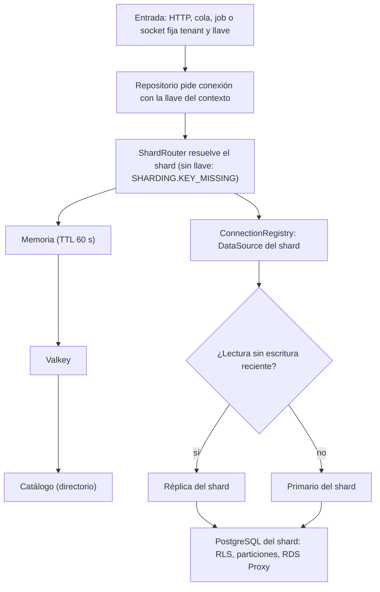
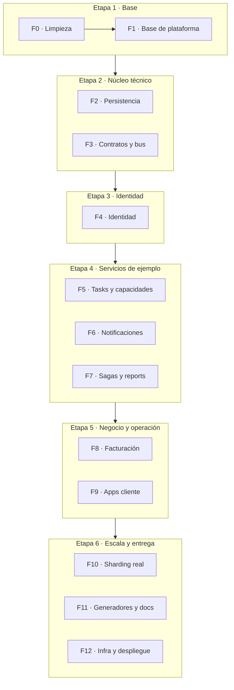

# Plataforma backend: plan de arquitectura

Nov 11, 2026 · Documento vivo: https://claude.ai/artifact/Bn67Z4R16bLoevfodCcHiT

## Resumen

La plataforma es un monorepo reutilizable para construir backends de microservicios en NestJS con TypeORM, arquitectura hexagonal y despliegue en AWS. Reemplaza al repositorio `node_template` y sirve como punto de partida para cualquier producto nuevo: se clona, se renombra y se agregan servicios con un generador.

Trae resuelto lo que todo backend necesita y casi nunca se hace bien desde el inicio: identidad con MFA, multitenancy, auditoría, mensajería con reintentos, sagas recuperables, archivos, notificaciones, facturación por uso y trazabilidad de punta a punta.

**Principios que guían cada decisión**

- **Hexagonal estricto.** El dominio y los casos de uso desconocen NestJS, TypeORM y AWS. Todo lo externo entra por puertos.
- **Agnóstico a la plataforma.** Migrar de AWS a otro proveedor significa reescribir adaptadores, nunca lógica de negocio.
- **Tipado antes que strings.** Operaciones, eventos, colas, permisos, errores y jobs se nombran con enums. Un cambio de nombre lo detecta el compilador.
- **Contratos explícitos.** Cada servicio publica lo que expone (operaciones, eventos, errores) con validación en tiempo de ejecución en ambos lados.
- **Todo deja rastro.** Cada request, mensaje, paso de saga y cambio en una tabla queda asociado a un `traceId` y a un actor.
- **Seguro por defecto.** Todo endpoint exige autenticación salvo que se declare público, y cada operación que modifica datos declara cómo se revierte.

## Punto de partida

[`jehernandezr/node_template`](https://github.com/jehernandezr/node_template) es un Express con Sequelize de enero de 2022 (9 commits). La plataforma nueva se escribe desde cero y conserva la idea original: auth con JWT, roles y manejo centralizado de errores.

Estos hallazgos se corrigen como parte del paso inicial:

| Hallazgo                                                                                                                   | Archivo                                      | Acción                                                                                           |
| -------------------------------------------------------------------------------------------------------------------------- | -------------------------------------------- | ------------------------------------------------------------------------------------------------ |
| `.env` versionado con `JWT_SECRET` y contraseña de la base                                                                 | `.env`                                       | Retirarlo del historial, rotar esos valores si se usaron en otro lugar y publicar `.env.example` |
| Credenciales de la base y del login impresas en consola                                                                    | `utils/dbConnection.ts`, `authMiddleware.ts` | Logger con redacción automática de campos sensibles                                              |
| El signup acepta `role` desde el body (cualquiera se registra como admin)                                                  | `authMiddleware.ts`                          | Roles asignados solo por el sistema o por un admin                                               |
| El login lee `user.password` antes de validar que el usuario exista                                                        | `authMiddleware.ts`                          | Respuesta 401 uniforme para usuario o clave inválidos                                            |
| `updatePassword` invierte los argumentos de bcrypt y guarda la clave nueva sin hash                                        | `authMiddleware.ts`                          | Flujo de cambio de clave con argon2id y revocación de sesiones                                   |
| Import `catchAsync` contra archivo `CatchAsync.ts` (compila en macOS, falla en Linux)                                      | controllers                                  | Lint de rutas sensibles a mayúsculas                                                             |
| `sync({ alter: true })` en el arranque                                                                                     | `server.ts`                                  | Migraciones versionadas, `synchronize` siempre apagado                                           |
| El manejador de errores llama `render('error')` sin motor de vistas y deja colgada la petición si `NODE_ENV` es otro valor | `errorController.ts`                         | Filtro global con formato RFC 9457                                                               |

## Monorepo con Nx

La raíz del repositorio es mínima ([ADR 0015](adr/0015-estructura-backend-front-y-codigo-compartido.md)). Contiene dos aplicaciones, `backend/` y `front/`, Nx como orquestador y las herramientas del repositorio. Cada aplicación es dueña de sus librerías: nada compartido entre backend y front vive en la raíz, y el front recibe los contratos generados desde el backend.

```text
backend/                       workspace pnpm del backend (Jest, ESLint y TypeScript en backend/package.json)
  libs/
    contracts/platform/        @contracts/platform: kit de contratos y piezas transversales
    contracts/identity/        @contracts/identity: contrato del servicio identity
    platform/                  kernel, primitives, config, observability, internal-api, saga,
                               messaging, resilience, cache, bloom, sharding, criteria
    shared/utils/              @shared/utils: funciones puras sobre los tipos de los contratos
  tools/contracts-export/      exporta los contratos a JSON (proyecto Nx contracts-export)
  infra/terraform/             raíz platform y módulos de AWS
  infra/local/                 scripts de arranque de PostgreSQL y LocalStack
  docker-compose.yml           stack local
front/                         pub workspace de Flutter
  apps/{web,mobile}/           shells
  microfrontends/              account, assistant, backoffice, billing, notifications, tasks, verifier
  packages/                    api, auth, contracts, i18n, realtime, shell_core, tokens, ui, utils
  tools/                       contracts_gen, nx-plugin y check_deferred_chunks.dart
nx.json  package.json  pnpm-workspace.yaml  pnpm-lock.yaml  .nvmrc  tsconfig.json
.github/  .husky/  commitlint.config.mjs  lint-staged.config.mjs  .prettierrc  renovate.json  docs/
```

**Un solo grafo para backend y front**

- `nx.json` registra los plugins `@nx/js/typescript` (`typecheck` y `build`), `@nx/jest/plugin` (`test`) y `@nx/eslint/plugin` (`lint`), limitados a `backend/**`. Cada proyecto del backend toma el nombre de su `package.json`: `platform-saga`, `contracts-identity`, `shared-utils`.
- `front/tools/nx-plugin/index.cjs` lee la lista `workspace:` de `front/pubspec.yaml` y registra cada miembro como proyecto `front-<nombre del pubspec>`: `front-shell_core`, `front-mf_tasks`, `front-web_shell`. Cada uno tiene `analyze`, `format-check` y, si tiene carpeta `test/`, `test`, todas con caché. Las dependencias entre paquetes Dart salen de sus `pubspec.yaml`.
- `front-contracts` depende de los proyectos de `backend/libs/contracts`. Un cambio de contrato marca como afectados los paquetes y microfrontends del front que lo usan.
- `test` depende de `^build`, así las librerías se compilan antes de probar a quien las usa.
- `pnpm nx affected -t lint test typecheck build analyze format-check` es el comando de uso diario y el de CI.

**Servicios**

Cada microservicio será una app en `backend/apps/<servicio>` con su dominio, su base de datos, sus migraciones y su despliegue. Los servicios previstos son `identity`, `tasks`, `reports`, `notifications`, `realtime`, `billing`, `files`, `agreements`, `assistant` y `backoffice-api`. El siguiente paso es crear `backend/apps/` con el primer servicio, sobre las librerías de plataforma que ya existen.

**Estructura interna de cada módulo**

```text
backend/apps/<servicio>/src/
  modules/<módulo>/
    domain/          entidades puras, value objects, puertos, errores
    application/     casos de uso
    infrastructure/  persistence/entities (*.orm-entity.ts), repositorios, mappers, clientes
    presentation/    controllers, gateways, handlers de mensajes, DTOs
  shared/{enums,constants,types,utils}/   compartido entre los módulos del servicio
```

**Reglas de dependencia**

- Entre proyectos manda la regla `@nx/enforce-module-boundaries` de `backend/eslint.config.mjs`, por tags: `type:contracts` depende solo de `type:contracts`; `type:util` de `type:util` y `type:contracts`; `type:platform` de `type:platform`, `type:util` y `type:contracts`; `type:tool` de contratos, utilidades y plataforma. `pnpm nx affected -t lint` la verifica.
- Una app de servicio (`type:app`) importa de otro servicio solo su paquete `@contracts/<servicio>`, nunca su código interno.
- Dentro de un módulo, `domain` depende solo de `kernel`; `application` depende de `domain`; `infrastructure` y `presentation` dependen de los dos. El siguiente paso es verificar estas capas en CI cuando exista el primer servicio.
- `@aws-sdk/*` solo aparece en `backend/libs/platform/adapters/aws`, la librería de adaptadores de AWS que se crea con el primer adaptador.

## Front: shells y microfrontends

`front/` reúne todo el cliente en un pub workspace de Flutter ([ADR 0012](adr/0012-front-flutter-shells-microfrontends.md)). Dos shells, `web` y `mobile`, componen los mismos microfrontends: un dominio se escribe una vez y aparece en las dos plataformas. Nx orquesta el workspace con el plugin propio `front/tools/nx-plugin/index.cjs`.

| Pieza                    | Qué es                                                                                                                                                               |
| ------------------------ | -------------------------------------------------------------------------------------------------------------------------------------------------------------------- |
| `front/apps/web`         | Shell web (`web_shell`). `WebShell` registra los microfrontends, crea el `ShellRuntime` y arma el router con `buildShellRouter`, con página de step-up en `/step-up` |
| `front/apps/mobile`      | Shell para iOS y Android (`mobile_shell`), con su registro, su router y deep links                                                                                   |
| `front/microfrontends/*` | Un paquete por dominio (`mf_<dominio>`) con su manifiesto, pantallas, datos y textos                                                                                 |
| `front/packages/*`       | Piezas compartidas por los shells y los microfrontends                                                                                                               |

| Microfrontend   | Web | Móvil | Contenido                                             |
| --------------- | --- | ----- | ----------------------------------------------------- |
| `account`       | Sí  | Sí    | Resumen, sesiones, dispositivos, seguridad y acuerdos |
| `tasks`         | Sí  | Sí    | CRUD de ejemplo                                       |
| `notifications` | Sí  | Sí    | Bandeja y preferencias                                |
| `assistant`     | Sí  | Sí    | Lista de conversaciones y chat con el asistente de IA |
| `billing`       | Sí  | No    | Plan, facturas y detalle de factura                   |
| `backoffice`    | Sí  | No    | Tenants, sagas y DLQ                                  |
| `verifier`      | No  | Sí    | Verificación en el dispositivo registrado             |

Cada shell registra solo los microfrontends que declaran su plataforma en el manifiesto (`platforms`).

**Contrato de microfrontend**

Cada microfrontend exporta un `MicrofrontendManifest` de `shell_core` y cumple el contrato del [ADR 0018](adr/0018-contrato-de-microfrontend.md). Un manifiesto con el contrato completo se ve así:

```dart
final MicrofrontendManifest tasksManifest = MicrofrontendManifest(
  id: MicrofrontendId.tasks,
  platforms: {AppPlatform.web, AppPlatform.mobile},
  access: AccessRule.authenticated(),
  menu: const [MenuEntry(labelKey: 'menuTasks', path: '/tasks', order: 20)],
  screens: [
    ScreenRoute(
      path: '/tasks',
      loadLibrary: screens.loadLibrary,
      builder: (scope, {params = const {}}) => screens.buildTasksList(scope),
    ),
  ],
  lifecycleFactory: () => MiLifecycle(),
);
```

- **Pantallas:** `screens: [ScreenRoute(...)]` con `path`, el `loadLibrary` del import diferido y un builder `(scope, {params})` sin `BuildContext`. `params` une query y path; gana el path. Las subrutas se protegen con `ScreenRoute(access: ...)`.
- **Identidad:** `ShellRuntime.identityEpoch` sube con cada cambio de usuario o tenant. `buildShellRouter` envuelve cada página en un `KeyedSubtree` con ese valor y la pantalla se reconstruye desde cero para la nueva identidad.
- **Ciclo de vida:** `lifecycleFactory` crea una instancia por activación. Los eventos salen con `ShellContext.emit` y se escuchan con `ShellContext.listen`; al rotar la identidad el contexto se cancela.
- **Recursos:** los repositorios implementan `ScopedResource` y el scope los cierra.
- **Acceso:** `AccessRule.mfa(maxAge)` exige un segundo factor reciente. Las acciones se protegen con `AccessGate` o `context.can(regla)`.
- **Layout:** cada pantalla es dueña de su única barra superior con `AppPage` de `ui`. El shell usa `ShellChrome`.
- **Estados y errores:** `AsyncValueView` para carga, error y datos; `showActionError` para el error de una acción.

Los siete manifiestos usan `screens:`, y `notifications` crea su ciclo de vida con `lifecycleFactory`. Las API anteriores (`routes:`, `lifecycle:`, `ShellContext.eventBus` y `AdaptiveScaffold.compactActions`) se eliminaron.

**Carga diferida**

El manifiesto se importa de forma inmediata: el shell lo lee al arrancar para armar rutas, menú y visibilidad. Las pantallas, los datos y los textos viven detrás de `deferred as` y se descargan cuando alguien navega a ellas. Así la web de un cliente sin acceso al backoffice nunca ejecuta su código.

`front/tools/check_deferred_chunks.dart` lo comprueba después de `flutter build web --release --source-maps`, desde `front/apps/web`. Falla si:

1. `main.dart.js.map` lista fuentes de `microfrontends/*/lib/src/{data,screens,l10n}`.
2. Algún texto ARB del backoffice de 12 caracteres o más aparece en `main.dart.js`.

El ciclo de vida de `notifications` viaja en el bundle inicial con el manifiesto, así que carga `src/data` con `deferred as` a través de un puente (`lifecycle/unread_counts.dart`). En la VM (móvil y pruebas) un import condicional usa la variante directa, porque allí no hay bundle que dividir.

**Reglas**

- Los microfrontends dependen solo de `front/packages` y nunca entre sí. Se comunican por eventos del shell y por rutas.
- Pantallas adaptativas: los widgets de `ui` se ajustan a pantalla grande y pequeña. Una pantalla con versión propia por plataforma se declara con `PlatformScreen`.
- Visibilidad por permisos, plan y feature flag con los enums generados desde el backend. La interfaz oculta lo que el usuario no puede usar; la autoridad es la API.
- Nada en `front/` importa librerías del backend; solo usa lo generado en `front/packages/contracts`.
- Lo compartido entre pantallas de un microfrontend vive en su `lib/src/shared/{enums,constants,types,utils}`.

**Paquetes compartidos** (`front/packages`)

| Paquete      | Qué contiene                                                                                                                           |
| ------------ | -------------------------------------------------------------------------------------------------------------------------------------- |
| `shell_core` | `MicrofrontendManifest`, `ScreenRoute`, registro, `ShellRuntime`, `ShellContext`, router (`buildShellRouter`) y reglas de acceso       |
| `api`        | `ApiClient` con un `HttpTransport` inyectable: valida la petición contra el contrato antes de llamar y decodifica respuestas y errores |
| `contracts`  | `lib/src/core` escrito a mano y `lib/src/<servicio>` generado por `contracts_gen` desde `backend/libs/contracts`                       |
| `utils`      | Funciones puras sobre los tipos de `contracts`: montos, fechas, identificadores y errores de campo                                     |
| `auth`       | Puertos, modelos y `SessionManager` de la sesión, con fakes para pruebas                                                               |
| `realtime`   | Cliente de tiempo real con reconexión con backoff, reanudación por `lastEventId` y deduplicación por id                                |
| `ui`         | Widgets adaptativos, layout (`AppPage`, `ShellChrome`, `PlatformScreen`) y tema                                                        |
| `tokens`     | Colores y escalas de diseño en Dart                                                                                                    |
| `i18n`       | Textos en español e inglés (ARB), incluidos los mensajes del catálogo de errores                                                       |

El siguiente paso en `realtime` son los adaptadores SSE y Socket.IO que implementan `RealtimeTransport`.

**Despliegue.** El módulo `cloudfront-waf` crea el bucket S3 y la distribución de CloudFront de la web. El siguiente paso es el pipeline que publica la web y la app móvil.

## Agnóstico a la plataforma

Cada capacidad externa es un puerto en `backend/libs/platform/capabilities` con un adaptador por proveedor. El negocio habla con el puerto; el módulo de cada servicio elige el adaptador por configuración. Cambiar de nube significa escribir adaptadores nuevos y otro Terraform.

| Capacidad                   | Puerto                              | Adaptador AWS                               | Adaptador local y alternativas                                      |
| --------------------------- | ----------------------------------- | ------------------------------------------- | ------------------------------------------------------------------- |
| Tópicos (pub/sub)           | `TopicPublisher`                    | SNS                                         | En memoria; Google Pub/Sub, Kafka                                   |
| Colas                       | `QueueSender`, `QueueConsumer`      | SQS                                         | En memoria, BullMQ sobre Valkey; RabbitMQ                           |
| Archivos                    | `FileStorage`                       | S3                                          | Sistema de archivos local, MinIO; GCS, Azure Blob                   |
| Jobs programados            | `JobScheduler`                      | EventBridge Scheduler                       | `node-cron`; Cloud Scheduler, CronJob de Kubernetes                 |
| Caché y datos de vida corta | `Cache`, `KeyValueStore`            | ElastiCache for Valkey                      | Valkey en Docker; cualquier servidor compatible con Redis           |
| Email                       | `EmailSender`                       | SES                                         | SMTP con Mailpit                                                    |
| Push                        | `PushSender`                        | APNs, FCM y Web Push directos               | Igual en cualquier nube                                             |
| Secretos                    | `SecretsProvider`                   | Secrets Manager                             | Variables de entorno; Vault                                         |
| Feature flags               | OpenFeature                         | Proveedor propio sobre DB + Valkey          | flagd; AppConfig                                                    |
| Tiempo real                 | `RealtimeGateway`                   | Socket.IO y SSE en NestJS sobre Fargate     | Los mismos gateways en local o Kubernetes                           |
| Firmas y cifrado            | `Signer`, `KeyManagement`           | KMS                                         | Claves locales                                                      |
| Entrada de cómputo          | `main.ts`, `lambda.ts`, `worker.ts` | Lambda, Fargate                             | Cualquier contenedor                                                |
| Observabilidad              | OpenTelemetry                       | Collector ADOT hacia OpenObserve en Fargate | OpenObserve en un contenedor; cualquier backend compatible con OTel |

La topología de mensajería, los jobs y los buckets se declaran en código de forma abstracta (tópico, cola, job). El Terraform de AWS lee esas declaraciones; otro proveedor tendría su propio módulo leyendo las mismas.

**Entradas agnósticas**

Endpoints, handlers de eventos, jobs, operaciones internas y mensajes en tiempo real se escriben una sola vez con decoradores de la plataforma (`@Endpoint`, `@Subscribe`, `@ScheduledJob`, `@InternalOperation`, `@RealtimeHandler`) y llaman casos de uso. Un adaptador de entrada traduce cada runtime a esas declaraciones.

| Runtime                     | Adaptador de entrada                                                               |
| --------------------------- | ---------------------------------------------------------------------------------- |
| Lambda con API Gateway HTTP | `lambda.ts` convierte el evento en un request de NestJS                            |
| Lambda con SQS              | Convierte el lote en mensajes para `@Subscribe` y reporta fallos parciales         |
| EventBridge Scheduler       | Convierte el disparo en la ejecución de su `@ScheduledJob`                         |
| Contenedor de tiempo real   | `@WebSocketGateway` (Socket.IO) y `@Sse()` de NestJS llaman a `@RealtimeHandler`   |
| Fargate, Kubernetes o local | `main.ts` y `worker.ts`: servidor HTTP, consumidores por long polling, cron y `ws` |

Cambiar de runtime es cambiar el adaptador de entrada. Controllers, handlers y casos de uso quedan iguales.

## Identificadores, trazabilidad y observabilidad

**Identificadores UUIDv7**

- Todo identificador es un UUIDv7: usuarios, tenants, sesiones, dispositivos, eventos, sagas, jobs, archivos, facturas y el propio `traceId`.
- La app genera el ID (librería `uuid`, puerto `IdGenerator`), así la entidad tiene identidad antes de persistirse. En TypeORM se usa `@PrimaryColumn('uuid')`.
- Los UUIDv7 se ordenan por tiempo: los índices de Postgres crecen en orden y sirven como cursor de paginación (`?after=<id>`).
- Los secretos usan 256 bits aleatorios de `crypto.randomBytes`: refresh tokens, `mfaToken`, OTP, tokens de reset y API keys.
- Un UUIDv7 revela su fecha de creación al milisegundo. Se tiene en cuenta en IDs públicos donde esa fecha sea sensible.

**Trazabilidad**

- El `traceId` es un UUIDv7 generado al entrar al sistema. Sus 128 bits sin guiones forman un trace-id W3C válido dentro de `traceparent`, compatible con OpenTelemetry y X-Ray.
- Viaja en headers HTTP, atributos de cada mensaje, pasos de saga, auditoría y como comentario en cada SQL.
- La respuesta devuelve `x-trace-id` para que soporte encuentre el caso en segundos.
- Si un cliente externo envía su propio `traceparent`, se guarda como `externalTraceId`.

**Observabilidad con OpenTelemetry**

OpenTelemetry (OTel) es el estándar abierto de instrumentación: produce logs, trazas y métricas enlazados por el mismo `traceId` y los envía a cualquier backend. El backend es la herramienta donde se consultan, al estilo de Datadog.

- Instrumentación automática de HTTP, NestJS, `pg`, el cliente de Valkey, el SDK de AWS y `fetch`. Spans propios en casos de uso, pasos de saga, handlers de mensajes y jobs.
- Logs: el `LoggerPort` escribe JSON con `trace_id` y `span_id` y los exporta como logs OTel, así cada log abre su traza completa. Campos como `password`, `token` y `authorization` se ocultan automáticamente.
- Métricas: latencia por endpoint, errores por código, profundidad y edad de colas, reintentos, sagas detenidas, aciertos de caché y uso por tenant.
- Un OpenTelemetry Collector recibe todo y lo reenvía: en Lambda como capa (ADOT, la distribución de AWS), en Fargate como sidecar y en local dentro de `docker-compose`. Cambiar de backend es cambiar la configuración del Collector.

Una sola herramienta concentra logs, métricas, trazas, dashboards y alertas en todos los entornos: **OpenObserve**.

| Herramienta | Qué es                                                                                                                      | Uso                                                                                               |
| ----------- | --------------------------------------------------------------------------------------------------------------------------- | ------------------------------------------------------------------------------------------------- |
| OpenObserve | Open source y nativo OTel; logs, métricas, trazas, dashboards y alertas en una interfaz; corre en un solo contenedor Docker | Todos los entornos: un contenedor en local y una tarea de Fargate con almacenamiento en S3 en AWS |
| SigNoz      | Open source con vistas de APM más completas; corre con Docker Compose sobre ClickHouse                                      | Alternativa si se necesita un análisis de trazas más profundo                                     |

**Control del volumen de logs**

| Control                                        | Uso                                                                             |
| ---------------------------------------------- | ------------------------------------------------------------------------------- |
| `LOG_LEVEL` (`debug`, `info`, `warn`, `error`) | Nivel global; en Lambda también alimenta `logging_config.application_log_level` |
| `LOG_SAMPLE_RATE`                              | Porcentaje de requests que loguean en debug (ejemplo: 0.01)                     |
| `LOG_DEBUG_CONTEXTS`                           | Debug solo para módulos específicos (ejemplo: `auth,reports`)                   |
| `DB_LOG_QUERIES`, `DB_SLOW_QUERY_MS`           | SQL apagado por defecto, queries lentas siempre registradas                     |
| Feature flag `log-level`                       | Cambio de nivel en caliente, sin redeploy                                       |

El muestreo de trazas se configura en el Collector (todas las trazas con error y un porcentaje del resto). La retención es de 14 días en dev y 30 en prod.

## Errores

Cada error tiene un código único y legible con la forma `SERVICIO.SUBMÓDULO.ERROR`. El cliente reacciona al código; el mensaje es solo para personas y no incluye valores de entrada.

**Códigos como enums**

Los códigos se declaran como enums, nunca como literales sueltos:

- Cada librería de `backend/libs/platform` declara los suyos con prefijo `PLATFORM.` (por ejemplo `SagaErrorCode.UncertainOutcome = 'PLATFORM.SAGA.UNCERTAIN_OUTCOME'`).
- `@contracts/platform` reúne todos los códigos de plataforma en `PlatformErrorCode`.
- Cada servicio declara los suyos en su paquete de contratos, como `IdentityErrorCode` en `backend/libs/contracts/identity/src/enums`.

`PlatformError` de `@platform/kernel` es la base de todos los errores: lleva `code`, `retryable` y `details`. `DomainError` la extiende para las reglas de negocio y por defecto no es reintentable. `ERROR_CODE_PATTERN` e `isErrorCode` validan el formato del código.

**Catálogos**

`defineErrorCatalog` de `@contracts/platform` crea una entrada por cada valor del enum, con `httpStatus`, `retryable`, `audience` (`public` o `internal`), `description` y `messageKey`. `messageKey` se deriva del código con la misma regla del front: `PLATFORM.AUTH.FORBIDDEN` da `error_platform_auth_forbidden`.

- `platformErrorCatalog` cubre los códigos de plataforma. Su prueba falla si un código se repite, si no cumple el formato o si aparece un código `PLATFORM.*` en `backend/libs/platform` sin entrada.
- `identityErrorCatalog` cubre los códigos de identity.
- Los códigos públicos llegan al front generados, con su `messageKey`. Una prueba de `front/packages/contracts` exige el mensaje en español y en inglés de cada uno en los ARB de `front/packages/i18n`. Los internos nunca llegan al cliente.

**Clasificación de fallas**

`@platform/primitives` define `FailureKind` y `classifyFailure`, que comparten resilience, cache, messaging, sharding, internal-api y saga:

| `FailureKind`       | Significado                                                         |
| ------------------- | ------------------------------------------------------------------- |
| `Transient`         | Reintentar la misma llamada puede funcionar                         |
| `Permanent`         | Repetirla da el mismo resultado: regla de negocio, 4xx, inexistente |
| `ProtocolViolation` | Contrato roto o fallo de implementación; nunca se reintenta         |
| `Timeout`           | Se agotó el tiempo; el efecto pudo aplicarse o no                   |
| `Cancelled`         | Quien llama abortó; el efecto pudo aplicarse o no                   |

`classifyFailure` recorre el error y hasta tres niveles de `cause`, y usa la primera señal explícita, en este orden:

1. Una propiedad `failureKind`.
2. `name` igual a `AbortError` (cancelado) o `TimeoutError` (tiempo agotado).
3. El booleano `retryable` de `PlatformError`.
4. Un error del SDK de AWS v3 con `$retryable` o con nombre de limitación de tasa o tiempo agotado (`ThrottlingException`, `SlowDown`, `RequestTimeout`): pasajero.
5. Un código de red de Node o undici, o un SQLSTATE pasajero de Postgres.
6. Un estado HTTP: 408, 425, 429, 502, 503 y 504 son pasajeros; el resto de 4xx y 5xx, permanentes.

Sin señal, un `TypeError`, `ReferenceError`, `SyntaxError`, `RangeError` o `ZodError` es una violación de protocolo, y cualquier otra cosa es permanente. Lo desconocido no se reintenta.

`CallOutcome.fromError` traduce esa clase al resultado de una llamada entre procesos: un `DomainError` es `business-error`; `Transient`, `transient-failure`; `Timeout` y `Cancelled`, `uncertain`; el resto, `protocol-violation`.

**Respuesta HTTP** en formato RFC 9457 (Problem Details). `toProblemDetails` de `@contracts/platform` arma la respuesta desde una entrada del catálogo:

```json
{
  "type": "https://docs.<dominio>/errors/IDENTITY.MFA.CODE_EXPIRED",
  "title": "El código expiró",
  "status": 400,
  "code": "IDENTITY.MFA.CODE_EXPIRED",
  "detail": "Solicita un código nuevo.",
  "traceId": "0193f1c2-...",
  "errors": [{ "field": "code", "code": "PLATFORM.VALIDATION.REQUIRED" }]
}
```

Los errores de campo usan los códigos `PLATFORM.VALIDATION.*` y rutas con punto (`items.0.name`), los mismos en el servidor y en el cliente.

**Reglas**

- Los casos de uso solo lanzan errores de dominio.
- Cada operación interna declara los códigos que puede devolver. El cliente trata un código no declarado como violación de protocolo.
- El siguiente paso es el filtro global de HTTP de la primera app: traduce los errores de dominio con el catálogo y responde `PLATFORM.INTERNAL.UNEXPECTED` con su `traceId` y sin detalles internos ante un error inesperado.

## Endpoints

Un solo decorador, `@Endpoint`, reúne ruta, autenticación, autorización, MFA, rate limit, idempotencia, versión, deprecación y documentación. Las reglas de acceso viven en un archivo de políticas por módulo, así el controller se lee en segundos.

```ts
@Resource(Resources.Tasks, { tenantScoped: true })
export class TasksController {
  @Endpoint.post('/', {
    summary: 'Crear tarea',
    auth: [AuthMethod.Jwt, AuthMethod.ApiKey],
    access: TaskPolicies.create,          // permisos, grupos y ownership
    entitlement: Feature.Tasks,           // el plan del tenant lo incluye
    rateLimit: RateLimitTier.Standard,
    idempotent: true,
    responses: { 201: TaskResponse },
  })
  create(@Body() dto: CreateTaskDto, @Actor() actor: Actor) { ... }
}
```

**Pipeline de cada request**

1. Middleware: `traceId`, contexto de request (CLS).
2. Guards: autenticación (JWT, API key, firma), tenant, autorización, MFA, plan, rate limit.
3. Interceptores: idempotencia, caché HTTP, timeout, logging, transformación de versión.
4. Pipes: validación con `whitelist` y `forbidNonWhitelisted`.
5. Filtro: errores en formato RFC 9457.

Los casos de uso corren dentro de un `UseCaseRunner` con comportamientos encadenables (transacción, auditoría, métricas, reintentos). Esos comportamientos aplican igual si el caso de uso se invoca por HTTP, por la API interna, desde una cola o por WebSocket.

La conexión a base de datos se define en el módulo y queda fuera del endpoint: `PersistenceModule.forFeature({ connection: Connections.Tasks, sharding: ShardKey.Tenant, cache: { ttl: '5s' } })`.

**Matriz de acceso.** CI genera la lista de todos los endpoints con su autenticación y permisos. Un endpoint público aparece señalado y requiere aprobación en el PR.

**Versionamiento**

- **Versión mayor en la URL** (`/v1`, `/v2`) para rediseños completos, con el versionamiento nativo de NestJS.
- **Versión por request dentro de la mayor**: el cliente envía `Api-Version: 2026-11-01` (si lo omite, se usa la versión fijada a su API key o tenant). La lógica de negocio vive una sola vez en la versión actual; transformadores por versión convierten el request antiguo al actual y la respuesta actual al formato antiguo. Cuando una versión cambia el comportamiento de verdad, `@Endpoint({ versions: { [ApiVersion.V2026_06]: LegacyCreateTask } })` resuelve otro caso de uso por inyección de dependencias. Así el negocio queda libre de condicionales por versión.

**Deprecación**

- `@Endpoint({ deprecated: { since, sunset, replacement } })` agrega los headers `Deprecation`, `Sunset` y `Link`.
- Se mide el uso por versión, tenant y API key, y `notifications` avisa a quienes la usan 90, 30 y 7 días antes del cierre.
- Después del `sunset`, el endpoint responde `410` con `PLATFORM.API.VERSION_SUNSET`.

**Documentación autogenerada**

- OpenAPI con el plugin del CLI de `@nestjs/swagger` (deduce los tipos de los DTOs) y UI con Scalar.
- AsyncAPI para eventos y colas, generado desde la topología y los contratos.
- Un portal que reúne todos los servicios, el catálogo de errores y la matriz de acceso. En prod queda detrás de autenticación.
- SDK de TypeScript para el frontend, generado desde OpenAPI.

## Persistencia

`backend/libs/platform/persistence` es nuestra capa sobre TypeORM. El dominio ve solo puertos de repositorio; TypeORM queda como motor interno y se puede reemplazar sin tocar el negocio.

```ts
export class TypeOrmTaskRepository
  extends BaseRepository<Task, TaskOrmEntity>
  implements TaskRepository {
  // solo los métodos propios del agregado
}
```

**Lo que trae `BaseRepository`**

- Lectura: `findById`, `findOne(criteria)`, `findMany(criteria, cursor)`, `exists`, `count`, `stream`.
- Escritura: `save`, `saveMany`, `upsert`, `softDelete`, `restore`.
- Bloqueo optimista con columna `version` y bloqueo pesimista.
- `Criteria` propio: `Criteria.where(TaskField.Status).eq(TaskStatus.Open)`, traducido a QueryBuilder.
- Transacciones con el puerto `TransactionManager` (Unit of Work en CLS); el outbox se escribe en la misma transacción.
- Columnas de auditoría (`createdAt`, `updatedAt`, `createdBy`, `updatedBy`) y soft delete automáticos.
- Cada SQL lleva un comentario `/* traceId=… tenantId=… */` para ubicarlo en Performance Insights.
- Lecturas a réplica y escrituras al primario; dentro de una transacción o justo después de escribir, se lee del primario.

**Entidades y migraciones.** Las entidades ORM viven en `infrastructure/persistence/entities` de cada módulo y se registran explícitamente en `database/entities.ts` de cada servicio (esbuild exige imports explícitos). Cada servicio tiene su carpeta `migrations/` y scripts `migration:generate`, `migration:run` y `migration:revert`. `synchronize` siempre está apagado.

**Particionamiento**

- Se declara en la entidad: `@Partitioned({ by: PartitionBy.Range, column: 'id', interval: Interval.Month, retention: '12 months' })`. También admite `List` y `Hash`.
- Como el UUIDv7 contiene la fecha, se particiona por rango del propio `id` y la llave primaria sigue siendo solo `id`.
- Helpers de migración (`createPartitionedTable`, `createRangePartitions`) y un job programado que crea particiones futuras y archiva las vencidas.
- En desarrollo, la capa avisa cuando una query sobre tabla particionada omite la llave de partición.

**Sharding**: el enrutamiento de cada query al shard correcto se detalla en [Sharding y enrutamiento de datos](#sharding-y-enrutamiento-de-datos).

**Caché de queries con Valkey**

- Cache-aside en la capa, activable por repositorio o por módulo, con TTL corto (2 a 10 segundos) y variación aleatoria.
- Invalidación por versión: cada tenant y entidad tiene un contador que forma parte de la clave. Una escritura lo incrementa y las claves anteriores quedan obsoletas al instante.
- Single-flight: ante una clave expirada, una sola petición consulta la base y las demás esperan su resultado.
- Las lecturas dentro de una transacción van directo a la base.

**Auditoría de cambios**

- `@Audited({ exclude: ['passwordHash'] })` en la entidad genera, en la migración, un trigger que escribe en `audit_log`.
- La capa ejecuta `set_config('app.actor_id' | 'app.tenant_id' | 'app.trace_id', …, true)` en cada transacción. Así el trigger sabe quién hizo el cambio, incluso en updates masivos o SQL manual.
- Cada registro guarda tabla, id, operación, valores antes y después (solo campos cambiados), actor, tenant, `traceId` y fecha.
- `audit_log` está particionada por mes, solo admite inserciones y tiene retención configurable.
- El backoffice muestra el historial de cualquier registro.

## Sharding y enrutamiento de datos

Cada query llega a su shard sin que el código de negocio lo pida: el repositorio toma la llave del contexto, el router resuelve el shard y la capa elige primario o réplica. La plantilla arranca con un shard y crece a N con el mismo código.

| Concepto         | Qué es                                                                                                                                           |
| ---------------- | ------------------------------------------------------------------------------------------------------------------------------------------------ |
| Shard lógico     | Una base PostgreSQL con el esquema completo del servicio. Varios shards lógicos conviven en una instancia física                                 |
| Instancia física | Un servidor RDS con su RDS Proxy y sus réplicas; aloja uno o más shards lógicos                                                                  |
| Grupo de shards  | Los shards lógicos asignados a un tenant dentro de su región: uno para un tenant pequeño, varios para uno grande                                 |
| Llave de shard   | El valor que elige el shard dentro del grupo. Cada servicio o entidad declara la suya según cómo se consultan sus datos                          |
| Región           | País o región donde vive la información del tenant, elegida por el tenant                                                                        |
| Catálogo         | Base global pequeña con el directorio tenant → región → grupo, el mapa shard lógico → instancia, los índices globales y las tablas de referencia |

La cadena de enrutamiento es **tenant → región → grupo de shards → shard lógico → instancia física**. Tenants y shards son independientes: crecer es agregar shards lógicos a un grupo o mover shards lógicos a instancias nuevas, sin tocar los tenants uno por uno.

**Declaración en código**

```ts
@ShardedEntity()
@Partitioned({ by: PartitionBy.Range, column: TaskColumn.Id, interval: Interval.Month })
export class TaskOrmEntity {
  @PrimaryColumn('uuid') id: string;
  @ShardKeyColumn() tenantId: string;                    // tasks reparte por tenant
}

@ShardedEntity()
export class UserOrmEntity {
  @PrimaryColumn('uuid') @ShardKeyColumn() id: string;   // identity reparte por usuario
}

@GlobalEntity()                                          // vive en el catálogo
export class PlanOrmEntity { ... }

PersistenceModule.forFeature({
  connection: Connections.Identity,
  sharding: { strategy: ShardStrategy.Directory, key: ShardKey.User },
});
```

**La llave según la necesidad**

| Llave             | Cuándo                                                       | Ejemplos                                                      |
| ----------------- | ------------------------------------------------------------ | ------------------------------------------------------------- |
| `ShardKey.Tenant` | Los datos se consultan por tenant y caben en un shard        | tasks, billing, reportes                                      |
| `ShardKey.User`   | Los datos se consultan por usuario o el tenant es muy grande | identity, preferencias, bandeja de notificaciones             |
| Propia            | Otro patrón de acceso, con un `ShardKeyResolver`             | Una entidad que se reparte por cuenta o por región de negocio |

Cuando la llave es distinta del tenant, el router ubica primero el grupo del tenant y luego elige el shard lógico con hash consistente sobre la llave. Así un tenant compartido con millones de clientes se reparte en varios shards sin crear un shard caliente.

**Índices globales.** Las consultas que llegan sin la llave usan un índice en el catálogo. El login por email consulta `identity_lookup`, que guarda el HMAC del email con el `userId`, la región y el shard: datos de enrutamiento, sin datos personales en claro.

**Primera implementación: identity.** El sharding se estrena en `identity` (usuarios, credenciales, sesiones, dispositivos) con un shard lógico por región en producción y dos en local y pruebas. Los demás servicios usan el mismo código con un solo shard y activan más cuando su tráfico lo pida, por configuración.

**Cómo se enruta una query**



El resultado del directorio se cachea en tres niveles, y la decisión entre réplica y primario usa una marca en el contexto que dura unos segundos después de cada escritura.

Si el contexto llega sin llave de shard, la capa responde `PLATFORM.SHARDING.KEY_MISSING` y la query se detiene. Nunca existe un shard por defecto.

**Estrategias** (interfaz `ShardingStrategy`, intercambiable por módulo)

| Estrategia                | Cómo decide                           | Cuándo usarla                                          |
| ------------------------- | ------------------------------------- | ------------------------------------------------------ |
| `Directory` (por defecto) | Tabla `tenant → shard` en el catálogo | Mover tenants y dar shards dedicados a tenants grandes |
| `ConsistentHash`          | Anillo con nodos virtuales            | Muchas llaves pequeñas sin catálogo                    |
| `Range`                   | Rangos de la llave                    | Llaves con orden natural, como fechas                  |
| Propia                    | Implementación de `ShardingStrategy`  | Reglas de negocio específicas                          |

Los tenants nuevos reciben shard con una `ShardPlacementPolicy` durante la saga de alta: el shard con menos carga, la región del tenant o un shard dedicado para planes enterprise.

**Consultas entre shards**, siempre explícitas:

```ts
const page = await this.tasks
  .acrossShards()
  .where(Criteria.where(TaskField.Status).eq(TaskStatus.Overdue))
  .orderBy(TaskField.Id)
  .limit(100)
  .fetch(cursor); // consulta en paralelo y fusiona ordenando por UUIDv7
```

Tienen límite de concurrencia y timeout por shard, e indican cuando un resultado llega parcial. Se usan en backoffice y reportes.

**Transacciones.** Una transacción vive dentro de un shard. Tocar dos shards en la misma transacción responde `PLATFORM.SHARDING.CROSS_SHARD_TX`; ese caso se resuelve con una saga.

**Migraciones.** `nx run <servicio>:migrate` migra primero el catálogo y luego cada shard en paralelo con límite. Cada shard registra su estado en `shard_migrations`; si uno falla, el despliegue del servicio se detiene y el reintento continúa donde quedó.

**Mover datos sin interrupción** (`SagaType.MoveShard` lleva un shard lógico a otra instancia; `SagaType.MoveTenant` lleva un tenant a otro grupo o región)

1. **Copia inicial**: snapshot de las filas del tenant, o de la base lógica completa, en el destino.
2. **Sincronización continua**: replicación lógica de PostgreSQL con filtro por `tenant_id` (filtros de fila disponibles desde PostgreSQL 15) mantiene el destino al día. El origen sigue atendiendo lecturas y escrituras.
3. **Verificación**: conteos y checksums por tabla mientras el retraso de replicación baja a cero.
4. **Corte**: un candado por tenant en Valkey retiene las escrituras nuevas por un instante (objetivo: menos de un segundo). Las peticiones esperan, ninguna falla. Con retraso cero se cambia el directorio y se publica `PlatformEvent.ShardDirectoryChanged`.
5. **Cierre**: las escrituras siguen contra el destino. El origen se conserva durante un periodo de gracia para volver atrás si hace falta, y luego se limpia.

**Residencia de datos por región**

- Cada tenant elige país o región al crearse; el directorio lo guarda y la saga de alta lo ubica en un grupo de shards de esa región.
- Cada región despliega su propio stack: servicios, shards, Valkey, colas y almacenamiento de archivos. Los datos del tenant permanecen en su región.
- El catálogo global guarda solo datos de enrutamiento (ids, región, shard y HMAC del email). Vive en la región principal con réplicas de lectura en las demás.
- El login consulta el catálogo y devuelve la URL regional (por ejemplo `co.api.<dominio>`). El JWT lleva la región (`rgn`) y el SDK del cliente usa esa URL. Una petición que llega a otra región recibe una redirección.
- Cambiar de región es un `MoveTenant` entre regiones, con el mismo traslado sin interrupción.
- La primera versión despliega una región; agregar otra es desplegar su stack con Terraform.

**Operaciones de sharding como código.** Los shards se declaran en la configuración versionada de cada servicio y en Terraform. Agregar un shard o mover un tenant es un cambio en el repositorio que sigue el ciclo normal: PR, revisión y pipeline. El pipeline aplica la infraestructura, corre las migraciones y, cuando el cambio incluye traslados, lanza la saga `SagaType.MoveShard`. Cada ejecución queda en la auditoría con el commit que la originó.

**Operación.** Cada span lleva `db.shard`; hay métricas por shard (conexiones, latencia, tamaño, tenants) y una alarma por desbalance. En local y en las pruebas de integración corren dos shards, así el enrutamiento se ejercita desde el primer día.

## Búsqueda vectorial e híbrida

PostgreSQL resuelve la búsqueda semántica con la extensión pgvector, en el mismo shard y bajo las mismas reglas de tenant que el resto de los datos. No hace falta un motor de búsqueda aparte.

```ts
@Searchable({
  text: [TaskField.Title, TaskField.Description],
  embedding: { fields: [TaskField.Title, TaskField.Description], model: EmbeddingModel.Default },
})
export class TaskOrmEntity { ... }

const results = await this.taskSearch.search({
  query: 'facturas vencidas de proveedores',
  mode: SearchMode.Hybrid,
  filter: Criteria.where(TaskField.Status).eq(TaskStatus.Open),
  limit: 20,
});
```

- **Almacenamiento**: una tabla de embeddings por entidad buscable (`entity_id`, `tenant_id`, modelo, versión del modelo, vector, `content_hash`), en el shard del tenant, con índice HNSW.
- **Generación asíncrona**: al guardar la entidad, el outbox publica el cambio y un consumidor calcula el embedding con el puerto `EmbeddingProvider`. El `content_hash` evita recalcular cuando el texto no cambió.
- **Búsqueda híbrida**: texto completo de Postgres (`tsvector` con configuración en español) y similitud vectorial, fusionados con Reciprocal Rank Fusion. Modos `SearchMode.Text`, `Vector` e `Hybrid`.
- **Filtros**: RLS por tenant más los criterios de la query; los escaneos iterativos de índice de pgvector mantienen el número de resultados cuando el filtro es selectivo.
- **Cambio de modelo**: cada vector guarda su versión de modelo; un job reindexa en segundo plano y la búsqueda usa la versión activa hasta completar.
- **Proveedores de embeddings**: Voyage AI, Amazon Bedrock o un modelo local para desarrollo y pruebas, intercambiables por configuración.
- El módulo de IA usa esta misma búsqueda para recuperar contexto (RAG).

## Módulo de IA

`backend/libs/platform/ai` le da a cualquier servicio capacidades de IA con las mismas reglas del resto de la plataforma: puertos, tenant, permisos, auditoría, costos y trazas. El servicio de ejemplo `backend/apps/assistant` es un asistente con búsqueda sobre los datos del tenant y herramientas que ejecutan casos de uso.

**Proveedores**

| Puerto                                                                 | Adaptador por defecto              | Alternativas                                                                                 |
| ---------------------------------------------------------------------- | ---------------------------------- | -------------------------------------------------------------------------------------------- |
| `LlmProvider` (mensajes, streaming, herramientas, salida estructurada) | Claude API con `@anthropic-ai/sdk` | Claude en Amazon Bedrock (`AnthropicBedrockMantle`); modelo local con Ollama para desarrollo |
| `EmbeddingProvider`                                                    | Voyage AI                          | Amazon Bedrock; modelo local                                                                 |

Los modelos se eligen por enum, así cambiar de modelo es configuración: `AiModel.Default` apunta a `claude-opus-5-5`; `AiModel.Fast` a `claude-haiku-5-5` para clasificación y extracción masiva.

**Prompts, salidas y herramientas**

```ts
@AiPrompt({
  id: PromptId.SummarizeTask,
  version: 3,
  model: AiModel.Default,
  effort: AiEffort.Medium,
})
export class SummarizeTaskPrompt extends PromptDefinition<
  SummarizeInput,
  TaskSummary
> {
  readonly output = TaskSummarySchema; // zod, validado al recibir
}

@AiTool({ description: 'Crea una tarea para el usuario actual', confirm: true })
export class CreateTaskTool extends UseCaseTool<CreateTaskUseCase> {}
```

- Prompts como clases versionadas, con su esquema de salida y pruebas.
- Salida estructurada con el formato JSON del proveedor, validada con zod antes de llegar al caso de uso.
- `@AiTool` expone un caso de uso existente como herramienta. Corre con el `Actor`, el tenant y los permisos del usuario que conversa. Las herramientas que modifican datos piden confirmación al usuario.
- El bucle de herramientas usa el tool runner del SDK de Anthropic.
- Respuestas en streaming hacia el cliente por SSE.

**RAG**: el contexto sale de la búsqueda híbrida del tenant. Los documentos recuperados entran al modelo como datos y nunca como instrucciones, con citas hacia su origen.

**Costos y límites**

- Cada llamada publica `BillingEvent.UsageRecorded` con tokens de entrada y salida por tenant, usuario y modelo.
- Cuotas por plan con entitlements (`Feature.AiAssistant`, `Quota.AiTokensMonthly`) y límites por usuario.
- Prompt caching del proveedor: herramientas y system prompt estables van primero.
- Trabajos masivos por cola con la API de Batches del proveedor, que cuesta la mitad.

**Seguridad y resiliencia**

- Redacción de datos personales antes de enviar, configurable por tenant.
- Si el modelo rechaza una solicitud (`stop_reason: refusal`), se usa el fallback del servidor (`fallbacks: "default"`) y el caso queda registrado.
- Timeout, circuit breaker, bulkhead para respetar el rate limit del proveedor y fallback a otro adaptador.
- Registro de cada interacción (prompt, versión, respuesta, herramientas usadas) con retención configurable y auditoría.

**Observabilidad y calidad**

- Spans de OpenTelemetry por llamada con modelo, tokens, latencia y costo, visibles en OpenObserve junto al resto de la traza.
- Un conjunto de casos de evaluación por prompt. CI los corre cuando un prompt cambia y compara contra la versión anterior.

## Resiliencia y Bloom filters

`backend/libs/platform/resilience` aplica políticas declaradas a cada adaptador de salida: base de datos, Valkey, colas, APIs externas, proveedores de IA y email. Usa la librería cockatiel.

```ts
export class VoyageEmbeddingAdapter implements EmbeddingProvider {
  @Resilient(ResiliencePolicyName.ExternalApi, { idempotent: true, dependencyKey: 'voyage' })
  async embed(texts: string[], signal?: AbortSignal): Promise<number[][]> { ... }
}
```

Los reintentos solo aplican a operaciones marcadas como idempotentes, cada dependencia tiene su propio circuit breaker y bulkhead, y el decorador entrega un `AbortSignal` como último argumento para cancelar el trabajo cuando vence el timeout.

| Patrón                                     | Qué hace                                                                      | Dónde se usa                         |
| ------------------------------------------ | ----------------------------------------------------------------------------- | ------------------------------------ |
| Timeout                                    | Corta llamadas lentas                                                         | Toda llamada de red                  |
| Reintento con backoff exponencial y jitter | Reintenta solo errores transitorios en operaciones idempotentes               | Clientes HTTP, Valkey, colas         |
| Circuit breaker                            | Deja de llamar a una dependencia caída y la prueba de nuevo tras un intervalo | APIs externas, IA, email             |
| Bulkhead                                   | Limita las llamadas concurrentes por dependencia                              | IA, consultas entre shards, archivos |
| Fallback                                   | Responde degradado: caché anterior, proveedor alterno o valor por defecto     | Lecturas, IA, feature flags          |
| Load shedding                              | Responde 503 con `Retry-After` cuando la carga supera un umbral               | Gateway HTTP y tiempo real           |

- **Degradación elegante**: si Valkey falla, la caché se omite y se lee de la base, el rate limit pasa a límites locales y los feature flags usan el último valor conocido.
- **Health checks** de liveness y readiness con `@nestjs/terminus`; una instancia sin sus dependencias críticas sale del balanceador.
- **Infraestructura**: RDS y Valkey en Multi-AZ con failover automático.
- Cada política emite métricas y spans (estado del circuito, reintentos, rechazos).
- **Pruebas de fallos**: en integración, Toxiproxy inyecta latencia y cortes entre los servicios y sus dependencias.

**Bloom filters**

El puerto `BloomFilter` responde "seguro que no" o "quizás sí" en microsegundos y con muy poca memoria. Un "quizás" siempre se confirma en la fuente real, porque el filtro admite falsos positivos y nunca falsos negativos. Adaptadores: Valkey (comandos `BF.*` del módulo de Bloom, o bitmaps propios si la versión desplegada no lo incluye) y en memoria.

| Uso                   | Para qué                                                                                                                                 |
| --------------------- | ---------------------------------------------------------------------------------------------------------------------------------------- |
| Contraseñas filtradas | Rechaza al registrarse o cambiar clave una contraseña presente en la lista pública de Have I Been Pwned, sin llamar a servicios externos |
| Tokens revocados      | Descarta en memoria los tokens sanos antes de consultar Valkey                                                                           |
| Mensajes procesados   | Atajo de idempotencia antes de consultar `processed_messages`                                                                            |
| Protección de caché   | Evita ir a la base por llaves que no existen                                                                                             |
| Deduplicación         | Eventos de medición y webhooks entrantes repetidos                                                                                       |

Cada filtro declara su tasa de falsos positivos (por defecto 1 %) y su reconstrucción periódica con un job programado.

## Identidad

El servicio `identity` emite y controla toda la identidad: usuarios, sesiones, dispositivos, MFA, API keys, tenants y grupos. Los demás servicios solo verifican.

**Sesiones y JWT**

| Token                    | Qué es                                                              | Vida                                                                                                                              | Dónde vive en el cliente                                                        |
| ------------------------ | ------------------------------------------------------------------- | --------------------------------------------------------------------------------------------------------------------------------- | ------------------------------------------------------------------------------- |
| Access token (JWT ES256) | Sin estado; cada servicio lo verifica con la clave pública del JWKS | 10 a 15 min                                                                                                                       | Memoria                                                                         |
| Session token (opaco)    | Apunta a una fila de `sessions`; en la base se guarda su hash       | Vence tras 1 día sin actividad; cada refresh mientras se usa la app extiende la ventana otro día, con un tope absoluto de 30 días | Web: cookie `httpOnly`, `Secure`, `SameSite=Strict`. Móvil: Keychain o Keystore |

- Claims: `sub`, `tid` (tenant activo), `sid` (sesión), `did` (dispositivo), `amr` (métodos usados), `auth_time`, `roles`, `iss`, `aud`, `exp`, `jti`.
- Cada refresh rota el session token. Reusar uno anterior revoca la sesión completa.
- Revocar una sesión publica `IdentityEvent.SessionRevoked` y agrega el `sid` a una lista en Valkey con TTL igual a la vida restante del access token. El guard la consulta con caché de pocos segundos.
- La clave de firma rota con `kid` en el JWKS; la anterior convive durante la ventana de transición.
- Contraseñas con argon2id. Cambiar la contraseña revoca las demás sesiones.

**Invalidación de tokens**

Un access token es válido hasta su `exp`, así que la plataforma lo invalida antes con los mecanismos de esta tabla. El guard revisa en orden la firma, la expiración, la sesión, las épocas y la versión de permisos.

| Mecanismo                           | Qué invalida                           | Cómo                                                                                                                                      |
| ----------------------------------- | -------------------------------------- | ----------------------------------------------------------------------------------------------------------------------------------------- |
| Sesión revocada (`sid`)             | Una sesión y todos sus tokens          | Lista en Valkey con TTL igual a la vida restante del access token, con un Bloom filter delante para descartar en memoria los tokens sanos |
| Época del usuario (`revokedBefore`) | Todos los tokens de un usuario         | Marca de tiempo en Valkey; se rechaza todo token con `iat` anterior                                                                       |
| Época del tenant                    | Todos los tokens de un tenant          | La misma marca a nivel de tenant, para suspensiones                                                                                       |
| Versión de permisos (`pv`)          | Tokens con roles o grupos viejos       | El token lleva `pv`; si no coincide con la versión actual, responde `IDENTITY.TOKEN.STALE_PERMISSIONS` y el cliente refresca              |
| Rotación de emergencia de la clave  | Todos los tokens firmados con un `kid` | Se retira el `kid` del JWKS                                                                                                               |

**Qué dispara cada invalidación**: logout, cierre de todas las sesiones, cambio de contraseña o de MFA, dispositivo eliminado, reuso de un session token, cambio de roles o grupos, usuario o tenant suspendido, acción de un administrador y compromiso de una clave.

- `identity` publica `IdentityEvent.TokensRevoked` con el alcance (sesión, usuario o tenant). Cada servicio actualiza su caché local en segundos.
- El gateway de tiempo real cierra en el acto las conexiones Socket.IO y SSE de las sesiones afectadas.
- Cada invalidación queda en la auditoría con su motivo y su actor.

**Dispositivos**

- En el primer login el servidor emite un `deviceId` firmado que el cliente guarda y envía en cada login.
- Tabla `devices`: nombre legible ("iPhone · Safari"), plataforma, primera y última vez visto, última IP, `trustedUntil`, push token.
- Tabla `login_attempts`: cada intento con resultado, motivo, IP, dispositivo y `traceId`. Alimenta la auditoría y el bloqueo por fuerza bruta.
- El usuario ve sus dispositivos y sesiones, cierra sesiones remotas, cierra todas menos la actual y retira la confianza de un dispositivo.
- Datos personales bajo Ley 1581: retención configurable y sin fingerprinting invasivo.

**Bloqueo por intentos fallidos**

| Nivel                              | Regla                                      | Efecto                                                                                                                     |
| ---------------------------------- | ------------------------------------------ | -------------------------------------------------------------------------------------------------------------------------- |
| Cuenta y origen (IP o dispositivo) | 5 fallos en 15 min                         | Ese origen queda bloqueado 15 min; cada bloqueo nuevo duplica la espera (15, 30, 60 min) hasta un tope de 24 h             |
| Cuenta                             | 20 fallos en 1 h desde varios orígenes     | Modo protegido: solo entran dispositivos registrados y passkeys; cualquier otro origen necesita además un código por email |
| IP                                 | 50 fallos en 15 min sobre cualquier cuenta | Bloqueo de la IP y regla de rate limit en WAF contra relleno de credenciales                                               |

- Contadores en Valkey con TTL; cada intento queda en `login_attempts`.
- Respuesta uniforme `IDENTITY.AUTH.INVALID_CREDENTIALS`, con `Retry-After` cuando hay bloqueo. Los emails inexistentes cuentan igual, así el bloqueo nunca revela si una cuenta existe.
- El modo protegido impide que un atacante deje afuera al dueño: desde su dispositivo registrado o su passkey sigue entrando.
- Al activarse un bloqueo o el modo protegido, el usuario recibe alerta por email y push. Se desbloquea al vencer la espera, con un enlace por email o desde backoffice con auditoría.
- Umbrales configurables por tenant dentro de límites seguros. Un desafío CAPTCHA (Turnstile o hCaptcha) detrás de un puerto es opcional desde el tercer fallo.
- Las mismas reglas aplican a los intentos de MFA, recuperación de clave y verificación de API keys.

**MFA y dispositivos registrados**

El MFA protege dos momentos: el registro de cada dispositivo nuevo, obligatorio para todos los usuarios, y cada login de un administrador.

| Quién                                     | Cuándo se pide MFA                                                                                          |
| ----------------------------------------- | ----------------------------------------------------------------------------------------------------------- |
| Clientes                                  | Al registrar un dispositivo. Desde un dispositivo registrado, el login usa el código que la app genera sola |
| Administradores de tenant y de backoffice | En cada login                                                                                               |

**Registro del dispositivo.** La app genera un par de claves en Secure Enclave, Android Keystore o WebCrypto (no exportable) y envía la clave pública. Desde ese momento el dispositivo firma sus solicitudes y queda ligado al usuario.

**Login desde un dispositivo registrado.** El servidor envía un challenge; la app lo firma con su clave, genera el código de 8 dígitos y lo envía sin intervención del usuario. Para el cliente, el login es email y contraseña, o solo su passkey.

**Login desde un dispositivo nuevo** (termina registrándolo)

1. `POST /auth/login` con email y contraseña. Responde `{ mfaRequired, mfaToken, methods }`.
2. `POST /auth/mfa/challenges { mfaToken, method }`.
   - Si el usuario ya tiene un dispositivo registrado: código de **8 dígitos** (2 a 3 min) visible solo en la app de ese dispositivo. Un push la abre en la pantalla del código con el contexto del intento (navegador, sistema, ciudad aproximada, IP) y el botón "No fui yo".
   - Si es su primer dispositivo: código de **6 dígitos** al email verificado (5 min).
3. `POST /auth/mfa/verify { mfaToken, challengeId, code, devicePublicKey }` crea la sesión y registra el dispositivo nuevo.

**Passkeys desde la primera versión** (WebAuthn con `@simplewebauthn/server`). Permiten login sin contraseña; una passkey en un dispositivo registrado cumple los dos factores. En backoffice es el método recomendado.

**Reglas.** El código queda atado al `mfaToken` que lo pidió, se guarda como HMAC y es de un solo uso. Máximo 5 intentos por challenge y 3 challenges cada 15 min. Con un dispositivo registrado, el email deja de ofrecerse. TOTP y códigos de recuperación quedan como respaldo.

**Recuperación sin dispositivo.** Por email, con alerta inmediata a todos los canales del usuario. La espera crece de forma exponencial con cada recuperación en los últimos 90 días: 24 h, 48 h, 96 h y así sucesivamente (`MFA_RECOVERY_BASE_HOURS = 24`).

**Paso adicional (step-up).** `@Endpoint({ mfa: { maxAgeMinutes: 10 } })` protege operaciones sensibles (cambiar email o clave, desactivar MFA, crear API keys). Si el último MFA es antiguo, responde `IDENTITY.MFA.STEP_UP_REQUIRED` y el dispositivo registrado lo resuelve con su código automático.

**Alertas de seguridad** (siempre por email y push): login desde dispositivo nuevo, registro de verificador, recuperación de clave o de verificador, cambio de email, MFA desactivado, uso de código de recuperación, API key creada o revocada.

**API keys**

- Formato `sk_live_<prefijo>_<secreto>`. El prefijo se guarda en claro para buscar la key; el secreto como HMAC con pepper. Se muestra una sola vez.
- Pertenecen a una service account del tenant, con permisos acotados, expiración, IPs permitidas opcionales, último uso y nivel de rate limit.
- Operaciones: crear (con step-up de MFA), listar, rotar (la anterior sigue válida N horas) y revocar (evento que invalida la caché en todos los servicios al instante).
- Los casos de uso reciben un `Actor` (usuario o service account) sin importar cómo se autenticó.

## Multitenancy, grupos y backoffice

**Tenants**

- Un tenant es una organización. Todo usuario pertenece al menos a uno; los clientes finales pueden compartir un tenant común, como el de clientes de la plataforma. Un usuario puede pertenecer a varias con roles distintos; el JWT lleva el tenant activo (`tid`) y cambiar de tenant emite un token nuevo.
- Aislamiento: tablas compartidas con `tenant_id` y Row-Level Security de Postgres como segunda barrera. La capa de persistencia fija `app.tenant_id` en cada transacción. El comportamiento de RDS Proxy con estas variables se valida en la fase de persistencia.
- Cada tenant tiene su región y su grupo de shards. Un tenant grande o compartido recibe un grupo de varios shards, y uno que lo exija recibe shards dedicados (modelo pool y silo).
- El tenant se resuelve desde el JWT, la API key o el subdominio y header en endpoints públicos. Se propaga a logs, eventos, claves de caché, rate limits, feature flags y métricas de facturación.
- Ciclo de vida: alta con saga (`SagaType.TenantOnboarding`), suspensión por facturación, reactivación y borrado con saga.

**Grupos, roles y permisos**

- Dentro de cada tenant, los usuarios pertenecen a grupos; los grupos tienen roles; los roles tienen permisos.
- El catálogo de permisos es un enum en código (`Permission.TasksCreate`). Las asignaciones viven en la base y se editan sin deploy.
- Los permisos efectivos de cada usuario se cachean en Valkey con versión por tenant.
- Roles de tenant iniciales: `Owner`, `Admin`, `Member`, `Billing`.

**Backoffice con perfiles**

- Los roles de plataforma son independientes de los roles de tenant: `PlatformRole.SuperAdmin`, `Support`, `Finance`, `ReadOnly`, extensible.
- `backend/apps/backoffice-api` es un BFF con audiencia propia (`aud: backoffice`) que llama a la API interna de cada servicio.
- Acceso con MFA obligatorio (passkey recomendada) y lista de IPs opcional.
- Suplantación ("ver como") con motivo, duración limitada, auditoría completa y aviso al usuario.
- Vistas iniciales: tenants y usuarios, sesiones y dispositivos, historial de auditoría, sagas y DLQs, facturación y uso, feature flags, deprecaciones.

## Acuerdos: términos, consentimientos y documentos firmados

El servicio `backend/apps/agreements` es genérico: maneja cualquier documento que un usuario o un tenant deba aceptar o firmar, con versiones, audiencias, evidencia y efectos sobre permisos.

| Concepto        | Qué es                                                                                                                                      |
| --------------- | ------------------------------------------------------------------------------------------------------------------------------------------- |
| Tipo de acuerdo | Enum `AgreementType`, ampliable: `TermsOfService`, `PrivacyPolicy`, `DataProcessingConsent`, `MarketingConsent`, `FeatureTerms`, `Contract` |
| Documento       | Versión inmutable de un acuerdo: contenido guardado en `files`, hash SHA-256, idioma, fecha de vigencia y tipo de cambio (mayor o menor)    |
| Audiencia       | A quién aplica: todos, un tenant, un plan, un rol, un grupo, una feature o un país                                                          |
| Requisito       | Bloqueante (sin aceptar no se usa lo que protege) u opcional, con plazo de gracia                                                           |
| Aceptación      | Quién, cuándo, qué versión y hash, IP, dispositivo, `traceId` y método                                                                      |
| Revocación      | Retiro de un consentimiento revocable, con fecha y efecto inmediato                                                                         |

**Métodos de aceptación, de menor a mayor evidencia**

1. Clic en "Acepto".
2. Clic más código de verificación (6 dígitos por email o el código automático del dispositivo registrado).
3. Firma del hash del documento con la clave del dispositivo registrado.
4. Firma digital certificada por un proveedor externo, conectado por el puerto `DigitalSignatureProvider`.

**Uso en endpoints**

```ts
@Endpoint.post('/reports', { ..., agreements: [AgreementType.DataProcessingConsent] })
```

Si falta una aceptación, la respuesta es `LEGAL.AGREEMENT.ACCEPTANCE_REQUIRED` con la lista de documentos pendientes, y el frontend los muestra para aceptarlos.

**Efectos sobre permisos.** Aceptar un acuerdo publica `AgreementsEvent.Accepted`, que puede habilitar permisos o features (por ejemplo, compartir datos con un tercero). Revocarlo publica `AgreementsEvent.Revoked` y los retira.

**Versiones.** Un cambio mayor exige aceptar de nuevo y se vuelve bloqueante al vencer el plazo de gracia. Un cambio menor solo se notifica.

**Evidencia.** Cada aceptación o firma genera un paquete PDF con el documento, el registro (quién, cuándo, cómo) y los hashes, guardado de forma inmutable (S3 Object Lock). El usuario y el backoffice lo descargan.

**Marco legal.** El diseño sigue la Ley 1581 de 2012 (consentimiento previo, expreso, informado y revocable) y la Ley 527 de 1999 con el Decreto 2364 de 2012 (mensajes de datos y firma electrónica). Los textos y el nivel de firma de cada acuerdo se validan con asesoría legal.

**Backoffice.** Crear versiones, programar su vigencia, ver el porcentaje de aceptación por audiencia y exportar evidencia.

## Contratos y API interna

Los contratos son la única forma en que un servicio conoce a otro y en que el front conoce al backend. Se escriben una vez, en TypeScript con zod, y de ahí salen el JSON intermedio y el Dart del front ([ADR 0015](adr/0015-estructura-backend-front-y-codigo-compartido.md) y [ADR 0017](adr/0017-export-de-contratos.md)).

**Dónde viven**

```text
backend/libs/contracts/
  platform/              @contracts/platform: kit, esquemas transversales y catálogo PLATFORM.*
  <servicio>/            @contracts/<servicio>: lo que el servicio expone
    src/
      enums/             solo enums (accesos, códigos de error, rutas, operaciones, eventos)
      constants/         valores constantes y objetos `as const`
      types/             interfaces
      schemas/           esquemas zod con `satisfies z.ZodType<Tipo>`
      http/              rutas públicas que consume el front
      internal/          operaciones internas entre servicios
      events/            eventos publicados
      errors/            catálogo de errores del servicio
      contract.ts        ServiceContract del servicio
    export/contract.json generado, se confirma en git
```

Hoy existen `platform` e `identity`. Los proyectos llevan los tags `type:contracts` y `scope:<servicio>`.

**Kit de `@contracts/platform`**

- `defineRoute`: método, path, esquema de petición y de respuesta, códigos de error y requisito de acceso (`Access.public()` o `Access.authenticated(...)`).
- `defineOperation`: operación interna con `id`, `input`, `output`, `idempotent`, `mutating`, `compensatedBy` (o `Compensation.None` con `compensationReason`), `errors`, `timeoutMs`, `retry` y `description`.
- `defineEvent`: tipo CloudEvents con la versión al final y esquema del payload.
- `defineErrorCatalog`: catálogo de errores (ver [Errores](#errores)).
- `defineServiceContract`: reúne todo lo anterior y valida nombres e identificadores únicos.
- `validateContract` y `fieldErrorsFromZod`: traducen los issues de zod a `FieldError` con códigos `PLATFORM.VALIDATION.*`.

**Una operación con su compensación declarada**

```ts
export const RevokeUserSessionsOperation = defineOperation({
  id: IdentityOperation.RevokeUserSessions,
  input: RevokeUserSessionsInputSchema,
  output: RevokedSessionsSchema,
  idempotent: true,
  compensatedBy: Compensation.None,
  compensationReason:
    'Revocar sesiones no se deshace por seguridad: el usuario vuelve a iniciar sesión.',
  errors: [IdentityErrorCode.UserNotFound],
  timeoutMs: 3000,
  description: 'Revoca todas las sesiones de un usuario y publica el evento.',
});
```

`defineOperation` rechaza una operación que modifica datos sin `compensatedBy`, un `Compensation.None` sin motivo, una operación que se compensa a sí misma y códigos de error con formato inválido o repetidos.

**Del TypeScript al Dart**

1. `pnpm nx run contracts-export:export` escribe `backend/libs/contracts/<servicio>/export/contract.json`: JSON Schema 2020-12 con enums, constantes, esquemas, rutas, operaciones, eventos y errores.
2. `dart run contracts_gen` (dentro de `front/`) lee esos JSON y escribe `front/packages/contracts/lib/src/<servicio>/{enums,constants,types,schemas,http}` con la cabecera `// GENERATED, do not edit.`.
3. `pnpm nx run contracts-export:check` y `dart run contracts_gen --check` fallan si lo confirmado difiere de lo que produce el TypeScript. CI los corre en el job `contracts`.

Un cambio en `backend/libs/contracts` incluye en el mismo commit el JSON exportado y el Dart regenerado. Un servicio nuevo se registra en `backend/tools/contracts-export/src/registry.ts`.

**Validar antes de llamar**

Todo cliente valida la petición contra el contrato antes de salir por la red. El servidor vuelve a validar siempre: la autoridad es el servidor.

- Backend: `InternalClient.call(operación, entrada, opciones)` valida la entrada con el esquema de la operación. Si es inválida, devuelve `protocol-violation` con los `FieldError` y no llama al transporte. También valida la salida y los códigos de error al recibirlos.
- Front: `ApiClient` de `front/packages/api` valida la petición con el validador generado. Si falla, lanza `ContractViolationException` con los mismos `FieldError` del servidor y no llama al `HttpTransport`. Las respuestas de error se leen como `ProblemDetails` y se lanzan como `ApiErrorException`.

**API interna** (`@platform/internal-api`)

El descriptor de `defineOperation` se pasa directamente a las piezas de la API interna, sin clases ni decoradores:

```ts
registry.register(RevokeUserSessionsOperation);
router.register(RevokeUserSessionsOperation, handler);
const outcome = await client.call(RevokeUserSessionsOperation, input, {
  idempotencyKey,
});
```

- `ContractRegistry` registra las operaciones y valida que cada `compensatedBy` exista.
- `InternalRouter` es el lado servidor: valida la entrada, aplica idempotencia por tenant, operación y llave con un claim de tres estados, revisa plazos y resultados contra el contrato y despacha al handler.
- `InternalClient` es el lado cliente: aplica reintentos, backoff y presupuesto de tiempo. Solo reintenta operaciones `idempotent: true`, y solo ante `transient-failure` o `uncertain`.
- El resultado es siempre un `CallOutcome`: `success`, `business-error` (código declarado en el contrato), `transient-failure`, `uncertain` o `protocol-violation`. Quien llama decide qué hacer con cada caso.
- `@Operation` y `OperationContract` siguen funcionando, marcados `@deprecated`.

Hoy existen el transporte en proceso (`InProcessTransport`) y el almacén de idempotencia en memoria (`InMemoryProcessedOperationStore`). El siguiente paso es el transporte HTTP interno y un almacén persistente que guarde el resultado en la misma transacción que los efectos del handler.

**Reglas del contrato**

- Toda operación que modifica datos declara su `compensatedBy`, o `Compensation.None` con un motivo.
- Toda operación es idempotente por llave: el servidor devuelve el resultado guardado si la llamada se repite.
- Un cambio incompatible crea una versión nueva de la operación o del evento. La anterior convive mientras alguien la use.

## Bus de mensajería

`backend/libs/platform/messaging` despacha eventos y comandos sin que el negocio sepa si van a un tópico o a una cola. Una topología tipada es la única fuente de verdad: de ella salen el despacho en ejecución, la infraestructura, el entorno local, los tests y la documentación.

| Tipo     | Cuándo                                   | Mecanismo                          | Ejemplo                                        |
| -------- | ---------------------------------------- | ---------------------------------- | ---------------------------------------------- |
| Evento   | Algo pasó y a otros les interesa         | Tópico con una cola por consumidor | `TasksEvent.TaskUpdated` hacia `notifications` |
| Comando  | Pedir trabajo a un servicio concreto     | Cola del servicio dueño            | `ReportsCommand.GenerateReport`                |
| Consulta | Un dato inmediato que no conviene copiar | API interna                        | `TasksOperation.GetTaskSummary`                |

**Topología**

```ts
const tasksEvents = new TopicDef(Topic.TasksEvents);
const reportsCommands = new QueueDef(Queue.ReportsCommands).deadLetter({
  maxReceiveCount: 5,
});

export class PlatformTopology extends Topology {
  topics = [tasksEvents];

  queues = [
    new QueueDef(Queue.NotificationsTasksEvents)
      .subscribesTo(tasksEvents, { types: [TasksEvent.TaskUpdated] })
      .retry(
        RetryPolicy.exponential({
          maxAttempts: 6,
          baseMs: 2_000,
          maxMs: 600_000,
          jitter: true,
        }),
      )
      .deadLetter({ maxReceiveCount: 6, retentionDays: 14 }),
    reportsCommands,
  ];

  routes = [
    Route.event(new TaskUpdated()).to(tasksEvents),
    Route.command(new GenerateReport()).to(reportsCommands),
  ];
}
```

**De la topología sale**

- **Ejecución**: `bus.publish(event)` y `bus.send(command)` resuelven la ruta y usan el adaptador configurado (SNS y SQS en AWS).
- **Terraform**: un comando exporta la topología a JSON y el módulo crea tópicos, colas, DLQs, suscripciones con filtros y permisos IAM. Agregar un tópico conectado a tres colas es editar esta clase.
- **Local**: un script crea lo mismo en LocalStack; los tests usan un bus en memoria.
- **Documentación**: AsyncAPI.
- **Validación al arrancar**: cada ruta apunta a un tópico o cola declarado y cada evento tiene su esquema.

**Formato del mensaje**

Los mensajes siguen CloudEvents 1.0, la especificación de la CNCF para eventos independiente del proveedor. Cualquier broker o consumidor externo los entiende.

```json
{
  "specversion": "1.0",
  "id": "<uuidv7>",
  "type": "tasks.task.updated.v1",
  "source": "/services/tasks",
  "subject": "<taskId>",
  "time": "...",
  "datacontenttype": "application/json",
  "traceparent": "00-<traceId>-<spanId>-01",
  "tenantid": "...",
  "actorid": "...",
  "data": {}
}
```

**Consumidores**

- Se declaran con `@Subscribe(TasksEvent.TaskUpdated)` en la capa de presentación.
- Corren en Lambda (lotes con fallos parciales) o en Fargate (long polling) con el mismo `MessageDispatcher`: valida el esquema, revisa idempotencia (`processed_messages`), restaura `traceId`, tenant y actor, y ejecuta el handler.

**Reintentos y DLQ**

- Backoff exponencial real: el dispatcher calcula `base · 2^intento + jitter` y lo aplica con `ChangeMessageVisibility`, porque SQS por sí solo reintenta con intervalo fijo.
- Errores permanentes (validación, mensaje corrupto) van directo a la DLQ sin gastar reintentos.
- Cada DLQ tiene alarma, vista en backoffice e inspección y redrive con `StartMessageMoveTask`.

**Garantías adicionales**

- Outbox: el evento se guarda en la misma transacción del cambio, se publica justo después del commit y un barrido periódico recoge lo que haya quedado.
- Orden por agregado con colas FIFO y `MessageGroupId = aggregateId` cuando el orden importa.
- Claim-check en almacenamiento de archivos para mensajes que superan el tamaño máximo.
- Mensajes diferidos: `bus.send(cmd, { delay })` usa el retraso de la cola hasta 15 min y el scheduler para plazos mayores.

## Sagas

`backend/libs/platform/saga` coordina operaciones entre servicios con una bitácora persistente de cada paso. Si el nodo que ejecuta una saga se cae, otro la retoma exactamente donde quedó, incluidas las compensaciones a medio camino. La saga orquesta; los reintentos y timeouts de cada llamada son del cliente de la API interna.

**Definición con clases y referencias a operaciones**

```ts
// Referencias tipadas a operaciones de otros servicios, a partir de sus descriptores.
const CreateTenant: OperationRef<CreateTenantInput, CreateTenantOutput> = {
  id: CreateTenantOp.id,
  compensatedBy: DeleteTenantOp.id,
};
const SendWelcomeEmail: OperationRef<WelcomeInput, WelcomeOutput> = {
  id: SendWelcomeEmailOp.id,
  compensatedBy: null,
};

export class TenantOnboardingSaga extends SagaDefinition<TenantOnboardingState> {
  readonly type = SagaType.TenantOnboarding;

  protected define(flow: SagaFlow<TenantOnboardingState>): void {
    flow
      .step(CreateTenant)
      .input((s) => ({ name: s.tenantName, ownerId: s.ownerId }))
      .onSuccess((s, out) => {
        s.tenantId = out.tenantId;
      })
      .compensationInput((s) => ({ tenantId: s.tenantId! }))
      .step(OpenBillingAccount)
      .input((s) => ({ tenantId: s.tenantId!, plan: s.plan }))
      .step(AssignShard)
      .input((s) => ({ tenantId: s.tenantId! }))
      .pivot()
      .step(SendWelcomeEmail)
      .input((s) => ({ tenantId: s.tenantId!, ownerId: s.ownerId }));
  }
}
```

Cada paso recibe un `OperationRef` (`{ id, compensatedBy }`) tipado por la entrada y la salida de la operación. Los ids salen de los descriptores de `defineOperation` del paquete de contratos del servicio dueño, así que la saga usa las reversas que ese servicio ya declara. Renombrar una operación rompe la compilación.

**Validaciones al arrancar**

- Los pasos antes de `pivot()` tienen compensación.
- Los pasos después de `pivot()` son idempotentes: se reintentan hasta completar y nunca disparan compensación.
- Cada contrato referenciado está registrado y su reversa existe.

**Bitácora en base de datos**

| Tabla            | Contenido                                                                                                                                                               |
| ---------------- | ----------------------------------------------------------------------------------------------------------------------------------------------------------------------- |
| `saga_instances` | Tipo, estado, `state` (jsonb), paso actual, dirección, `version`, `lease_owner`, `lease_until`, `next_attempt_at`, `deadline_at`, `traceId`, `tenantId`, fechas         |
| `saga_step_log`  | Un registro por intento de paso: operación, dirección (avance o compensación), estado, llave de idempotencia, entrada y salida (con redacción), código de error, fechas |

Las tablas viven en la base del servicio que orquesta.

**Protocolo de cada paso (write-ahead)**

1. En una transacción: registra el paso como `Dispatched` con su llave `sagaId:paso:dirección` y avanza la `version` de la instancia.
2. Llama la operación con el cliente de la API interna, que aplica su propia política de reintentos y timeout.
3. En otra transacción: guarda el resultado, actualiza el `state` y decide el siguiente paso.

Si el proceso muere entre el paso 1 y el 3, el registro queda en `Dispatched`. Al retomar, la saga repite la llamada con la misma llave. El servicio destino devuelve el resultado guardado si ya la había ejecutado, o la ejecuta por primera vez. El efecto ocurre una sola vez.

**Recuperación**

- Quien ejecuta una saga toma un lease (`lease_owner`, `lease_until` = ahora + 30 s) y lo renueva mientras trabaja.
- `SagaRecoveryJob` corre cada minuto y al arrancar cada instancia. Toma con `FOR UPDATE SKIP LOCKED` las sagas activas con lease vencido o `next_attempt_at` cumplido y las retoma desde la bitácora.
- Pasos asíncronos (respuesta por cola) quedan en `WaitingReply`, correlacionados por la llave. Si la respuesta tarda más de lo que declara el contrato, la recuperación reenvía el comando con la misma llave.

**Cómo reacciona a cada resultado**

| Resultado del cliente | En avance                                                                                                                                      | En compensación                                             |
| --------------------- | ---------------------------------------------------------------------------------------------------------------------------------------------- | ----------------------------------------------------------- |
| `Success`             | Siguiente paso                                                                                                                                 | Siguiente compensación                                      |
| `BusinessError`       | Antes del pivote, inicia compensación en orden inverso. Después del pivote, estado `RequiresIntervention`                                      | Estado `CompensationFailed`, alerta e intervención manual   |
| `TransientFailure`    | Estado `Suspended`; la recuperación la retoma más tarde. Al cumplirse `deadline_at`, compensa                                                  | Estado `Suspended`; la recuperación insiste hasta completar |
| `Uncertain`           | Estado `Suspended` con `PLATFORM.SAGA.UNCERTAIN_OUTCOME`; se reintenta con la misma llave. Al cumplirse `deadline_at`, compensa desde ese paso | Estado `Suspended`; la recuperación insiste hasta completar |

Las compensaciones son idempotentes y toleran el caso en que la operación original nunca se aplicó (responden éxito sin hacer nada). Por eso un paso con resultado incierto se compensa con seguridad.

Un paso tiene resultado incierto cuando la llamada supera `maxStepDurationMs` o termina por tiempo agotado o cancelación. Si la suspensión se agota (por defecto, más de 20 intentos o 24 horas), la saga pasa a `RequiresIntervention`. El detalle está en el [ADR 0008](adr/0008-sagas-orquestadas-bitacora-persistente.md#resultado-incierto).

**Aislamiento.** Mientras la saga corre, los recursos involucrados quedan en un estado intermedio del dominio (por ejemplo, tenant `Provisioning`) para que nadie los use a medias.

**Operación y visibilidad**

- El backoffice muestra la línea de tiempo de cada saga con sus pasos, entradas, salidas y errores, enlazada por `traceId`.
- Acciones manuales auditadas: reintentar un paso, forzar compensación, marcar como resuelta con motivo.
- Eventos `PlatformEvent.SagaCompleted`, `SagaCompensated` y `SagaCompensationFailed`; métricas de duración y sagas detenidas; alarma por `CompensationFailed`.

**Sagas de ejemplo**: alta de tenant, borrado de cuenta en todos los servicios (habeas data) y traslado de tenant entre shards.

Los flujos simples, sin necesidad de deshacer, siguen como coreografía por eventos.

## Capacidades compartidas

**Archivos**

El puerto `FileStorage` ofrece `put`, `get` (stream), `head`, `delete`, `createUploadUrl`, `createDownloadUrl` y carga multipart. El servicio `files` guarda los metadatos y expone el flujo.

1. `POST /files/upload-intents` con nombre, tipo y tamaño. Responde `{ fileId, uploadUrl, headers, expiresAt }`.
2. El cliente sube directo a la URL.
3. El evento del almacenamiento (o `POST /files/{id}/complete`) dispara la verificación de tamaño, tipo y checksum, y el escaneo de malware.
4. El archivo pasa de `PendingUpload` a `Ready` (o `Rejected`) y se publica `FilesEvent.FileReady`.

- Con S3, la URL es prefirmada por S3.
- Con un proveedor sin URLs prefirmadas, el adaptador devuelve una URL del propio servicio `files` con un token HMAC que fija expiración, tamaño y tipo; `files` recibe el stream y lo escribe en el almacenamiento. Para el cliente el flujo es idéntico.
- Descargas con URL firmada de vida corta, o stream a través de la API para archivos privados pequeños.
- Metadatos: tenant, dueño, llave, tamaño, tipo, checksum, estado y retención. Los límites de tamaño y cuota salen del plan del tenant.

**Jobs programados**

```ts
@ScheduledJob({ id: JobId.PurgeLoginAttempts, cron: '0 3 * * *', timezone: 'America/Bogota' })
export class PurgeLoginAttemptsJob implements JobHandler { ... }

await this.scheduler.scheduleOnce(JobId.ExpireTrial, at, { tenantId });
```

- El puerto `JobScheduler` cubre jobs recurrentes y de una sola vez. En AWS, EventBridge Scheduler publica en una cola; en local, `node-cron`.
- Un lock distribuido en Valkey evita ejecuciones dobles.
- Tabla `job_runs`: estado, duración, error y `traceId`. Vista y ejecución manual en backoffice.
- Jobs incluidos: particiones futuras, purga por retención, cierre de periodo de facturación, recuperación de sagas, barrido del outbox, avisos de deprecación.

**Feature flags**

- OpenFeature como puerto estándar. Proveedor por defecto propio (definiciones en base de datos, caché en Valkey); AppConfig o flagd como alternativas.
- Segmentación por tenant, plan, usuario, grupo y porcentaje.
- Flags como enum (`Flag.NewReports`) y uso en endpoints: `@Endpoint({ flag: Flag.NewReports })`.
- El nivel de log se controla también por flag.

**Webhooks y firmas**

- Utilidad `SignatureVerifier` reutilizable con esquemas intercambiables (`SignatureScheme.HmacSha256`, `StandardWebhooks`, esquemas por proveedor). Valida firma, ventana de tiempo y nonce en Valkey contra repeticiones.
- **Webhooks entrantes**: un endpoint se marca con `@Endpoint({ auth: AuthMethod.Signature, signature: SignatureScheme.HmacSha256 })`. Solo los servicios que lo necesitan los declaran.
- **Webhooks salientes** (módulo opcional): los tenants registran URLs y eventos de interés; las entregas siguen la especificación Standard Webhooks (`webhook-id`, `webhook-timestamp`, `webhook-signature`), con reintentos exponenciales por cola, registro de cada entrega, desactivación tras fallos repetidos y rotación de secretos.

## Notificaciones

El servicio `notifications` maneja todos los canales con una sola entrada: `notify(userId, NotificationType.SecurityNewDeviceLogin, data)`. El tipo define la criticidad; las preferencias del usuario definen los canales. Las alertas de seguridad salen siempre por email y push.

**Email**

- Puerto `EmailSender`; adaptador SES en AWS y SMTP con Mailpit en local.
- Terraform configura dominio, DKIM, SPF, DMARC y un configuration set que envía los eventos de SES al bus.
- Plantillas versionadas con React Email o MJML, con i18n y vista previa.
- Correos de seguridad sin seguimiento. Correos masivos con `List-Unsubscribe` de un clic, requisito de Gmail y Yahoo.
- Lista de supresión automática para rebotes y quejas.

**Registro de cada correo** (`email_messages` y `email_events`)

| Evento                                                       | Fuente                                                                                           |
| ------------------------------------------------------------ | ------------------------------------------------------------------------------------------------ |
| Enviado, entregado, rebote, queja, rechazo, entrega demorada | Eventos del proveedor                                                                            |
| Abierto (primera vez y conteo)                               | Píxel de seguimiento. Apple Mail lo descarga automáticamente, así que es un indicador aproximado |
| Click                                                        | Enlaces con seguimiento                                                                          |

Cada registro guarda tenant, usuario, plantilla y versión, destinatario, id del proveedor, `traceId` y las fechas de cada evento. El cierre de un correo queda fuera de lo que un cliente de email reporta. La retención es configurable.

**Push desde nuestro servidor**

- Conexión directa con APNs (iOS, token `.p8`), FCM HTTP v1 (Android) y Web Push con VAPID (navegadores). Sin intermediarios como OneSignal.
- En móvil, el sistema operativo exige pasar por APNs o FCM. Con la app abierta se usa WebSocket.
- Push tokens ligados a `devices`, limpiados cuando el proveedor los reporta inválidos.
- Registro de envío, entrega y apertura (la app reporta la apertura).
- El push de MFA abre la app verificadora en la pantalla del código.

**Tiempo real: Socket.IO y SSE**

`backend/apps/realtime` es un gateway de NestJS en Fargate, detrás de un ALB, con dos canales alimentados por el mismo origen de mensajes:

| Canal                           | Dirección               | Uso                                                                                               |
| ------------------------------- | ----------------------- | ------------------------------------------------------------------------------------------------- |
| Socket.IO (`@WebSocketGateway`) | Bidireccional           | Pantallas que envían y reciben: colaboración en tasks, confirmaciones, presencia                  |
| SSE (`@Sse()`)                  | Del servidor al cliente | Notificaciones, estado de jobs, código de MFA. Es HTTP normal, atraviesa proxies y reconecta solo |

- Autenticación con el JWT en el handshake de Socket.IO y con la cookie de sesión en SSE. Salas por usuario, tenant y recurso.
- Escala horizontal con el adaptador de Socket.IO sobre Valkey. El transporte es solo WebSocket, así el balanceador no necesita sesiones pegajosas.
- Recuperación tras un corte: Socket.IO usa _connection state recovery_ y SSE usa `Last-Event-ID`. Ambos reponen los mensajes de los últimos minutos desde un Valkey Stream, así un código de MFA llega aunque la conexión se haya caído.
- `notifications` decide qué enviar; `realtime` solo entrega. El negocio usa el puerto `RealtimeGateway`.

**Push dentro y fuera de la app**

SSE y Socket.IO entregan mientras la app o la pestaña están abiertas: ese es el push dentro de la app. Con la app o el navegador cerrados, el sistema operativo solo despierta la app con su servicio de push nativo. `notifications` elige el canal según la presencia que el gateway registra en Valkey:

| Estado del usuario    | Canal                               |
| --------------------- | ----------------------------------- |
| App o pestaña abierta | SSE o Socket.IO                     |
| Web cerrada           | Push web vía FCM con Service Worker |
| App móvil cerrada     | APNs (iOS) o FCM (Android)          |

Las alertas de seguridad salen por todos los canales a la vez. Cada notificación queda en la bandeja persistente con estado leída o no leída, y aplican las preferencias por tipo y canal y el horario de silencio.

## Planes, medición y facturación

El servicio `billing` calcula qué debe pagar cada tenant y lleva el estado de cada factura. El cobro es un proceso aparte que se conecta por un puerto y mueve esos estados.

| Componente    | Qué hace                                                                                                                                                 |
| ------------- | -------------------------------------------------------------------------------------------------------------------------------------------------------- |
| Planes        | Catálogo versionado con precio, periodicidad, features incluidas (`Feature`) y límites (`Quota`)                                                         |
| Suscripciones | Tenant, plan, periodo vigente y estado (`Trialing`, `Active`, `PastDue`, `Suspended`, `Canceled`)                                                        |
| Medición      | Los servicios publican `BillingEvent.UsageRecorded` con métrica, cantidad y llave de idempotencia; `billing` agrega por tenant y periodo                 |
| Entitlements  | `@Endpoint({ entitlement: Feature.Webhooks })` y verificación de cuotas con caché en Valkey; al superar el límite responde `BILLING.QUOTA.EXCEEDED`      |
| Facturas      | Un job cierra cada periodo y genera la factura (`Draft`, `Issued`, `Paid`, `Failed`, `Void`) con sus líneas de cargo fijo y uso                          |
| Cobro         | Puerto `PaymentProvider` y operaciones internas `BillingOperation.MarkInvoicePaid` y `MarkInvoiceFailed`, para que el proceso externo informe resultados |

- Dinero en enteros de la unidad mínima con su moneda.
- Ciclo de morosidad: `Failed` lleva la suscripción a `PastDue`; tras el periodo de gracia, a `Suspended`, que publica un evento e `identity` suspende el tenant.
- Cambios de plan con prorrateo y un evento que actualiza los entitlements al instante.
- Las facturas de `billing` son documentos internos de cobro. La factura electrónica ante la DIAN se emite en la integración con el proveedor de cobro y facturación.

## Infraestructura AWS y CI/CD

La infraestructura vive en `backend/infra/terraform`: una raíz `platform` por región que compone módulos reutilizables. El detalle de variables y salidas está en el [README de Terraform](../backend/infra/terraform/README.md).

| Módulo            | Recursos                                                                                                             |
| ----------------- | -------------------------------------------------------------------------------------------------------------------- |
| `network`         | VPC con subredes públicas, privadas y de datos en dos zonas, NAT opcional, endpoints de VPC y flow logs              |
| `rds-postgres`    | RDS PostgreSQL 17 con CMK, parámetros propios, usuarios por servicio con rotación y RDS Proxy de escritura y lectura |
| `valkey`          | ElastiCache for Valkey serverless con CMK, TLS y autenticación IAM                                                   |
| `messaging`       | Tópicos SNS, colas SQS, DLQ, suscripciones, KMS y alarmas, leídos del JSON de la topología                           |
| `ecs-cluster`     | Clúster ECS Fargate con Container Insights                                                                           |
| `alb`             | ALB público para la API y para Socket.IO y SSE                                                                       |
| `observability`   | OpenObserve en Fargate con ALB interno                                                                               |
| `cloudfront-waf`  | CloudFront con WAFv2 para la web Flutter y la API                                                                    |
| `files-bucket`    | Bucket S3 de archivos de usuarios                                                                                    |
| `ses`             | Identidad SES, configuration sets y tópico de eventos                                                                |
| `service-fargate` | Microservicio en Fargate: API detrás del ALB o worker que escala por cola                                            |
| `service-lambda`  | Lambda consumidora de una cola SQS                                                                                   |

**Raíz `platform`**

- Una raíz por región, con el mismo código y otro `tfvars`. `environments/dev.tfvars` y `environments/prod.tfvars` traen los valores de cada entorno; la variable `environment` acepta `dev`, `staging` y `prod`.
- Estado en S3 con `encrypt` y `use_lockfile`. El bucket, la clave y la región llegan con `-backend-config`: un estado por región y entorno.
- Los servicios se declaran en la variable `services`, un mapa por nombre. `kind = "fargate"` crea una API o un worker; `kind = "lambda"`, un consumidor de cola. Agregar un microservicio es agregar una entrada en el `tfvars`.
- El módulo `messaging` lee la topología que exporta `Topology.toJSON()` de `@platform/messaging`. `examples/topology.example.json` sirve para validar y para dev.
- Terraform `>= 1.11` y provider de AWS `>= 6.0, < 7.0`. La versión fijada para CI está en `backend/infra/terraform/.terraform-version`.

**Red y salida a Internet**

La variable `egress` del módulo `network` decide la salida de las subredes privadas ([ADR 0016](adr/0016-egress-de-red.md)): `none`, `single_nat` (dev) o `per_az_nat` (prod). Las subredes de datos (RDS, RDS Proxy, Valkey) no tienen ruta a Internet y llegan a AWS solo por endpoints de VPC. El tráfico a AWS no pasa por el NAT.

**Datos**

- Las apps nunca usan el usuario maestro de RDS. Cada servicio tiene su rol, su esquema y un secreto con rotación; una Lambda de bootstrap dentro de la VPC crea los roles.
- Las apps escriben por `rds_proxy_endpoint` y leen por `reader_endpoint`.
- El grupo de parámetros activa `rds.logical_replication`, que habilita los traslados de shard sin corte.
- Valkey autentica por IAM con un usuario por servicio.

**Validación en CI**

El job `terraform` de `ci.yml` corre cuando cambia `backend/infra/terraform/**`: `terraform fmt -check -recursive`, `terraform init -backend=false` y `terraform validate` de `platform` y de cada ejemplo en `examples/`, y `tflint`. `security.yml` revisa la configuración con Trivy (ver [Calidad y seguridad](#calidad-y-seguridad)).

**Siguiente paso: despliegue**

El siguiente paso es el pipeline de despliegue en GitHub Actions con OIDC hacia AWS:

1. `terraform plan` de las raíces afectadas como comentario en el PR.
2. Al hacer merge, migraciones de cada servicio afectado en todos sus shards, como tarea única en Fargate.
3. `terraform apply` y publicación de la imagen o la Lambda del servicio.
4. Smoke tests contra el entorno y promoción de `staging` a `prod` con aprobación manual.

**Desarrollo local**

`backend/docker-compose.yml` levanta PostgreSQL con pgvector (bases `catalog`, `identity_shard_0`, `identity_shard_1` y `tasks_shard_0`), Valkey, LocalStack, Mailpit y OpenObserve. La guía está en [Desarrollo local](local-development.md).

Con los adaptadores de cada capacidad, el siguiente paso son dos modos de ejecución:

| Modo         | Adaptadores                                                  | Para qué                                         |
| ------------ | ------------------------------------------------------------ | ------------------------------------------------ |
| `local`      | En memoria, Postgres, Valkey y Mailpit                       | Desarrollo diario rápido, sin AWS                |
| `localstack` | Adaptadores AWS contra LocalStack, el simulador local de AWS | Probar la integración con AWS antes de desplegar |

## Calidad y seguridad

Las decisiones de CI, seguridad y versiones de herramientas están en el [ADR 0019](adr/0019-ci-y-toolchain.md). Los workflows son `.github/workflows/ci.yml` y `.github/workflows/security.yml`.

**CI (`ci.yml`)**

Corre en cada PR y en cada push a `main`. Un job `changes` (`dorny/paths-filter`) decide qué jobs condicionales corren. Cada job tiene `timeout-minutes` y permisos mínimos.

| Job            | Corre cuando cambia                                                 | Qué hace                                                                                                                                                       |
| -------------- | ------------------------------------------------------------------- | -------------------------------------------------------------------------------------------------------------------------------------------------------------- |
| `nx`           | siempre                                                             | `pnpm install --frozen-lockfile`, `flutter pub get` en `front/`, `pnpm nx affected -t lint test typecheck build analyze format-check` y `pnpm nx format:check` |
| `contracts`    | `backend/libs/contracts`, `front/packages/contracts`, `front/tools` | `pnpm nx run contracts-export:check` y `dart run contracts_gen --check`                                                                                        |
| `web-deferred` | `front/**`                                                          | `flutter build web --release --source-maps` y `front/tools/check_deferred_chunks.dart`                                                                         |
| `terraform`    | `backend/infra/terraform/**`                                        | `terraform fmt`, `init -backend=false` y `validate` de `platform` y de los ejemplos, y `tflint`                                                                |
| `ci-ok`        | siempre                                                             | Agrega el resultado de todos los jobs                                                                                                                          |

Un cambio en `ci.yml` activa todos los filtros. `ci-ok` falla si algún job terminó en `failure` o `cancelled`; un job omitido por el filtro cuenta como válido. `ci-ok` es el único check requerido para `main`, así los jobs condicionales no bloquean los PR que no los tocan.

El job `nx` guarda la caché de `.nx/cache` y usa `nrwl/nx-set-shas` para calcular lo afectado contra `main`.

**Seguridad (`security.yml`)**

Corre en cada PR, en cada push a `main` y los lunes a las 06:00 UTC:

- **gitleaks** 8.30.1, instalado desde la release con verificación SHA-256, sobre todo el historial.
- **dependency-review-action** en los PR, con severidad alta o crítica.
- **OSV-Scanner** sobre `pnpm-lock.yaml` y `front/pubspec.lock`.
- **Trivy** en modo configuración sobre `backend/infra/terraform`, con severidad `HIGH` y `CRITICAL`.
- **CodeQL** para `javascript-typescript`.

**Versiones fijadas**

- Node: `.nvmrc` en la raíz (24). pnpm: campo `packageManager` del `package.json` de la raíz.
- Flutter: `front/.flutter-version`. CI la lee y la pasa a `subosito/flutter-action`.
- Terraform: `backend/infra/terraform/.terraform-version`.
- Toda acción de terceros se referencia por el SHA completo del commit, con la versión en un comentario. Renovate (`renovate.json`, con `helpers:pinGitHubActionDigests`) mantiene los SHA, las dependencias y las versiones de Node, Flutter y Terraform.

**Hooks de git**

- `commit-msg`: commitlint con `@commitlint/config-conventional`.
- `pre-commit`: lint-staged. Prettier formatea JS, TS, JSON, Markdown y YAML; ESLint corrige el TypeScript de `backend/`; `dart format` formatea el Dart de `front/`.

**Estándares de código**

- TypeScript con `strict: true` y ESM con `module: nodenext` (`backend/tsconfig.base.json`). Las importaciones relativas terminan en `.js`.
- ESLint con flat config (`backend/eslint.config.mjs`) y la regla `@nx/enforce-module-boundaries`.
- Prettier con la configuración de `.prettierrc` en la raíz. El Dart se formatea con `dart format` y se analiza con `flutter analyze`.

**Pruebas**

- Cada librería del backend tiene su `jest.config.cjs` con `@swc/jest` y las pruebas `*.spec.ts` junto al código. El chequeo de tipos corre aparte, en el target `typecheck`.
- Cada miembro del pub workspace con carpeta `test/` tiene el target `test` (`flutter test`).
- Las pruebas de `@platform/saga` simulan la caída del proceso justo después de registrar un paso (`crashAfterDispatch`) y verifican que la saga retomada repita la llamada con la misma llave y produzca un solo efecto.

El siguiente paso, con los primeros servicios, son las pruebas de integración con Postgres y Valkey reales (Testcontainers), las e2e contra la app y las de carga con k6 contra staging.

**Documentación del repositorio**: README, ADRs para cada decisión de arquitectura, [guía de contribución](../CONTRIBUTING.md) y [desarrollo local](local-development.md).

## Fases de construcción

La construcción avanza en seis etapas. Cada etapa depende de la anterior y, dentro de una etapa, las fases avanzan en paralelo.



La infraestructura de cada pieza se agrega en su propia fase; F12 completa el Terraform por servicio y el pipeline de despliegue. El sharding real va en la etapa final porque el `ShardRouter` existe desde F2 y agregar shards después mantiene intacto el código de negocio.

## Decisiones

**Tomadas**

| Tema                         | Decisión                                                                                                                                                                                                                  |
| ---------------------------- | ------------------------------------------------------------------------------------------------------------------------------------------------------------------------------------------------------------------------- |
| Stack                        | NestJS, TypeORM, PostgreSQL, Node 24 LTS, TypeScript estricto                                                                                                                                                             |
| Repositorio                  | Reescritura completa de `node_template` como monorepo Nx con raíz mínima, `backend/` (pnpm) y `front/` (pub workspace)                                                                                                    |
| Identificadores              | UUIDv7 en todo, incluido el `traceId`                                                                                                                                                                                     |
| Observabilidad               | OpenTelemetry con OpenObserve como única herramienta de logs, métricas y trazas                                                                                                                                           |
| Autenticación                | Propia: JWT ES256 de 10 a 15 min y session token opaco rotativo; argon2id                                                                                                                                                 |
| Sesión                       | Vence tras 1 día sin actividad; cada refresh mientras se usa la app extiende la ventana, con un tope absoluto de 30 días                                                                                                  |
| MFA                          | Obligatorio al registrar cualquier dispositivo; en cada login solo para administradores. El dispositivo registrado genera su código de 8 dígitos automáticamente; el primer dispositivo se valida con 6 dígitos por email |
| Passkeys                     | Desde la primera versión                                                                                                                                                                                                  |
| Recuperación sin dispositivo | Por email con alertas y espera exponencial: 24 h, 48 h, 96 h                                                                                                                                                              |
| Caché y datos de vida corta  | Valkey                                                                                                                                                                                                                    |
| Mensajería                   | Tópicos y colas abstractos con topología tipada y formato CloudEvents; SNS y SQS como adaptador AWS                                                                                                                       |
| Consistencia entre servicios | Sagas orquestadas con bitácora persistente y recuperación; reintentos y timeouts en el cliente                                                                                                                            |
| Contratos                    | TypeScript con zod por servicio, exportados a JSON y generados en Dart; validación antes de llamar y reversa declarada por operación                                                                                      |
| Plataforma                   | Agnóstica: endpoints, eventos, jobs y tiempo real con un adaptador de entrada por runtime                                                                                                                                 |
| Sharding                     | Shards lógicos en grupos por tenant, llave elegida por servicio o entidad, traslados sin interrupción con replicación lógica, operaciones como código. Se estrena en identity                                             |
| Errores                      | Códigos `SERVICIO.SUBMÓDULO.ERROR` y RFC 9457                                                                                                                                                                             |
| Versionamiento               | Mayor en URL, versión por header con transformadores, deprecación con `Sunset`                                                                                                                                            |
| Auditoría                    | Triggers por entidad con actor, tenant y `traceId` de la sesión                                                                                                                                                           |
| Facturación                  | Planes, medición y facturas internas; cobro conectado por puerto                                                                                                                                                          |
| Pruebas                      | Jest (unitarias, integración, e2e) con Testcontainers, k6 para carga, LocalStack para AWS local                                                                                                                           |
| Tiempo real                  | Socket.IO y SSE en NestJS sobre Fargate, con recuperación de mensajes desde Valkey                                                                                                                                        |
| Push                         | SSE o Socket.IO con la app abierta; Web Push, APNs o FCM con la app cerrada                                                                                                                                               |
| Bloqueo de cuenta            | Bloqueo exponencial por origen, modo protegido por cuenta y bloqueo de IP                                                                                                                                                 |
| Invalidación de tokens       | Sesión revocada, épocas de usuario y tenant, versión de permisos y retiro de claves                                                                                                                                       |
| Búsqueda                     | Híbrida en PostgreSQL: texto completo y pgvector                                                                                                                                                                          |
| IA                           | Módulo propio en NestJS con puertos de LLM y embeddings; Claude como proveedor por defecto                                                                                                                                |
| Resiliencia                  | Políticas con cockatiel y Bloom filters sobre Valkey                                                                                                                                                                      |
| Acuerdos                     | Servicio genérico de términos, consentimientos y documentos firmados                                                                                                                                                      |
| Residencia de datos          | Cada tenant elige país o región; stack completo por región y catálogo global solo con datos de enrutamiento                                                                                                               |
| Tenants                      | Todo usuario pertenece a un tenant; los clientes finales pueden compartir uno                                                                                                                                             |
| Base de datos                | RDS PostgreSQL con sharding propio                                                                                                                                                                                        |
| Apps cliente                 | Carpeta front/ con dos shells Flutter (web y mobile) que componen microfrontends por dominio compartidos entre ambos                                                                                                      |
| Framework de clientes        | Flutter para móvil, web y backoffice, con cliente HTTP (`api`), contratos, autenticación y widgets compartidos en Dart                                                                                                    |

**Por tomar**

Todas las decisiones del plan están tomadas. Las que surjan durante la construcción se registran como ADRs en el repositorio.

## Alcance de fases siguientes

El plan cubre el backend completo. Estas piezas se construyen sobre él en fases posteriores:

- **Clientes**: las pantallas de negocio de cada microfrontend, construidas sobre el esqueleto, el `ApiClient` y la autenticación que ya trae el monorepo.
- **Cobro real y facturación electrónica**: integración con la pasarela de pagos y con un proveedor autorizado por la DIAN, conectados al puerto `PaymentProvider`.
- **DPoP en todos los tokens**: ligar el access token y el session token a la clave del dispositivo registrado.
- **Analítica**: exportación de eventos a un data lake para reportes de negocio.
- **Observabilidad avanzada**: SLOs por servicio, alertas sobre esos SLOs y dashboards de negocio.
- **Resiliencia**: recuperación ante desastres entre regiones y pruebas de caos.
- **Herramientas de sharding**: rebalanceo automático de shards lógicos según la carga.
