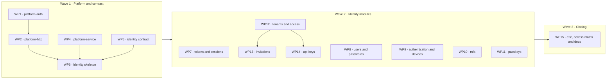

# F4 phase design: Identity

- Status: Accepted
- Date: 2026-11-13
- Historical design: where it differs, the ADRs from 0030 on and the [F12 plan](../plan/f12-infra-and-deployment.md) win. In particular `TRUST_PROXY_HOPS` is replaced by `CloudFront-Viewer-Address` ([ADR 0045](../adr/0045-edge-domains-and-real-time.md)), readiness does not include Valkey ([ADR 0044](../adr/0044-valkey-failure-policy.md)), `DB_CREDENTIALS` is replaced by IAM database auth ([ADR 0041](../adr/0041-secrets-and-database-credentials.md)) and the mailer is gated by `DEPLOY_ENVIRONMENT`, not `NODE_ENV` ([ADR 0046](../adr/0046-providers-and-telemetry-per-environment.md)).
- Working branch: `feat/f4-identity`
- Related ADRs: [0005](../adr/0005-authentication-sessions-jwt.md), [0006](../adr/0006-mfa-registered-device-passkeys.md), [0010](../adr/0010-logical-sharding-region-residency.md), [0015](../adr/0015-repository-structure-and-shared-code.md), [0021](../adr/0021-valkey-adapter.md), [0022](../adr/0022-token-verification-shared-revocation-state.md) and [0023](../adr/0023-identity-data-routing.md)

This document splits the construction of `backend/apps/identity`, and of the platform pieces it needs, into work packages (WP) that several agents can build in parallel without touching the same files. It contains no production code: it fixes names, folders, public APIs, tables, routes, events, error codes, tests and the work order.

Where the plan and an ADR disagree, the ADR wins. That is why sign-in is called `POST /v1/auth/sign-in` (current contract) and not `POST /auth/login` (plan).

## 1. Starting point

| Piece                  | Status today                                                                                                                                                                                                                                                       |
| ---------------------- | ------------------------------------------------------------------------------------------------------------------------------------------------------------------------------------------------------------------------------------------------------------------ |
| `@contracts/identity`  | 13 routes (sign-in, MFA, refresh, sign-out, step-up, `me/access`, sessions, devices), 2 internal operations, 2 events, 15 codes. The front (`front/packages/auth`) already consumes 9 routes.                                                                      |
| `@contracts/platform`  | `defineRoute`, `Access`, `decodeQuery`, `validateContract`, `toProblemDetails`, `PLATFORM.*` catalog.                                                                                                                                                              |
| `@platform/*`          | kernel, primitives, config, observability (`RequestContext`, `setupTelemetry`), persistence (`ShardResolver`, `ShardScope`, `ShardedRepository`, `ShardedMigrationRunner`, TypeORM migrations), sharding, cache, bloom, resilience, internal-api, messaging, saga. |
| `@platform/adapters-*` | Valkey (cache, routing, Bloom, directory channel), Postgres (outbox, `processed_messages`), AWS (SNS and SQS).                                                                                                                                                     |
| `backend/apps`         | Does not exist. NestJS is not in the workspace.                                                                                                                                                                                                                    |
| Local environment      | `catalog`, `identity_shard_0` and `identity_shard_1` in Postgres; Valkey with the Bloom module; Mailpit.                                                                                                                                                           |

Four platform pieces are missing (HTTP entry, token verification, rate limits and service bootstrap), plus one adjustment to persistence (`ShardScope`) and the complete service.

The persistence in this table is the layer over `pg`. Before F4 starts it is replaced by TypeORM according to the [persistence and sagas design](typeorm-persistence-and-sagas.md). The adjustments that this and the backend plan bring to sections 3.3 to 3.6 are in [section 4.3 of the backend plan](../plan/backend.md#43-adjustments-this-plan-forces-on-the-f4-design), and the order of the F4 packages alongside the others is in the [plan](../plan/README.md#execution-order-by-waves).

## 2. Key decisions

1. **Contract-driven routes.** `@Endpoint(SignInRoute, options)` takes method, path, schema, codes and access from the `RouteDefinition`. The controller does not repeat the path. This way the server cannot diverge from the contract the front consumes.
2. **Cryptography with `node:crypto`.** JWT ES256, JWKS, argon2id, HMAC, TOTP, AES-256-GCM and opaque tokens are implemented on top of Node 24's `node:crypto`. Only NestJS (a plan decision) and `@simplewebauthn/server` are added. See section 9.
3. **Local verification in every service.** `@platform/auth` verifies signature, expirations, revoked session, epochs and permission version without calling identity. The revocation state lives in a shared, read-only Valkey key space, `auth:*` (ADR 0022).
4. **User data in the user's shard, tenant data in the tenant's shard.** User data is routed by `ShardKey.User` within the group of its home tenant (`homeTenantId`). Tenant data (members, groups, roles, API keys) is routed by `ShardKey.Tenant`. The catalog stores only routing indexes (ADR 0023).
5. **Opaque tokens with a route.** Session token, reset token, email verification token, `mfaToken`, signed `deviceId` and invitation carry the id of the user (or tenant) and that of its home tenant. With that, identity reaches the shard without querying the catalog.
6. **Web or native app by header.** The mobile app declares its channel with `Authorization: Bearer <session token>` (refresh and sign-out) or `X-Session-Transport: bearer` (sign-in and MFA verification) and receives the token in the body. Without those headers the channel is web: the session token travels only in the `__Host-session` cookie. In addition, an `Origin` that is not in the allowed list responds `PLATFORM.AUTH.ORIGIN_REJECTED` (CSRF defense).
7. **A single contract change, at the start.** In the first wave the contract WP adds all the F4 routes, schemas, codes, events and operations, together with the generated Dart and the ARB texts. The module WPs do not edit the contract.

## 3. New platform pieces

### 3.1 Map

| Library                               | Folder                             | Tags                              | Depends on                                                                                                                                                |
| ------------------------------------- | ---------------------------------- | --------------------------------- | --------------------------------------------------------------------------------------------------------------------------------------------------------- |
| `@platform/auth`                      | `backend/libs/platform/auth`       | `type:platform`, `scope:platform` | kernel, primitives, bloom, observability, `@contracts/platform`, `@contracts/identity` (boundary exception, ADR 0022), zod                                |
| `@platform/rate-limit`                | `backend/libs/platform/rate-limit` | `type:platform`, `scope:platform` | kernel, primitives (already exists, no changes in F4)                                                                                                     |
| `@platform/http`                      | `backend/libs/platform/http`       | `type:platform`, `scope:platform` | auth, rate-limit, observability, internal-api, `@contracts/platform`, `@contracts/identity`, `@nestjs/common`, `@nestjs/core`, `@nestjs/platform-express` |
| `@platform/service`                   | `backend/libs/platform/service`    | `type:platform`, `scope:platform` | http, config, observability, persistence, sharding, cache, bloom, resilience, messaging, internal-api, valkey, postgres and aws adapters                  |
| Change in `@platform/persistence`     | `persistence/src/shard-scope.ts`   | already delivered                 | sharding                                                                                                                                                  |
| Change in `@platform/adapters-valkey` | `src/auth/` and `src/rate-limit/`  | no change                         | auth, rate-limit                                                                                                                                          |

None of these libraries imports code from `backend/apps`. `@platform/auth` and `@platform/rate-limit` do not import NestJS: a worker, a Lambda or the real-time gateway can use them.

### 3.2 `@platform/auth`: token verification and actor

Every service uses it to authenticate requests. Identity also uses its writers.

**Files and public API**

| File (`src/`)                       | Exports                                                                                                                                                                                                          |
| ----------------------------------- | ---------------------------------------------------------------------------------------------------------------------------------------------------------------------------------------------------------------- |
| `actor.ts`                          | `Actor = UserActor \| ServiceAccountActor \| SystemActor`, discriminated by `kind: ActorType` (the enum already exists in `@platform/observability`). `isUserActor`, `isServiceAccountActor`.                    |
| `jwt/jwt-codec.ts`                  | `signEs256Jwt(header, claims, privateKey)`, `parseJwt(token)`, `verifyEs256Signature(parsed, publicKey)`. Signs with `crypto.sign('sha256', …, { dsaEncoding: 'ieee-p1363' })`.                                  |
| `jwt/access-token-claims.ts`        | `AccessTokenClaimsSchema` (zod, imported from `@contracts/identity`), `AccessTokenHeader`, `ACCESS_TOKEN_TYPE = 'at+jwt'`, `CLOCK_SKEW_MS = 30_000`.                                                             |
| `jwks/jwk.ts`                       | `toPublicJwk(keyObject, kid)`, `publicKeyFromJwk(jwk)` with `createPublicKey({ format: 'jwk' })`. Only accepts `kty: 'EC'`, `crv: 'P-256'`.                                                                      |
| `jwks/jwks-key-source.ts`           | Port `JwksKeySource { keyFor(kid): Promise<KeyObject \| undefined> }`. `StaticJwksKeySource`. `RemoteJwksKeySource` with `fetch`, a 5 min cache and at most one reload every 30 s on an unknown `kid`.           |
| `state/auth-state-keys.ts`          | `AuthStateKey` (builders for `auth:*` keys) and `AUTH_REVOCATIONS_CHANNEL = 'auth:revocations'`.                                                                                                                 |
| `state/auth-state.ts`               | Ports `AuthStateReader` and `AuthStateWriter` (section 3.2.3). `InMemoryAuthState` implements both.                                                                                                              |
| `state/cached-auth-state-reader.ts` | `CachedAuthStateReader`: 5 s local LRU cache for epochs and versions, in-memory Bloom for revoked sessions, rebuild every 10 s and subscription to the channel.                                                  |
| `verifier/access-token-verifier.ts` | `AccessTokenVerifier.verify(token, { audience }) → Promise<UserActor>`. Throws `AuthenticationError`.                                                                                                            |
| `verifier/authentication-error.ts`  | `AuthenticationError extends PlatformError` with a `code` from `PlatformErrorCode` or from `IdentityErrorCode`.                                                                                                  |
| `api-keys/api-key-format.ts`        | `parseApiKey(raw) → { environment, prefix, secret } \| undefined`, `ApiKeyEnvironment` (`Live`, `Test`). Format `sk_live_<prefix>_<secret>`.                                                                     |
| `api-keys/api-key-authenticator.ts` | Port `ApiKeyResolver` (implemented by identity in process or by the internal client in other services). `CachedApiKeyAuthenticator` with the `auth:apikey:{prefix}` cache.                                       |
| `access/access-grant.ts`            | `AccessGrant { permissions, platformRoles, features, flags, permissionVersion }`. Port `AccessResolver`. `CachedAccessResolver` reads `auth:access:{tid}:{uid}` and falls back to the `GetUserAccess` operation. |
| `access/evaluate-access.ts`         | `evaluateAccess(requirement: AccessRequirement, actor, grant, now) → AccessDecision` (`Allowed`, `Forbidden`, `StepUpRequired`).                                                                                 |

#### 3.2.1 Access token claims

The header is `{ alg: 'ES256', typ: 'at+jwt', kid }`. The verifier rejects any other `alg`, a present `crit` or a token longer than 8192 characters.

| Claim               | Content                                                                               |
| ------------------- | ------------------------------------------------------------------------------------- |
| `iss`               | Region issuer (`IDENTITY_ISSUER`).                                                    |
| `aud`               | `api` or `backoffice`.                                                                |
| `sub`               | User id.                                                                              |
| `tid`               | Active tenant.                                                                        |
| `htid`              | User's home tenant. New, required by routing (ADR 0023).                              |
| `sid`               | Session.                                                                              |
| `did`               | Device, if the session has one.                                                       |
| `amr`               | Methods used (`pwd`, `passkey`, `device`, `email_otp`, `totp`, `recovery_code`).      |
| `auth_time`         | Last interactive authentication, including step-up.                                   |
| `roles`             | User's roles in the active tenant.                                                    |
| `proles`            | Platform roles. New, separates backoffice from tenant.                                |
| `pv`                | Permission version: `"<tenant version>.<user version in the tenant>"`.                |
| `rgn`               | Residency region.                                                                     |
| `sxp`               | Absolute session cap (epoch in seconds). New, allows responding `SESSION.EXPIRED`.    |
| `iat`, `exp`, `jti` | Standard. `exp - iat` between 10 and 15 minutes (`ACCESS_TOKEN_TTL`, default 10 min). |

The `AccessTokenClaimsSchema` schema lives in `@contracts/identity` (`schemas/access-token.schema.ts`), because the token format is part of the identity contract.

#### 3.2.2 Verification order

`AccessTokenVerifier.verify` checks in this order and stops at the first failure:

| Step | Check                                           | Code                                                      |
| ---- | ----------------------------------------------- | --------------------------------------------------------- |
| 1    | Format, `alg`, `typ`, size                      | `PLATFORM.AUTH.UNAUTHENTICATED`                           |
| 2    | `kid` in the JWKS and ES256 signature           | `PLATFORM.AUTH.UNAUTHENTICATED`                           |
| 3    | `iss` and `aud`                                 | `PLATFORM.AUTH.UNAUTHENTICATED`                           |
| 4    | `exp` and `iat` with 30 s of tolerance          | `PLATFORM.AUTH.TOKEN_EXPIRED` (new, the client refreshes) |
| 5    | `sxp` expired                                   | `IDENTITY.SESSION.EXPIRED`                                |
| 6    | `sid` revoked (local Bloom, then Valkey)        | `IDENTITY.SESSION.REVOKED`                                |
| 7    | User epoch: earlier `iat` or suspended user     | `IDENTITY.TOKEN.REVOKED` or `IDENTITY.USER.SUSPENDED`     |
| 8    | Tenant epoch: earlier `iat` or suspended tenant | `IDENTITY.TOKEN.REVOKED` or `IDENTITY.TENANT.SUSPENDED`   |
| 9    | `pv` older than the current one                 | `IDENTITY.TOKEN.STALE_PERMISSIONS`                        |

Step 9 accepts a `pv` newer than the one in the local cache, because versions only go up and the cache can lag a few seconds behind identity; it rejects only an older one (the tenant or user version lower than the current one). Steps 6 to 9 match the contract's `SessionGuardErrors`. If Valkey fails in steps 6 to 9, the verifier uses the last value in its local cache. If it has none, it responds `PLATFORM.RESILIENCE.CIRCUIT_OPEN` (503): it never accepts a token without being able to check revocation.

#### 3.2.3 Shared state in Valkey

Identity writes and every service reads. The keys do not carry the service prefix.

| Key                                | Type    | Content and lifetime                                                                      |
| ---------------------------------- | ------- | ----------------------------------------------------------------------------------------- |
| `auth:revoked:{sid}`               | string  | Reason. TTL equal to the remaining life of the access token plus 30 s.                    |
| `auth:revoked-index`               | zset    | `sid` with a score equal to its expiration. Source for rebuilding the local Bloom.        |
| `auth:epoch:user:{userId}`         | string  | JSON `{ revokedBefore, suspended }`. No TTL.                                              |
| `auth:epoch:tenant:{tenantId}`     | string  | JSON `{ revokedBefore, suspended }`. No TTL.                                              |
| `auth:pv:tenant:{tenantId}`        | string  | Tenant permission version (goes up with role or group changes).                           |
| `auth:pv:user:{tenantId}:{userId}` | string  | User version in the tenant (goes up with membership or user group changes).               |
| `auth:access:{tenantId}:{userId}`  | string  | JSON `AccessGrant` with its `permissionVersion`. TTL of 15 min.                           |
| `auth:apikey:{prefix}`             | hash    | Field `sha256(secret)` with the key's principal. TTL of 60 s; revocation deletes the key. |
| `auth:revocations`                 | pub/sub | Immediate notice of each session revocation.                                              |

```ts
export abstract class AuthStateReader {
  abstract isSessionRevoked(sessionId: string): Promise<boolean>;
  abstract userEpoch(userId: string): Promise<Epoch | undefined>;
  abstract tenantEpoch(tenantId: string): Promise<Epoch | undefined>;
  abstract permissionVersion(
    tenantId: string,
    userId: string,
  ): Promise<PermissionVersion | undefined>;
}

export abstract class AuthStateWriter {
  abstract revokeSession(
    sessionId: string,
    ttlMs: number,
    reason: RevocationReason,
  ): Promise<void>;
  abstract setUserEpoch(userId: string, epoch: Epoch): Promise<void>;
  abstract setTenantEpoch(tenantId: string, epoch: Epoch): Promise<void>;
  abstract setPermissionVersion(
    tenantId: string,
    userId: string | undefined,
    version: number,
  ): Promise<void>;
  abstract putAccessGrant(
    tenantId: string,
    userId: string,
    grant: AccessGrant,
  ): Promise<void>;
  abstract dropApiKey(prefix: string): Promise<void>;
}
```

The `ValkeyAuthStateReader` and `ValkeyAuthStateWriter` adapters live in `backend/libs/platform/adapters/valkey/src/auth/`. Permission versions have their source of truth in Postgres (section 5.10); Valkey holds a copy. If the `auth:pv:*` key is missing, the verifier requests the `AccessGrant` with `GetUserAccess`, which brings the version.

#### 3.2.4 Authorization

`evaluateAccess` applies the route's `AccessRequirement`:

- `permissions`: the actor has all of them in the active tenant. If one is missing, `PLATFORM.AUTH.FORBIDDEN`.
- `platformRoles`: the actor has at least one. Otherwise, `PLATFORM.AUTH.FORBIDDEN`.
- `mfaMaxAgeMinutes`: `amr` includes a second factor and `auth_time` is within the window. Otherwise, `IDENTITY.MFA.STEP_UP_REQUIRED`.
- A `ServiceAccountActor` never satisfies `platformRoles` or `mfaMaxAgeMinutes`.

### 3.3 `@platform/rate-limit`

The library already exists: `RateLimiter`, `InMemoryRateLimiter`, `DegradingRateLimiter`, `RateLimitModule` and `ValkeyRateLimiter` in `@platform/adapters-valkey`. F4 does not build it. All it contributes is the mapping from `RateLimitTier` to rules (`RateLimitRule`), which lives in `@platform/http`.

Exponential lockout after failed attempts does not live here: it is an identity business rule that uses these counters (section 5.3).

### 3.4 `@platform/http`: HTTP entry on NestJS

#### 3.4.1 Decorators

```ts
@Resource(IdentityResource.Sessions)
export class SessionsController {
  constructor(
    private readonly runner: UseCaseRunner,
    private readonly refresh: RefreshSession,
  ) {}

  @Endpoint(RefreshSessionRoute, {
    rateLimit: RateLimitTier.Auth,
    sessionCookie: SessionCookieMode.Rotate,
  })
  refresh(
    @Input() input: RouteRequest<typeof RefreshSessionRoute>,
    @Exchange() http: HttpExchange,
  ) {
    return this.runner.run(this.refresh, { ...input, client: http.client });
  }
}
```

| Piece                     | What it does                                                                                                                                                                                   |
| ------------------------- | ---------------------------------------------------------------------------------------------------------------------------------------------------------------------------------------------- |
| `@Resource(name, opts?)`  | `@Controller()` without a prefix. `opts.tenantScoped` requires `tid` in the actor. `name` is a value of a service enum.                                                                        |
| `@Endpoint(route, opts?)` | Registers the contract's method and path (translates `{param}` to `:param`), success code, access metadata and options.                                                                        |
| `EndpointOptions`         | `auth?: readonly AuthMethod[]` (defaults to `[AuthMethod.Jwt]` if the route is authenticated), `rateLimit?: RateLimitTier`, `timeoutMs?`, `sessionCookie?: SessionCookieMode`, `versions?`.    |
| `@Input()`                | Validated input: route parameters, query (with `decodeQuery`) or body, depending on the method.                                                                                                |
| `@CurrentActor()`         | The authenticated `Actor`. It has this name so it does not clash with the `Actor` type.                                                                                                        |
| `@Exchange()`             | `HttpExchange`: `client` (`ip`, `userAgent`, `origin`, `channel: ClientChannel.Web \| Native`), `sessionCookie()`, `setSessionCookie(token, maxAgeMs)`, `clearSessionCookie()`, `setHeader()`. |

Enums: `AuthMethod` (`Jwt`, `ApiKey`), `RateLimitTier` (`Auth`, `Sensitive`, `Standard`, `Internal`), `SessionCookieMode` (`None`, `Issue`, `Rotate`, `Clear`), `ClientChannel` (`Web`, `Native`).

`@Endpoint` fails at startup if the route is public and declares `auth`, if a path is registered twice or if the service contract has a route without a handler (`HttpRouteRegistry.assertComplete(contract)`).

#### 3.4.2 Per-request pipeline

| Order | Nest piece                                    | Class                        | Responsibility                                                                                                                                                                                                                                             |
| ----- | --------------------------------------------- | ---------------------------- | ---------------------------------------------------------------------------------------------------------------------------------------------------------------------------------------------------------------------------------------------------------- |
| 1     | Middleware                                    | `RequestContextMiddleware`   | Belongs to `@platform/observability/nest`; `@platform/http` imports it. Sets `traceId` (from `traceparent` or a new UUIDv7), `externalTraceId`, `RequestContextStore.run`, `x-trace-id` header.                                                            |
| 2     | Middleware                                    | `SecurityHeadersMiddleware`  | `Strict-Transport-Security`, `X-Content-Type-Options`, `Referrer-Policy: no-referrer`, `Content-Security-Policy: default-src 'none'`, `Cache-Control: no-store` on `/v1/auth` routes.                                                                      |
| 3     | Middleware                                    | `OriginPolicyMiddleware`     | Reads `Origin`; if present and not in `WEB_ORIGINS`, responds `PLATFORM.AUTH.ORIGIN_REJECTED` (403). Sets `ClientChannel`: `Native` if the request carries `Authorization: Bearer` with a session token or `X-Session-Transport: bearer`, `Web` otherwise. |
| 4     | Guard                                         | `EndpointGuard`              | Authentication (JWT with `AccessTokenVerifier` or API key with `ApiKeyAuthenticator`), tenant, rate limit, `AccessGrant` and `evaluateAccess`, sunset (410 `PLATFORM.API.VERSION_SUNSET`).                                                                 |
| 5     | Interceptor                                   | `EndpointContextInterceptor` | Opens a new `RequestContext` with tenant and actor, applies `timeoutMs`, resolves `Api-Version`, adds `Deprecation`, `Sunset` and `Link`, and handles the session cookie.                                                                                  |
| 6     | Pipe                                          | `ContractInputPipe`          | Builds the input and validates it with `validateContract(route.request, …)`. Fails with `PLATFORM.VALIDATION.INVALID_INPUT` and per-field `errors`.                                                                                                        |
| 7     | Interceptor (outside production and in tests) | `ContractOutputInterceptor`  | Validates the response against `route.response`. A deviation is a server error.                                                                                                                                                                            |
| 8     | Filter                                        | `ProblemDetailsFilter`       | `PlatformError` to Problem Details with `ProblemDetailsFactory`, which composes the service catalog with the libraries' catalogs; `Retry-After` from `details.retryAfterSeconds`; anything unknown is `PLATFORM.INTERNAL.UNEXPECTED`.                      |

`ErrorCatalogRegistry` gathers `platformErrorCatalog`, the libraries' catalogs and the service's. It fails at startup if a code declared in a route has no entry.

**Per-request version.** `ApiVersionPolicy` reads `Api-Version` (date `YYYY-MM-DD`). Without the header it uses the version pinned to the API key or to the tenant and, if there is none, the current one. An unknown version responds `PLATFORM.API.UNSUPPORTED_VERSION` (400). In F4 there is a single version (`2026-11-01`) and no transformer; the `VersionTransformer` interface is ready.

**Session cookie.** Name `__Host-session`, `HttpOnly`, `Secure`, `SameSite=Strict`, `Path=/`, no `Domain`. `Max-Age` equal to the inactivity window. It is read from the `Cookie` header with an in-house parser (RFC 6265, only `name=value`). It is only used with `ClientChannel.Web`.

**Express.** `trust proxy` from `TRUST_PROXY_HOPS`, JSON body of at most 256 KiB (`PLATFORM.HTTP.PAYLOAD_TOO_LARGE`), only `application/json` (`PLATFORM.HTTP.UNSUPPORTED_MEDIA_TYPE`), broken JSON (`PLATFORM.HTTP.MALFORMED_BODY`), no `x-powered-by`. CORS with `app.enableCors` and the `WEB_ORIGINS` list, with credentials.

#### 3.4.3 Internal API over HTTP

`InternalApiController`, `HttpTransport` and the HMAC classes (`HmacInternalCallAuthenticator`, `HmacSigner`) belong to `@platform/internal-api`. `@platform/http` only mounts the controller, bypassing `EndpointGuard`, at `POST /internal/operations/:operationId`.

- Local authentication: HMAC-SHA256 signature of the method, path, time and body hash (`x-internal-signature` header, 60 s window). The AWS SigV4 adapter arrives in F12.
- `HttpTransport` signs the call and propagates `traceparent`, tenant, actor and idempotency.

### 3.5 `@platform/service`: bootstrap

```ts
export interface ServiceDefinition<C extends BaseConfig> {
  readonly name: string; // 'identity'
  readonly config: ConfigDefinition<z.ZodType<C>>;
  readonly rootModule: Type<unknown>;
  readonly contract: ServiceContract;
  readonly migrations: {
    readonly catalog: readonly DataSource[]; // reference DataSource, from which the TypeORM migrations are generated
    readonly shard: readonly DataSource[];
  };
  readonly sharding?: {
    readonly defaultKey: ShardKey;
    readonly requireScope: boolean;
  };
  readonly errorCatalogs: readonly ErrorCatalog[];
}

export function bootstrapHttp(
  def,
  options?: { env?: ConfigEnv; overrides?: Provider[] },
): Promise<RunningService>;
export function bootstrapWorker(def, options?): Promise<RunningService>;
export function runMigrations(
  def,
  target: MigrationTarget,
): Promise<MigrationReport>; // Catalog, Shards, All
```

| Piece                        | What it does                                                                                                                                                                                                              |
| ---------------------------- | ------------------------------------------------------------------------------------------------------------------------------------------------------------------------------------------------------------------------- |
| Service `instrumentation.ts` | First import of `main.ts`: loads the base config and calls `setupTelemetry(telemetryOptionsFromConfig(...))` before importing NestJS, `pg` or `iovalkey`.                                                                 |
| `PlatformRuntimeModule`      | Composition of the library modules (wiring guide of the backend plan, section 6) plus `AuthStateReader`. It does not redefine what each module already provides.                                                          |
| `databaseConfigSchema`       | It is the `DatabaseConfig` section of `@platform/persistence`: `DB_PROXY_HOST`, `DB_READER_HOSTS`, `DB_PORT`, `DB_DATABASES` (JSON `{ shards, catalog }`), `DB_CREDENTIALS`. Same names as the Terraform `service` stack. |
| `valkeyConfigSchema`         | It is the `ValkeyConfig` section of `@platform/adapters-valkey`: `VALKEY_URL` locally, or `VALKEY_HOST`, `VALKEY_PORT`, `VALKEY_USER` and `VALKEY_KEY_PREFIX`.                                                            |
| `UseCaseRunner`              | `run(useCase, input, { transaction?: boolean })`: span, latency and error metrics, optional transaction with the `TransactionManager`. Used by HTTP, consumers and internal operations.                                   |
| `OutboxRelayJob`             | Belongs to `@platform/messaging` and replaces `OutboxRelayWorker`. Walks all the shards with `OutboxRelay` as a `ScheduledJob`.                                                                                           |
| `ScheduledJob`               | Periodic jobs use `ScheduledJob` and `JobRunner` from `@platform/scheduling`, with `ValkeyJobLock`. Replaces `IntervalJob`.                                                                                               |
| `HealthEndpoints`            | `GET /health/live` and `GET /health/ready` over the observability `HealthRegistry` (Postgres of each shard, catalog, Valkey), outside the contract.                                                                       |
| `runMigrations`              | Delegates to `ShardedMigrationRunner`: migrates the catalog first and then each shard in parallel with a limit of 4, with the platform migrations plus the service's.                                                     |
| Graceful shutdown            | `SIGTERM`: stops accepting, waits for in-flight requests (10 s), stops the relay, closes persistence, Valkey and telemetry.                                                                                               |

The ports the use cases see are abstract classes without decorators, so they serve as injection tokens without the domain importing NestJS.

### 3.6 `ShardScope` in `@platform/persistence`

It is delivered in `@platform/persistence` with the `requireScope` option and the `CROSS_SHARD_TX` error; it is outside the scope of WP4. This section describes its behavior.

Today `ShardedDatabaseResolver` takes the tenant from the context and the user from the actor. In identity that is not enough: the user being queried is almost never the actor (anonymous sign-in, an admin revoking someone else's sessions) and user data is routed by its home tenant, not by the active tenant.

```ts
export interface ShardScopeInit {
  readonly tenantId: string;
  readonly keyKind: ShardKey;
  readonly keyValue?: string;
}
export class ShardScope {
  static run<T>(scope: ShardScopeInit, fn: () => Promise<T>): Promise<T>;
  static current(): ShardScopeInit | undefined;
}
```

- `ShardedDatabaseResolver.resolve` uses `ShardScope.current()` if it exists and, otherwise, the context as today.
- New `requireScope` option in `PersistenceShardingOptions`: without a scope, `PLATFORM.SHARDING.KEY_MISSING`. Identity enables it.
- An open transaction does not change shards: a nested `ShardScope.run` that points to another shard inside a transaction responds `PLATFORM.SHARDING.CROSS_SHARD_TX`.

## 4. Structure of `backend/apps/identity`

```text
backend/apps/identity/
  package.json            name "identity", tags type:app and scope:identity, engines node >=24.7.0
  project.json            targets serve, worker, migrate, seed, test, test:integration, test:e2e
  tsconfig.json  tsconfig.app.json  tsconfig.spec.json  .spec.swcrc (decoratorMetadata)
  jest.config.cjs         unit, integration and e2e projects
  eslint.config.mjs       layer and module rules
  src/
    instrumentation.ts    setupTelemetry before anything else
    main.ts               bootstrapHttp(identityService)
    worker.ts             bootstrapWorker(identityService): relay, consumers and jobs
    migrate.ts            runMigrations(identityService, target)
    identity.service.ts   identity ServiceDefinition
    app.module.ts         imports the Nest modules of each module
    config/identity.config.ts
    database/catalog-migrations.ts  database/shard-migrations.ts
    messaging/identity.consumers.ts
    shared/
      enums/      identity-resource.enum.ts, identity-job.enum.ts, identity-cache-key.enum.ts, bloom-filter-name.enum.ts, security-alert-type.enum.ts, identity-email-template.enum.ts
      constants/  identity-defaults.constants.ts, lockout.constants.ts, system-roles.constants.ts, argon2.constants.ts, migration-ranges.constants.ts
      types/      user-ref.type.ts, client-info.type.ts, pending-authentication.type.ts
      utils/      opaque-token.ts, base64url.ts, constant-time.ts, email-normalization.ts, cidr.ts, shard-scopes.ts
    modules/<module>/
      index.ts            public facade of the module (the only thing other modules import)
      domain/             aggregates, value objects, ports (abstract classes), errors
      application/        use cases and <module>.facade.ts
      infrastructure/     persistence/{tables,repositories,migrations}, adapters (crypto, valkey, catalog)
      presentation/       <module>.module.ts, controllers, internal operations, consumers
      __tests__/utils/    in-memory fakes of its ports and of its facade
  test/
    support/              global-setup (Testcontainers), test app, HTTP client, deterministic clock and ids
    integration/          *.int-spec.ts
    e2e/                  *.e2e-spec.ts
```

**Dependency rules (service lint).**

- The layer rules of ADR 0015 are checked with `no-restricted-imports` by folder pattern (`dependency-cruiser` is still pending, ADR 0020).
- A module imports from another only `modules/<other>/index.ts`. The facade exposes read-only domain types and the abstract class `<Module>Facade`.
- `shared/utils` imports nothing from `modules/`.

**Identity modules.**

| Module           | Responsibility                                                              | Shard              |
| ---------------- | --------------------------------------------------------------------------- | ------------------ |
| `users`          | User, sign-up, email verification and change, profile, suspension           | User and catalog   |
| `passwords`      | argon2id hash, policy, leaked passwords, password change and recovery       | User               |
| `authentication` | Password sign-in, lockout by attempts, `login_attempts`                     | User               |
| `devices`        | Devices, signed `deviceId`, device key, approvals                           | User               |
| `mfa`            | Challenges, codes, TOTP, recovery codes, step-up, recovery without a device | User and Valkey    |
| `passkeys`       | WebAuthn: registration, passwordless sign-in and second factor              | User and catalog   |
| `sessions`       | Sessions, rotation, refresh, sign-out, revocation, tenant switch            | User               |
| `tokens`         | Signing keys, JWKS, access token issuance                                   | None               |
| `tenants`        | Tenants, slug, placement in shards, suspension                              | Tenant and catalog |
| `access`         | Memberships, groups, roles, effective permissions, permission version       | Tenant and user    |
| `invitations`    | Invitations to a tenant                                                     | Tenant             |
| `api-keys`       | Service accounts and API keys                                               | Tenant and catalog |
| `alerts`         | Security alerts and identity transactional email (ports with fakes)         | None               |

## 5. Modules

Conventions in this section:

- `UserRef = { userId, homeTenantId }`. Every use case over user data runs inside `inUserShard(ref, fn)` (`shared/utils/shard-scopes.ts`); tenant use cases, inside `inTenantShard(tenantId, fn)`.
- All shard tables carry `created_at`, `updated_at`, `created_by`, `updated_by` and `version` unless stated otherwise. Those marked "audited" carry the `audit_log` trigger.
- Tenant tables declare `tenant_id` as the tenant column of `TableDefinition` and have RLS. User tables do not declare a tenant column.
- Each module's migrations are TypeORM migrations and use its timestamp range (section 6.3).
- New codes are listed in section 7.

### 5.1 `users`

| Element      | Detail                                                                                                                                                                                                             |
| ------------ | ------------------------------------------------------------------------------------------------------------------------------------------------------------------------------------------------------------------ |
| Aggregates   | `User` (`id`, `homeTenantId`, `email: EmailAddress`, `emailVerifiedAt`, `status: UserStatus` with `PendingVerification`, `Active`, `Suspended`, `Deleted`, `displayName`, `locale`, `lastTenantId`), `EmailChange` |
| Ports        | `UserRepository`, `UserDirectory` (catalog `identity_lookup`), `EmailFingerprinter` (HMAC-SHA256 with `IDENTITY_EMAIL_PEPPER` of the normalized email), `EmailVerificationStore` (Valkey, 24 h)                    |
| Use cases    | `RegisterUser`, `ConfirmEmailVerification`, `ResendEmailVerification`, `GetMyProfile`, `UpdateMyProfile`, `RequestEmailChange` (step-up), `ConfirmEmailChange`, `SuspendUser`, `ReactivateUser`, `GetUserProfile`  |
| Facade       | `UsersFacade.findByEmail(email)`, `getByRef(ref)`, `register(input)`, `setLastTenant(ref, tenantId)`                                                                                                               |
| Shard tables | `users` (audited; `email_fingerprint bytea` unique)                                                                                                                                                                |
| Catalog      | `identity_lookup (email_fingerprint bytea PK, user_id uuid UNIQUE, home_tenant_id uuid, region text, status text, created_at)`. `status` is `reserved` or `active`.                                                |
| Routes       | `POST /v1/auth/sign-up`, `POST /v1/auth/email-verifications`, `POST /v1/auth/email-verifications/confirm`, `GET /v1/me`, `PATCH /v1/me`, `POST /v1/me/email-changes`, `POST /v1/me/email-changes/confirm`          |
| Operations   | `identity.users.suspend.v1` (compensated by `identity.users.reactivate.v1`), `identity.users.reactivate.v1` (compensated by `suspend`), `identity.users.get-profile.v1` (does not modify)                          |
| Events       | Publishes `identity.user.registered.v1`, `identity.user.suspended.v1`, `identity.user.reactivated.v1`, `identity.user.email-changed.v1`                                                                            |
| Errors       | `IDENTITY.USER.EMAIL_VERIFICATION_INVALID`, `IDENTITY.USER.SUSPENDED`, `IDENTITY.USER.NOT_FOUND`                                                                                                                   |

**Sign-up without revealing accounts.** `sign-up` always responds 202. If the email already exists, an "you already have an account" email is sent instead of the verification email.

**Sign-up across two databases.** The catalog and the shard do not share a transaction:

1. Inserts `identity_lookup` with `status = reserved`. The primary key guarantees a unique email across the platform.
2. In the user's shard it creates `users`, `password_credentials` and the outbox entry for `identity.user.registered.v1`.
3. Marks `identity_lookup` as `active`.

If step 2 fails, the reservation is deleted. The `IdentityJob.SweepReservedLookups` job deletes reservations older than 1 hour that have no user.

**Home tenant.** A customer who signs up alone lands in the shared customer tenant of their region (`IDENTITY_DEFAULT_TENANT_ID`). Someone who signs up with an invitation lands in the inviting tenant.

**Suspension.** `SuspendUser` changes the status, writes `auth:epoch:user:{id}` with `suspended: true`, revokes their sessions and publishes the event. `ReactivateUser` does the reverse. Both operations are idempotent and each is the compensation of the other.

### 5.2 `passwords`

| Element      | Detail                                                                                                                                                                           |
| ------------ | -------------------------------------------------------------------------------------------------------------------------------------------------------------------------------- |
| Aggregates   | `PasswordCredential` (`userId`, `hash` in PHC format, `changedAt`), `PasswordReset` (`id`, `userId`, `tokenHash`, `expiresAt`, `usedAt`)                                         |
| Ports        | `PasswordHasher` (`NodeArgon2idHasher`), `BreachedPasswordList` (Bloom `BloomFilterName.BreachedPasswords` in Valkey), `PasswordCredentialRepository`, `PasswordResetRepository` |
| Domain       | `PasswordPolicy`: 12 to 128 characters, different from the email, not leaked. No composition rules (NIST SP 800-63B).                                                            |
| Use cases    | `SetInitialPassword`, `ChangePassword` (10 min step-up), `RequestPasswordReset`, `ConfirmPasswordReset`, `RehashIfNeeded`                                                        |
| Facade       | `PasswordsFacade.verify(ref \| undefined, password)`, `setInitial(ref, password)`                                                                                                |
| Shard tables | `password_credentials` (audited, excludes `hash`), `password_resets`                                                                                                             |
| Routes       | `POST /v1/me/password`, `POST /v1/auth/password-resets`, `POST /v1/auth/password-resets/confirm`                                                                                 |
| Errors       | `IDENTITY.PASSWORD.POLICY_VIOLATION`, `IDENTITY.PASSWORD.BREACHED`, `IDENTITY.PASSWORD.CURRENT_INVALID`, `IDENTITY.PASSWORD.RESET_INVALID`                                       |

- argon2id with Node's `crypto.argon2('argon2id', …)` (since 24.7.0): 19 456 KiB of memory, 2 passes, parallelism 1, 16-byte salt, 32-byte tag (OWASP parameters). The PHC encoding (`$argon2id$v=19$m=…,t=…,p=…$salt$hash`) is in-house. The parameters live in `shared/constants/argon2.constants.ts`.
- `verify(undefined, …)` computes a hash against a fixed value so that the response time does not reveal whether the email exists.
- Changing or recovering the password revokes the other sessions (or all of them, on recovery) and raises an alert.
- `RequestPasswordReset` always responds 202. The token (`pr1_…`, 30 min, single use) carries the route to the shard.
- In F4 the leaked-password Bloom is filled from a test file with about a thousand common passwords. Loading the Have I Been Pwned list is a later job.

### 5.3 `authentication`

| Element      | Detail                                                                                                                                                                                                                            |
| ------------ | --------------------------------------------------------------------------------------------------------------------------------------------------------------------------------------------------------------------------------- |
| Aggregates   | `LoginAttempt` (insert only: result, reason, IP, device, `traceId`), `PendingAuthentication` (in `shared/types`: user, device, offered methods, purpose `SignIn`, `StepUp` or `Recovery`, session)                                |
| Domain       | `LockoutPolicy`: the plan's three rules with the values from `shared/constants/lockout.constants.ts`. `MfaRequirementPolicy`: decides whether a second factor is needed.                                                          |
| Ports        | `LoginAttemptRepository`, `LockoutStore` (Valkey: lockout level and end by origin and protected mode by account), `AttemptCounters` (over `RateLimiter`), `PendingAuthenticationStore` (Valkey, 10 min), `CaptchaVerifier` (fake) |
| Use cases    | `SignInWithPassword`, `UnlockAccount`                                                                                                                                                                                             |
| Shard tables | `login_attempts` partitioned by month on `id`, 12-month retention                                                                                                                                                                 |
| Routes       | `POST /v1/auth/sign-in` (existing)                                                                                                                                                                                                |
| Errors       | `IDENTITY.AUTH.INVALID_CREDENTIALS` (with `Retry-After` if there is a lockout), `IDENTITY.AUTH.EMAIL_NOT_VERIFIED`                                                                                                                |

**`SignInWithPassword` flow.**

1. Checks the IP lockouts and the account-plus-origin lockouts. If there is a lockout, responds `INVALID_CREDENTIALS` with `Retry-After`.
2. Looks up the user by email in the catalog. If it does not exist, verifies against the fixed hash and counts the failure anyway.
3. Verifies the password. A failure adds to the three counters and can trigger a lockout or protected mode, with an alert.
4. Suspended user: `IDENTITY.USER.SUSPENDED` (only after a correct password).
5. Recognizes the device with `DevicesFacade.recognize`.
6. `MfaRequirementPolicy`: requires a second factor if the device is not registered, if the user is an administrator of their default tenant or has platform roles, or if the account is in protected mode. From a registered device the method is `DeviceOtp`, which the app resolves on its own.
7. Without a second factor: `SessionsFacade.createSession`. With a second factor: `MfaFacade.startPending`, which responds `mfa_required` with `mfaToken` and methods.

Attempts with a nonexistent email have no shard: they stay in the Valkey counters and in the log, not in `login_attempts`.

### 5.4 `devices`

| Element      | Detail                                                                                                                                                                                                                                             |
| ------------ | -------------------------------------------------------------------------------------------------------------------------------------------------------------------------------------------------------------------------------------------------- |
| Aggregates   | `Device` (`id`, `userId`, `name`, `platform: ClientPlatform`, `publicKey` SPKI DER, `firstSeenAt`, `lastSeenAt`, `lastIp`, `trustedUntil`, `verifier`, `pushToken`, `removedAt`)                                                                   |
| Ports        | `DeviceRepository`, `DeviceIdCodec` (`dv1_…` with an HMAC from `IDENTITY_DEVICE_ID_KEY`), `DeviceSignatureVerifier` (ES256 with `node:crypto`), `DeviceApprovalStore` (Valkey), `NonceStore` (Valkey, 5 min), `PushNotifier` (fake)                |
| Use cases    | `RecognizeDevice`, `RegisterDevice`, `ListMyDevices`, `RemoveDevice`, `UntrustDevice`, `UpdatePushToken`, `PullDeviceApprovals`, `DenyDeviceApproval`                                                                                              |
| Facade       | `DevicesFacade.recognize(ref, deviceIdToken?)`, `issueDeviceId(ref)`, `register(ref, input)`, `verifiers(ref)`, `enqueueApproval(deviceId, approval)`                                                                                              |
| Shard tables | `devices` (audited)                                                                                                                                                                                                                                |
| Routes       | `GET /v1/me/devices` (existing), `DELETE /v1/me/devices/{deviceId}`, `POST /v1/me/devices/{deviceId}/untrust`, `PUT /v1/me/devices/current/push-token`, `POST /v1/auth/device-approvals/pull`, `POST /v1/auth/device-approvals/{challengeId}/deny` |
| Events       | `identity.device.registered.v1`, `identity.device.removed.v1`                                                                                                                                                                                      |
| Errors       | `IDENTITY.DEVICE.SIGNATURE_INVALID`, `IDENTITY.DEVICE.KEY_INVALID`                                                                                                                                                                                 |

**Device key.** The app sends the P-256 public key as SPKI DER in base64url (`devicePublicKey` in the contract). If the hardware delivers the raw 65-byte key, the client prepends the fixed SPKI header. The server validates it with `createPublicKey({ format: 'der', type: 'spki' })` and rejects any other curve.

**Registered device code.** Interpretation of "the app signs the challenge and generates the code":

1. The `DeviceOtp` challenge generates an 8-digit code, stores its HMAC and leaves a pending approval for each verifier device of the user, with the attempt's context (browser, system, IP, approximate city if CloudFront sends it).
2. The verifier app calls `POST /v1/auth/device-approvals/pull` with its `deviceId`, a timestamp, a nonce and the ES256 signature of `identity.device-approvals.pull\n<deviceId>\n<timestamp>\n<nonce>`. The signature proves it holds the key and the response brings the approvals with their code.
3. If the attempt happens on the same device, the app sends the code to `verify` on its own. If it happens on another one, the user copies it. "No fui yo" (it wasn't me) calls `deny`: it cancels the challenge, raises an alert and adds a failure to the lockout.

In F4 the push that wakes the app is a fake; the app polls when it opens. The SSE notice arrives with `realtime` (F6).

### 5.5 `mfa`

| Element      | Detail                                                                                                                                                                                                                                                                                                                                                                             |
| ------------ | ---------------------------------------------------------------------------------------------------------------------------------------------------------------------------------------------------------------------------------------------------------------------------------------------------------------------------------------------------------------------------------- |
| Aggregates   | `MfaChallenge` (Valkey: `id`, `pendingId`, `method`, `codeHmac`, `attempts`, `expiresAt`, `consumedAt`), `TotpFactor` (`userId`, encrypted secret, `confirmedAt`), `RecoveryCodeSet` (10 HMACs), `MfaRecovery` (`id`, `userId`, `requestedAt`, `availableAt`, `status`)                                                                                                            |
| Ports        | `ChallengeStore` (Valkey with Lua: atomic attempts and single use), `CodeGenerator` (`crypto.randomInt`), `SecretHasher` (HMAC-SHA256 with `IDENTITY_TOKEN_PEPPER`), `TotpAlgorithm` (in-house RFC 4226 and 6238, SHA-1, 30 s, 6 digits, ±1 window), `SecretBox` (AES-256-GCM with `IDENTITY_DATA_KEY`), `TotpFactorRepository`, `RecoveryCodeRepository`, `MfaRecoveryRepository` |
| Use cases    | `RequestMfaChallenge`, `VerifyMfa`, `StartStepUp`, `RequestStepUpChallenge`, `VerifyStepUp`, `StartTotpEnrollment`, `ConfirmTotpEnrollment`, `RemoveTotp`, `RegenerateRecoveryCodes`, `StartMfaRecovery`, `ConfirmMfaRecovery`                                                                                                                                                     |
| Facade       | `MfaFacade.startPending(input) → PendingMfa`                                                                                                                                                                                                                                                                                                                                       |
| Shard tables | `totp_factors` (audited, excludes the secret), `recovery_codes`, `mfa_recoveries`                                                                                                                                                                                                                                                                                                  |
| Routes       | Existing: `POST /v1/auth/mfa/challenges`, `POST /v1/auth/mfa/verify`, `POST /v1/me/step-up`, `POST /v1/me/step-up/challenges`, `POST /v1/me/step-up/verify`. New: `POST /v1/me/mfa/totp`, `POST /v1/me/mfa/totp/confirm`, `DELETE /v1/me/mfa/totp`, `POST /v1/me/mfa/recovery-codes`, `POST /v1/auth/mfa/recoveries`, `POST /v1/auth/mfa/recoveries/confirm`                       |
| Errors       | The existing `IDENTITY.MFA.*` plus `IDENTITY.MFA.RECOVERY_NOT_READY`, `IDENTITY.MFA.FACTOR_ALREADY_ENROLLED`, `IDENTITY.MFA.FACTOR_NOT_ENROLLED`                                                                                                                                                                                                                                   |

- `MfaRules` from the contract: 5 attempts per challenge, 3 challenges every 15 minutes, 8 digits and 180 s on a device, 6 digits and 300 s by email, 10-minute step-up.
- With a registered device, `EmailOtp` is not offered. TOTP and recovery codes are offered only if they are active.
- `VerifyMfa` with `devicePublicKey` registers the device, marks it as a verifier if it is the first one and raises the new-device alert.
- `VerifyStepUp` updates `sessions.mfa_verified_at`, `auth_time` and `amr`, and issues a new access token. The session token does not change.
- Recovery without a device: `StartMfaRecovery` receives the `mfaToken`, sends a link by email and alerts every channel. `availableAt = requestedAt + 24 h · 2^(recoveries in 90 days)` (`MFA_RECOVERY_BASE_HOURS`). Before that, `IDENTITY.MFA.RECOVERY_NOT_READY` with `Retry-After`. On confirmation, the verifiers are removed and the current device is registered.

### 5.6 `passkeys`

| Element      | Detail                                                                                                                                                                                                                                                                                                                                                    |
| ------------ | --------------------------------------------------------------------------------------------------------------------------------------------------------------------------------------------------------------------------------------------------------------------------------------------------------------------------------------------------------- |
| Aggregates   | `Passkey` (`id`, `userId`, `credentialId`, `publicKey` COSE, `signCount`, `transports`, `aaguid`, `backedUp`, `name`, `lastUsedAt`)                                                                                                                                                                                                                       |
| Ports        | `PasskeyRepository`, `PasskeyDirectory` (catalog `passkey_lookup`), `WebAuthnVerifier` (`SimpleWebAuthnVerifier` adapter), `WebAuthnChallengeStore` (Valkey, 5 min)                                                                                                                                                                                       |
| Use cases    | `StartPasskeyRegistration` (step-up), `FinishPasskeyRegistration`, `StartPasskeySignIn`, `FinishPasskeySignIn`, `StartPasskeyMfa`, `FinishPasskeyMfa`, `StartPasskeyStepUp`, `FinishPasskeyStepUp`, `ListPasskeys`, `RemovePasskey` (step-up)                                                                                                             |
| Shard tables | `passkeys` (audited)                                                                                                                                                                                                                                                                                                                                      |
| Catalog      | `passkey_lookup (credential_id_hash bytea PK, user_id uuid, home_tenant_id uuid, region text)`: sign-in without a user reaches the shard through the credential.                                                                                                                                                                                          |
| Routes       | `POST /v1/auth/passkeys/options`, `POST /v1/auth/passkeys/verify`, `POST /v1/auth/mfa/passkey/options`, `POST /v1/auth/mfa/passkey/verify`, `POST /v1/me/step-up/passkey/options`, `POST /v1/me/step-up/passkey/verify`, `GET /v1/me/passkeys`, `POST /v1/me/passkeys/registration-options`, `POST /v1/me/passkeys`, `DELETE /v1/me/passkeys/{passkeyId}` |
| Errors       | `IDENTITY.PASSKEY.VERIFICATION_FAILED`, `IDENTITY.PASSKEY.CHALLENGE_EXPIRED`                                                                                                                                                                                                                                                                              |

- The contract carries the WebAuthn options and response in base64url inside the JSON body (`optionsJson`, `credentialJson`), decision 9 of section 11. The Dart generator does not support objects with free-form properties (`clientExtensionResults`), and this way the contract does not copy the WebAuthn specification. The server decodes the field, validates it with zod (shape and maximum size) and passes it to the library.
- A passkey with user verification used from a registered device satisfies both factors (`amr: ['passkey', 'device']`).
- `rpID`, name and origins come from `WEBAUTHN_RP_ID`, `WEBAUTHN_RP_NAME` and `WEBAUTHN_ORIGINS`. Attestation `none`.

### 5.7 `sessions`

| Element      | Detail                                                                                                                                                                                                                                                                                    |
| ------------ | ----------------------------------------------------------------------------------------------------------------------------------------------------------------------------------------------------------------------------------------------------------------------------------------- |
| Aggregates   | `Session` (`id`, `userId`, `homeTenantId`, `activeTenantId`, `deviceId`, `tokenHash`, `generation`, `previousGenerationUntil`, `amr`, `authTime`, `mfaVerifiedAt`, `idleExpiresAt`, `absoluteExpiresAt`, `lastRefreshAt`, `ip`, `userAgent`, `platform`, `revokedAt`, `revocationReason`) |
| Ports        | `SessionRepository`, `SessionTokenCodec` (`st1_<route>_<secret>`), `AuthStateWriter`, `AccessTokenIssuer` (`tokens` facade)                                                                                                                                                               |
| Use cases    | `CreateSession`, `RefreshSession`, `SignOut`, `ListMySessions`, `RevokeMySession`, `RevokeOtherSessions`, `RevokeUserSessions`, `RevokeDeviceSessions`, `SwitchTenant`, `MarkMfaVerified`                                                                                                 |
| Facade       | `SessionsFacade.createSession(input) → IssuedSession`, `revokeUserSessions(ref, reason, { except? })`, `revokeDeviceSessions(ref, deviceId, reason)`, `markMfaVerified(sessionRef, at, amr) → SessionTokens`                                                                              |
| Shard tables | `sessions` (audited, excludes `token_hash`; partial index on `user_id` for non-revoked rows)                                                                                                                                                                                              |
| Routes       | Existing: `POST /v1/auth/refresh`, `POST /v1/auth/sign-out`, `GET /v1/me/sessions`, `DELETE /v1/me/sessions/{sessionId}`, `POST /v1/me/sessions/revoke-others`. New: `POST /v1/me/tenant-switch`                                                                                          |
| Operations   | `identity.sessions.revoke-for-user.v1` (existing)                                                                                                                                                                                                                                         |
| Events       | `identity.session.revoked.v1`, `identity.tokens.revoked.v1` (existing)                                                                                                                                                                                                                    |
| Errors       | Existing `IDENTITY.SESSION.*`, `IDENTITY.TENANT.NOT_MEMBER`                                                                                                                                                                                                                               |

- **Rotation.** The session token route carries `userId`, `homeTenantId`, `sessionId` and `generation`. The database stores the HMAC of the current generation's secret. A successful refresh bumps the generation, issues a new token and extends `idleExpiresAt` by one day without going past `absoluteExpiresAt` (30 days).
- **Reuse.** A token from an earlier generation revokes the session (`IDENTITY.SESSION.REUSED`), except within a 5 s grace period for the immediately previous generation. That grace covers two tabs that refresh at the same time with the same cookie: the second one receives a new access token without rotating the cookie.
- **Revoke.** Marks the row, writes `auth:revoked:{sid}`, publishes on `auth:revocations` and, through the outbox, `SessionRevoked` and `TokensRevoked`. Revoking all of a user's sessions also moves the user's epoch.
- **Cookie.** With `ClientChannel.Web`, `sign-in`, `mfa/verify`, `passkeys/verify` and `refresh` respond without `sessionToken` and with `Set-Cookie`. `sign-out` deletes the cookie. The routes receive `SessionCookieMode` in `@Endpoint`.
- **Tenant switch.** `SwitchTenant` verifies membership with `AccessFacade`, updates `active_tenant_id` and `users.last_tenant_id`, and issues a new access token with the new tenant's `tid` and `pv`.

### 5.8 `tokens`

| Element   | Detail                                                                                                                                              |
| --------- | --------------------------------------------------------------------------------------------------------------------------------------------------- |
| Domain    | `SigningKey` (`kid`, status `Active`, `Verifying` or `Retired`), `SigningKeyRing` (signs with the `Active` one, publishes `Active` and `Verifying`) |
| Ports     | `SigningKeyProvider` (`ConfigSigningKeyProvider` reads `IDENTITY_SIGNING_KEYS`, a secret with private JWKs), `AccessTokenIssuer`                    |
| Use cases | `IssueAccessToken`, `GetJwks`                                                                                                                       |
| Facade    | `TokensFacade.issue(input: AccessTokenInput) → { accessToken, accessExpiresAt }`                                                                    |
| Tables    | None                                                                                                                                                |
| Routes    | `GET /v1/auth/jwks` (public, `Cache-Control: public, max-age=300`)                                                                                  |

- Issuance computes `pv` with `AccessFacade`, writes `auth:access:{tid}:{uid}` and signs with `signEs256Jwt` from `@platform/auth`.
- Rotating means changing `IDENTITY_SIGNING_KEYS`: the new key enters as `Verifying`, becomes `Active` on the next deployment and the previous one stays `Verifying` for 30 minutes. Emergency rotation retires the compromised `kid`. The runbook goes in `docs/runbooks/identity-key-rotation.md` (WP15).
- The JWKS is a contract route under `/v1`, because `defineRoute` requires the version. The other services read it with `RemoteJwksKeySource` from `IDENTITY_JWKS_URL`.

### 5.9 `tenants`

| Element      | Detail                                                                                                                                                                                                                                                          |
| ------------ | --------------------------------------------------------------------------------------------------------------------------------------------------------------------------------------------------------------------------------------------------------------- |
| Aggregates   | `Tenant` (`id`, `slug`, `name`, `region`, `kind: TenantKind` with `Organization`, `SharedCustomers`, `Platform`, `status: TenantLifecycle` with `Provisioning`, `Active`, `Suspended`, `Deleting`, `pinnedApiVersion`, `lockoutOverrides`, `permissionVersion`) |
| Ports        | `TenantRepository`, `TenantDirectory` (catalog `tenant_lookup`), `TenantPlacement` (wraps `placeTenant` with `LeastLoadedPlacementPolicy` and `PostgresDirectoryStore`), `EntitlementsProvider` (fake with features by tenant kind)                             |
| Use cases    | `CreateTenant`, `GetCurrentTenant`, `UpdateTenant`, `SuspendTenant`, `ReactivateTenant`, `DiscardTenant`, `ListMyTenants`                                                                                                                                       |
| Facade       | `TenantsFacade.get(tenantId)`, `assertActive(tenantId)`                                                                                                                                                                                                         |
| Shard tables | `tenants` (audited)                                                                                                                                                                                                                                             |
| Catalog      | `tenant_lookup (slug text PK, tenant_id uuid UNIQUE, region text)`. The shard directory already exists (`shard_directory`).                                                                                                                                     |
| Routes       | `POST /v1/tenants`, `GET /v1/tenant`, `PATCH /v1/tenant`, `GET /v1/me/tenants`                                                                                                                                                                                  |
| Operations   | `identity.tenants.create.v1` (compensated by `identity.tenants.discard.v1`), `identity.tenants.discard.v1` (no compensation: deletes a tenant in `Provisioning`), `identity.tenants.suspend.v1` and `identity.tenants.reactivate.v1` (mutual compensation)      |
| Events       | `identity.tenant.created.v1`, `identity.tenant.suspended.v1`, `identity.tenant.reactivated.v1`                                                                                                                                                                  |
| Errors       | `IDENTITY.TENANT.NOT_FOUND` (internal), `IDENTITY.TENANT.SLUG_TAKEN`, `IDENTITY.TENANT.SUSPENDED`, `IDENTITY.TENANT.NOT_MEMBER`                                                                                                                                 |

- `CreateTenant` reserves the slug, places the tenant in shards of its region, creates the row, the system roles and groups, and the creator's `Owner` membership. In F4 it runs as a direct use case. The `TenantOnboarding` operations use `SagaModule.forFeature`: the F7 saga will use the `create` and `discard` operations.
- The `Platform` and `SharedCustomers` tenants of each region are created with `nx run identity:seed`, with fixed ids from the config.
- Suspending writes `auth:epoch:tenant:{id}` with `suspended: true`. Billing-driven suspension will call the operation from `billing` in F8.

### 5.10 `access`

| Element       | Detail                                                                                                                                                                                                                                                                                                                                                                                                                                  |
| ------------- | --------------------------------------------------------------------------------------------------------------------------------------------------------------------------------------------------------------------------------------------------------------------------------------------------------------------------------------------------------------------------------------------------------------------------------------- |
| Aggregates    | `Membership` (`tenantId`, `userId`, `status`, `permissionVersion`), `Group` (`id`, `tenantId`, `name`, `system`), `Role` (`id`, `tenantId`, `name`, `systemRole: TenantRole \| null`, `permissions: Permission[]`)                                                                                                                                                                                                                      |
| Domain        | `EffectiveAccessCalculator` (union of the permissions of the roles of the user's groups), `SystemRoles` (fixed permissions of `Owner`, `Admin`, `Member` and `Billing` in `shared/constants/system-roles.constants.ts`), `PermissionVersion`                                                                                                                                                                                            |
| Ports         | `MembershipRepository`, `GroupRepository`, `RoleRepository`, `UserTenantsProjection` (user's shard), `PlatformRoleRepository` (user's shard), `AuthStateWriter`                                                                                                                                                                                                                                                                         |
| Use cases     | `GetSessionAccess`, `GetUserAccess`, `ListMembers`, `RemoveMember`, `SetMemberGroups`, `ListGroups`, `CreateGroup`, `UpdateGroup`, `DeleteGroup`, `SetGroupRoles`, `ListRoles`, `CreateRole`, `UpdateRole`, `DeleteRole`, `ProjectMembership`, `AddMember`                                                                                                                                                                              |
| Facade        | `AccessFacade.resolve(userId, tenantId) → UserAccess`, `isMember(userId, tenantId)`, `defaultTenant(ref)`, `requiresMfaOnEveryLogin(ref, tenantId)`, `addMember(tenantId, ref, groupIds)`                                                                                                                                                                                                                                               |
| Tenant tables | `tenant_members`, `groups`, `group_members`, `roles`, `role_permissions`, `group_roles` (all audited, with RLS by `tenant_id`)                                                                                                                                                                                                                                                                                                          |
| User tables   | `user_tenants` (projection: `user_id`, `tenant_id`, `status`, `joined_at`), `platform_role_assignments` (`user_id`, `role: PlatformRole`)                                                                                                                                                                                                                                                                                               |
| Routes        | `GET /v1/me/access` (existing), `GET /v1/tenant/members`, `DELETE /v1/tenant/members/{userId}`, `PUT /v1/tenant/members/{userId}/groups`, `GET /v1/tenant/groups`, `POST /v1/tenant/groups`, `PATCH /v1/tenant/groups/{groupId}`, `DELETE /v1/tenant/groups/{groupId}`, `PUT /v1/tenant/groups/{groupId}/roles`, `GET /v1/tenant/roles`, `POST /v1/tenant/roles`, `PATCH /v1/tenant/roles/{roleId}`, `DELETE /v1/tenant/roles/{roleId}` |
| Operations    | `identity.users.get-access.v1` (existing; its output adds `permissionVersion` and `roles`)                                                                                                                                                                                                                                                                                                                                              |
| Events        | Publishes `identity.membership.changed.v1` and `identity.permissions.changed.v1`. Consumes `identity.membership.changed.v1` on the `identity-access-projection` queue.                                                                                                                                                                                                                                                                  |
| Errors        | `IDENTITY.ACCESS.LAST_OWNER`, `IDENTITY.ACCESS.SYSTEM_ROLE_IMMUTABLE`, `IDENTITY.ACCESS.NAME_TAKEN`                                                                                                                                                                                                                                                                                                                                     |

- **Source of truth.** Membership lives in the tenant's shard. `user_tenants` in the user's shard is a projection updated by the `MembershipChanged` consumer (the outbox publishes it in the same transaction). This way no transaction touches two shards.
- **Permission version.** `tenants.permission_version` goes up with changes to roles, groups or their permissions. `tenant_members.permission_version` goes up with changes to that user's groups. Both are copied to `auth:pv:*` after the commit and travel in the `pv` claim.
- **New permissions.** `Permission` adds `IdentityMembersRead`, `IdentityMembersManage`, `IdentityGroupsManage`, `IdentityRolesManage`, `IdentityInvitationsManage`, `IdentityServiceAccountsManage`, `IdentityApiKeysManage` and `IdentityTenantManage`. A role cannot grant a permission that its editor does not have.
- Platform roles are assigned only through the seed or from backoffice (outside F4).

### 5.11 `invitations`

| Element       | Detail                                                                                                                                                                           |
| ------------- | -------------------------------------------------------------------------------------------------------------------------------------------------------------------------------- |
| Aggregates    | `Invitation` (`id`, `tenantId`, `email`, `emailFingerprint`, `groupIds`, `invitedBy`, `tokenHash`, `expiresAt` at 7 days, `status`: `Pending`, `Accepted`, `Revoked`, `Expired`) |
| Ports         | `InvitationRepository`, `InvitationTokenCodec` (`iv1_<tenant>_<secret>`)                                                                                                         |
| Use cases     | `InviteUser`, `ListInvitations`, `RevokeInvitation`, `AcceptInvitation`                                                                                                          |
| Tenant tables | `invitations` (audited)                                                                                                                                                          |
| Routes        | `POST /v1/tenant/invitations`, `GET /v1/tenant/invitations`, `DELETE /v1/tenant/invitations/{invitationId}`, `POST /v1/invitations/accept`. `sign-up` accepts `invitationToken`. |
| Errors        | `IDENTITY.INVITATION.INVALID`, `IDENTITY.INVITATION.EMAIL_MISMATCH`                                                                                                              |

Accepting requires a verified email equal to the invited one. It adds the membership with `AccessFacade.addMember` and marks the invitation in the same transaction of the tenant's shard.

### 5.12 `api-keys`

| Element       | Detail                                                                                                                                                                                                                                                                                                                                                                                                       |
| ------------- | ------------------------------------------------------------------------------------------------------------------------------------------------------------------------------------------------------------------------------------------------------------------------------------------------------------------------------------------------------------------------------------------------------------ |
| Aggregates    | `ServiceAccount` (`id`, `tenantId`, `name`, `permissions`, `status`, `rateLimitTier`, `pinnedApiVersion`), `ApiKey` (`id`, `serviceAccountId`, `tenantId`, `prefix`, `secretHmac`, `environment`, `expiresAt`, `allowedCidrs`, `lastUsedAt`, `status`: `Active`, `Rotated` with `validUntil`, `Revoked`)                                                                                                     |
| Ports         | `ServiceAccountRepository`, `ApiKeyRepository`, `ApiKeyDirectory` (catalog `api_key_lookup`), `ApiKeySecretHasher` (HMAC with `IDENTITY_API_KEY_PEPPER`), `ApiKeyUsageBuffer` (Valkey, flushed by a job)                                                                                                                                                                                                     |
| Use cases     | `CreateServiceAccount`, `ListServiceAccounts`, `UpdateServiceAccount`, `DisableServiceAccount`, `CreateApiKey` (step-up), `ListApiKeys`, `RotateApiKey` (step-up), `RevokeApiKey`, `AuthenticateApiKey`                                                                                                                                                                                                      |
| Tenant tables | `service_accounts`, `api_keys` (audited, `api_keys` excludes `secret_hmac`)                                                                                                                                                                                                                                                                                                                                  |
| Catalog       | `api_key_lookup (prefix text PK, tenant_id uuid, region text)`                                                                                                                                                                                                                                                                                                                                               |
| Routes        | `GET /v1/tenant/service-accounts`, `POST /v1/tenant/service-accounts`, `PATCH /v1/tenant/service-accounts/{serviceAccountId}`, `DELETE /v1/tenant/service-accounts/{serviceAccountId}`, `GET /v1/tenant/service-accounts/{serviceAccountId}/api-keys`, `POST /v1/tenant/service-accounts/{serviceAccountId}/api-keys`, `POST /v1/tenant/api-keys/{apiKeyId}/rotate`, `DELETE /v1/tenant/api-keys/{apiKeyId}` |
| Operations    | `identity.api-keys.authenticate.v1` (does not modify; used by the `CachedApiKeyAuthenticator` of other services)                                                                                                                                                                                                                                                                                             |
| Events        | `identity.api-key.created.v1`, `identity.api-key.revoked.v1`                                                                                                                                                                                                                                                                                                                                                 |
| Errors        | `IDENTITY.API_KEY.INVALID`, `IDENTITY.API_KEY.EXPIRED`, `IDENTITY.API_KEY.IP_NOT_ALLOWED`, `IDENTITY.API_KEY.PERMISSION_NOT_GRANTABLE`, `IDENTITY.SERVICE_ACCOUNT.DISABLED`                                                                                                                                                                                                                                  |

- The secret (32 bytes in base64url) is shown only once. The prefix has 12 characters in base32.
- Rotating creates a new key and keeps the previous one valid for `API_KEY_ROTATION_GRACE_HOURS` (24 h by default).
- Revoking deletes `auth:apikey:{prefix}` and publishes the event. Verification failures count by prefix and IP with the same lockout rules.

### 5.13 `alerts`

| Element     | Detail                                                                                                                                                                                                                                                                                                                                  |
| ----------- | --------------------------------------------------------------------------------------------------------------------------------------------------------------------------------------------------------------------------------------------------------------------------------------------------------------------------------------- |
| Ports       | `SecurityAlerts.raise(alert)`, `IdentityMailer.send(template: IdentityEmailTemplate, to, variables)`                                                                                                                                                                                                                                    |
| F4 adapters | `OutboxSecurityAlerts` publishes `identity.security-alert.raised.v1` (no codes or secrets). `InMemoryIdentityMailer` (tests, exposes the last message). `DevConsoleIdentityMailer` (only with `NODE_ENV=development`; the config rejects it in production).                                                                             |
| Enums       | `SecurityAlertType` (`NewDeviceSignIn`, `VerifierRegistered`, `PasswordChanged`, `PasswordRecovered`, `MfaRecoveryStarted`, `MfaRecoveryCompleted`, `EmailChanged`, `MfaFactorRemoved`, `RecoveryCodeUsed`, `ApiKeyCreated`, `ApiKeyRevoked`, `AccountLocked`, `ProtectedModeEnabled`, `DeviceApprovalDenied`), `IdentityEmailTemplate` |

One-time codes never travel over the bus. In F6 the real `IdentityMailer` adapter will call `notifications`.

### 5.14 Configuration (`config/identity.config.ts`)

Extends `baseConfigSchema`, `databaseConfigSchema` and `valkeyConfigSchema`. Secrets use `secret()`.

| Variable                                                                                                                   | Use                                          |
| -------------------------------------------------------------------------------------------------------------------------- | -------------------------------------------- |
| `IDENTITY_REGION`, `IDENTITY_ISSUER`, `IDENTITY_AUDIENCES`                                                                 | `rgn`, `iss` and `aud` claims                |
| `IDENTITY_SIGNING_KEYS`                                                                                                    | Private JWKs with `kid` and status (secret)  |
| `IDENTITY_EMAIL_PEPPER`, `IDENTITY_TOKEN_PEPPER`, `IDENTITY_API_KEY_PEPPER`, `IDENTITY_DEVICE_ID_KEY`, `IDENTITY_DATA_KEY` | HMAC and encryption keys (secrets, 32 bytes) |
| `ACCESS_TOKEN_TTL`, `SESSION_IDLE_TTL`, `SESSION_ABSOLUTE_TTL`                                                             | 10 min (between 10 and 15), 1 day, 30 days   |
| `WEB_ORIGINS`, `TRUST_PROXY_HOPS`                                                                                          | Origin policy, CORS and client IP            |
| `IDENTITY_DEFAULT_TENANT_ID`, `IDENTITY_PLATFORM_TENANT_ID`                                                                | Seeded tenants of the region                 |
| `WEBAUTHN_RP_ID`, `WEBAUTHN_RP_NAME`, `WEBAUTHN_ORIGINS`                                                                   | Passkeys                                     |
| `MFA_RECOVERY_BASE_HOURS`, `API_KEY_ROTATION_GRACE_HOURS`                                                                  | 24 and 24                                    |
| `INTERNAL_API_SHARED_SECRET`                                                                                               | Local internal API signature (secret)        |
| `IDENTITY_MAILER`                                                                                                          | `memory` or `console`                        |

`backend/.env.example` documents each variable without real values.

## 6. Work packages

### 6.1 Waves and dependencies



- WP3 no longer exists: `@platform/rate-limit` is built. WP1, WP4 and WP5 start on the same day. WP2 starts with the WP1 interfaces in this document and uses its fakes until the implementation arrives. WP6 starts when WP2 and WP4 publish their interfaces and finishes when wave 1 is integrated.
- In wave 2, each WP codes against the facades of the others (section 6.4) with the fakes in `modules/<m>/__tests__/utils/`. WP13 and WP14 integrate with the real `access` at the end of the wave.
- Each WP is integrated into `feat/f4-identity` with its own PR. A wave starts when the previous one is integrated and green.

### 6.2 Card for each WP

| WP   | Exclusive folders                                                                                                                                                                                                                                                                                                                       | Delivers                                                                                                                                 | Depends on                  |
| ---- | --------------------------------------------------------------------------------------------------------------------------------------------------------------------------------------------------------------------------------------------------------------------------------------------------------------------------------------- | ---------------------------------------------------------------------------------------------------------------------------------------- | --------------------------- |
| WP1  | `backend/libs/platform/auth/**`, `backend/libs/platform/adapters/valkey/src/auth/**`, `backend/infra/terraform/stacks/data/main.tf` (`auth:*` ACL)                                                                                                                                                                                      | Section 3.2, the ADR 0022 Valkey ACL with its `terraform test`                                                                           | WP5 (claims schema, day 1)  |
| WP2  | `backend/libs/platform/http/**`                                                                                                                                                                                                                                                                                                         | Section 3.4, including the internal API over HTTP                                                                                        | WP1 (interfaces)            |
| WP3  | Removed: `@platform/rate-limit` already exists. Only the mapping from `RateLimitTier` to rules remains, delivered by WP2                                                                                                                                                                                                                | Section 3.3                                                                                                                              | None                        |
| WP4  | `backend/libs/platform/service/**`                                                                                                                                                                                                                                                                                                      | Section 3.5                                                                                                                              | None                        |
| WP5  | `backend/libs/contracts/identity/**`, `backend/libs/contracts/platform/src/{enums,errors}/**`, `front/packages/contracts/lib/src/{platform,identity}/**`, ARB files of `front/packages/i18n`, `TOKEN_EXPIRED` handling in `front/packages/auth`                                                                                         | Complete section 7, `contracts-export:check` and `contracts_gen --check` green                                                           | None                        |
| WP6  | `backend/apps/identity/*` (project root), `src/{main,worker,migrate,instrumentation,identity.service,app.module}.ts`, `src/config/**`, `src/database/**`, `src/messaging/**`, `src/shared/**`, `src/__tests__/utils/**`, stubs of each `modules/<m>/{index.ts,presentation/<m>.module.ts,application/<m>.facade.ts,__tests__/utils/**}` | App that starts with all modules empty, migrates the catalog and two shards, green health, test harness, external dependencies installed | WP2, WP4, WP5               |
| WP7  | `modules/tokens/**`, `modules/sessions/**`                                                                                                                                                                                                                                                                                              | Sections 5.7 and 5.8                                                                                                                     | Wave 1                      |
| WP8  | `modules/users/**`, `modules/passwords/**`                                                                                                                                                                                                                                                                                              | Sections 5.1 and 5.2                                                                                                                     | Wave 1                      |
| WP9  | `modules/authentication/**`, `modules/devices/**`                                                                                                                                                                                                                                                                                       | Sections 5.3 and 5.4                                                                                                                     | Wave 1                      |
| WP10 | `modules/mfa/**`, `modules/alerts/**`                                                                                                                                                                                                                                                                                                   | Sections 5.5 and 5.13                                                                                                                    | Wave 1                      |
| WP11 | `modules/passkeys/**`                                                                                                                                                                                                                                                                                                                   | Section 5.6                                                                                                                              | Wave 1                      |
| WP12 | `modules/tenants/**`, `modules/access/**`                                                                                                                                                                                                                                                                                               | Sections 5.9 and 5.10, and the `seed`                                                                                                    | Wave 1                      |
| WP13 | `modules/invitations/**`                                                                                                                                                                                                                                                                                                                | Section 5.11                                                                                                                             | Wave 1, WP12 at integration |
| WP14 | `modules/api-keys/**`                                                                                                                                                                                                                                                                                                                   | Section 5.12                                                                                                                             | Wave 1, WP12 at integration |
| WP15 | `backend/apps/identity/test/e2e/**`, `docs/**`, `tests/load/identity/**`                                                                                                                                                                                                                                                                | Section 8.3, access matrix, key runbook, ARCHITECTURE and ADR status                                                                     | Wave 2                      |

The `modules/` paths are relative to `backend/apps/identity/src/`.

### 6.3 Shared files and their owner

| File                                                                            | Owner                                                  | Rule for the others                                                                                                                                                                                                                                                                                |
| ------------------------------------------------------------------------------- | ------------------------------------------------------ | -------------------------------------------------------------------------------------------------------------------------------------------------------------------------------------------------------------------------------------------------------------------------------------------------- |
| `backend/apps/identity/src/app.module.ts`                                       | WP6                                                    | Already imports the `<Module>Module` of each module. Nobody edits it in wave 2.                                                                                                                                                                                                                    |
| `src/modules/<m>/index.ts`, `application/<m>.facade.ts`                         | WP6 creates them, they pass to the module's WP         | Changing a facade signature requires notifying the WPs that use it and updating the fake in the same PR.                                                                                                                                                                                           |
| `src/database/shard-migrations.ts`, `catalog-migrations.ts`                     | WP6                                                    | They concatenate, in a fixed order, the `<module>ShardMigrations` and `<module>CatalogMigrations` arrays that each module exports from `infrastructure/persistence/migrations/index.ts`.                                                                                                           |
| Migration timestamps                                                            | WP6 (`shared/constants/migration-ranges.constants.ts`) | Each module uses its block: users `1795000100000`, passwords `…0200000`, authentication `…0300000`, devices `…0400000`, mfa `…0500000`, passkeys `…0600000`, sessions `…0700000`, tenants `…0800000`, access `…0900000`, invitations `…1000000`, api-keys `…1100000`. Within the block, step by 1. |
| `src/shared/**`                                                                 | WP6                                                    | The enums and constants of section 4 are declared in full in wave 1. A new value in wave 2 is requested from the integrator.                                                                                                                                                                       |
| `src/config/identity.config.ts`, `backend/.env.example`                         | WP6                                                    | All the variables of section 5.14 exist from wave 1.                                                                                                                                                                                                                                               |
| `src/messaging/identity.consumers.ts`                                           | WP6                                                    | Registers the consumers that each `presentation/<m>.module.ts` exports.                                                                                                                                                                                                                            |
| `backend/libs/contracts/identity/**` and generated Dart                         | WP5 in wave 1, then WP15                               | In wave 2 a contract change is a small separate PR, reviewed by the integrator, with the export and Dart regenerated.                                                                                                                                                                              |
| `backend/libs/platform/adapters/valkey/src/index.ts`                            | WP1                                                    | WP3 no longer exists, so nobody else adds lines.                                                                                                                                                                                                                                                   |
| `backend/eslint.config.mjs`                                                     | WP1                                                    | Adds the `platform-auth` and `platform-http` exception toward `contracts-identity` (ADR 0022).                                                                                                                                                                                                     |
| Each project's `package.json` and `pnpm-lock.yaml`                              | WP2 (Nest in `@platform/http`), WP6 (identity)         | All external dependencies come in during wave 1. No dependencies are added in wave 2.                                                                                                                                                                                                              |
| `backend/infra/terraform/topology.json`, `backend/libs/contracts/asyncapi.json` | WP5                                                    | Regenerated with `contracts-export`.                                                                                                                                                                                                                                                               |

### 6.4 Facades between modules

WP6 creates these abstract classes with their types and one in-memory fake per module. The wave 2 WPs implement them.

```ts
export abstract class UsersFacade {
  abstract findByEmail(email: string): Promise<UserSnapshot | undefined>;
  abstract getByRef(ref: UserRef): Promise<UserSnapshot>;
  abstract register(input: RegisterUserInput): Promise<UserRef>;
  abstract setLastTenant(ref: UserRef, tenantId: string): Promise<void>;
}
export abstract class PasswordsFacade {
  abstract verify(ref: UserRef | undefined, password: string): Promise<boolean>;
  abstract setInitial(ref: UserRef, password: string): Promise<void>;
}
export abstract class DevicesFacade {
  abstract recognize(
    ref: UserRef,
    deviceIdToken?: string,
  ): Promise<DeviceRecognition>;
  abstract issueDeviceId(ref: UserRef): Promise<string>;
  abstract register(
    ref: UserRef,
    input: RegisterDeviceInput,
  ): Promise<DeviceSnapshot>;
  abstract verifiers(ref: UserRef): Promise<readonly DeviceSnapshot[]>;
  abstract enqueueApproval(
    deviceId: string,
    approval: DeviceApproval,
  ): Promise<void>;
}
export abstract class MfaFacade {
  abstract startPending(input: StartPendingInput): Promise<PendingMfa>;
}
export abstract class SessionsFacade {
  abstract createSession(input: CreateSessionInput): Promise<IssuedSession>;
  abstract revokeUserSessions(
    ref: UserRef,
    reason: RevocationReason,
    options?: { except?: string },
  ): Promise<number>;
  abstract revokeDeviceSessions(
    ref: UserRef,
    deviceId: string,
    reason: RevocationReason,
  ): Promise<number>;
  abstract markMfaVerified(
    session: SessionRef,
    at: Date,
    amr: readonly AuthMethodReference[],
  ): Promise<SessionTokens>;
}
export abstract class TokensFacade {
  abstract issue(
    input: AccessTokenInput,
  ): Promise<{ accessToken: string; accessExpiresAt: Date }>;
}
export abstract class TenantsFacade {
  abstract get(tenantId: string): Promise<TenantSnapshot>;
  abstract assertActive(tenantId: string): Promise<void>;
}
export abstract class AccessFacade {
  abstract resolve(userId: string, tenantId: string): Promise<UserAccess>;
  abstract isMember(userId: string, tenantId: string): Promise<boolean>;
  abstract defaultTenant(ref: UserRef): Promise<string>;
  abstract requiresMfaOnEveryLogin(
    ref: UserRef,
    tenantId: string,
  ): Promise<boolean>;
  abstract addMember(
    tenantId: string,
    ref: UserRef,
    groupIds: readonly string[],
  ): Promise<void>;
}
```

`SecurityAlerts` and `IdentityMailer` are `alerts` ports that any module injects.

## 7. Contract changes (WP5)

All of them come in during wave 1, with `export/contract.json`, the Dart in `front/packages/contracts`, `topology.json`, `asyncapi.json` and the es and en texts of each public code.

### 7.1 `@contracts/platform`

| Change                           | Detail                                                                                                                                                                                                                                                       |
| -------------------------------- | ------------------------------------------------------------------------------------------------------------------------------------------------------------------------------------------------------------------------------------------------------------ |
| New codes in `PlatformErrorCode` | `PLATFORM.AUTH.TOKEN_EXPIRED` (401, retryable), `PLATFORM.AUTH.ORIGIN_REJECTED` (403), `PLATFORM.API.UNSUPPORTED_VERSION` (400), `PLATFORM.HTTP.PAYLOAD_TOO_LARGE` (413), `PLATFORM.HTTP.UNSUPPORTED_MEDIA_TYPE` (415), `PLATFORM.HTTP.MALFORMED_BODY` (400) |
| Front                            | `front/packages/auth`: on `TOKEN_EXPIRED` it refreshes and retries once, the same as on `STALE_PERMISSIONS`.                                                                                                                                                 |

### 7.2 `@contracts/identity`

**Enums.** `Permission` adds the eight permissions of section 5.10. New: `TenantRole` (`owner`, `admin`, `member`, `billing`), `TenantKind`, `TenantLifecycle` (named this way so it does not clash with `TenantStatus` from `@platform/sharding`), `UserStatus`, `AuthMethodReference`, `ApiKeyEnvironment`, `ApiKeyStatus` and `InvitationStatus`. `IdentityRoute`, `IdentityOperation`, `IdentityEvent`, `IdentityQueue` and `IdentityErrorCode` add the values of this section.

**New routes** (id in parentheses, all under `/v1`):

| Group                         | Routes                                                                                                                                                                                                                                                                                                                                                                                                                                                                                                                                                                                                                                                                                                 |
| ----------------------------- | ------------------------------------------------------------------------------------------------------------------------------------------------------------------------------------------------------------------------------------------------------------------------------------------------------------------------------------------------------------------------------------------------------------------------------------------------------------------------------------------------------------------------------------------------------------------------------------------------------------------------------------------------------------------------------------------------------ |
| Sign-up and email             | `POST /auth/sign-up` (`identity.auth.sign-up`), `POST /auth/email-verifications` (`identity.auth.email-verification-resend`), `POST /auth/email-verifications/confirm` (`identity.auth.email-verification-confirm`)                                                                                                                                                                                                                                                                                                                                                                                                                                                                                    |
| Password                      | `POST /me/password` (`identity.me.password-change`, step-up), `POST /auth/password-resets` (`identity.auth.password-reset-request`), `POST /auth/password-resets/confirm` (`identity.auth.password-reset-confirm`)                                                                                                                                                                                                                                                                                                                                                                                                                                                                                     |
| Profile                       | `GET /me` (`identity.me.profile`), `PATCH /me` (`identity.me.profile-update`), `POST /me/email-changes` (`identity.me.email-change`, step-up), `POST /me/email-changes/confirm` (`identity.me.email-change-confirm`)                                                                                                                                                                                                                                                                                                                                                                                                                                                                                   |
| Keys                          | `GET /auth/jwks` (`identity.auth.jwks`)                                                                                                                                                                                                                                                                                                                                                                                                                                                                                                                                                                                                                                                                |
| Devices                       | `DELETE /me/devices/{deviceId}` (`identity.devices.remove`), `POST /me/devices/{deviceId}/untrust` (`identity.devices.untrust`), `PUT /me/devices/current/push-token` (`identity.devices.push-token`), `POST /auth/device-approvals/pull` (`identity.device-approvals.pull`), `POST /auth/device-approvals/{challengeId}/deny` (`identity.device-approvals.deny`)                                                                                                                                                                                                                                                                                                                                      |
| MFA                           | `POST /me/mfa/totp` (`identity.mfa.totp-start`, step-up), `POST /me/mfa/totp/confirm` (`identity.mfa.totp-confirm`), `DELETE /me/mfa/totp` (`identity.mfa.totp-remove`, step-up), `POST /me/mfa/recovery-codes` (`identity.mfa.recovery-codes`, step-up), `POST /auth/mfa/recoveries` (`identity.auth.mfa-recovery-start`), `POST /auth/mfa/recoveries/confirm` (`identity.auth.mfa-recovery-confirm`)                                                                                                                                                                                                                                                                                                 |
| Passkeys                      | `POST /auth/passkeys/options` (`identity.auth.passkey-options`), `POST /auth/passkeys/verify` (`identity.auth.passkey-verify`), `POST /auth/mfa/passkey/options` (`identity.auth.mfa-passkey-options`), `POST /auth/mfa/passkey/verify` (`identity.auth.mfa-passkey-verify`), `POST /me/step-up/passkey/options` (`identity.step-up.passkey-options`), `POST /me/step-up/passkey/verify` (`identity.step-up.passkey-verify`), `GET /me/passkeys` (`identity.passkeys.list`), `POST /me/passkeys/registration-options` (`identity.passkeys.registration-options`, step-up), `POST /me/passkeys` (`identity.passkeys.register`), `DELETE /me/passkeys/{passkeyId}` (`identity.passkeys.remove`, step-up) |
| Session                       | `POST /me/tenant-switch` (`identity.sessions.switch-tenant`)                                                                                                                                                                                                                                                                                                                                                                                                                                                                                                                                                                                                                                           |
| Tenants                       | `POST /tenants` (`identity.tenants.create`), `GET /tenant` (`identity.tenant.get`), `PATCH /tenant` (`identity.tenant.update`, `IdentityTenantManage`), `GET /me/tenants` (`identity.me.tenants`)                                                                                                                                                                                                                                                                                                                                                                                                                                                                                                      |
| Members, groups and roles     | `GET /tenant/members`, `DELETE /tenant/members/{userId}`, `PUT /tenant/members/{userId}/groups`, `GET /tenant/groups`, `POST /tenant/groups`, `PATCH /tenant/groups/{groupId}`, `DELETE /tenant/groups/{groupId}`, `PUT /tenant/groups/{groupId}/roles`, `GET /tenant/roles`, `POST /tenant/roles`, `PATCH /tenant/roles/{roleId}`, `DELETE /tenant/roles/{roleId}` (ids `identity.members.*`, `identity.groups.*`, `identity.roles.*`)                                                                                                                                                                                                                                                                |
| Invitations                   | `POST /tenant/invitations`, `GET /tenant/invitations`, `DELETE /tenant/invitations/{invitationId}`, `POST /invitations/accept` (ids `identity.invitations.*`)                                                                                                                                                                                                                                                                                                                                                                                                                                                                                                                                          |
| Service accounts and API keys | `GET /tenant/service-accounts`, `POST /tenant/service-accounts`, `PATCH /tenant/service-accounts/{serviceAccountId}`, `DELETE /tenant/service-accounts/{serviceAccountId}`, `GET /tenant/service-accounts/{serviceAccountId}/api-keys`, `POST /tenant/service-accounts/{serviceAccountId}/api-keys` (step-up), `POST /tenant/api-keys/{apiKeyId}/rotate` (step-up), `DELETE /tenant/api-keys/{apiKeyId}` (ids `identity.service-accounts.*`, `identity.api-keys.*`)                                                                                                                                                                                                                                    |

**Schemas that change.** `SignUpRequest` (with an optional `invitationToken`), `UserAccess` and `SessionAccess` add `roles` and `permissionVersion`, and `AccessTokenClaims` is new (imported by `@platform/auth`). The WebAuthn schemas are `{ optionsJson: string }` and `{ credentialJson: string }` in base64url.

**New operations.** `identity.users.suspend.v1` and `identity.users.reactivate.v1`, `identity.users.get-profile.v1`, `identity.tenants.create.v1` and `identity.tenants.discard.v1`, `identity.tenants.suspend.v1` and `identity.tenants.reactivate.v1`, `identity.api-keys.authenticate.v1`. Each operation that modifies data declares its compensation according to section 5.

**New events.** `identity.user.registered.v1`, `identity.user.suspended.v1`, `identity.user.reactivated.v1`, `identity.user.email-changed.v1`, `identity.device.registered.v1`, `identity.device.removed.v1`, `identity.tenant.created.v1`, `identity.tenant.suspended.v1`, `identity.tenant.reactivated.v1`, `identity.membership.changed.v1`, `identity.permissions.changed.v1`, `identity.api-key.created.v1`, `identity.api-key.revoked.v1`, `identity.security-alert.raised.v1`. All on the `identity-events` topic. New `identity-access-projection` queue subscribed to `identity.membership.changed.v1`.

**New codes in `IdentityErrorCode`.**

| Code                                        | HTTP | Audience |
| ------------------------------------------- | ---- | -------- |
| `IDENTITY.AUTH.EMAIL_NOT_VERIFIED`          | 403  | public   |
| `IDENTITY.USER.EMAIL_VERIFICATION_INVALID`  | 400  | public   |
| `IDENTITY.PASSWORD.POLICY_VIOLATION`        | 400  | public   |
| `IDENTITY.PASSWORD.BREACHED`                | 400  | public   |
| `IDENTITY.PASSWORD.CURRENT_INVALID`         | 400  | public   |
| `IDENTITY.PASSWORD.RESET_INVALID`           | 400  | public   |
| `IDENTITY.DEVICE.SIGNATURE_INVALID`         | 401  | public   |
| `IDENTITY.DEVICE.KEY_INVALID`               | 400  | public   |
| `IDENTITY.MFA.RECOVERY_NOT_READY`           | 403  | public   |
| `IDENTITY.MFA.FACTOR_ALREADY_ENROLLED`      | 409  | public   |
| `IDENTITY.MFA.FACTOR_NOT_ENROLLED`          | 400  | public   |
| `IDENTITY.PASSKEY.VERIFICATION_FAILED`      | 400  | public   |
| `IDENTITY.PASSKEY.CHALLENGE_EXPIRED`        | 400  | public   |
| `IDENTITY.TENANT.NOT_FOUND`                 | 404  | internal |
| `IDENTITY.TENANT.SLUG_TAKEN`                | 409  | public   |
| `IDENTITY.TENANT.NOT_MEMBER`                | 403  | public   |
| `IDENTITY.ACCESS.LAST_OWNER`                | 409  | public   |
| `IDENTITY.ACCESS.SYSTEM_ROLE_IMMUTABLE`     | 409  | public   |
| `IDENTITY.ACCESS.NAME_TAKEN`                | 409  | public   |
| `IDENTITY.INVITATION.INVALID`               | 400  | public   |
| `IDENTITY.INVITATION.EMAIL_MISMATCH`        | 403  | public   |
| `IDENTITY.API_KEY.INVALID`                  | 401  | public   |
| `IDENTITY.API_KEY.EXPIRED`                  | 401  | public   |
| `IDENTITY.API_KEY.IP_NOT_ALLOWED`           | 403  | public   |
| `IDENTITY.API_KEY.PERMISSION_NOT_GRANTABLE` | 403  | public   |
| `IDENTITY.SERVICE_ACCOUNT.DISABLED`         | 403  | public   |

## 8. Tests and definition of done

### 8.1 Tests per WP

| WP   | Unit                                                                                                                                                                                             | Integration (Testcontainers)                                                                                                |
| ---- | ------------------------------------------------------------------------------------------------------------------------------------------------------------------------------------------------ | --------------------------------------------------------------------------------------------------------------------------- |
| WP1  | JWT codec with RFC 7515 vectors and tampered tokens (`alg: none`, `alg: HS256` with the public key, DER signature, unknown `kid`), order of the nine steps, `evaluateAccess`, Bloom with rebuild | `ValkeyAuthStateReader` and `Writer`: TTL, zset, pub/sub, server outage with local cache                                    |
| WP2  | Decorators, route registration from the contract, pipe with `decodeQuery`, filter with internal and public codes, cookie, `Origin`, version and sunset                                           | Minimal Nest app with a test contract against `fetch` (no supertest): full pipeline, signed internal API                    |
| WP3  | Removed                                                                                                                                                                                          | Removed                                                                                                                     |
| WP4  | `UseCaseRunner` and module composition                                                                                                                                                           | `runMigrations` over the catalog and two shards, retry after a partial failure, relay over two shards                       |
| WP5  | `contract.spec.ts`: unique ids, existing compensations, codes with a catalog entry, JSON-safe schemas                                                                                            | `contracts-export:check`, `dart run contracts_gen --check`, front ARB test                                                  |
| WP6  | Config: rejects the console mailer in production                                                                                                                                                 | The app starts, migrates, answers health and every contract route has a handler (stubs with `PLATFORM.INTERNAL.UNEXPECTED`) |
| WP7  | Rotation, grace and reuse, expiration windows, claims, key ring                                                                                                                                  | Concurrent refresh, revocation with real Valkey, event outbox                                                               |
| WP8  | Policy, PHC, email normalization, constant-time `verify` without a user (without measuring time; it checks that the hasher is called)                                                            | Sign-up across catalog and shard with a failure in step 2, reservation sweep                                                |
| WP9  | `LockoutPolicy` (15, 30, 60 min up to 24 h; protected mode; IP), `MfaRequirementPolicy`, device signature                                                                                        | Counters in Valkey, partitioned `login_attempts`                                                                            |
| WP10 | TOTP with RFC 6238 vectors, single use, five attempts, three challenges, exponential recovery wait                                                                                               | `ChallengeStore` with Lua and concurrency                                                                                   |
| WP11 | WebAuthn JSON validation, signature counter                                                                                                                                                      | Registration and assertion with a simulated authenticator (`node:crypto` keys), `passkey_lookup`                            |
| WP12 | Effective permissions, immutable system roles, last owner, permission version                                                                                                                    | RLS by tenant, `user_tenants` projection by the consumer, `placeTenant` with two shards                                     |
| WP13 | Invitation states, different email                                                                                                                                                               | Accept with an existing user and with a new sign-up                                                                         |
| WP14 | Key format and parsing, CIDR, rotation grace                                                                                                                                                     | `AuthenticateApiKey` with cache, revocation that deletes the cache                                                          |

Unit tests use the fakes of each port, `InMemoryAuthState`, and a deterministic clock and `IdGenerator`. Integration tests use `pgvector/pgvector:0.8.7-pg17` with `catalog`, `identity_shard_0` and `identity_shard_1`, and `valkey/valkey-bundle:8.1.11`. They are skipped without Docker, as `adapters/valkey` does today.

### 8.2 Distribution across two shards

`src/__tests__/utils` creates two home tenants placed in different groups and a shared tenant with a two-shard group. Each wave 2 integration test verifies that its rows land in the shard the router computes, and at least one test per module uses a user in each shard.

### 8.3 E2E (WP15)

In `backend/apps/identity/test/e2e/`, with the full app, real Postgres and Valkey, an in-memory bus and `InMemoryIdentityMailer`:

1. `sign-up` and email confirmation.
2. `sign-in` from a new device: `mfa_required` with `email_otp`.
3. `mfa/challenges` and `mfa/verify` with a `devicePublicKey` generated with `node:crypto`: session created and verifier device registered.
4. `GET /v1/me/access` with the access token.
5. `refresh`: rotates the token. Presenting the previous token outside the grace period responds `IDENTITY.SESSION.REUSED`, and the current access token becomes `IDENTITY.SESSION.REVOKED`.
6. `sign-in` from the registered device: `device_otp`, signed `device-approvals/pull` and `verify` with the code.
7. Step-up: `POST /v1/me/password` responds `STEP_UP_REQUIRED`; after `step-up/verify` it works and the other sessions are revoked.
8. `sign-out`: refresh responds `IDENTITY.SESSION.REVOKED`.
9. Web variant: without channel headers, the token travels in `__Host-session` and never in the body; with `X-Session-Transport: bearer` it travels in the body; with a disallowed `Origin`, `PLATFORM.AUTH.ORIGIN_REJECTED`.
10. Lockout: five failures give `INVALID_CREDENTIALS` with `Retry-After`, also with a nonexistent email.

Also: one e2e per wave 2 WP over its routes, and an authorization e2e that walks the access matrix and tests each authenticated route without a token, with a token lacking the permission and with an expired step-up.

### 8.4 Definition of done

A WP is done when:

- `pnpm nx affected -t lint test typecheck build` passes, with 80 % coverage of lines, statements and functions and 75 % of branches per project.
- `pnpm nx run contracts-export:check`, `dart run contracts_gen --check` and `pnpm nx format:check` pass.
- Its integration tests pass with Docker and its routes have at least one e2e.
- It adds no dependencies outside the table in section 9 and writes no secrets in code, tests or docs.
- No new code writes an event, permission, code or queue as a literal.
- It updates `backend/.env.example` if it uses a variable (through WP6) and keeps the facade and its fake up to date.

F4 is done when wave 3 passes the full e2e twice in a row, the generated access matrix has no unapproved public routes, and ARCHITECTURE and ADRs 0022 and 0023 reflect what was built.

## 9. External dependencies

Before proposing each library, we checked whether Node 24's `node:crypto` covers it:

| Need                               | Covered by `node:crypto`                                                                                                               | Decision                               |
| ---------------------------------- | -------------------------------------------------------------------------------------------------------------------------------------- | -------------------------------------- |
| JWT ES256 and JWKS                 | Yes: `sign` and `verify` with `dsaEncoding: 'ieee-p1363'`, `KeyObject.export({ format: 'jwk' })`, `createPublicKey({ format: 'jwk' })` | In-house in `@platform/auth`           |
| argon2id                           | Yes since Node 24.7.0: `crypto.argon2('argon2id', …)`                                                                                  | In-house (requires Node 24.7 or later) |
| HMAC of codes, emails and API keys | Yes: `createHmac`, `timingSafeEqual`                                                                                                   | In-house                               |
| Opaque tokens and codes            | Yes: `randomBytes`, `randomInt`                                                                                                        | In-house                               |
| TOTP and HOTP                      | Yes: HMAC-SHA1                                                                                                                         | In-house (RFC 4226 and 6238)           |
| TOTP secret encryption             | Yes: AES-256-GCM                                                                                                                       | In-house                               |
| Device key signature               | Yes: ES256 with an SPKI key                                                                                                            | In-house                               |
| Rate limit and lockout             | Not applicable: Valkey and in-house logic                                                                                              | In-house                               |
| Cookies, security headers          | Not applicable: small parser and middleware                                                                                            | In-house                               |
| Request context                    | `AsyncLocalStorage` (already in `RequestContext`)                                                                                      | In-house, no `nestjs-cls`              |
| Health checks                      | Not applicable                                                                                                                         | In-house, no `@nestjs/terminus`        |
| HTTP tests                         | Native `fetch` against `app.listen(0)`                                                                                                 | In-house, no `supertest`               |
| WebAuthn                           | Partial: verifies signatures, but does not decode CBOR, COSE or the attestation formats                                                | Library                                |
| HTTP framework                     | Not applicable                                                                                                                         | NestJS (plan decision)                 |

| Package                    | Exact version | Published  | Where                                           | Why it is not built in-house                                                                                                                                                               | Discarded in-house alternative                                                                                                     |
| -------------------------- | ------------- | ---------- | ----------------------------------------------- | ------------------------------------------------------------------------------------------------------------------------------------------------------------------------------------------ | ---------------------------------------------------------------------------------------------------------------------------------- |
| `@nestjs/common`           | `12.3.2`      | 2026-10-27 | `@platform/http`, `@platform/service`, identity | The plan chooses NestJS for dependency injection, modules and the guards, interceptors and filters model. Rewriting it adds nothing to the product.                                        | In-house router on `node:http`: more platform code to maintain and it departs from the plan.                                       |
| `@nestjs/core`             | `12.3.2`      | 2026-10-27 | same                                            | NestJS core.                                                                                                                                                                               | The same.                                                                                                                          |
| `@nestjs/platform-express` | `12.3.2`      | 2026-10-27 | `@platform/http`                                | NestJS HTTP adapter; brings Express 5 and `cors`.                                                                                                                                          | In-house NestJS adapter on `node:http`: a large surface of HTTP edge cases.                                                        |
| `reflect-metadata`         | `0.2.2`       | 2024-03-29 | same                                            | NestJS peer dependency for decorator metadata.                                                                                                                                             | None: NestJS requires it.                                                                                                          |
| `rxjs`                     | `7.8.2`       | 2025-02-22 | same                                            | NestJS peer dependency (interceptors).                                                                                                                                                     | None: NestJS requires it.                                                                                                          |
| `@simplewebauthn/server`   | `14.0.3`      | 2026-09-25 | `modules/passkeys/infrastructure`               | Verifying WebAuthn requires CBOR, COSE keys (EC2, RSA, OKP), authenticator data, counters and attestation formats with X.509 chains. A bug there opens the door to impersonating passkeys. | Only `none` attestation and ES256 with an in-house CBOR decoder: still delicate cryptography and it leaves out RSA authenticators. |

All versions were published at least two weeks before this date and are pinned exactly, without `^` or `~`. The ones already present (`testcontainers` and `@testcontainers/postgresql` 12.2.1, `zod`, `iovalkey` and `pg`) do not change. `uuid` is not used: UUIDv7 is in-house, `UuidV7IdGenerator` on `node:crypto` (ADR 0003). `typeorm` comes in with package WP-01 of the [backend plan](../plan/backend.md) and persistence uses it from WP-09 on ([design](typeorm-persistence-and-sagas.md)).

Fallback, not installed: if, when building WP8, the `crypto.argon2` API of the deployed Node version is not marked stable, `argon2@0.45.1` (2026-07-21) is used behind the same `PasswordHasher` port. It is a one-line decision in the adapter.

## 10. Outside F4

| Piece                                                        | How it is simulated in F4                                                                                 | Phase |
| ------------------------------------------------------------ | --------------------------------------------------------------------------------------------------------- | ----- |
| `backoffice-api`, `backoffice` audience, impersonation       | Platform roles are assigned with the seed. The audience already exists in the verifier.                   | Later |
| `agreements` and the `agreements` requirement of `@Endpoint` | `EndpointOptions` does not declare it yet.                                                                | Later |
| Real notifications (email, push, inbox)                      | `IdentityMailer` in memory or console; fake `PushNotifier`; alerts as outbox events without a consumer.   | F6    |
| Closing Socket.IO and SSE connections                        | `SessionRevoked` and `TokensRevoked` are published; nobody consumes them yet.                             | F6    |
| `TenantOnboarding` saga                                      | Direct `CreateTenant`; the `create` and `discard` operations are ready.                                   | F7    |
| Plans and entitlements                                       | `EntitlementsProvider` with fixed features by `TenantKind`.                                               | F8    |
| Feature flags                                                | Fixed list in the config; the `flags` of `UserAccess` come from there.                                    | F5    |
| `@ScheduledJob` and `JobScheduler`                           | `ScheduledJob` with `ValkeyJobLock` inside `worker.ts`.                                                   | F5    |
| Lambda entry (`lambda.ts`) and internal SigV4                | `main.ts` and `worker.ts` in a container; HMAC on the local internal API.                                 | F12   |
| OpenAPI, Scalar and portal                                   | The exported contract is the source; OpenAPI generation from `contract.json` goes with the documentation. | F11   |
| Full Have I Been Pwned list                                  | Bloom with a test list.                                                                                   | Later |
| CAPTCHA and per-IP WAF rule                                  | `CaptchaVerifier` that always approves; the per-IP lockout lives in Valkey.                               | F12   |
| Multiple regions, `MoveTenant`, regional URL at sign-in      | One region; `PLATFORM.SHARDING.WRONG_REGION` if another one arrives.                                      | F10   |
| DPoP                                                         | Nothing.                                                                                                  | Later |

## 11. Decisions that require the user

On November 14, 2026 the user approved the ten decisions, with the adjustment to number 6 described below. With that, ADRs 0022 and 0023 move to `Accepted`.

1. **Approved. New claims.** `htid`, `proles`, `sxp`, `typ: at+jwt` and `pv` as a pair of versions (ADR 0022 and 0023).
2. **Approved. `auth:*` space in Valkey.** Changes the rule of ADR 0021 and of the `data` stack: today each service only sees its own prefix; with this all of them read `auth:*` and only identity writes (ADR 0022).
3. **Approved. `@Endpoint(route)` instead of `@Endpoint.post('/', {...})`.** The plan shows routes written in the controller; this design takes them from the contract.
4. **Approved. OpenAPI without `@nestjs/swagger`.** The plan asks for the Swagger plugin and Scalar. To minimize dependencies, the proposal is to generate OpenAPI from `contract.json` in F11.
5. **Approved. Node 24.22.2.** `crypto.argon2` requires at least that version. The proposal is to pin `.nvmrc` to an exact version of the 24 line (for example `24.22.2`) in WP6.
6. **Approved with an adjustment. Web or native channel by header.** The mobile app declares its channel: it sends the session token in `Authorization: Bearer <session token>` on refresh and sign-out, and `X-Session-Transport: bearer` on sign-in and on MFA verification, when it does not have a token yet. With that header the response carries the token in the body; without it, the channel is web and the token travels only in the `__Host-session` cookie. This way a client that declares nothing never receives the token in the body.
7. **Approved. Registered device code.** It is interpreted as a code that the verifier app obtains with a signed request and sends on its own, not as a code derived from the signature.
8. **Approved (12). Minimum password length.** The plan does not set it; the proposal is 12.
9. **Approved. WebAuthn in base64url inside the contract JSON.** The WebAuthn options and response travel as a base64url text field (`optionsJson`, `credentialJson`) inside the request's JSON body. The server decodes that field, validates it with zod (shape and maximum size) and passes it to `@simplewebauthn/server`, which verifies the signature. This way the contract and the Dart generator do not copy the WebAuthn specification.
10. **Approved. Attempts with nonexistent emails only in Valkey and logs.** `login_attempts` stores only attempts on existing accounts, because without a user there is no shard.
