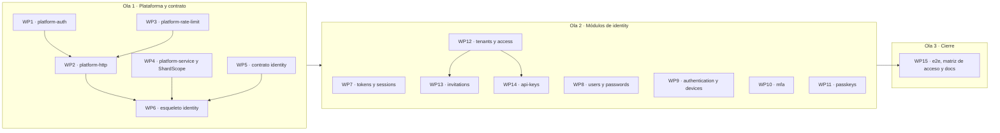

# Diseño de la fase F4: Identidad

- Estado: Propuesta
- Fecha: 2026-11-13
- Rama de trabajo: `feat/f4-identity`
- ADR relacionados: [0005](../adr/0005-autenticacion-sesiones-jwt.md), [0006](../adr/0006-mfa-dispositivo-registrado-passkeys.md), [0010](../adr/0010-sharding-logico-residencia-region.md), [0015](../adr/0015-estructura-backend-front-y-codigo-compartido.md), [0021](../adr/0021-adaptador-valkey.md), [0022](../adr/0022-verificacion-de-tokens-y-estado-de-revocacion-compartido.md) y [0023](../adr/0023-enrutamiento-de-datos-de-identity.md)

Este documento reparte la construcción de `backend/apps/identity` y de las piezas de plataforma que necesita en paquetes de trabajo (WP) que varios agentes pueden construir en paralelo sin tocar los mismos archivos. No contiene código de producción: fija nombres, carpetas, API públicas, tablas, rutas, eventos, códigos de error, pruebas y el orden de trabajo.

Donde el plan y un ADR se contradicen, manda el ADR. Por eso el inicio de sesión se llama `POST /v1/auth/sign-in` (contrato vigente) y no `POST /auth/login` (plan).

## 1. Punto de partida

| Pieza                  | Estado hoy                                                                                                                                                                                                               |
| ---------------------- | ------------------------------------------------------------------------------------------------------------------------------------------------------------------------------------------------------------------------ |
| `@contracts/identity`  | 13 rutas (sign-in, MFA, refresh, sign-out, step-up, `me/access`, sesiones, dispositivos), 2 operaciones internas, 2 eventos, 15 códigos. El front (`front/packages/auth`) ya consume 9 rutas.                            |
| `@contracts/platform`  | `defineRoute`, `Access`, `decodeQuery`, `validateContract`, `toProblemDetails`, catálogo `PLATFORM.*`.                                                                                                                   |
| `@platform/*`          | kernel, primitives, config, observability (`RequestContext`, `setupTelemetry`), persistence (`createPersistence`, `BaseRepository`, migraciones SQL), sharding, cache, bloom, resilience, internal-api, messaging, saga. |
| `@platform/adapters-*` | Valkey (caché, ruteo, Bloom, canal de directorio), Postgres (outbox, `processed_messages`), AWS (SNS y SQS).                                                                                                             |
| `backend/apps`         | No existe. NestJS no está en el workspace.                                                                                                                                                                               |
| Entorno local          | `catalog`, `identity_shard_0` e `identity_shard_1` en Postgres; Valkey con el módulo de Bloom; Mailpit.                                                                                                                  |

Faltan cuatro piezas de plataforma (entrada HTTP, verificación de tokens, límites de tasa y arranque del servicio), un ajuste a la persistencia (`ShardScope`) y el servicio completo.

## 2. Decisiones clave

1. **Rutas guiadas por el contrato.** `@Endpoint(SignInRoute, opciones)` toma método, path, esquema, códigos y acceso del `RouteDefinition`. El controller no repite el path. Así el servidor no puede divergir del contrato que consume el front.
2. **Criptografía con `node:crypto`.** JWT ES256, JWKS, argon2id, HMAC, TOTP, AES-256-GCM y tokens opacos se implementan sobre `node:crypto` de Node 24. Solo se agregan NestJS (decisión del plan) y `@simplewebauthn/server`. Ver la sección 9.
3. **Verificación local en cada servicio.** `@platform/auth` verifica firma, vencimientos, sesión revocada, épocas y versión de permisos sin llamar a identity. El estado de revocación vive en un espacio de llaves de Valkey compartido de solo lectura, `auth:*` (ADR 0022).
4. **Datos de usuario en el shard del usuario, datos de tenant en el shard del tenant.** Los datos de usuario se enrutan por `ShardKey.User` dentro del grupo de su tenant de origen (`homeTenantId`). Los de tenant (miembros, grupos, roles, API keys) se enrutan por `ShardKey.Tenant`. El catálogo guarda solo índices de enrutamiento (ADR 0023).
5. **Tokens opacos con ruta.** Session token, token de reset, token de verificación de email, `mfaToken`, `deviceId` firmado e invitación llevan el id del usuario (o del tenant) y el de su tenant de origen. Con eso identity llega al shard sin consultar el catálogo.
6. **Web o app nativa por el header `Origin`.** Un `Origin` permitido indica navegador: el session token va en la cookie `__Host-session`. Sin `Origin`, el token viaja en el cuerpo. Un `Origin` no permitido responde `PLATFORM.AUTH.ORIGIN_REJECTED`.
7. **Un solo cambio de contrato, al inicio.** El WP de contrato agrega en la primera ola todas las rutas, esquemas, códigos, eventos y operaciones de F4, junto con el Dart generado y los textos ARB. Los WP de módulos no editan el contrato.

## 3. Piezas de plataforma nuevas

### 3.1 Mapa

| Librería                              | Carpeta                                       | Tags                              | Depende de                                                                                                                                                |
| ------------------------------------- | --------------------------------------------- | --------------------------------- | --------------------------------------------------------------------------------------------------------------------------------------------------------- |
| `@platform/auth`                      | `backend/libs/platform/auth`                  | `type:platform`, `scope:platform` | kernel, primitives, bloom, observability, `@contracts/platform`, `@contracts/identity` (excepción de límites, ADR 0022), zod                              |
| `@platform/rate-limit`                | `backend/libs/platform/rate-limit`            | `type:platform`, `scope:platform` | kernel, primitives                                                                                                                                        |
| `@platform/http`                      | `backend/libs/platform/http`                  | `type:platform`, `scope:platform` | auth, rate-limit, observability, internal-api, `@contracts/platform`, `@contracts/identity`, `@nestjs/common`, `@nestjs/core`, `@nestjs/platform-express` |
| `@platform/service`                   | `backend/libs/platform/service`               | `type:platform`, `scope:platform` | http, config, observability, persistence, sharding, cache, bloom, resilience, messaging, internal-api, adapters valkey, postgres y aws                    |
| Cambio en `@platform/persistence`     | `persistence/src/lib/sharding/shard-scope.ts` | sin cambio                        | sharding                                                                                                                                                  |
| Cambio en `@platform/adapters-valkey` | `src/lib/auth/` y `src/lib/rate-limit/`       | sin cambio                        | auth, rate-limit                                                                                                                                          |

Ninguna de estas librerías importa código de `backend/apps`. `@platform/auth` y `@platform/rate-limit` no importan NestJS: los puede usar un worker, una Lambda o el gateway de tiempo real.

### 3.2 `@platform/auth`: verificación de tokens y actor

Lo usan todos los servicios para autenticar peticiones. Identity además usa sus escritores.

**Archivos y API pública**

| Archivo (`src/lib/`)                | Exporta                                                                                                                                                                                                          |
| ----------------------------------- | ---------------------------------------------------------------------------------------------------------------------------------------------------------------------------------------------------------------- |
| `actor.ts`                          | `Actor = UserActor \| ServiceAccountActor \| SystemActor`, discriminado por `kind: ActorType` (el enum ya existe en `@platform/observability`). `isUserActor`, `isServiceAccountActor`.                          |
| `jwt/jwt-codec.ts`                  | `signEs256Jwt(header, claims, privateKey)`, `parseJwt(token)`, `verifyEs256Signature(parsed, publicKey)`. Firma con `crypto.sign('sha256', …, { dsaEncoding: 'ieee-p1363' })`.                                   |
| `jwt/access-token-claims.ts`        | `AccessTokenClaimsSchema` (zod, importado de `@contracts/identity`), `AccessTokenHeader`, `ACCESS_TOKEN_TYPE = 'at+jwt'`, `CLOCK_SKEW_MS = 30_000`.                                                              |
| `jwks/jwk.ts`                       | `toPublicJwk(keyObject, kid)`, `publicKeyFromJwk(jwk)` con `createPublicKey({ format: 'jwk' })`. Solo acepta `kty: 'EC'`, `crv: 'P-256'`.                                                                        |
| `jwks/jwks-key-source.ts`           | Puerto `JwksKeySource { keyFor(kid): Promise<KeyObject \| undefined> }`. `StaticJwksKeySource`. `RemoteJwksKeySource` con `fetch`, caché de 5 min y una recarga como máximo cada 30 s ante un `kid` desconocido. |
| `state/auth-state-keys.ts`          | `AuthStateKey` (constructores de llaves `auth:*`) y `AUTH_REVOCATIONS_CHANNEL = 'auth:revocations'`.                                                                                                             |
| `state/auth-state.ts`               | Puertos `AuthStateReader` y `AuthStateWriter` (sección 3.2.3). `InMemoryAuthState` implementa los dos.                                                                                                           |
| `state/cached-auth-state-reader.ts` | `CachedAuthStateReader`: caché local LRU de 5 s para épocas y versiones, Bloom en memoria para sesiones revocadas, reconstrucción cada 10 s y suscripción al canal.                                              |
| `verifier/access-token-verifier.ts` | `AccessTokenVerifier.verify(token, { audience }) → Promise<UserActor>`. Lanza `AuthenticationError`.                                                                                                             |
| `verifier/authentication-error.ts`  | `AuthenticationError extends PlatformError` con `code` de `PlatformErrorCode` o de `IdentityErrorCode`.                                                                                                          |
| `api-keys/api-key-format.ts`        | `parseApiKey(raw) → { environment, prefix, secret } \| undefined`, `ApiKeyEnvironment` (`Live`, `Test`). Formato `sk_live_<prefijo>_<secreto>`.                                                                  |
| `api-keys/api-key-authenticator.ts` | Puerto `ApiKeyResolver` (lo implementa identity en proceso o el cliente interno en otros servicios). `CachedApiKeyAuthenticator` con caché `auth:apikey:{prefix}`.                                               |
| `access/access-grant.ts`            | `AccessGrant { permissions, platformRoles, features, flags, permissionVersion }`. Puerto `AccessResolver`. `CachedAccessResolver` lee `auth:access:{tid}:{uid}` y cae a la operación `GetUserAccess`.            |
| `access/evaluate-access.ts`         | `evaluateAccess(requirement: AccessRequirement, actor, grant, now) → AccessDecision` (`Allowed`, `Forbidden`, `StepUpRequired`).                                                                                 |

#### 3.2.1 Claims del access token

El header es `{ alg: 'ES256', typ: 'at+jwt', kid }`. El verificador rechaza cualquier otro `alg`, un `crit` presente o un token de más de 8192 caracteres.

| Claim               | Contenido                                                                                   |
| ------------------- | ------------------------------------------------------------------------------------------- |
| `iss`               | Emisor de la región (`IDENTITY_ISSUER`).                                                    |
| `aud`               | `api` o `backoffice`.                                                                       |
| `sub`               | Id del usuario.                                                                             |
| `tid`               | Tenant activo.                                                                              |
| `htid`              | Tenant de origen del usuario. Nuevo, lo pide el enrutamiento (ADR 0023).                    |
| `sid`               | Sesión.                                                                                     |
| `did`               | Dispositivo, si la sesión tiene uno.                                                        |
| `amr`               | Métodos usados (`pwd`, `passkey`, `device`, `email_otp`, `totp`, `recovery_code`).          |
| `auth_time`         | Última autenticación interactiva, incluido el step-up.                                      |
| `roles`             | Roles del usuario en el tenant activo.                                                      |
| `proles`            | Roles de plataforma. Nuevo, separa backoffice de tenant.                                    |
| `pv`                | Versión de permisos: `"<versión del tenant>.<versión del usuario en el tenant>"`.           |
| `rgn`               | Región de residencia.                                                                       |
| `sxp`               | Tope absoluto de la sesión (epoch en segundos). Nuevo, permite responder `SESSION.EXPIRED`. |
| `iat`, `exp`, `jti` | Estándar. `exp - iat` entre 10 y 15 minutos (`ACCESS_TOKEN_TTL`, por defecto 10 min).       |

El esquema `AccessTokenClaimsSchema` vive en `@contracts/identity` (`schemas/access-token.schema.ts`), porque el formato del token es contrato de identity.

#### 3.2.2 Orden de verificación

`AccessTokenVerifier.verify` revisa en este orden y se detiene en el primer fallo:

| Paso | Revisión                                               | Código                                                     |
| ---- | ------------------------------------------------------ | ---------------------------------------------------------- |
| 1    | Formato, `alg`, `typ`, tamaño                          | `PLATFORM.AUTH.UNAUTHENTICATED`                            |
| 2    | `kid` en el JWKS y firma ES256                         | `PLATFORM.AUTH.UNAUTHENTICATED`                            |
| 3    | `iss` y `aud`                                          | `PLATFORM.AUTH.UNAUTHENTICATED`                            |
| 4    | `exp` y `iat` con 30 s de tolerancia                   | `PLATFORM.AUTH.TOKEN_EXPIRED` (nuevo, el cliente refresca) |
| 5    | `sxp` vencido                                          | `IDENTITY.SESSION.EXPIRED`                                 |
| 6    | `sid` revocado (Bloom local, luego Valkey)             | `IDENTITY.SESSION.REVOKED`                                 |
| 7    | Época del usuario: `iat` anterior o usuario suspendido | `IDENTITY.TOKEN.REVOKED` o `IDENTITY.USER.SUSPENDED`       |
| 8    | Época del tenant: `iat` anterior o tenant suspendido   | `IDENTITY.TOKEN.REVOKED` o `IDENTITY.TENANT.SUSPENDED`     |
| 9    | `pv` distinto del actual                               | `IDENTITY.TOKEN.STALE_PERMISSIONS`                         |

Los pasos 6 a 9 coinciden con `SessionGuardErrors` del contrato. Si Valkey falla en los pasos 6 a 9, el verificador usa el último valor de su caché local. Si no tiene ninguno, responde `PLATFORM.RESILIENCE.CIRCUIT_OPEN` (503): nunca acepta un token sin poder revisar la revocación.

#### 3.2.3 Estado compartido en Valkey

Identity escribe y todos los servicios leen. Las llaves no llevan el prefijo del servicio.

| Llave                              | Tipo    | Contenido y vida                                                                               |
| ---------------------------------- | ------- | ---------------------------------------------------------------------------------------------- |
| `auth:revoked:{sid}`               | string  | Motivo. TTL igual a la vida restante del access token más 30 s.                                |
| `auth:revoked-index`               | zset    | `sid` con puntaje igual a su vencimiento. Fuente de la reconstrucción del Bloom local.         |
| `auth:epoch:user:{userId}`         | string  | JSON `{ revokedBefore, suspended }`. Sin TTL.                                                  |
| `auth:epoch:tenant:{tenantId}`     | string  | JSON `{ revokedBefore, suspended }`. Sin TTL.                                                  |
| `auth:pv:tenant:{tenantId}`        | string  | Versión de permisos del tenant (sube con cambios de roles o grupos).                           |
| `auth:pv:user:{tenantId}:{userId}` | string  | Versión del usuario en el tenant (sube con cambios de membresía o de grupos del usuario).      |
| `auth:access:{tenantId}:{userId}`  | string  | JSON `AccessGrant` con su `permissionVersion`. TTL de 15 min.                                  |
| `auth:apikey:{prefix}`             | hash    | Campo `sha256(secreto)` con el principal de la key. TTL de 60 s; la revocación borra la llave. |
| `auth:revocations`                 | pub/sub | Aviso inmediato de cada revocación de sesión.                                                  |

```ts
export abstract class AuthStateReader {
  abstract isSessionRevoked(sessionId: string): Promise<boolean>;
  abstract userEpoch(userId: string): Promise<Epoch | undefined>;
  abstract tenantEpoch(tenantId: string): Promise<Epoch | undefined>;
  abstract permissionVersion(
    tenantId: string,
    userId: string,
  ): Promise<PermissionVersion | undefined>;
}

export abstract class AuthStateWriter {
  abstract revokeSession(
    sessionId: string,
    ttlMs: number,
    reason: RevocationReason,
  ): Promise<void>;
  abstract setUserEpoch(userId: string, epoch: Epoch): Promise<void>;
  abstract setTenantEpoch(tenantId: string, epoch: Epoch): Promise<void>;
  abstract setPermissionVersion(
    tenantId: string,
    userId: string | undefined,
    version: number,
  ): Promise<void>;
  abstract putAccessGrant(
    tenantId: string,
    userId: string,
    grant: AccessGrant,
  ): Promise<void>;
  abstract dropApiKey(prefix: string): Promise<void>;
}
```

Los adaptadores `ValkeyAuthStateReader` y `ValkeyAuthStateWriter` viven en `backend/libs/platform/adapters/valkey/src/lib/auth/`. Las versiones de permisos tienen su fuente de verdad en Postgres (sección 5.10); Valkey es una copia. Si falta la llave `auth:pv:*`, el verificador pide el `AccessGrant` con `GetUserAccess`, que trae la versión.

#### 3.2.4 Autorización

`evaluateAccess` aplica el `AccessRequirement` de la ruta:

- `permissions`: el actor tiene todos en el tenant activo. Si falta uno, `PLATFORM.AUTH.FORBIDDEN`.
- `platformRoles`: el actor tiene alguno. Si no, `PLATFORM.AUTH.FORBIDDEN`.
- `mfaMaxAgeMinutes`: `amr` incluye un segundo factor y `auth_time` está dentro de la ventana. Si no, `IDENTITY.MFA.STEP_UP_REQUIRED`.
- Un `ServiceAccountActor` nunca cumple `platformRoles` ni `mfaMaxAgeMinutes`.

### 3.3 `@platform/rate-limit`

```ts
export interface RateLimitRule {
  readonly name: string;
  readonly limit: number;
  readonly windowMs: number;
}
export interface RateLimitResult {
  readonly allowed: boolean;
  readonly count: number;
  readonly remaining: number;
  readonly retryAfterMs: number;
}
export abstract class RateLimiter {
  abstract consume(
    key: string,
    rule: RateLimitRule,
    cost?: number,
  ): Promise<RateLimitResult>;
  abstract peek(key: string, rule: RateLimitRule): Promise<RateLimitResult>;
  abstract reset(key: string, rule: RateLimitRule): Promise<void>;
}
```

- `InMemoryRateLimiter`: ventana deslizante aproximada con dos ventanas fijas ponderadas.
- `DegradingRateLimiter`: usa el limitador de Valkey y, si falla, uno local con el límite dividido por `localDivisor` (degradación elegante del plan).
- `ValkeyRateLimiter` (en `adapters/valkey/src/lib/rate-limit/`): script Lua con `INCR` y `PEXPIRE` sobre dos ventanas, llamado con `EVALSHA`.

El bloqueo exponencial por intentos fallidos no vive aquí: es una regla de negocio de identity que usa estos contadores (sección 5.3).

### 3.4 `@platform/http`: entrada HTTP sobre NestJS

#### 3.4.1 Decoradores

```ts
@Resource(IdentityResource.Sessions)
export class SessionsController {
  constructor(
    private readonly runner: UseCaseRunner,
    private readonly refresh: RefreshSession,
  ) {}

  @Endpoint(RefreshSessionRoute, {
    rateLimit: RateLimitTier.Auth,
    sessionCookie: SessionCookieMode.Rotate,
  })
  refresh(
    @Input() input: RouteRequest<typeof RefreshSessionRoute>,
    @Exchange() http: HttpExchange,
  ) {
    return this.runner.run(this.refresh, { ...input, client: http.client });
  }
}
```

| Pieza                     | Qué hace                                                                                                                                                                                       |
| ------------------------- | ---------------------------------------------------------------------------------------------------------------------------------------------------------------------------------------------- |
| `@Resource(name, opts?)`  | `@Controller()` sin prefijo. `opts.tenantScoped` exige `tid` en el actor. `name` es un valor de un enum del servicio.                                                                          |
| `@Endpoint(route, opts?)` | Registra método y path del contrato (traduce `{param}` a `:param`), código de éxito, metadatos de acceso y opciones.                                                                           |
| `EndpointOptions`         | `auth?: readonly AuthMethod[]` (por defecto `[AuthMethod.Jwt]` si la ruta es autenticada), `rateLimit?: RateLimitTier`, `timeoutMs?`, `sessionCookie?: SessionCookieMode`, `versions?`.        |
| `@Input()`                | Entrada validada: parámetros de ruta, query (con `decodeQuery`) o cuerpo, según el método.                                                                                                     |
| `@CurrentActor()`         | El `Actor` autenticado. Se llama así para no chocar con el tipo `Actor`.                                                                                                                       |
| `@Exchange()`             | `HttpExchange`: `client` (`ip`, `userAgent`, `origin`, `channel: ClientChannel.Web \| Native`), `sessionCookie()`, `setSessionCookie(token, maxAgeMs)`, `clearSessionCookie()`, `setHeader()`. |

Enums: `AuthMethod` (`Jwt`, `ApiKey`), `RateLimitTier` (`Auth`, `Sensitive`, `Standard`, `Internal`), `SessionCookieMode` (`None`, `Issue`, `Rotate`, `Clear`), `ClientChannel` (`Web`, `Native`).

`@Endpoint` falla al arrancar si la ruta es pública y declara `auth`, si un path se registra dos veces o si el contrato del servicio tiene una ruta sin handler (`HttpRouteRegistry.assertComplete(contract)`).

#### 3.4.2 Pipeline de cada petición

| Orden | Pieza de Nest                                  | Clase                        | Responsabilidad                                                                                                                                                                         |
| ----- | ---------------------------------------------- | ---------------------------- | --------------------------------------------------------------------------------------------------------------------------------------------------------------------------------------- |
| 1     | Middleware                                     | `RequestContextMiddleware`   | `traceId` (del `traceparent` o UUIDv7 nuevo), `externalTraceId`, `RequestContext.run`, header `x-trace-id`.                                                                             |
| 2     | Middleware                                     | `SecurityHeadersMiddleware`  | `Strict-Transport-Security`, `X-Content-Type-Options`, `Referrer-Policy: no-referrer`, `Content-Security-Policy: default-src 'none'`, `Cache-Control: no-store` en rutas de `/v1/auth`. |
| 3     | Middleware                                     | `OriginPolicyMiddleware`     | Lee `Origin`; si viene y no está en `WEB_ORIGINS`, responde `PLATFORM.AUTH.ORIGIN_REJECTED` (403). Fija `ClientChannel`.                                                                |
| 4     | Guard                                          | `EndpointGuard`              | Autenticación (JWT con `AccessTokenVerifier` o API key con `ApiKeyAuthenticator`), tenant, rate limit, `AccessGrant` y `evaluateAccess`, sunset (410 `PLATFORM.API.VERSION_SUNSET`).    |
| 5     | Interceptor                                    | `EndpointContextInterceptor` | Abre un `RequestContext` nuevo con tenant y actor, aplica `timeoutMs`, resuelve `Api-Version`, agrega `Deprecation`, `Sunset` y `Link`, y maneja la cookie de sesión.                   |
| 6     | Pipe                                           | `ContractInputPipe`          | Arma la entrada y la valida con `validateContract(route.request, …)`. Falla con `PLATFORM.VALIDATION.INVALID_INPUT` y `errors` por campo.                                               |
| 7     | Interceptor (fuera de producción y en pruebas) | `ContractOutputInterceptor`  | Valida la respuesta contra `route.response`. Un desvío es un error del servidor.                                                                                                        |
| 8     | Filtro                                         | `ProblemDetailsFilter`       | `PlatformError` a Problem Details con `ErrorCatalogRegistry` y `toProblemDetails`; `Retry-After` desde `details.retryAfterSeconds`; lo desconocido es `PLATFORM.INTERNAL.UNEXPECTED`.   |

`ErrorCatalogRegistry` reúne `platformErrorCatalog` y los catálogos del servicio. Falla al arrancar si un código declarado en una ruta no tiene entrada.

**Versión por petición.** `ApiVersionPolicy` lee `Api-Version` (fecha `AAAA-MM-DD`). Sin header usa la versión fijada a la API key o al tenant y, si no hay, la actual. Una versión desconocida responde `PLATFORM.API.UNSUPPORTED_VERSION` (400). En F4 existe una sola versión (`2026-11-01`) y ningún transformador; la interfaz `VersionTransformer` queda lista.

**Cookie de sesión.** Nombre `__Host-session`, `HttpOnly`, `Secure`, `SameSite=Strict`, `Path=/`, sin `Domain`. `Max-Age` igual a la ventana de inactividad. Se lee del header `Cookie` con un parser propio (RFC 6265, solo `nombre=valor`). Solo se usa con `ClientChannel.Web`.

**Express.** `trust proxy` desde `TRUST_PROXY_HOPS`, cuerpo JSON de 256 KiB como máximo (`PLATFORM.HTTP.PAYLOAD_TOO_LARGE`), solo `application/json` (`PLATFORM.HTTP.UNSUPPORTED_MEDIA_TYPE`), JSON roto (`PLATFORM.HTTP.MALFORMED_BODY`), sin `x-powered-by`. CORS con `app.enableCors` y la lista `WEB_ORIGINS`, con credenciales.

#### 3.4.3 API interna por HTTP

- `InternalApiController`: `POST /internal/operations/:operationId`, delega en `InternalRouter`. No pasa por `EndpointGuard`.
- `InternalCallAuthenticator` (puerto): en local, `HmacInternalCallAuthenticator` con firma HMAC-SHA256 del método, path, hora y hash del cuerpo (header `x-internal-signature`, ventana de 60 s). El adaptador SigV4 de AWS llega en F12.
- `HttpInternalTransport implements Transport`: usa `fetch`, firma con `InternalCallSigner` y propaga `traceparent`, tenant, actor e idempotencia.

### 3.5 `@platform/service`: arranque

```ts
export interface ServiceDefinition<C extends BaseConfig> {
  readonly name: string; // 'identity'
  readonly config: ConfigDefinition<z.ZodType<C>>;
  readonly rootModule: Type<unknown>;
  readonly contract: ServiceContract;
  readonly migrations: {
    readonly catalog: readonly SqlMigration[];
    readonly shard: readonly SqlMigration[];
  };
  readonly sharding?: {
    readonly defaultKey: ShardKey;
    readonly requireScope: boolean;
  };
  readonly errorCatalogs: readonly ErrorCatalog[];
}

export function bootstrapHttp(
  def,
  options?: { env?: ConfigEnv; overrides?: Provider[] },
): Promise<RunningService>;
export function bootstrapWorker(def, options?): Promise<RunningService>;
export function runMigrations(
  def,
  target: MigrationTarget,
): Promise<MigrationReport>; // Catalog, Shards, All
```

| Pieza                             | Qué hace                                                                                                                                                                                                                                    |
| --------------------------------- | ------------------------------------------------------------------------------------------------------------------------------------------------------------------------------------------------------------------------------------------- |
| `instrumentation.ts` del servicio | Primera importación de `main.ts`: carga la config base y llama `setupTelemetry(telemetryOptionsFromConfig(...))` antes de importar NestJS, `pg` o `iovalkey`.                                                                               |
| `PlatformRuntimeModule`           | Módulo global de Nest con `Clock`, `IdGenerator`, `LoggerPort`, `MetricsPort`, `TransactionManager`, `DatabaseResolver`, `CachePort`, `RateLimiter`, `MessageBus` (`OutboxMessageBus`), `InternalRouter`, `ShardRouter`, `AuthStateReader`. |
| `databaseConfigSchema`            | `DB_PROXY_HOST`, `DB_READER_HOSTS`, `DB_PORT`, `DB_DATABASES` (JSON `{ shards, catalog }`), `DB_CREDENTIALS`. Mismos nombres que el stack `service` de Terraform.                                                                           |
| `valkeyConfigSchema`              | `VALKEY_URL` en local, o `VALKEY_HOST`, `VALKEY_PORT`, `VALKEY_USER` y `VALKEY_KEY_PREFIX`.                                                                                                                                                 |
| `UseCaseRunner`                   | `run(useCase, input, { transaction?: boolean })`: span, métricas de latencia y error, transacción opcional con el `TransactionManager`. Lo usan HTTP, consumidores y operaciones internas.                                                  |
| `OutboxRelayWorker`               | Recorre `databases.all()` (todos los shards) con `OutboxRelay` y publica después de cada commit y cada 5 s.                                                                                                                                 |
| `IntervalJob`                     | Job periódico con candado `SET NX PX` en Valkey. Puente hasta `@ScheduledJob` de F5.                                                                                                                                                        |
| `HealthEndpoints`                 | `GET /health/live` y `GET /health/ready` (Postgres de cada shard, catálogo, Valkey) sobre el adaptador HTTP, fuera del contrato.                                                                                                            |
| `runMigrations`                   | Migra primero el catálogo (`catalogMigrations` de la plataforma más las del servicio) y luego cada shard en paralelo con límite 4 (`shardMigrations` más las del servicio), con `applyMigrations`.                                          |
| Cierre ordenado                   | `SIGTERM`: deja de aceptar, espera las peticiones en curso (10 s), detiene el relay, cierra persistencia, Valkey y telemetría.                                                                                                              |

Los puertos que ven los casos de uso son clases abstractas sin decoradores, así sirven de token de inyección sin que el dominio importe NestJS.

### 3.6 `ShardScope` en `@platform/persistence`

Hoy `ShardedDatabaseResolver` toma el tenant del contexto y el usuario del actor. En identity eso no alcanza: el usuario que se consulta casi nunca es el actor (inicio de sesión anónimo, un admin que revoca sesiones de otro) y los datos de usuario se enrutan por su tenant de origen, no por el tenant activo.

```ts
export interface ShardScopeInit {
  readonly tenantId: string;
  readonly keyKind: ShardKey;
  readonly keyValue?: string;
}
export class ShardScope {
  static run<T>(scope: ShardScopeInit, fn: () => Promise<T>): Promise<T>;
  static current(): ShardScopeInit | undefined;
}
```

- `ShardedDatabaseResolver.resolve` usa `ShardScope.current()` si existe y, si no, el contexto como hoy.
- Opción nueva `requireScope` en `PersistenceShardingOptions`: sin scope, `PLATFORM.SHARDING.KEY_MISSING`. Identity la activa.
- Una transacción abierta no cambia de shard: un `ShardScope.run` anidado que apunte a otro shard dentro de una transacción responde `PLATFORM.SHARDING.CROSS_SHARD_TX`.

## 4. Estructura de `backend/apps/identity`

```text
backend/apps/identity/
  package.json            nombre "identity", tags type:app y scope:identity, engines node >=24.7.0
  project.json            targets serve, worker, migrate, seed, test, test:integration, test:e2e
  tsconfig.json  tsconfig.app.json  tsconfig.spec.json  .spec.swcrc (decoratorMetadata)
  jest.config.cjs         proyectos unit, integration y e2e
  eslint.config.mjs       reglas de capas y de módulos
  src/
    instrumentation.ts    setupTelemetry antes que todo
    main.ts               bootstrapHttp(identityService)
    worker.ts             bootstrapWorker(identityService): relay, consumidores y jobs
    migrate.ts            runMigrations(identityService, target)
    identity.service.ts   ServiceDefinition de identity
    app.module.ts         importa los módulos de Nest de cada módulo
    config/identity.config.ts
    database/catalog-migrations.ts  database/shard-migrations.ts
    messaging/identity.consumers.ts
    shared/
      enums/      identity-resource.enum.ts, identity-job.enum.ts, identity-cache-key.enum.ts, bloom-filter-name.enum.ts, security-alert-type.enum.ts, identity-email-template.enum.ts
      constants/  identity-defaults.constants.ts, lockout.constants.ts, system-roles.constants.ts, argon2.constants.ts, migration-ranges.constants.ts
      types/      user-ref.type.ts, client-info.type.ts, pending-authentication.type.ts
      utils/      opaque-token.ts, base64url.ts, constant-time.ts, email-normalization.ts, cidr.ts, shard-scopes.ts
    modules/<módulo>/
      index.ts            fachada pública del módulo (lo único que otros módulos importan)
      domain/             agregados, value objects, puertos (clases abstractas), errores
      application/        casos de uso y <módulo>.facade.ts
      infrastructure/     persistence/{tables,repositories,migrations}, adaptadores (crypto, valkey, catálogo)
      presentation/       <módulo>.module.ts, controllers, operaciones internas, consumidores
      testing/            fakes en memoria de sus puertos y de su fachada
  test/
    support/              global-setup (Testcontainers), app de prueba, cliente HTTP, reloj e ids deterministas
    integration/          *.int-spec.ts
    e2e/                  *.e2e-spec.ts
```

**Reglas de dependencia (lint del servicio).**

- Las reglas de capa del ADR 0015 se verifican con `no-restricted-imports` por patrón de carpeta (`dependency-cruiser` sigue pendiente, ADR 0020).
- Un módulo importa de otro solo `modules/<otro>/index.ts`. La fachada expone tipos de dominio de solo lectura y la clase abstracta `<Módulo>Facade`.
- `shared/utils` no importa nada de `modules/`.

**Módulos de identity.**

| Módulo           | Responsabilidad                                                                         | Shard              |
| ---------------- | --------------------------------------------------------------------------------------- | ------------------ |
| `users`          | Usuario, registro, verificación y cambio de email, perfil, suspensión                   | Usuario y catálogo |
| `passwords`      | Hash argon2id, política, contraseñas filtradas, cambio y recuperación de contraseña     | Usuario            |
| `authentication` | Inicio de sesión con contraseña, bloqueo por intentos, `login_attempts`                 | Usuario            |
| `devices`        | Dispositivos, `deviceId` firmado, clave del dispositivo, aprobaciones                   | Usuario            |
| `mfa`            | Desafíos, códigos, TOTP, códigos de recuperación, step-up, recuperación sin dispositivo | Usuario y Valkey   |
| `passkeys`       | WebAuthn: registro, inicio de sesión sin contraseña y segundo factor                    | Usuario y catálogo |
| `sessions`       | Sesiones, rotación, refresh, cierre, revocación, cambio de tenant                       | Usuario            |
| `tokens`         | Claves de firma, JWKS, emisión del access token                                         | Ninguno            |
| `tenants`        | Tenants, slug, ubicación en shards, suspensión                                          | Tenant y catálogo  |
| `access`         | Membresías, grupos, roles, permisos efectivos, versión de permisos                      | Tenant y usuario   |
| `invitations`    | Invitaciones a un tenant                                                                | Tenant             |
| `api-keys`       | Service accounts y API keys                                                             | Tenant y catálogo  |
| `alerts`         | Alertas de seguridad y correo transaccional de identity (puertos con fakes)             | Ninguno            |

## 5. Módulos

Convenciones de esta sección:

- `UserRef = { userId, homeTenantId }`. Todo caso de uso sobre datos de usuario corre dentro de `inUserShard(ref, fn)` (`shared/utils/shard-scopes.ts`); los de tenant, dentro de `inTenantShard(tenantId, fn)`.
- Todas las tablas de shard llevan `created_at`, `updated_at`, `created_by`, `updated_by` y `version` salvo que se diga otra cosa. Las marcadas "auditada" llevan el trigger de `audit_log`.
- Las tablas de tenant declaran `tenant_id` como columna de tenant de `TableDefinition` y tienen RLS. Las de usuario no declaran columna de tenant.
- Las migraciones de cada módulo usan su rango de timestamps (sección 6.3).
- Los códigos nuevos se listan en la sección 7.

### 5.1 `users`

| Elemento     | Detalle                                                                                                                                                                                                           |
| ------------ | ----------------------------------------------------------------------------------------------------------------------------------------------------------------------------------------------------------------- |
| Agregados    | `User` (`id`, `homeTenantId`, `email: EmailAddress`, `emailVerifiedAt`, `status: UserStatus` con `PendingVerification`, `Active`, `Suspended`, `Deleted`, `displayName`, `locale`, `lastTenantId`), `EmailChange` |
| Puertos      | `UserRepository`, `UserDirectory` (catálogo `identity_lookup`), `EmailFingerprinter` (HMAC-SHA256 con `IDENTITY_EMAIL_PEPPER` del email normalizado), `EmailVerificationStore` (Valkey, 24 h)                     |
| Casos de uso | `RegisterUser`, `ConfirmEmailVerification`, `ResendEmailVerification`, `GetMyProfile`, `UpdateMyProfile`, `RequestEmailChange` (step-up), `ConfirmEmailChange`, `SuspendUser`, `ReactivateUser`, `GetUserProfile` |
| Fachada      | `UsersFacade.findByEmail(email)`, `getByRef(ref)`, `register(input)`, `setLastTenant(ref, tenantId)`                                                                                                              |
| Tablas shard | `users` (auditada; `email_fingerprint bytea` único)                                                                                                                                                               |
| Catálogo     | `identity_lookup (email_fingerprint bytea PK, user_id uuid UNIQUE, home_tenant_id uuid, region text, status text, created_at)`. `status` es `reserved` o `active`.                                                |
| Rutas        | `POST /v1/auth/sign-up`, `POST /v1/auth/email-verifications`, `POST /v1/auth/email-verifications/confirm`, `GET /v1/me`, `PATCH /v1/me`, `POST /v1/me/email-changes`, `POST /v1/me/email-changes/confirm`         |
| Operaciones  | `identity.users.suspend.v1` (compensa `identity.users.reactivate.v1`), `identity.users.reactivate.v1` (compensa `suspend`), `identity.users.get-profile.v1` (no modifica)                                         |
| Eventos      | Publica `identity.user.registered.v1`, `identity.user.suspended.v1`, `identity.user.reactivated.v1`, `identity.user.email-changed.v1`                                                                             |
| Errores      | `IDENTITY.USER.EMAIL_VERIFICATION_INVALID`, `IDENTITY.USER.SUSPENDED`, `IDENTITY.USER.NOT_FOUND`                                                                                                                  |

**Registro sin revelar cuentas.** `sign-up` responde siempre 202. Si el email ya existe, se envía un correo "ya tienes cuenta" en lugar del de verificación.

**Registro entre dos bases.** El catálogo y el shard no comparten transacción:

1. Inserta `identity_lookup` con `status = reserved`. La llave primaria garantiza un email único por plataforma.
2. En el shard del usuario crea `users`, `password_credentials` y el outbox de `identity.user.registered.v1`.
3. Marca `identity_lookup` como `active`.

Si el paso 2 falla, se borra la reserva. El job `IdentityJob.SweepReservedLookups` borra reservas de más de 1 hora sin usuario.

**Tenant de origen.** Un cliente que se registra solo queda en el tenant compartido de clientes de su región (`IDENTITY_DEFAULT_TENANT_ID`). Quien se registra con una invitación queda en el tenant que invita.

**Suspensión.** `SuspendUser` cambia el estado, escribe `auth:epoch:user:{id}` con `suspended: true`, revoca sus sesiones y publica el evento. `ReactivateUser` hace lo inverso. Ambas operaciones son idempotentes y cada una es la compensación de la otra.

### 5.2 `passwords`

| Elemento     | Detalle                                                                                                                                                                          |
| ------------ | -------------------------------------------------------------------------------------------------------------------------------------------------------------------------------- |
| Agregados    | `PasswordCredential` (`userId`, `hash` en formato PHC, `changedAt`), `PasswordReset` (`id`, `userId`, `tokenHash`, `expiresAt`, `usedAt`)                                        |
| Puertos      | `PasswordHasher` (`NodeArgon2idHasher`), `BreachedPasswordList` (Bloom `BloomFilterName.BreachedPasswords` en Valkey), `PasswordCredentialRepository`, `PasswordResetRepository` |
| Dominio      | `PasswordPolicy`: de 12 a 128 caracteres, distinta del email, no filtrada. Sin reglas de composición (NIST SP 800-63B).                                                          |
| Casos de uso | `SetInitialPassword`, `ChangePassword` (step-up de 10 min), `RequestPasswordReset`, `ConfirmPasswordReset`, `RehashIfNeeded`                                                     |
| Fachada      | `PasswordsFacade.verify(ref \| undefined, password)`, `setInitial(ref, password)`                                                                                                |
| Tablas shard | `password_credentials` (auditada, excluye `hash`), `password_resets`                                                                                                             |
| Rutas        | `POST /v1/me/password`, `POST /v1/auth/password-resets`, `POST /v1/auth/password-resets/confirm`                                                                                 |
| Errores      | `IDENTITY.PASSWORD.POLICY_VIOLATION`, `IDENTITY.PASSWORD.BREACHED`, `IDENTITY.PASSWORD.CURRENT_INVALID`, `IDENTITY.PASSWORD.RESET_INVALID`                                       |

- argon2id con `crypto.argon2('argon2id', …)` de Node (desde 24.7.0): memoria 19 456 KiB, 2 pasadas, paralelismo 1, sal de 16 bytes, etiqueta de 32 bytes (parámetros de OWASP). La codificación PHC (`$argon2id$v=19$m=…,t=…,p=…$sal$hash`) es propia. Los parámetros viven en `shared/constants/argon2.constants.ts`.
- `verify(undefined, …)` calcula un hash contra un valor fijo para que el tiempo de respuesta no revele si el email existe.
- Cambiar o recuperar la contraseña revoca las demás sesiones (o todas, en la recuperación) y levanta una alerta.
- `RequestPasswordReset` responde siempre 202. El token (`pr1_…`, 30 min, un solo uso) lleva la ruta al shard.
- En F4 el Bloom de contraseñas filtradas se llena desde un archivo de prueba con unas mil contraseñas comunes. La carga de la lista de Have I Been Pwned es un job posterior.

### 5.3 `authentication`

| Elemento     | Detalle                                                                                                                                                                                                                             |
| ------------ | ----------------------------------------------------------------------------------------------------------------------------------------------------------------------------------------------------------------------------------- |
| Agregados    | `LoginAttempt` (solo inserción: resultado, motivo, IP, dispositivo, `traceId`), `PendingAuthentication` (en `shared/types`: usuario, dispositivo, métodos ofrecidos, propósito `SignIn`, `StepUp` o `Recovery`, sesión)             |
| Dominio      | `LockoutPolicy`: las tres reglas del plan con los valores de `shared/constants/lockout.constants.ts`. `MfaRequirementPolicy`: decide si hace falta segundo factor.                                                                  |
| Puertos      | `LoginAttemptRepository`, `LockoutStore` (Valkey: nivel y fin del bloqueo por origen y modo protegido por cuenta), `AttemptCounters` (sobre `RateLimiter`), `PendingAuthenticationStore` (Valkey, 10 min), `CaptchaVerifier` (fake) |
| Casos de uso | `SignInWithPassword`, `UnlockAccount`                                                                                                                                                                                               |
| Tablas shard | `login_attempts` particionada por mes sobre `id`, retención de 12 meses                                                                                                                                                             |
| Rutas        | `POST /v1/auth/sign-in` (existente)                                                                                                                                                                                                 |
| Errores      | `IDENTITY.AUTH.INVALID_CREDENTIALS` (con `Retry-After` si hay bloqueo), `IDENTITY.AUTH.EMAIL_NOT_VERIFIED`                                                                                                                          |

**Flujo de `SignInWithPassword`.**

1. Revisa los bloqueos de IP y de cuenta más origen. Si hay bloqueo, responde `INVALID_CREDENTIALS` con `Retry-After`.
2. Busca el usuario por email en el catálogo. Si no existe, verifica contra el hash fijo y cuenta el fallo igual.
3. Verifica la contraseña. Un fallo suma a los tres contadores y puede activar bloqueo o modo protegido, con alerta.
4. Usuario suspendido: `IDENTITY.USER.SUSPENDED` (solo después de una contraseña correcta).
5. Reconoce el dispositivo con `DevicesFacade.recognize`.
6. `MfaRequirementPolicy`: pide segundo factor si el dispositivo no está registrado, si el usuario es administrador de su tenant por defecto o tiene roles de plataforma, o si la cuenta está en modo protegido. Desde un dispositivo registrado el método es `DeviceOtp`, que la app resuelve sola.
7. Sin segundo factor: `SessionsFacade.createSession`. Con segundo factor: `MfaFacade.startPending`, que responde `mfa_required` con `mfaToken` y métodos.

Los intentos con un email inexistente no tienen shard: quedan en los contadores de Valkey y en el log, no en `login_attempts`.

### 5.4 `devices`

| Elemento     | Detalle                                                                                                                                                                                                                                             |
| ------------ | --------------------------------------------------------------------------------------------------------------------------------------------------------------------------------------------------------------------------------------------------- |
| Agregados    | `Device` (`id`, `userId`, `name`, `platform: ClientPlatform`, `publicKey` SPKI DER, `firstSeenAt`, `lastSeenAt`, `lastIp`, `trustedUntil`, `verifier`, `pushToken`, `removedAt`)                                                                    |
| Puertos      | `DeviceRepository`, `DeviceIdCodec` (`dv1_…` con HMAC de `IDENTITY_DEVICE_ID_KEY`), `DeviceSignatureVerifier` (ES256 con `node:crypto`), `DeviceApprovalStore` (Valkey), `NonceStore` (Valkey, 5 min), `PushNotifier` (fake)                        |
| Casos de uso | `RecognizeDevice`, `RegisterDevice`, `ListMyDevices`, `RemoveDevice`, `UntrustDevice`, `UpdatePushToken`, `PullDeviceApprovals`, `DenyDeviceApproval`                                                                                               |
| Fachada      | `DevicesFacade.recognize(ref, deviceIdToken?)`, `issueDeviceId(ref)`, `register(ref, input)`, `verifiers(ref)`, `enqueueApproval(deviceId, approval)`                                                                                               |
| Tablas shard | `devices` (auditada)                                                                                                                                                                                                                                |
| Rutas        | `GET /v1/me/devices` (existente), `DELETE /v1/me/devices/{deviceId}`, `POST /v1/me/devices/{deviceId}/untrust`, `PUT /v1/me/devices/current/push-token`, `POST /v1/auth/device-approvals/pull`, `POST /v1/auth/device-approvals/{challengeId}/deny` |
| Eventos      | `identity.device.registered.v1`, `identity.device.removed.v1`                                                                                                                                                                                       |
| Errores      | `IDENTITY.DEVICE.SIGNATURE_INVALID`, `IDENTITY.DEVICE.KEY_INVALID`                                                                                                                                                                                  |

**Clave del dispositivo.** La app envía la clave pública P-256 como SPKI DER en base64url (`devicePublicKey` del contrato). Si el hardware entrega la clave cruda de 65 bytes, el cliente le antepone el encabezado SPKI fijo. El servidor la valida con `createPublicKey({ format: 'der', type: 'spki' })` y rechaza otra curva.

**Código del dispositivo registrado.** Interpretación de "la app firma el challenge y genera el código":

1. El desafío `DeviceOtp` genera un código de 8 dígitos, guarda su HMAC y deja una aprobación pendiente para cada dispositivo verificador del usuario, con el contexto del intento (navegador, sistema, IP, ciudad aproximada si CloudFront la envía).
2. La app verificadora llama `POST /v1/auth/device-approvals/pull` con su `deviceId`, una marca de tiempo, un nonce y la firma ES256 de `identity.device-approvals.pull\n<deviceId>\n<timestamp>\n<nonce>`. La firma prueba que tiene la clave y la respuesta trae las aprobaciones con su código.
3. Si el intento ocurre en el mismo dispositivo, la app envía el código sola a `verify`. Si ocurre en otro, el usuario lo copia. "No fui yo" llama `deny`: cancela el desafío, levanta una alerta y suma un fallo al bloqueo.

En F4 el push que despierta la app es un fake; la app consulta al abrirse. El aviso por SSE llega con `realtime` (F6).

### 5.5 `mfa`

| Elemento     | Detalle                                                                                                                                                                                                                                                                                                                                                                            |
| ------------ | ---------------------------------------------------------------------------------------------------------------------------------------------------------------------------------------------------------------------------------------------------------------------------------------------------------------------------------------------------------------------------------- |
| Agregados    | `MfaChallenge` (Valkey: `id`, `pendingId`, `method`, `codeHmac`, `attempts`, `expiresAt`, `consumedAt`), `TotpFactor` (`userId`, secreto cifrado, `confirmedAt`), `RecoveryCodeSet` (10 HMAC), `MfaRecovery` (`id`, `userId`, `requestedAt`, `availableAt`, `status`)                                                                                                              |
| Puertos      | `ChallengeStore` (Valkey con Lua: intentos atómicos y un solo uso), `CodeGenerator` (`crypto.randomInt`), `SecretHasher` (HMAC-SHA256 con `IDENTITY_TOKEN_PEPPER`), `TotpAlgorithm` (RFC 4226 y 6238 propios, SHA-1, 30 s, 6 dígitos, ventana de ±1), `SecretBox` (AES-256-GCM con `IDENTITY_DATA_KEY`), `TotpFactorRepository`, `RecoveryCodeRepository`, `MfaRecoveryRepository` |
| Casos de uso | `RequestMfaChallenge`, `VerifyMfa`, `StartStepUp`, `RequestStepUpChallenge`, `VerifyStepUp`, `StartTotpEnrollment`, `ConfirmTotpEnrollment`, `RemoveTotp`, `RegenerateRecoveryCodes`, `StartMfaRecovery`, `ConfirmMfaRecovery`                                                                                                                                                     |
| Fachada      | `MfaFacade.startPending(input) → PendingMfa`                                                                                                                                                                                                                                                                                                                                       |
| Tablas shard | `totp_factors` (auditada, excluye el secreto), `recovery_codes`, `mfa_recoveries`                                                                                                                                                                                                                                                                                                  |
| Rutas        | Existentes: `POST /v1/auth/mfa/challenges`, `POST /v1/auth/mfa/verify`, `POST /v1/me/step-up`, `POST /v1/me/step-up/challenges`, `POST /v1/me/step-up/verify`. Nuevas: `POST /v1/me/mfa/totp`, `POST /v1/me/mfa/totp/confirm`, `DELETE /v1/me/mfa/totp`, `POST /v1/me/mfa/recovery-codes`, `POST /v1/auth/mfa/recoveries`, `POST /v1/auth/mfa/recoveries/confirm`                  |
| Errores      | Los `IDENTITY.MFA.*` existentes más `IDENTITY.MFA.RECOVERY_NOT_READY`, `IDENTITY.MFA.FACTOR_ALREADY_ENROLLED`, `IDENTITY.MFA.FACTOR_NOT_ENROLLED`                                                                                                                                                                                                                                  |

- Reglas de `MfaRules` del contrato: 5 intentos por desafío, 3 desafíos cada 15 minutos, 8 dígitos y 180 s en dispositivo, 6 dígitos y 300 s por email, step-up de 10 minutos.
- Con un dispositivo registrado, `EmailOtp` no se ofrece. TOTP y códigos de recuperación se ofrecen solo si están activos.
- `VerifyMfa` con `devicePublicKey` registra el dispositivo, lo marca verificador si es el primero y levanta la alerta de dispositivo nuevo.
- `VerifyStepUp` actualiza `sessions.mfa_verified_at`, `auth_time` y `amr`, y emite un access token nuevo. El session token no cambia.
- Recuperación sin dispositivo: `StartMfaRecovery` recibe el `mfaToken`, envía un enlace por email y alerta a todos los canales. `availableAt = requestedAt + 24 h · 2^(recuperaciones en 90 días)` (`MFA_RECOVERY_BASE_HOURS`). Antes de eso, `IDENTITY.MFA.RECOVERY_NOT_READY` con `Retry-After`. Al confirmar, se retiran los verificadores y el dispositivo actual queda registrado.

### 5.6 `passkeys`

| Elemento     | Detalle                                                                                                                                                                                                                                                                                                                                                   |
| ------------ | --------------------------------------------------------------------------------------------------------------------------------------------------------------------------------------------------------------------------------------------------------------------------------------------------------------------------------------------------------- |
| Agregados    | `Passkey` (`id`, `userId`, `credentialId`, `publicKey` COSE, `signCount`, `transports`, `aaguid`, `backedUp`, `name`, `lastUsedAt`)                                                                                                                                                                                                                       |
| Puertos      | `PasskeyRepository`, `PasskeyDirectory` (catálogo `passkey_lookup`), `WebAuthnVerifier` (adaptador `SimpleWebAuthnVerifier`), `WebAuthnChallengeStore` (Valkey, 5 min)                                                                                                                                                                                    |
| Casos de uso | `StartPasskeyRegistration` (step-up), `FinishPasskeyRegistration`, `StartPasskeySignIn`, `FinishPasskeySignIn`, `StartPasskeyMfa`, `FinishPasskeyMfa`, `StartPasskeyStepUp`, `FinishPasskeyStepUp`, `ListPasskeys`, `RemovePasskey` (step-up)                                                                                                             |
| Tablas shard | `passkeys` (auditada)                                                                                                                                                                                                                                                                                                                                     |
| Catálogo     | `passkey_lookup (credential_id_hash bytea PK, user_id uuid, home_tenant_id uuid, region text)`: el inicio de sesión sin usuario llega al shard por la credencial.                                                                                                                                                                                         |
| Rutas        | `POST /v1/auth/passkeys/options`, `POST /v1/auth/passkeys/verify`, `POST /v1/auth/mfa/passkey/options`, `POST /v1/auth/mfa/passkey/verify`, `POST /v1/me/step-up/passkey/options`, `POST /v1/me/step-up/passkey/verify`, `GET /v1/me/passkeys`, `POST /v1/me/passkeys/registration-options`, `POST /v1/me/passkeys`, `DELETE /v1/me/passkeys/{passkeyId}` |
| Errores      | `IDENTITY.PASSKEY.VERIFICATION_FAILED`, `IDENTITY.PASSKEY.CHALLENGE_EXPIRED`                                                                                                                                                                                                                                                                              |

- El contrato transporta las opciones y la respuesta de WebAuthn como texto JSON en base64url (`optionsJson`, `credentialJson`). El generador de Dart no admite objetos con propiedades libres (`clientExtensionResults`), y así el contrato no copia la especificación de WebAuthn. El servidor valida ese JSON con zod antes de pasarlo a la librería.
- Una passkey con verificación de usuario usada desde un dispositivo registrado cumple los dos factores (`amr: ['passkey', 'device']`).
- `rpID`, nombre y orígenes salen de `WEBAUTHN_RP_ID`, `WEBAUTHN_RP_NAME` y `WEBAUTHN_ORIGINS`. Atestación `none`.

### 5.7 `sessions`

| Elemento     | Detalle                                                                                                                                                                                                                                                                                   |
| ------------ | ----------------------------------------------------------------------------------------------------------------------------------------------------------------------------------------------------------------------------------------------------------------------------------------- |
| Agregados    | `Session` (`id`, `userId`, `homeTenantId`, `activeTenantId`, `deviceId`, `tokenHash`, `generation`, `previousGenerationUntil`, `amr`, `authTime`, `mfaVerifiedAt`, `idleExpiresAt`, `absoluteExpiresAt`, `lastRefreshAt`, `ip`, `userAgent`, `platform`, `revokedAt`, `revocationReason`) |
| Puertos      | `SessionRepository`, `SessionTokenCodec` (`st1_<ruta>_<secreto>`), `AuthStateWriter`, `AccessTokenIssuer` (fachada de `tokens`)                                                                                                                                                           |
| Casos de uso | `CreateSession`, `RefreshSession`, `SignOut`, `ListMySessions`, `RevokeMySession`, `RevokeOtherSessions`, `RevokeUserSessions`, `RevokeDeviceSessions`, `SwitchTenant`, `MarkMfaVerified`                                                                                                 |
| Fachada      | `SessionsFacade.createSession(input) → IssuedSession`, `revokeUserSessions(ref, reason, { except? })`, `revokeDeviceSessions(ref, deviceId, reason)`, `markMfaVerified(sessionRef, at, amr) → SessionTokens`                                                                              |
| Tablas shard | `sessions` (auditada, excluye `token_hash`; índice parcial por `user_id` sin revocar)                                                                                                                                                                                                     |
| Rutas        | Existentes: `POST /v1/auth/refresh`, `POST /v1/auth/sign-out`, `GET /v1/me/sessions`, `DELETE /v1/me/sessions/{sessionId}`, `POST /v1/me/sessions/revoke-others`. Nueva: `POST /v1/me/tenant-switch`                                                                                      |
| Operaciones  | `identity.sessions.revoke-for-user.v1` (existente)                                                                                                                                                                                                                                        |
| Eventos      | `identity.session.revoked.v1`, `identity.tokens.revoked.v1` (existentes)                                                                                                                                                                                                                  |
| Errores      | `IDENTITY.SESSION.*` existentes, `IDENTITY.TENANT.NOT_MEMBER`                                                                                                                                                                                                                             |

- **Rotación.** La ruta del session token lleva `userId`, `homeTenantId`, `sessionId` y `generation`. La base guarda el HMAC del secreto de la generación actual. Un refresh correcto sube la generación, emite un token nuevo y extiende `idleExpiresAt` un día sin pasar de `absoluteExpiresAt` (30 días).
- **Reuso.** Un token de una generación anterior revoca la sesión (`IDENTITY.SESSION.REUSED`), salvo dentro de una gracia de 5 s para la generación inmediata anterior. Esa gracia cubre dos pestañas que refrescan a la vez con la misma cookie: la segunda recibe un access token nuevo sin rotar la cookie.
- **Revocar.** Marca la fila, escribe `auth:revoked:{sid}`, publica en `auth:revocations` y, por el outbox, `SessionRevoked` y `TokensRevoked`. Revocar todas las sesiones de un usuario además mueve la época del usuario.
- **Cookie.** Con `ClientChannel.Web`, `sign-in`, `mfa/verify`, `passkeys/verify` y `refresh` responden sin `sessionToken` y con `Set-Cookie`. `sign-out` borra la cookie. Las rutas reciben `SessionCookieMode` en `@Endpoint`.
- **Cambio de tenant.** `SwitchTenant` verifica la membresía con `AccessFacade`, actualiza `active_tenant_id` y `users.last_tenant_id`, y emite un access token nuevo con el `tid` y el `pv` del tenant nuevo.

### 5.8 `tokens`

| Elemento     | Detalle                                                                                                                                  |
| ------------ | ---------------------------------------------------------------------------------------------------------------------------------------- |
| Dominio      | `SigningKey` (`kid`, estado `Active`, `Verifying` o `Retired`), `SigningKeyRing` (firma con la `Active`, publica `Active` y `Verifying`) |
| Puertos      | `SigningKeyProvider` (`ConfigSigningKeyProvider` lee `IDENTITY_SIGNING_KEYS`, un secreto con JWK privados), `AccessTokenIssuer`          |
| Casos de uso | `IssueAccessToken`, `GetJwks`                                                                                                            |
| Fachada      | `TokensFacade.issue(input: AccessTokenInput) → { accessToken, accessExpiresAt }`                                                         |
| Tablas       | Ninguna                                                                                                                                  |
| Rutas        | `GET /v1/auth/jwks` (pública, `Cache-Control: public, max-age=300`)                                                                      |

- La emisión calcula `pv` con `AccessFacade`, escribe `auth:access:{tid}:{uid}` y firma con `signEs256Jwt` de `@platform/auth`.
- Rotar es cambiar `IDENTITY_SIGNING_KEYS`: la clave nueva entra como `Verifying`, pasa a `Active` en el siguiente despliegue y la anterior queda `Verifying` durante 30 minutos. La rotación de emergencia retira el `kid` comprometido. El runbook queda en `docs/runbooks/rotacion-claves-identity.md` (WP15).
- El JWKS es una ruta del contrato bajo `/v1`, porque `defineRoute` exige la versión. Los demás servicios lo leen con `RemoteJwksKeySource` desde `IDENTITY_JWKS_URL`.

### 5.9 `tenants`

| Elemento     | Detalle                                                                                                                                                                                                                                                       |
| ------------ | ------------------------------------------------------------------------------------------------------------------------------------------------------------------------------------------------------------------------------------------------------------- |
| Agregados    | `Tenant` (`id`, `slug`, `name`, `region`, `kind: TenantKind` con `Organization`, `SharedCustomers`, `Platform`, `status: TenantLifecycle` con `Provisioning`, `Active`, `Suspended`, `Deleting`, `pinnedApiVersion`, `lockoutOverrides`, `permissionVersion`) |
| Puertos      | `TenantRepository`, `TenantDirectory` (catálogo `tenant_lookup`), `TenantPlacement` (envuelve `placeTenant` con `LeastLoadedPlacementPolicy` y `PostgresDirectoryStore`), `EntitlementsProvider` (fake con features por tipo de tenant)                       |
| Casos de uso | `CreateTenant`, `GetCurrentTenant`, `UpdateTenant`, `SuspendTenant`, `ReactivateTenant`, `DiscardTenant`, `ListMyTenants`                                                                                                                                     |
| Fachada      | `TenantsFacade.get(tenantId)`, `assertActive(tenantId)`                                                                                                                                                                                                       |
| Tablas shard | `tenants` (auditada)                                                                                                                                                                                                                                          |
| Catálogo     | `tenant_lookup (slug text PK, tenant_id uuid UNIQUE, region text)`. El directorio de shards ya existe (`shard_directory`).                                                                                                                                    |
| Rutas        | `POST /v1/tenants`, `GET /v1/tenant`, `PATCH /v1/tenant`, `GET /v1/me/tenants`                                                                                                                                                                                |
| Operaciones  | `identity.tenants.create.v1` (compensa `identity.tenants.discard.v1`), `identity.tenants.discard.v1` (sin compensación: borra un tenant en `Provisioning`), `identity.tenants.suspend.v1` y `identity.tenants.reactivate.v1` (compensación mutua)             |
| Eventos      | `identity.tenant.created.v1`, `identity.tenant.suspended.v1`, `identity.tenant.reactivated.v1`                                                                                                                                                                |
| Errores      | `IDENTITY.TENANT.NOT_FOUND` (interno), `IDENTITY.TENANT.SLUG_TAKEN`, `IDENTITY.TENANT.SUSPENDED`, `IDENTITY.TENANT.NOT_MEMBER`                                                                                                                                |

- `CreateTenant` reserva el slug, ubica el tenant en shards de su región, crea la fila, los roles y grupos de sistema, y la membresía `Owner` del creador. En F4 corre como caso de uso directo. La saga `TenantOnboarding` de F7 usará las operaciones `create` y `discard`.
- Los tenants `Platform` y `SharedCustomers` de cada región se crean con `nx run identity:seed`, con ids fijos de la config.
- Suspender escribe `auth:epoch:tenant:{id}` con `suspended: true`. La suspensión por facturación llamará la operación desde `billing` en F8.

### 5.10 `access`

| Elemento       | Detalle                                                                                                                                                                                                                                                                                                                                                                                                                                  |
| -------------- | ---------------------------------------------------------------------------------------------------------------------------------------------------------------------------------------------------------------------------------------------------------------------------------------------------------------------------------------------------------------------------------------------------------------------------------------- |
| Agregados      | `Membership` (`tenantId`, `userId`, `status`, `permissionVersion`), `Group` (`id`, `tenantId`, `name`, `system`), `Role` (`id`, `tenantId`, `name`, `systemRole: TenantRole \| null`, `permissions: Permission[]`)                                                                                                                                                                                                                       |
| Dominio        | `EffectiveAccessCalculator` (unión de permisos de los roles de los grupos del usuario), `SystemRoles` (permisos fijos de `Owner`, `Admin`, `Member` y `Billing` en `shared/constants/system-roles.constants.ts`), `PermissionVersion`                                                                                                                                                                                                    |
| Puertos        | `MembershipRepository`, `GroupRepository`, `RoleRepository`, `UserTenantsProjection` (shard del usuario), `PlatformRoleRepository` (shard del usuario), `AuthStateWriter`                                                                                                                                                                                                                                                                |
| Casos de uso   | `GetSessionAccess`, `GetUserAccess`, `ListMembers`, `RemoveMember`, `SetMemberGroups`, `ListGroups`, `CreateGroup`, `UpdateGroup`, `DeleteGroup`, `SetGroupRoles`, `ListRoles`, `CreateRole`, `UpdateRole`, `DeleteRole`, `ProjectMembership`, `AddMember`                                                                                                                                                                               |
| Fachada        | `AccessFacade.resolve(userId, tenantId) → UserAccess`, `isMember(userId, tenantId)`, `defaultTenant(ref)`, `requiresMfaOnEveryLogin(ref, tenantId)`, `addMember(tenantId, ref, groupIds)`                                                                                                                                                                                                                                                |
| Tablas tenant  | `tenant_members`, `groups`, `group_members`, `roles`, `role_permissions`, `group_roles` (todas auditadas, con RLS por `tenant_id`)                                                                                                                                                                                                                                                                                                       |
| Tablas usuario | `user_tenants` (proyección: `user_id`, `tenant_id`, `status`, `joined_at`), `platform_role_assignments` (`user_id`, `role: PlatformRole`)                                                                                                                                                                                                                                                                                                |
| Rutas          | `GET /v1/me/access` (existente), `GET /v1/tenant/members`, `DELETE /v1/tenant/members/{userId}`, `PUT /v1/tenant/members/{userId}/groups`, `GET /v1/tenant/groups`, `POST /v1/tenant/groups`, `PATCH /v1/tenant/groups/{groupId}`, `DELETE /v1/tenant/groups/{groupId}`, `PUT /v1/tenant/groups/{groupId}/roles`, `GET /v1/tenant/roles`, `POST /v1/tenant/roles`, `PATCH /v1/tenant/roles/{roleId}`, `DELETE /v1/tenant/roles/{roleId}` |
| Operaciones    | `identity.users.get-access.v1` (existente; su salida suma `permissionVersion` y `roles`)                                                                                                                                                                                                                                                                                                                                                 |
| Eventos        | Publica `identity.membership.changed.v1` e `identity.permissions.changed.v1`. Consume `identity.membership.changed.v1` en la cola `identity-access-projection`.                                                                                                                                                                                                                                                                          |
| Errores        | `IDENTITY.ACCESS.LAST_OWNER`, `IDENTITY.ACCESS.SYSTEM_ROLE_IMMUTABLE`, `IDENTITY.ACCESS.NAME_TAKEN`                                                                                                                                                                                                                                                                                                                                      |

- **Fuente de verdad.** La membresía vive en el shard del tenant. `user_tenants` en el shard del usuario es una proyección que actualiza el consumidor de `MembershipChanged` (lo publica el outbox en la misma transacción). Así ninguna transacción toca dos shards.
- **Versión de permisos.** `tenants.permission_version` sube con cambios en roles, grupos o sus permisos. `tenant_members.permission_version` sube con cambios en los grupos de ese usuario. Ambas se copian a `auth:pv:*` después del commit y viajan en el claim `pv`.
- **Permisos nuevos.** `Permission` suma `IdentityMembersRead`, `IdentityMembersManage`, `IdentityGroupsManage`, `IdentityRolesManage`, `IdentityInvitationsManage`, `IdentityServiceAccountsManage`, `IdentityApiKeysManage` e `IdentityTenantManage`. Un rol no puede otorgar un permiso que quien lo edita no tiene.
- Los roles de plataforma se asignan solo con el seed o desde backoffice (fuera de F4).

### 5.11 `invitations`

| Elemento      | Detalle                                                                                                                                                                         |
| ------------- | ------------------------------------------------------------------------------------------------------------------------------------------------------------------------------- |
| Agregados     | `Invitation` (`id`, `tenantId`, `email`, `emailFingerprint`, `groupIds`, `invitedBy`, `tokenHash`, `expiresAt` a 7 días, `status`: `Pending`, `Accepted`, `Revoked`, `Expired`) |
| Puertos       | `InvitationRepository`, `InvitationTokenCodec` (`iv1_<tenant>_<secreto>`)                                                                                                       |
| Casos de uso  | `InviteUser`, `ListInvitations`, `RevokeInvitation`, `AcceptInvitation`                                                                                                         |
| Tablas tenant | `invitations` (auditada)                                                                                                                                                        |
| Rutas         | `POST /v1/tenant/invitations`, `GET /v1/tenant/invitations`, `DELETE /v1/tenant/invitations/{invitationId}`, `POST /v1/invitations/accept`. `sign-up` acepta `invitationToken`. |
| Errores       | `IDENTITY.INVITATION.INVALID`, `IDENTITY.INVITATION.EMAIL_MISMATCH`                                                                                                             |

Aceptar exige un email verificado igual al invitado. Agrega la membresía con `AccessFacade.addMember` y marca la invitación en la misma transacción del shard del tenant.

### 5.12 `api-keys`

| Elemento      | Detalle                                                                                                                                                                                                                                                                                                                                                                                                      |
| ------------- | ------------------------------------------------------------------------------------------------------------------------------------------------------------------------------------------------------------------------------------------------------------------------------------------------------------------------------------------------------------------------------------------------------------ |
| Agregados     | `ServiceAccount` (`id`, `tenantId`, `name`, `permissions`, `status`, `rateLimitTier`, `pinnedApiVersion`), `ApiKey` (`id`, `serviceAccountId`, `tenantId`, `prefix`, `secretHmac`, `environment`, `expiresAt`, `allowedCidrs`, `lastUsedAt`, `status`: `Active`, `Rotated` con `validUntil`, `Revoked`)                                                                                                      |
| Puertos       | `ServiceAccountRepository`, `ApiKeyRepository`, `ApiKeyDirectory` (catálogo `api_key_lookup`), `ApiKeySecretHasher` (HMAC con `IDENTITY_API_KEY_PEPPER`), `ApiKeyUsageBuffer` (Valkey, volcado por job)                                                                                                                                                                                                      |
| Casos de uso  | `CreateServiceAccount`, `ListServiceAccounts`, `UpdateServiceAccount`, `DisableServiceAccount`, `CreateApiKey` (step-up), `ListApiKeys`, `RotateApiKey` (step-up), `RevokeApiKey`, `AuthenticateApiKey`                                                                                                                                                                                                      |
| Tablas tenant | `service_accounts`, `api_keys` (auditadas, `api_keys` excluye `secret_hmac`)                                                                                                                                                                                                                                                                                                                                 |
| Catálogo      | `api_key_lookup (prefix text PK, tenant_id uuid, region text)`                                                                                                                                                                                                                                                                                                                                               |
| Rutas         | `GET /v1/tenant/service-accounts`, `POST /v1/tenant/service-accounts`, `PATCH /v1/tenant/service-accounts/{serviceAccountId}`, `DELETE /v1/tenant/service-accounts/{serviceAccountId}`, `GET /v1/tenant/service-accounts/{serviceAccountId}/api-keys`, `POST /v1/tenant/service-accounts/{serviceAccountId}/api-keys`, `POST /v1/tenant/api-keys/{apiKeyId}/rotate`, `DELETE /v1/tenant/api-keys/{apiKeyId}` |
| Operaciones   | `identity.api-keys.authenticate.v1` (no modifica; la usa `CachedApiKeyAuthenticator` de otros servicios)                                                                                                                                                                                                                                                                                                     |
| Eventos       | `identity.api-key.created.v1`, `identity.api-key.revoked.v1`                                                                                                                                                                                                                                                                                                                                                 |
| Errores       | `IDENTITY.API_KEY.INVALID`, `IDENTITY.API_KEY.EXPIRED`, `IDENTITY.API_KEY.IP_NOT_ALLOWED`, `IDENTITY.API_KEY.PERMISSION_NOT_GRANTABLE`, `IDENTITY.SERVICE_ACCOUNT.DISABLED`                                                                                                                                                                                                                                  |

- El secreto (32 bytes en base64url) se muestra una sola vez. El prefijo tiene 12 caracteres en base32.
- Rotar crea una key nueva y deja la anterior válida `API_KEY_ROTATION_GRACE_HOURS` (24 h por defecto).
- Revocar borra `auth:apikey:{prefix}` y publica el evento. Los fallos de verificación cuentan por prefijo e IP con las mismas reglas de bloqueo.

### 5.13 `alerts`

| Elemento       | Detalle                                                                                                                                                                                                                                                                                                                                 |
| -------------- | --------------------------------------------------------------------------------------------------------------------------------------------------------------------------------------------------------------------------------------------------------------------------------------------------------------------------------------- |
| Puertos        | `SecurityAlerts.raise(alert)`, `IdentityMailer.send(template: IdentityEmailTemplate, to, variables)`                                                                                                                                                                                                                                    |
| Adaptadores F4 | `OutboxSecurityAlerts` publica `identity.security-alert.raised.v1` (sin códigos ni secretos). `InMemoryIdentityMailer` (pruebas, expone el último mensaje). `DevConsoleIdentityMailer` (solo con `NODE_ENV=development`; la config lo rechaza en producción).                                                                           |
| Enums          | `SecurityAlertType` (`NewDeviceSignIn`, `VerifierRegistered`, `PasswordChanged`, `PasswordRecovered`, `MfaRecoveryStarted`, `MfaRecoveryCompleted`, `EmailChanged`, `MfaFactorRemoved`, `RecoveryCodeUsed`, `ApiKeyCreated`, `ApiKeyRevoked`, `AccountLocked`, `ProtectedModeEnabled`, `DeviceApprovalDenied`), `IdentityEmailTemplate` |

Los códigos de un solo uso nunca viajan por el bus. En F6 el adaptador real de `IdentityMailer` llamará a `notifications`.

### 5.14 Configuración (`config/identity.config.ts`)

Extiende `baseConfigSchema`, `databaseConfigSchema` y `valkeyConfigSchema`. Los secretos usan `secret()`.

| Variable                                                                                                                   | Uso                                           |
| -------------------------------------------------------------------------------------------------------------------------- | --------------------------------------------- |
| `IDENTITY_REGION`, `IDENTITY_ISSUER`, `IDENTITY_AUDIENCES`                                                                 | Claims `rgn`, `iss` y `aud`                   |
| `IDENTITY_SIGNING_KEYS`                                                                                                    | JWK privados con `kid` y estado (secreto)     |
| `IDENTITY_EMAIL_PEPPER`, `IDENTITY_TOKEN_PEPPER`, `IDENTITY_API_KEY_PEPPER`, `IDENTITY_DEVICE_ID_KEY`, `IDENTITY_DATA_KEY` | Llaves HMAC y de cifrado (secretos, 32 bytes) |
| `ACCESS_TOKEN_TTL`, `SESSION_IDLE_TTL`, `SESSION_ABSOLUTE_TTL`                                                             | 10 min (entre 10 y 15), 1 día, 30 días        |
| `WEB_ORIGINS`, `TRUST_PROXY_HOPS`                                                                                          | Política de origen, CORS e IP del cliente     |
| `IDENTITY_DEFAULT_TENANT_ID`, `IDENTITY_PLATFORM_TENANT_ID`                                                                | Tenants sembrados de la región                |
| `WEBAUTHN_RP_ID`, `WEBAUTHN_RP_NAME`, `WEBAUTHN_ORIGINS`                                                                   | Passkeys                                      |
| `MFA_RECOVERY_BASE_HOURS`, `API_KEY_ROTATION_GRACE_HOURS`                                                                  | 24 y 24                                       |
| `INTERNAL_API_SHARED_SECRET`                                                                                               | Firma de la API interna en local (secreto)    |
| `IDENTITY_MAILER`                                                                                                          | `memory` o `console`                          |

`backend/.env.example` documenta cada variable sin valores reales.

## 6. Paquetes de trabajo

### 6.1 Olas y dependencias



- WP1, WP3, WP4 y WP5 arrancan el mismo día. WP2 arranca con las interfaces de WP1 y WP3 de este documento y usa sus fakes hasta que lleguen las implementaciones. WP6 arranca cuando WP2 y WP4 publican sus interfaces y termina cuando la ola 1 está integrada.
- En la ola 2, cada WP programa contra las fachadas de los demás (sección 6.4) con los fakes de `modules/<m>/testing/`. WP13 y WP14 integran con `access` real al final de la ola.
- Cada WP se integra a `feat/f4-identity` con su propio PR. Una ola empieza cuando la anterior está integrada y en verde.

### 6.2 Ficha de cada WP

| WP   | Carpetas exclusivas                                                                                                                                                                                                                                                                                                           | Entrega                                                                                                                                          | Depende de                     |
| ---- | ----------------------------------------------------------------------------------------------------------------------------------------------------------------------------------------------------------------------------------------------------------------------------------------------------------------------------- | ------------------------------------------------------------------------------------------------------------------------------------------------ | ------------------------------ |
| WP1  | `backend/libs/platform/auth/**`, `backend/libs/platform/adapters/valkey/src/lib/auth/**`, `backend/infra/terraform/stacks/data/main.tf` (ACL de `auth:*`)                                                                                                                                                                     | Sección 3.2, ACL de Valkey del ADR 0022 con su `terraform test`                                                                                  | WP5 (esquema de claims, día 1) |
| WP2  | `backend/libs/platform/http/**`                                                                                                                                                                                                                                                                                               | Sección 3.4, incluida la API interna por HTTP                                                                                                    | WP1, WP3 (interfaces)          |
| WP3  | `backend/libs/platform/rate-limit/**`, `backend/libs/platform/adapters/valkey/src/lib/rate-limit/**`                                                                                                                                                                                                                          | Sección 3.3                                                                                                                                      | Ninguna                        |
| WP4  | `backend/libs/platform/service/**`, `backend/libs/platform/persistence/src/lib/sharding/**`                                                                                                                                                                                                                                   | Secciones 3.5 y 3.6                                                                                                                              | Ninguna                        |
| WP5  | `backend/libs/contracts/identity/**`, `backend/libs/contracts/platform/src/{enums,errors}/**`, `front/packages/contracts/lib/src/{platform,identity}/**`, ARB de `front/packages/i18n`, manejo de `TOKEN_EXPIRED` en `front/packages/auth`                                                                                    | Sección 7 completa, `contracts-export:check` y `contracts_gen --check` en verde                                                                  | Ninguna                        |
| WP6  | `backend/apps/identity/*` (raíz del proyecto), `src/{main,worker,migrate,instrumentation,identity.service,app.module}.ts`, `src/config/**`, `src/database/**`, `src/messaging/**`, `src/shared/**`, `test/support/**`, stubs de cada `modules/<m>/{index.ts,presentation/<m>.module.ts,application/<m>.facade.ts,testing/**}` | App que arranca con todos los módulos vacíos, migra catálogo y dos shards, health en verde, harness de pruebas, dependencias externas instaladas | WP2, WP4, WP5                  |
| WP7  | `modules/tokens/**`, `modules/sessions/**`                                                                                                                                                                                                                                                                                    | Secciones 5.7 y 5.8                                                                                                                              | Ola 1                          |
| WP8  | `modules/users/**`, `modules/passwords/**`                                                                                                                                                                                                                                                                                    | Secciones 5.1 y 5.2                                                                                                                              | Ola 1                          |
| WP9  | `modules/authentication/**`, `modules/devices/**`                                                                                                                                                                                                                                                                             | Secciones 5.3 y 5.4                                                                                                                              | Ola 1                          |
| WP10 | `modules/mfa/**`, `modules/alerts/**`                                                                                                                                                                                                                                                                                         | Secciones 5.5 y 5.13                                                                                                                             | Ola 1                          |
| WP11 | `modules/passkeys/**`                                                                                                                                                                                                                                                                                                         | Sección 5.6                                                                                                                                      | Ola 1                          |
| WP12 | `modules/tenants/**`, `modules/access/**`                                                                                                                                                                                                                                                                                     | Secciones 5.9 y 5.10, y el `seed`                                                                                                                | Ola 1                          |
| WP13 | `modules/invitations/**`                                                                                                                                                                                                                                                                                                      | Sección 5.11                                                                                                                                     | Ola 1, WP12 al integrar        |
| WP14 | `modules/api-keys/**`                                                                                                                                                                                                                                                                                                         | Sección 5.12                                                                                                                                     | Ola 1, WP12 al integrar        |
| WP15 | `backend/apps/identity/test/e2e/**`, `docs/**`, `tests/load/identity/**`                                                                                                                                                                                                                                                      | Sección 8.3, matriz de acceso, runbook de claves, ARCHITECTURE y estado de los ADR                                                               | Ola 2                          |

Las rutas de `modules/` son relativas a `backend/apps/identity/src/`.

### 6.3 Archivos compartidos y su dueño

| Archivo                                                                         | Dueño                                                  | Regla para los demás                                                                                                                                                                                                                                                                               |
| ------------------------------------------------------------------------------- | ------------------------------------------------------ | -------------------------------------------------------------------------------------------------------------------------------------------------------------------------------------------------------------------------------------------------------------------------------------------------- |
| `backend/apps/identity/src/app.module.ts`                                       | WP6                                                    | Ya importa el `<Módulo>Module` de cada módulo. Nadie lo edita en la ola 2.                                                                                                                                                                                                                         |
| `src/modules/<m>/index.ts`, `application/<m>.facade.ts`                         | WP6 los crea, pasan al WP del módulo                   | Cambiar una firma de fachada exige avisar a los WP que la usan y actualizar el fake en el mismo PR.                                                                                                                                                                                                |
| `src/database/shard-migrations.ts`, `catalog-migrations.ts`                     | WP6                                                    | Concatenan en orden fijo los arreglos `<módulo>ShardMigrations` y `<módulo>CatalogMigrations` que exporta cada módulo desde `infrastructure/persistence/migrations/index.ts`.                                                                                                                      |
| Timestamps de migración                                                         | WP6 (`shared/constants/migration-ranges.constants.ts`) | Cada módulo usa su bloque: users `1795000100000`, passwords `…0200000`, authentication `…0300000`, devices `…0400000`, mfa `…0500000`, passkeys `…0600000`, sessions `…0700000`, tenants `…0800000`, access `…0900000`, invitations `…1000000`, api-keys `…1100000`. Dentro del bloque, de 1 en 1. |
| `src/shared/**`                                                                 | WP6                                                    | Los enums y constantes de la sección 4 se declaran completos en la ola 1. Un valor nuevo en la ola 2 se pide al integrador.                                                                                                                                                                        |
| `src/config/identity.config.ts`, `backend/.env.example`                         | WP6                                                    | Todas las variables de la sección 5.14 existen desde la ola 1.                                                                                                                                                                                                                                     |
| `src/messaging/identity.consumers.ts`                                           | WP6                                                    | Registra los consumidores que exporta cada `presentation/<m>.module.ts`.                                                                                                                                                                                                                           |
| `backend/libs/contracts/identity/**` y Dart generado                            | WP5 en la ola 1, luego WP15                            | En la ola 2 un cambio de contrato es un PR pequeño aparte, revisado por el integrador, con export y Dart regenerados.                                                                                                                                                                              |
| `backend/libs/platform/adapters/valkey/src/index.ts`                            | WP1                                                    | WP3 agrega una línea `export * from './lib/rate-limit/index.js'`; el conflicto es de una línea.                                                                                                                                                                                                    |
| `backend/eslint.config.mjs`                                                     | WP1                                                    | Agrega la excepción `platform-auth` y `platform-http` hacia `contracts-identity` (ADR 0022).                                                                                                                                                                                                       |
| `package.json` de cada proyecto y `pnpm-lock.yaml`                              | WP2 (Nest en `@platform/http`), WP6 (identity)         | Todas las dependencias externas entran en la ola 1. En la ola 2 no se agregan dependencias.                                                                                                                                                                                                        |
| `backend/infra/terraform/topology.json`, `backend/libs/contracts/asyncapi.json` | WP5                                                    | Se regeneran con `contracts-export`.                                                                                                                                                                                                                                                               |

### 6.4 Fachadas entre módulos

WP6 crea estas clases abstractas con sus tipos y un fake en memoria por módulo. Los WP de la ola 2 las implementan.

```ts
export abstract class UsersFacade {
  abstract findByEmail(email: string): Promise<UserSnapshot | undefined>;
  abstract getByRef(ref: UserRef): Promise<UserSnapshot>;
  abstract register(input: RegisterUserInput): Promise<UserRef>;
  abstract setLastTenant(ref: UserRef, tenantId: string): Promise<void>;
}
export abstract class PasswordsFacade {
  abstract verify(ref: UserRef | undefined, password: string): Promise<boolean>;
  abstract setInitial(ref: UserRef, password: string): Promise<void>;
}
export abstract class DevicesFacade {
  abstract recognize(
    ref: UserRef,
    deviceIdToken?: string,
  ): Promise<DeviceRecognition>;
  abstract issueDeviceId(ref: UserRef): Promise<string>;
  abstract register(
    ref: UserRef,
    input: RegisterDeviceInput,
  ): Promise<DeviceSnapshot>;
  abstract verifiers(ref: UserRef): Promise<readonly DeviceSnapshot[]>;
  abstract enqueueApproval(
    deviceId: string,
    approval: DeviceApproval,
  ): Promise<void>;
}
export abstract class MfaFacade {
  abstract startPending(input: StartPendingInput): Promise<PendingMfa>;
}
export abstract class SessionsFacade {
  abstract createSession(input: CreateSessionInput): Promise<IssuedSession>;
  abstract revokeUserSessions(
    ref: UserRef,
    reason: RevocationReason,
    options?: { except?: string },
  ): Promise<number>;
  abstract revokeDeviceSessions(
    ref: UserRef,
    deviceId: string,
    reason: RevocationReason,
  ): Promise<number>;
  abstract markMfaVerified(
    session: SessionRef,
    at: Date,
    amr: readonly AuthMethodReference[],
  ): Promise<SessionTokens>;
}
export abstract class TokensFacade {
  abstract issue(
    input: AccessTokenInput,
  ): Promise<{ accessToken: string; accessExpiresAt: Date }>;
}
export abstract class TenantsFacade {
  abstract get(tenantId: string): Promise<TenantSnapshot>;
  abstract assertActive(tenantId: string): Promise<void>;
}
export abstract class AccessFacade {
  abstract resolve(userId: string, tenantId: string): Promise<UserAccess>;
  abstract isMember(userId: string, tenantId: string): Promise<boolean>;
  abstract defaultTenant(ref: UserRef): Promise<string>;
  abstract requiresMfaOnEveryLogin(
    ref: UserRef,
    tenantId: string,
  ): Promise<boolean>;
  abstract addMember(
    tenantId: string,
    ref: UserRef,
    groupIds: readonly string[],
  ): Promise<void>;
}
```

`SecurityAlerts` e `IdentityMailer` son puertos de `alerts` que cualquier módulo inyecta.

## 7. Cambios de contrato (WP5)

Todos entran en la ola 1, con `export/contract.json`, el Dart de `front/packages/contracts`, `topology.json`, `asyncapi.json` y los textos es y en de cada código público.

### 7.1 `@contracts/platform`

| Cambio                                | Detalle                                                                                                                                                                                                                                                         |
| ------------------------------------- | --------------------------------------------------------------------------------------------------------------------------------------------------------------------------------------------------------------------------------------------------------------- |
| Códigos nuevos en `PlatformErrorCode` | `PLATFORM.AUTH.TOKEN_EXPIRED` (401, reintentable), `PLATFORM.AUTH.ORIGIN_REJECTED` (403), `PLATFORM.API.UNSUPPORTED_VERSION` (400), `PLATFORM.HTTP.PAYLOAD_TOO_LARGE` (413), `PLATFORM.HTTP.UNSUPPORTED_MEDIA_TYPE` (415), `PLATFORM.HTTP.MALFORMED_BODY` (400) |
| Front                                 | `front/packages/auth`: ante `TOKEN_EXPIRED` refresca y reintenta una vez, igual que ante `STALE_PERMISSIONS`.                                                                                                                                                   |

### 7.2 `@contracts/identity`

**Enums.** `Permission` suma los ocho permisos de la sección 5.10. Nuevos: `TenantRole` (`owner`, `admin`, `member`, `billing`), `TenantKind`, `TenantLifecycle` (se llama así para no chocar con `TenantStatus` de `@platform/sharding`), `UserStatus`, `AuthMethodReference`, `ApiKeyEnvironment`, `ApiKeyStatus` e `InvitationStatus`. `IdentityRoute`, `IdentityOperation`, `IdentityEvent`, `IdentityQueue` e `IdentityErrorCode` suman los valores de esta sección.

**Rutas nuevas** (id entre paréntesis, todas bajo `/v1`):

| Grupo                       | Rutas                                                                                                                                                                                                                                                                                                                                                                                                                                                                                                                                                                                                                                                                                                  |
| --------------------------- | ------------------------------------------------------------------------------------------------------------------------------------------------------------------------------------------------------------------------------------------------------------------------------------------------------------------------------------------------------------------------------------------------------------------------------------------------------------------------------------------------------------------------------------------------------------------------------------------------------------------------------------------------------------------------------------------------------ |
| Registro y email            | `POST /auth/sign-up` (`identity.auth.sign-up`), `POST /auth/email-verifications` (`identity.auth.email-verification-resend`), `POST /auth/email-verifications/confirm` (`identity.auth.email-verification-confirm`)                                                                                                                                                                                                                                                                                                                                                                                                                                                                                    |
| Contraseña                  | `POST /me/password` (`identity.me.password-change`, step-up), `POST /auth/password-resets` (`identity.auth.password-reset-request`), `POST /auth/password-resets/confirm` (`identity.auth.password-reset-confirm`)                                                                                                                                                                                                                                                                                                                                                                                                                                                                                     |
| Perfil                      | `GET /me` (`identity.me.profile`), `PATCH /me` (`identity.me.profile-update`), `POST /me/email-changes` (`identity.me.email-change`, step-up), `POST /me/email-changes/confirm` (`identity.me.email-change-confirm`)                                                                                                                                                                                                                                                                                                                                                                                                                                                                                   |
| Claves                      | `GET /auth/jwks` (`identity.auth.jwks`)                                                                                                                                                                                                                                                                                                                                                                                                                                                                                                                                                                                                                                                                |
| Dispositivos                | `DELETE /me/devices/{deviceId}` (`identity.devices.remove`), `POST /me/devices/{deviceId}/untrust` (`identity.devices.untrust`), `PUT /me/devices/current/push-token` (`identity.devices.push-token`), `POST /auth/device-approvals/pull` (`identity.device-approvals.pull`), `POST /auth/device-approvals/{challengeId}/deny` (`identity.device-approvals.deny`)                                                                                                                                                                                                                                                                                                                                      |
| MFA                         | `POST /me/mfa/totp` (`identity.mfa.totp-start`, step-up), `POST /me/mfa/totp/confirm` (`identity.mfa.totp-confirm`), `DELETE /me/mfa/totp` (`identity.mfa.totp-remove`, step-up), `POST /me/mfa/recovery-codes` (`identity.mfa.recovery-codes`, step-up), `POST /auth/mfa/recoveries` (`identity.auth.mfa-recovery-start`), `POST /auth/mfa/recoveries/confirm` (`identity.auth.mfa-recovery-confirm`)                                                                                                                                                                                                                                                                                                 |
| Passkeys                    | `POST /auth/passkeys/options` (`identity.auth.passkey-options`), `POST /auth/passkeys/verify` (`identity.auth.passkey-verify`), `POST /auth/mfa/passkey/options` (`identity.auth.mfa-passkey-options`), `POST /auth/mfa/passkey/verify` (`identity.auth.mfa-passkey-verify`), `POST /me/step-up/passkey/options` (`identity.step-up.passkey-options`), `POST /me/step-up/passkey/verify` (`identity.step-up.passkey-verify`), `GET /me/passkeys` (`identity.passkeys.list`), `POST /me/passkeys/registration-options` (`identity.passkeys.registration-options`, step-up), `POST /me/passkeys` (`identity.passkeys.register`), `DELETE /me/passkeys/{passkeyId}` (`identity.passkeys.remove`, step-up) |
| Sesión                      | `POST /me/tenant-switch` (`identity.sessions.switch-tenant`)                                                                                                                                                                                                                                                                                                                                                                                                                                                                                                                                                                                                                                           |
| Tenants                     | `POST /tenants` (`identity.tenants.create`), `GET /tenant` (`identity.tenant.get`), `PATCH /tenant` (`identity.tenant.update`, `IdentityTenantManage`), `GET /me/tenants` (`identity.me.tenants`)                                                                                                                                                                                                                                                                                                                                                                                                                                                                                                      |
| Miembros, grupos y roles    | `GET /tenant/members`, `DELETE /tenant/members/{userId}`, `PUT /tenant/members/{userId}/groups`, `GET /tenant/groups`, `POST /tenant/groups`, `PATCH /tenant/groups/{groupId}`, `DELETE /tenant/groups/{groupId}`, `PUT /tenant/groups/{groupId}/roles`, `GET /tenant/roles`, `POST /tenant/roles`, `PATCH /tenant/roles/{roleId}`, `DELETE /tenant/roles/{roleId}` (ids `identity.members.*`, `identity.groups.*`, `identity.roles.*`)                                                                                                                                                                                                                                                                |
| Invitaciones                | `POST /tenant/invitations`, `GET /tenant/invitations`, `DELETE /tenant/invitations/{invitationId}`, `POST /invitations/accept` (ids `identity.invitations.*`)                                                                                                                                                                                                                                                                                                                                                                                                                                                                                                                                          |
| Service accounts y API keys | `GET /tenant/service-accounts`, `POST /tenant/service-accounts`, `PATCH /tenant/service-accounts/{serviceAccountId}`, `DELETE /tenant/service-accounts/{serviceAccountId}`, `GET /tenant/service-accounts/{serviceAccountId}/api-keys`, `POST /tenant/service-accounts/{serviceAccountId}/api-keys` (step-up), `POST /tenant/api-keys/{apiKeyId}/rotate` (step-up), `DELETE /tenant/api-keys/{apiKeyId}` (ids `identity.service-accounts.*`, `identity.api-keys.*`)                                                                                                                                                                                                                                    |

**Esquemas que cambian.** `SignUpRequest` (con `invitationToken` opcional), `UserAccess` y `SessionAccess` suman `roles` y `permissionVersion`, y `AccessTokenClaims` es nuevo (lo importa `@platform/auth`). Los esquemas de WebAuthn son `{ optionsJson: string }` y `{ credentialJson: string }` en base64url.

**Operaciones nuevas.** `identity.users.suspend.v1` y `identity.users.reactivate.v1`, `identity.users.get-profile.v1`, `identity.tenants.create.v1` y `identity.tenants.discard.v1`, `identity.tenants.suspend.v1` y `identity.tenants.reactivate.v1`, `identity.api-keys.authenticate.v1`. Cada operación que modifica declara su compensación según la sección 5.

**Eventos nuevos.** `identity.user.registered.v1`, `identity.user.suspended.v1`, `identity.user.reactivated.v1`, `identity.user.email-changed.v1`, `identity.device.registered.v1`, `identity.device.removed.v1`, `identity.tenant.created.v1`, `identity.tenant.suspended.v1`, `identity.tenant.reactivated.v1`, `identity.membership.changed.v1`, `identity.permissions.changed.v1`, `identity.api-key.created.v1`, `identity.api-key.revoked.v1`, `identity.security-alert.raised.v1`. Todos en el tópico `identity-events`. Cola nueva `identity-access-projection` suscrita a `identity.membership.changed.v1`.

**Códigos nuevos en `IdentityErrorCode`.**

| Código                                      | HTTP | Audiencia |
| ------------------------------------------- | ---- | --------- |
| `IDENTITY.AUTH.EMAIL_NOT_VERIFIED`          | 403  | public    |
| `IDENTITY.USER.EMAIL_VERIFICATION_INVALID`  | 400  | public    |
| `IDENTITY.PASSWORD.POLICY_VIOLATION`        | 400  | public    |
| `IDENTITY.PASSWORD.BREACHED`                | 400  | public    |
| `IDENTITY.PASSWORD.CURRENT_INVALID`         | 400  | public    |
| `IDENTITY.PASSWORD.RESET_INVALID`           | 400  | public    |
| `IDENTITY.DEVICE.SIGNATURE_INVALID`         | 401  | public    |
| `IDENTITY.DEVICE.KEY_INVALID`               | 400  | public    |
| `IDENTITY.MFA.RECOVERY_NOT_READY`           | 403  | public    |
| `IDENTITY.MFA.FACTOR_ALREADY_ENROLLED`      | 409  | public    |
| `IDENTITY.MFA.FACTOR_NOT_ENROLLED`          | 400  | public    |
| `IDENTITY.PASSKEY.VERIFICATION_FAILED`      | 400  | public    |
| `IDENTITY.PASSKEY.CHALLENGE_EXPIRED`        | 400  | public    |
| `IDENTITY.TENANT.NOT_FOUND`                 | 404  | internal  |
| `IDENTITY.TENANT.SLUG_TAKEN`                | 409  | public    |
| `IDENTITY.TENANT.NOT_MEMBER`                | 403  | public    |
| `IDENTITY.ACCESS.LAST_OWNER`                | 409  | public    |
| `IDENTITY.ACCESS.SYSTEM_ROLE_IMMUTABLE`     | 409  | public    |
| `IDENTITY.ACCESS.NAME_TAKEN`                | 409  | public    |
| `IDENTITY.INVITATION.INVALID`               | 400  | public    |
| `IDENTITY.INVITATION.EMAIL_MISMATCH`        | 403  | public    |
| `IDENTITY.API_KEY.INVALID`                  | 401  | public    |
| `IDENTITY.API_KEY.EXPIRED`                  | 401  | public    |
| `IDENTITY.API_KEY.IP_NOT_ALLOWED`           | 403  | public    |
| `IDENTITY.API_KEY.PERMISSION_NOT_GRANTABLE` | 403  | public    |
| `IDENTITY.SERVICE_ACCOUNT.DISABLED`         | 403  | public    |

## 8. Pruebas y criterio de terminado

### 8.1 Pruebas por WP

| WP   | Unitarias                                                                                                                                                                                                  | Integración (Testcontainers)                                                                                             |
| ---- | ---------------------------------------------------------------------------------------------------------------------------------------------------------------------------------------------------------- | ------------------------------------------------------------------------------------------------------------------------ |
| WP1  | Codec JWT con vectores de RFC 7515 y tokens alterados (`alg: none`, `alg: HS256` con la clave pública, firma DER, `kid` desconocido), orden de los nueve pasos, `evaluateAccess`, Bloom con reconstrucción | `ValkeyAuthStateReader` y `Writer`: TTL, zset, pub/sub, caída del servidor con caché local                               |
| WP2  | Decoradores, registro de rutas desde el contrato, pipe con `decodeQuery`, filtro con códigos internos y públicos, cookie, `Origin`, versión y sunset                                                       | App Nest mínima con un contrato de prueba contra `fetch` (sin supertest): pipeline completo, API interna firmada         |
| WP3  | Ventana deslizante con reloj determinista, degradación a local                                                                                                                                             | `ValkeyRateLimiter` con concurrencia                                                                                     |
| WP4  | `ShardScope` anidado, `requireScope`, cruce de shard en transacción, `UseCaseRunner`                                                                                                                       | `runMigrations` sobre catálogo y dos shards, reintento después de una falla parcial, relay sobre dos shards              |
| WP5  | `contract.spec.ts`: ids únicos, compensaciones existentes, códigos con catálogo, esquemas JSON-safe                                                                                                        | `contracts-export:check`, `dart run contracts_gen --check`, prueba ARB del front                                         |
| WP6  | Config: rechaza el mailer de consola en producción                                                                                                                                                         | La app arranca, migra, responde health y cada ruta del contrato tiene handler (stubs con `PLATFORM.INTERNAL.UNEXPECTED`) |
| WP7  | Rotación, gracia y reuso, ventanas de expiración, claims, anillo de claves                                                                                                                                 | Refresh concurrente, revocación con Valkey real, outbox de eventos                                                       |
| WP8  | Política, PHC, normalización de email, `verify` sin usuario con tiempo constante (sin medir tiempo; se verifica que llama al hasher)                                                                       | Registro entre catálogo y shard con falla en el paso 2, barrido de reservas                                              |
| WP9  | `LockoutPolicy` (15, 30, 60 min hasta 24 h; modo protegido; IP), `MfaRequirementPolicy`, firma del dispositivo                                                                                             | Contadores en Valkey, `login_attempts` particionada                                                                      |
| WP10 | TOTP con vectores de RFC 6238, un solo uso, cinco intentos, tres desafíos, espera exponencial de recuperación                                                                                              | `ChallengeStore` con Lua y concurrencia                                                                                  |
| WP11 | Validación del JSON de WebAuthn, contador de firmas                                                                                                                                                        | Registro y aserción con un autenticador simulado (claves de `node:crypto`), `passkey_lookup`                             |
| WP12 | Permisos efectivos, roles de sistema inmutables, último owner, versión de permisos                                                                                                                         | RLS por tenant, proyección `user_tenants` por el consumidor, `placeTenant` con dos shards                                |
| WP13 | Estados de la invitación, email distinto                                                                                                                                                                   | Aceptar con usuario existente y con registro nuevo                                                                       |
| WP14 | Formato y parseo de la key, CIDR, gracia de rotación                                                                                                                                                       | `AuthenticateApiKey` con caché, revocación que borra la caché                                                            |

Las unitarias usan los fakes de cada puerto, `InMemoryAuthState`, reloj e `IdGenerator` deterministas. Las de integración usan `pgvector/pgvector:0.8.7-pg17` con `catalog`, `identity_shard_0` e `identity_shard_1`, y `valkey/valkey-bundle:8.1.11`. Se saltan sin Docker, como hoy en `adapters/valkey`.

### 8.2 Distribución en dos shards

`test/support` crea dos tenants de origen ubicados en grupos distintos y un tenant compartido con un grupo de dos shards. Cada prueba de integración de la ola 2 verifica que sus filas caen en el shard que calcula el router, y al menos una prueba por módulo usa un usuario en cada shard.

### 8.3 E2E (WP15)

En `backend/apps/identity/test/e2e/`, con la app completa, Postgres y Valkey reales, bus en memoria y `InMemoryIdentityMailer`:

1. `sign-up` y confirmación del email.
2. `sign-in` desde un dispositivo nuevo: `mfa_required` con `email_otp`.
3. `mfa/challenges` y `mfa/verify` con `devicePublicKey` generada con `node:crypto`: sesión creada y dispositivo verificador registrado.
4. `GET /v1/me/access` con el access token.
5. `refresh`: rota el token. Presentar el token anterior fuera de la gracia responde `IDENTITY.SESSION.REUSED`, y el access token vigente pasa a `IDENTITY.SESSION.REVOKED`.
6. `sign-in` desde el dispositivo registrado: `device_otp`, `device-approvals/pull` firmado y `verify` con el código.
7. Step-up: `POST /v1/me/password` responde `STEP_UP_REQUIRED`; tras `step-up/verify` funciona y las demás sesiones quedan revocadas.
8. `sign-out`: el refresh responde `IDENTITY.SESSION.REVOKED`.
9. Variante web: con `Origin` permitido, el token viaja en `__Host-session` y nunca en el cuerpo; con `Origin` no permitido, `PLATFORM.AUTH.ORIGIN_REJECTED`.
10. Bloqueo: cinco fallos dan `INVALID_CREDENTIALS` con `Retry-After`, también con un email inexistente.

Además: un e2e por WP de la ola 2 sobre sus rutas, y un e2e de autorización que recorre la matriz de acceso y prueba cada ruta autenticada sin token, con token sin permiso y con step-up vencido.

### 8.4 Criterio de terminado

Un WP está terminado cuando:

- `pnpm nx affected -t lint test typecheck build` pasa, con cobertura de 80 % en líneas, sentencias y funciones y 75 % en ramas por proyecto.
- `pnpm nx run contracts-export:check`, `dart run contracts_gen --check` y `pnpm nx format:check` pasan.
- Sus pruebas de integración pasan con Docker y sus rutas tienen al menos un e2e.
- No agrega dependencias fuera de la tabla de la sección 9 ni escribe secretos en código, pruebas o docs.
- Ningún código nuevo escribe un evento, permiso, código o cola como literal.
- Actualiza `backend/.env.example` si usa una variable (vía WP6) y deja la fachada y su fake al día.

F4 está terminada cuando la ola 3 pasa el e2e completo dos veces seguidas, la matriz de acceso generada no tiene rutas públicas sin aprobar y ARCHITECTURE y los ADR 0022 y 0023 reflejan lo construido.

## 9. Dependencias externas

Antes de proponer cada librería se revisó si `node:crypto` de Node 24 lo cubre:

| Necesidad                          | Cubre `node:crypto`                                                                                                                | Decisión                            |
| ---------------------------------- | ---------------------------------------------------------------------------------------------------------------------------------- | ----------------------------------- |
| JWT ES256 y JWKS                   | Sí: `sign` y `verify` con `dsaEncoding: 'ieee-p1363'`, `KeyObject.export({ format: 'jwk' })`, `createPublicKey({ format: 'jwk' })` | Propio en `@platform/auth`          |
| argon2id                           | Sí desde Node 24.7.0: `crypto.argon2('argon2id', …)`                                                                               | Propio (exige Node 24.7 o superior) |
| HMAC de códigos, emails y API keys | Sí: `createHmac`, `timingSafeEqual`                                                                                                | Propio                              |
| Tokens opacos y códigos            | Sí: `randomBytes`, `randomInt`                                                                                                     | Propio                              |
| TOTP y HOTP                        | Sí: HMAC-SHA1                                                                                                                      | Propio (RFC 4226 y 6238)            |
| Cifrado del secreto TOTP           | Sí: AES-256-GCM                                                                                                                    | Propio                              |
| Firma de la clave del dispositivo  | Sí: ES256 con clave SPKI                                                                                                           | Propio                              |
| Límite de tasa y bloqueo           | No aplica: Valkey y lógica propia                                                                                                  | Propio                              |
| Cookies, cabeceras de seguridad    | No aplica: parser y middleware pequeños                                                                                            | Propio                              |
| Contexto de petición               | `AsyncLocalStorage` (ya en `RequestContext`)                                                                                       | Propio, sin `nestjs-cls`            |
| Health checks                      | No aplica                                                                                                                          | Propio, sin `@nestjs/terminus`      |
| Pruebas HTTP                       | `fetch` nativo contra `app.listen(0)`                                                                                              | Propio, sin `supertest`             |
| WebAuthn                           | Parcial: verifica firmas, pero no decodifica CBOR, COSE ni los formatos de atestación                                              | Librería                            |
| Framework HTTP                     | No aplica                                                                                                                          | NestJS (decisión del plan)          |

| Paquete                    | Versión exacta | Publicada  | Dónde                                           | Por qué no se implementa en casa                                                                                                                                                             | Alternativa propia descartada                                                                                                        |
| -------------------------- | -------------- | ---------- | ----------------------------------------------- | -------------------------------------------------------------------------------------------------------------------------------------------------------------------------------------------- | ------------------------------------------------------------------------------------------------------------------------------------ |
| `@nestjs/common`           | `12.3.2`       | 2026-10-27 | `@platform/http`, `@platform/service`, identity | El plan elige NestJS para inyección de dependencias, módulos y el modelo de guards, interceptores y filtros. Reescribirlo no aporta al producto.                                             | Router propio sobre `node:http`: más código de plataforma que mantener y se aparta del plan.                                         |
| `@nestjs/core`             | `12.3.2`       | 2026-10-27 | ídem                                            | Núcleo de NestJS.                                                                                                                                                                            | La misma.                                                                                                                            |
| `@nestjs/platform-express` | `12.3.2`       | 2026-10-27 | `@platform/http`                                | Adaptador HTTP de NestJS; trae Express 5 y `cors`.                                                                                                                                           | Adaptador propio de NestJS sobre `node:http`: superficie grande de casos borde de HTTP.                                              |
| `reflect-metadata`         | `0.2.2`        | 2024-03-29 | ídem                                            | Dependencia par de NestJS para los metadatos de los decoradores.                                                                                                                             | Ninguna: NestJS la exige.                                                                                                            |
| `rxjs`                     | `7.8.2`        | 2025-02-22 | ídem                                            | Dependencia par de NestJS (interceptores).                                                                                                                                                   | Ninguna: NestJS la exige.                                                                                                            |
| `@simplewebauthn/server`   | `14.0.3`       | 2026-09-25 | `modules/passkeys/infrastructure`               | Verificar WebAuthn exige CBOR, claves COSE (EC2, RSA, OKP), datos del autenticador, contadores y formatos de atestación con cadenas X.509. Un error ahí abre la puerta a suplantar passkeys. | Solo atestación `none` y ES256 con un decodificador CBOR propio: sigue siendo criptografía delicada y deja fuera autenticadores RSA. |

Todas las versiones se publicaron al menos dos semanas antes de esta fecha y se fijan exactas, sin `^` ni `~`. Las ya presentes (`testcontainers` y `@testcontainers/postgresql` 12.2.1, `uuid`, `zod`, `iovalkey`, `typeorm`, `pg`) no cambian.

Respaldo, sin instalar: si al construir WP8 la API `crypto.argon2` de la versión de Node desplegada no está marcada estable, se usa `argon2@0.45.1` (2026-07-21) detrás del mismo puerto `PasswordHasher`. Es una decisión de una línea en el adaptador.

## 10. Fuera de F4

| Pieza                                                   | Cómo se simula en F4                                                                                        | Fase      |
| ------------------------------------------------------- | ----------------------------------------------------------------------------------------------------------- | --------- |
| `backoffice-api`, audiencia `backoffice`, suplantación  | Los roles de plataforma se asignan con el seed. La audiencia ya existe en el verificador.                   | Posterior |
| `agreements` y el requisito `agreements` de `@Endpoint` | `EndpointOptions` no lo declara todavía.                                                                    | Posterior |
| Notificaciones reales (email, push, bandeja)            | `IdentityMailer` en memoria o consola; `PushNotifier` fake; alertas como eventos del outbox sin consumidor. | F6        |
| Cierre de conexiones Socket.IO y SSE                    | Se publican `SessionRevoked` y `TokensRevoked`; nadie los consume aún.                                      | F6        |
| Saga `TenantOnboarding`                                 | `CreateTenant` directo; las operaciones `create` y `discard` quedan listas.                                 | F7        |
| Planes y entitlements                                   | `EntitlementsProvider` con features fijas por `TenantKind`.                                                 | F8        |
| Feature flags                                           | Lista fija en la config; `flags` de `UserAccess` sale de ahí.                                               | F5        |
| `@ScheduledJob` y `JobScheduler`                        | `IntervalJob` con candado en Valkey dentro de `worker.ts`.                                                  | F5        |
| Entrada Lambda (`lambda.ts`) y SigV4 interno            | `main.ts` y `worker.ts` en contenedor; HMAC en la API interna local.                                        | F12       |
| OpenAPI, Scalar y portal                                | El contrato exportado es la fuente; la generación de OpenAPI desde `contract.json` va con la documentación. | F11       |
| Lista completa de Have I Been Pwned                     | Bloom con una lista de prueba.                                                                              | Posterior |
| CAPTCHA y regla WAF por IP                              | `CaptchaVerifier` que siempre aprueba; el bloqueo por IP vive en Valkey.                                    | F12       |
| Varias regiones, `MoveTenant`, URL regional en el login | Una región; `PLATFORM.SHARDING.WRONG_REGION` si llega otra.                                                 | F10       |
| DPoP                                                    | Nada.                                                                                                       | Posterior |

## 11. Decisiones que requieren al usuario

El usuario aprobó el 14 de noviembre de 2026 las decisiones 2, 4 y 5. Las demás siguen en revisión; mientras tanto, los WP siguen lo que propone este documento y los ADR quedan en `Propuesta`.

1. **Claims nuevos.** `htid`, `proles`, `sxp`, `typ: at+jwt` y `pv` como par de versiones (ADR 0022 y 0023).
2. **Aprobada. Espacio `auth:*` en Valkey.** Cambia la regla del ADR 0021 y del stack `data`: hoy cada servicio solo ve su prefijo; con esto todos leen `auth:*` y solo identity escribe (ADR 0022).
3. **`@Endpoint(route)` en lugar de `@Endpoint.post('/', {...})`.** El plan muestra rutas escritas en el controller; este diseño las toma del contrato.
4. **Aprobada. OpenAPI sin `@nestjs/swagger`.** El plan pide el plugin de Swagger y Scalar. Para minimizar dependencias, se propone generar OpenAPI desde `contract.json` en F11.
5. **Aprobada. Node 24.22.2.** `crypto.argon2` exige al menos esa versión. Se propone fijar `.nvmrc` en una versión exacta de la línea 24 (por ejemplo `24.22.2`) en WP6.
6. **Canal web o nativo por `Origin`.** Alternativa: un header propio del cliente, que obligaría a cambiar el front.
7. **Código del dispositivo registrado.** Se interpreta como un código que la app verificadora obtiene con una petición firmada y envía sola, no como un código derivado de la firma.
8. **Longitud mínima de contraseña.** El plan no la fija; se propone 12.
9. **WebAuthn como JSON en texto dentro del contrato.** Evita modelar WebAuthn en zod y en el generador de Dart, a cambio de validar ese JSON en el servidor.
10. **Intentos con emails inexistentes solo en Valkey y logs.** `login_attempts` guarda solo intentos de cuentas existentes, porque sin usuario no hay shard.
