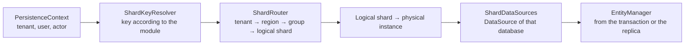

# Design: persistence on TypeORM with sharding and persistent sagas

- Status: Accepted
- Date: 2026-11-14
- Replaces: the custom layer on top of `pg` from ADR 0009 (revision of November 14) and the current engine of `@platform/saga`
- Related ADRs: [0008](../adr/0008-sagas-orquestadas-bitacora-persistente.md), [0009](../adr/0009-rds-postgresql-capa-persistencia-propia.md), [0010](../adr/0010-sharding-logico-residencia-region.md) and [0023](../adr/0023-enrutamiento-de-datos-de-identity.md)

## 1. Goal

- TypeORM is the ORM: entities, `DataSource`, `EntityManager`, `QueryBuilder` and its migrations. There is no hand-written SQL except where TypeORM falls short, and then it goes inside a repository.
- `@platform/persistence` wraps TypeORM for what TypeORM does not provide: choosing the logical shard, reaching the physical instance, keeping a transaction in a single shard, reading from the replica and migrating every database.
- A service only writes entities, repositories and migrations. Routing is transparent.
- Sagas store their log in the database of the orchestrating service, with TypeORM, and are used with one line from a use case.

## 2. How a query is routed



- **Logical shard:** a `<service>_shard_<n>` database. It is the unit that moves between instances.
- **Physical shard:** an RDS instance that hosts several logical shards.
- **Catalog:** the global database with the directory and the reference tables.
- `ShardRouter` (`@platform/sharding`) already resolves tenant, region, group, logical shard and instance with caching and tombstones. What is new is what connects that result to TypeORM.

## 3. Pieces of `@platform/persistence`

All of them are classes with constructor dependencies.

| Class                                    | Responsibility                                                                                                                                                                                                                                                                         |
| ---------------------------------------- | -------------------------------------------------------------------------------------------------------------------------------------------------------------------------------------------------------------------------------------------------------------------------------------- |
| `ShardDataSources`                       | Creates and keeps one TypeORM `DataSource` per physical database (instance plus logical shard), with `replication` (primary and replicas). Creates them on first use and closes the unused ones; closes the old one when a shard moves to another instance.                            |
| `CatalogDataSource`                      | The catalog `DataSource`.                                                                                                                                                                                                                                                              |
| `ShardResolver`                          | From the context and the module declaration (`ShardKey.Tenant`, `ShardKey.User` or `ShardKey.Custom`) it derives the key, calls `ShardRouter` and returns the shard's `DataSource`.                                                                                                    |
| `TypeOrmTransactionManager`              | Implements the `TransactionManager` port from `@platform/primitives` with a `QueryRunner` of the resolved shard. Keeps the unit of work in `AsyncLocalStorage`, runs the `afterCommit` hooks and refuses to touch another shard inside the same transaction (`TransactionShardGuard`). |
| `EntityManagerProvider`                  | Provides the right `EntityManager`: the one of the current transaction or, outside of one, the one of the shard's replica. `readPrimary()` forces the primary.                                                                                                                         |
| `ShardedRepository<TAggregate, TEntity>` | Base of the repositories. Uses `EntityManagerProvider` and an injected `EntityMapper<TAggregate, TEntity>`. Applies tenant, optimistic version (`@VersionColumn`), soft delete (`@DeleteDateColumn`), auditing and `Criteria` with UUIDv7 cursor pagination.                           |
| `CatalogRepository<TAggregate, TEntity>` | The same on the catalog.                                                                                                                                                                                                                                                               |
| `ShardScope`                             | Runs a block in the shard of an explicit key, for the cases in ADR 0023 (for example, the user of another tenant).                                                                                                                                                                     |
| `AcrossShards`                           | Iterates over several shards for reports and maintenance tasks, with a deadline and bounded concurrency.                                                                                                                                                                               |
| `ShardedMigrationRunner`                 | Runs `dataSource.runMigrations()` on each logical shard and on the catalog, each one under `pg_advisory_lock`. Used by the `migrate` binary of each app.                                                                                                                               |
| `PersistenceModule`                      | NestJS module. `forRoot(config)` wires everything above with default values, and `forFeature({ entities, sharding })` registers a module's repositories with its key.                                                                                                                  |

The base entities (`AuditedEntity`, `VersionedEntity`) bring a uuid `id`, auditing, version and soft delete in `timestamptz`. Each module's shard key is declared in `forFeature`, not in decorators on the entity.

## 4. Where each thing lives in a service

```
backend/apps/identity/
├── migrations/
│   ├── shard/             TypeORM migrations of the shard databases
│   └── catalog/           TypeORM migrations of the catalog
└── src/
    ├── database/
    │   ├── shard.data-source.ts    reference DataSource for migration-generate
    │   └── catalog.data-source.ts
    └── modules/users/infrastructure/persistence/
        ├── entities/user.entity.ts
        ├── mappers/user.mapper.ts
        └── typeorm-user.repository.ts
```

- `pnpm nx run identity:migration-generate --name=CreateUsers --target=shard` generates the migration by comparing the entities with a temporary database.
- `migration-run` and `migration-revert` use the same `DataSource`.
- The platform tables (outbox, processed messages, idempotency, shard directory and saga log) have their entities and migrations in `@platform/adapters-postgres` (`src/entities` and `src/migrations`). Each app adds them to its `DataSource` with `platformShardEntities`, `platformShardMigrations` and their catalog equivalents.

Usage from a module:

```ts
@Module({
  imports: [
    PersistenceModule.forFeature({
      entities: [UserEntity],
      sharding: { key: ShardKey.User },
    }),
  ],
  providers: [
    UserMapper,
    { provide: UserRepository, useClass: TypeOrmUserRepository },
  ],
})
export class UsersModule {}

export class TypeOrmUserRepository
  extends ShardedRepository<User, UserEntity>
  implements UserRepository
{
  async findByEmail(email: Email): Promise<User | null> {
    const entity = await this.manager().findOneBy(UserEntity, {
      email: email.value,
    });
    return entity ? this.mapper.toDomain(entity) : null;
  }
}
```

## 5. Sagas

Approved by the user on November 14, 2026.

- **Persistent store:** `TypeOrmSagaStore` in `@platform/adapters-postgres`, with the entities `SagaInstanceEntity` and `SagaStepLogEntity` and their migrations.
  - Every protected write is an `UPDATE ... WHERE version = :v AND lease_token = :t`.
  - The instance and its step are saved in the same transaction.
  - `findRecoverable` uses `FOR UPDATE SKIP LOCKED`.
  - `InMemorySagaStore` moves to `__tests__/utils` of `@platform/saga`.
- **Domain:** `SagaInstance` is an aggregate. Its transitions are pure methods: `recordDispatch`, `completeStep`, `startCompensation`, `completeCompensation`, `suspend` and `finish`.
- **Collaborators:**
  - `StepExecutor`: dispatches and calls the operation through `OperationInvoker`.
  - `CompensationRunner`: runs the compensations.
  - `LeaseKeeper`: acquires, renews and releases the lease.
  - `SagaRecoveryJob`: resumes the sagas.
  - `SagaEventPublisher`: emits events and traces.
- **Facade:** `SagaEngine` stays small, with `start` and `resume`.
- **Usage:** `SagaModule.forFeature([CreateTenantSaga])` wires the engine with default values (lease, deadlines, owner) and registers recovery. A use case injects `Sagas` and calls `await this.sagas.start(CreateTenantSaga, state, { idempotencyKey })`.
- Definitions are still `SagaDefinition` classes with `flow.step(...).pivot()`, and compensations still come from the `compensatedBy` of each contract.

### 5.1 Where the log lives and what it stores

- **No shared saga database.** Each orchestrating service stores its log in its own database. A common database for all services would couple them and would be a single point of failure.
- **Own schema, in the tenant's shard.** The `saga.instances` and `saga.step_log` tables go in a `saga` schema inside the shard database of the orchestrating service. It is a logical database of its own (its migrations, its permissions), but in the same physical database as the service's data, for two reasons: the saga starts in the same transaction as the local change that triggers it, with no dual write, and its data stays in the tenant's region (ADR 0010). `SagaRecoveryJob` iterates over the shards with `AcrossShards` and `FOR UPDATE SKIP LOCKED`.
- **The instance knows everything needed to resume.** Each instance stores the saga type (which identifies the definition and its steps), the state, the tenant, the actor and the origin tenant that started it, the `traceparent`, the idempotency key and the reply channel (completion event or status query). Resuming it does not need the caller: the owning service resumes it, and the result goes out through the outbox as an event (`SagaCompleted`, `SagaCompensated`) or through `GET /v1/sagas/{sagaId}`.
- **Directory in the catalog.** `saga_directory (saga_id, service, tenant_id, region, logical_shard, type, status, updated_at)` in the service's catalog, written at start and on every status change, makes it possible to find the history of any saga by its id without iterating over shards: support, the backoffice and the status query use it. It stores no payloads, only where the saga lives.
- **Log before calling (write-ahead).** Before each call, the step is left `Dispatched` with its full input and its `sagaId:step:direction` key. After the call the response or the error is saved. The compensation is built from the stored input and output, not from process memory.
- **The participant stores its response.** Each called service records the response for each idempotency key (`processed_messages`) in the same transaction as its effects. If the orchestrator's Lambda or container goes down between `Dispatched` and the response, on resume the same request is resent with the same key: the participant returns the stored response without repeating the effect. This way no step is lost or duplicated.
- **Resume without a live process.** The lease expires and `SagaRecoveryJob`, scheduled (EventBridge on AWS, cron locally), resumes the saga from the last confirmed step.
- **Sensitive data and size.** Input and output are stored encrypted when they carry personal data, and a job purges finished sagas after the retention period. A large payload is stored by reference (resource id), not in full.

Discarded alternative: AWS Step Functions as the orchestrator. It handles state and retries, but ties the platform to AWS (the design is agnostic and runs locally), limits the payload to 256 KB and charges per transition.

## 6. Work packages

| Package               | Scope                                                                                                                                      | Depends on                           |
| --------------------- | ------------------------------------------------------------------------------------------------------------------------------------------ | ------------------------------------ |
| P1 · persistence core | Complete `@platform/persistence` (section 3), its integration tests with two shards on real Postgres and the Nx migration targets          | Nothing                              |
| P2 · platform tables  | TypeORM entities, migrations and stores in `@platform/adapters-postgres`: outbox, processed, idempotency, directory and `TypeOrmSagaStore` | P1 interfaces                        |
| P3 · saga engine      | Redesign of `@platform/saga` (section 5) against the `SagaStore` port, plus `SagaModule`                                                   | `SagaStore` port; integrates with P2 |

The execution order is set by the [plan](../plan/README.md#orden-de-ejecución-por-olas): P1 is WP-09, P2 is WP-10 and P3 is WP-12 of the [backend plan](../plan/backend.md#d11-persistence-with-typeorm-and-sagas-package-boundary), which hands `TypeOrmSagaStore` from P2 to P3. On closing, ADRs 0008 and 0009, `docs/ARCHITECTURE.md` and the `backend-persistencia-typeorm` skill are updated.
