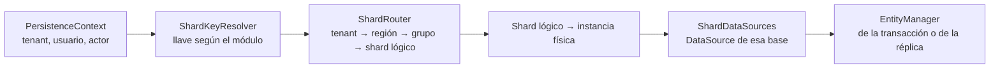

# Diseño: persistencia sobre TypeORM con sharding y sagas persistentes

- Estado: Propuesta
- Fecha: 2026-11-14
- Reemplaza: la capa propia sobre `pg` del ADR 0009 (revisión del 14 de noviembre) y el motor actual de `@platform/saga`
- ADR relacionados: [0008](../adr/0008-sagas-orquestadas-bitacora-persistente.md), [0009](../adr/0009-rds-postgresql-capa-persistencia-propia.md), [0010](../adr/0010-sharding-logico-residencia-region.md) y [0023](../adr/0023-enrutamiento-de-datos-de-identity.md)

## 1. Objetivo

- TypeORM es el ORM: entidades, `DataSource`, `EntityManager`, `QueryBuilder` y sus migraciones. No hay SQL a mano salvo donde TypeORM no llega, y entonces va dentro de un repositorio.
- `@platform/persistence` envuelve TypeORM para lo que TypeORM no trae: elegir el shard lógico, llegar a la instancia física, mantener una transacción en un solo shard, leer de la réplica y migrar todas las bases.
- Un servicio solo escribe entidades, repositorios y migraciones. El ruteo es transparente.
- Las sagas guardan su bitácora en la base del servicio que orquesta, con TypeORM, y se usan con una línea desde un caso de uso.

## 2. Cómo se rutea una consulta



- **Shard lógico:** una base `<servicio>_shard_<n>`. Es la unidad que se mueve entre instancias.
- **Shard físico:** una instancia de RDS que aloja varios shards lógicos.
- **Catálogo:** la base global con el directorio y las tablas de referencia.
- `ShardRouter` (`@platform/sharding`) ya resuelve tenant, región, grupo, shard lógico e instancia con caché y tombstones. Lo nuevo es lo que conecta ese resultado con TypeORM.

## 3. Piezas de `@platform/persistence`

Todas son clases con dependencias por constructor.

| Clase                                    | Responsabilidad                                                                                                                                                                                                                                                                     |
| ---------------------------------------- | ----------------------------------------------------------------------------------------------------------------------------------------------------------------------------------------------------------------------------------------------------------------------------------- |
| `ShardDataSources`                       | Crea y guarda un `DataSource` de TypeORM por base física (instancia más shard lógico), con `replication` (primario y réplicas). Los crea al primer uso y cierra los que no se usan; cierra el viejo cuando un shard cambia de instancia.                                            |
| `CatalogDataSource`                      | El `DataSource` del catálogo.                                                                                                                                                                                                                                                       |
| `ShardResolver`                          | Del contexto y la declaración del módulo (`ShardKey.Tenant`, `ShardKey.User` o `ShardKey.Custom`) saca la llave, llama a `ShardRouter` y devuelve el `DataSource` del shard.                                                                                                        |
| `TypeOrmTransactionManager`              | Implementa el puerto `TransactionManager` de `@platform/primitives` con un `QueryRunner` del shard resuelto. Guarda la unidad de trabajo en `AsyncLocalStorage`, corre los hooks `afterCommit` y rechaza tocar otro shard dentro de la misma transacción (`TransactionShardGuard`). |
| `EntityManagerProvider`                  | Da el `EntityManager` correcto: el de la transacción actual o, fuera de ella, el de la réplica del shard. `readPrimary()` fuerza el primario.                                                                                                                                       |
| `ShardedRepository<TAggregate, TEntity>` | Base de los repositorios. Usa `EntityManagerProvider` y un `EntityMapper<TAggregate, TEntity>` inyectado. Aplica tenant, versión optimista (`@VersionColumn`), borrado lógico (`@DeleteDateColumn`), auditoría y `Criteria` con paginación por cursor UUIDv7.                       |
| `CatalogRepository<TAggregate, TEntity>` | Lo mismo sobre el catálogo.                                                                                                                                                                                                                                                         |
| `ShardScope`                             | Ejecuta un bloque en el shard de una llave explícita, para los casos del ADR 0023 (por ejemplo, el usuario de otro tenant).                                                                                                                                                         |
| `AcrossShards`                           | Recorre varios shards para reportes y tareas de mantenimiento, con plazo y concurrencia acotada.                                                                                                                                                                                    |
| `ShardedMigrationRunner`                 | Corre `dataSource.runMigrations()` en cada shard lógico y en el catálogo, cada uno bajo `pg_advisory_lock`. Lo usa el binario `migrate` de cada app.                                                                                                                                |
| `PersistenceModule`                      | Módulo de NestJS. `forRoot(config)` arma todo lo anterior con valores por defecto, y `forFeature({ entities, sharding })` registra los repositorios de un módulo con su llave.                                                                                                      |

Las entidades base (`AuditedEntity`, `VersionedEntity`) traen `id` uuid, auditoría, versión y borrado lógico en `timestamptz`. La llave de shard de cada módulo se declara en `forFeature`, no en decoradores sobre la entidad.

## 4. Dónde vive cada cosa en un servicio

```
backend/apps/identity/
├── migrations/
│   ├── shard/             migraciones de TypeORM de las bases de shard
│   └── catalog/           migraciones de TypeORM del catálogo
└── src/
    ├── database/
    │   ├── shard.data-source.ts    DataSource de referencia para migration-generate
    │   └── catalog.data-source.ts
    └── modules/users/infrastructure/persistence/
        ├── entities/user.entity.ts
        ├── mappers/user.mapper.ts
        └── typeorm-user.repository.ts
```

- `pnpm nx run identity:migration-generate --name=CreateUsers --target=shard` genera la migración comparando las entidades con una base temporal.
- `migration-run` y `migration-revert` usan los mismos `DataSource`.
- Las tablas de la plataforma (outbox, mensajes procesados, idempotencia, directorio de shards y bitácora de sagas) tienen sus entidades y migraciones en `@platform/adapters-postgres` (`src/entities` y `src/migrations`). Cada app las suma a su `DataSource` con `platformShardEntities`, `platformShardMigrations` y sus equivalentes del catálogo.

Uso desde un módulo:

```ts
@Module({
  imports: [
    PersistenceModule.forFeature({
      entities: [UserEntity],
      sharding: { key: ShardKey.User },
    }),
  ],
  providers: [
    UserMapper,
    { provide: UserRepository, useClass: TypeOrmUserRepository },
  ],
})
export class UsersModule {}

export class TypeOrmUserRepository
  extends ShardedRepository<User, UserEntity>
  implements UserRepository
{
  async findByEmail(email: Email): Promise<User | null> {
    const entity = await this.manager().findOneBy(UserEntity, {
      email: email.value,
    });
    return entity ? this.mapper.toDomain(entity) : null;
  }
}
```

## 5. Sagas

Aprobado por el usuario el 14 de noviembre de 2026.

- **Store persistente:** `TypeOrmSagaStore` en `@platform/adapters-postgres`, con las entidades `SagaInstanceEntity` y `SagaStepLogEntity` y sus migraciones.
  - Cada escritura protegida es un `UPDATE ... WHERE version = :v AND lease_token = :t`.
  - La instancia y su paso se guardan en la misma transacción.
  - `findRecoverable` usa `FOR UPDATE SKIP LOCKED`.
  - `InMemorySagaStore` pasa a `__tests__/utils` de `@platform/saga`.
- **Dominio:** `SagaInstance` es un agregado. Sus transiciones son métodos puros: `recordDispatch`, `completeStep`, `startCompensation`, `completeCompensation`, `suspend` y `finish`.
- **Colaboradores:**
  - `StepExecutor`: despacha y llama la operación por `OperationInvoker`.
  - `CompensationRunner`: corre las compensaciones.
  - `LeaseKeeper`: toma, renueva y suelta el lease.
  - `SagaRecoveryJob`: retoma las sagas.
  - `SagaEventPublisher`: emite eventos y trazas.
- **Fachada:** `SagaEngine` queda pequeño, con `start` y `resume`.
- **Uso:** `SagaModule.forFeature([CreateTenantSaga])` arma el motor con valores por defecto (lease, plazos, dueño) y registra la recuperación. Un caso de uso inyecta `Sagas` y llama `await this.sagas.start(CreateTenantSaga, state, { idempotencyKey })`.
- Las definiciones siguen siendo clases `SagaDefinition` con `flow.step(...).pivot()`, y las compensaciones siguen saliendo del `compensatedBy` de cada contrato.

## 6. Paquetes de trabajo

| Paquete                      | Alcance                                                                                                                                        | Depende de                            |
| ---------------------------- | ---------------------------------------------------------------------------------------------------------------------------------------------- | ------------------------------------- |
| P1 · núcleo de persistencia  | `@platform/persistence` completo (sección 3), sus pruebas de integración con dos shards en Postgres real y los targets de migración de Nx      | Nada                                  |
| P2 · tablas de la plataforma | Entidades, migraciones y stores de TypeORM en `@platform/adapters-postgres`: outbox, procesados, idempotencia, directorio y `TypeOrmSagaStore` | Interfaces de P1                      |
| P3 · motor de sagas          | Rediseño de `@platform/saga` (sección 5) contra el puerto `SagaStore`, más `SagaModule`                                                        | Puerto `SagaStore`; se integra con P2 |

P1 y P3 arrancan juntos. P2 arranca cuando P1 fija sus interfaces. Al cerrar, se actualizan los ADR 0008 y 0009, `docs/ARCHITECTURE.md` y la skill `backend-persistencia-typeorm`.
