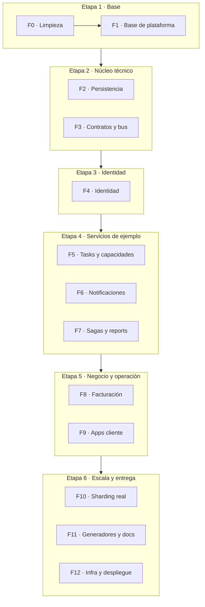

# Plan de construcción

Este archivo es la entrada única al plan del proyecto: fases, orden de ejecución, estado y registro de decisiones. El repositorio es la fuente de verdad. El [resumen ejecutivo en Claude Docs](https://claude.ai/artifact/Bn67Z4R16bLoevfodCcHiT) solo lo resume para leerlo fuera del repositorio.

| Archivo                                      | Qué contiene                                                                                                                     |
| -------------------------------------------- | -------------------------------------------------------------------------------------------------------------------------------- |
| `docs/plan/README.md`                        | Visión, fases con su estado, orden de ejecución por olas, cómo corre una ola y decisiones                                        |
| [`docs/plan/backend.md`](backend.md)         | Paquetes WP-01 a WP-13 del backend: decisiones de diseño, criterios de cierre y riesgos                                          |
| [`docs/plan/front.md`](front.md)             | Paquetes P0.1 a P4.3 del front: decisiones de diseño, comandos de aceptación y riesgos                                           |
| [`docs/design/`](../design/)                 | Detalle técnico de cada tema: [F4](../design/f4-identity.md) y [persistencia y sagas](../design/persistencia-typeorm-y-sagas.md) |
| [`docs/adr/`](../adr/README.md)              | Registro de las decisiones de arquitectura                                                                                       |
| [`docs/ARCHITECTURE.md`](../ARCHITECTURE.md) | Qué es la plataforma y cómo está construida                                                                                      |
| [`docs/plan/archivo/`](archivo/)             | Copias históricas; no se mantienen                                                                                               |

## Visión

Una plantilla de monorepo para construir backends de microservicios en NestJS con TypeORM sobre PostgreSQL, arquitectura hexagonal, despliegue en AWS y clientes en Flutter. Se clona, se renombra y se le agregan servicios.

Trae resuelto lo que todo producto necesita: identidad con MFA, multitenancy, auditoría, mensajería con reintentos, sagas recuperables, archivos, notificaciones, facturación por uso y trazabilidad de punta a punta. Los principios que guían cada decisión están en el [resumen de la arquitectura](../ARCHITECTURE.md#resumen).

## Fases

La construcción avanza en seis etapas. Cada etapa depende de la anterior y, dentro de una etapa, las fases avanzan en paralelo.

La infraestructura de cada pieza se agrega en su propia fase; F12 completa el Terraform por servicio y el pipeline de despliegue. El sharding real va al final porque el `ShardRouter` existe desde F2 y agregar shards después no toca el código de negocio.

**Estado al 14 de noviembre de 2026**, verificado en el código y en `git log`:

| Fase                     | Estado                                                                                                                                                                                                       | Referencia                                                                                                                          |
| ------------------------ | ------------------------------------------------------------------------------------------------------------------------------------------------------------------------------------------------------------ | ----------------------------------------------------------------------------------------------------------------------------------- |
| F0 · Limpieza            | Construida. El Express con Sequelize de 2022 se reescribió desde cero como monorepo Nx                                                                                                                       | `df81442` (2026-11-11); hallazgos del repositorio original en el [archivo](archivo/plan-claude-docs-2026-11-14.md#punto-de-partida) |
| F1 · Base de plataforma  | Construida: monorepo Nx, `kernel`, `config`, `observability`, `@contracts/platform`, entorno local y CI                                                                                                      | `df81442`                                                                                                                           |
| F2 · Persistencia        | Construida junto con F3, sobre el driver `pg`: `persistence`, `criteria` y `sharding`, con `cache`, `bloom`, `resilience` y los adaptadores en el mismo commit. Se rehace sobre TypeORM en las olas 2 y 3    | `9afa085` (2026-11-12), [diseño de persistencia](../design/persistencia-typeorm-y-sagas.md)                                         |
| F3 · Contratos y bus     | Construida junto con F2: contratos con export a JSON y Dart, `messaging`, `internal-api` y `saga` con bitácora en memoria. Se rehace por capas en las olas 0 a 3                                             | `9afa085`, ADR 0007, 0008 y 0017                                                                                                    |
| F4 · Identidad           | Diseño aprobado. Construidos `@platform/rate-limit` (WP3), `@platform/auth` (WP1), `@platform/service` (WP4) y el contrato de identity (WP5). Sigue en las olas 5 a 7                                        | `796d1bd` (2026-11-13), [diseño de F4](../design/f4-identity.md)                                                                    |
| F5 · Tasks y capacidades | Por construir. `backend/apps` todavía no existe; el microfrontend `tasks` corre con datos de demostración                                                                                                    |                                                                                                                                     |
| F6 · Notificaciones      | Por construir. El microfrontend `notifications` corre con datos de demostración                                                                                                                              |                                                                                                                                     |
| F7 · Sagas y reports     | El motor `@platform/saga` existe desde F3 y se rehace en WP-12. El servicio `reports` y las sagas de ejemplo están por construir                                                                             | `9afa085`                                                                                                                           |
| F8 · Facturación         | Por construir. El microfrontend `billing` corre con datos de demostración                                                                                                                                    |                                                                                                                                     |
| F9 · Apps cliente        | Shells `web` y `mobile`, siete microfrontends y los paquetes compartidos, con datos de demostración. El plan del front los refactoriza en las olas 0 a 4; las pantallas de negocio llegan con cada servicio  | `9afa085`, `0fdc015`, [plan del front](front.md)                                                                                    |
| F10 · Sharding real      | `ShardRouter`, directorio de shards y dos shards de identity en local ya existen. Varias regiones y `MoveTenant` están por construir                                                                         | ADR 0010 y 0023                                                                                                                     |
| F11 · Generadores y docs | Por construir. El generador de microfrontends llega antes, en el paquete P4.3 del front                                                                                                                      |                                                                                                                                     |
| F12 · Infra y despliegue | Terraform por stacks con runtime elegible por servicio, CI (`ci.yml`) y seguridad (`security.yml`). El siguiente paso es el pipeline de despliegue con OIDC hacia AWS y el que publica la web y la app móvil | `13f606f` (2026-11-13), ADR 0019 y 0020                                                                                             |

Después de F12 vienen, sobre la misma base: las pantallas de negocio de cada microfrontend; cobro real y factura electrónica ante la DIAN por el puerto `PaymentProvider`; DPoP en todos los tokens; exportación de eventos a un data lake; SLOs y alertas por servicio; recuperación ante desastres entre regiones con pruebas de caos; y rebalanceo automático de shards lógicos.

## Orden de ejecución por olas

Tres planes se ejecutan juntos, ola por ola: el [plan del backend](backend.md), el [plan del front](front.md) y el [diseño de F4](../design/f4-identity.md#61-olas-y-dependencias). El [diseño de persistencia y sagas](../design/persistencia-typeorm-y-sagas.md) no tiene olas propias: sus paquetes P1, P2 y P3 son WP-09, WP-10 y WP-12 del plan del backend (decisión D11).

| Ola | Backend                                                                                                                                                                                                           | Front                                                                          | F4                                                                                                         | Estado                                                                                         |
| --- | ----------------------------------------------------------------------------------------------------------------------------------------------------------------------------------------------------------------- | ------------------------------------------------------------------------------ | ---------------------------------------------------------------------------------------------------------- | ---------------------------------------------------------------------------------------------- |
| 0   | WP-01 fundaciones, WP-02 kit de contratos y herramientas, WP-03 skills, ADR y lint                                                                                                                                | P0.1 reloj y versiones, P0.2 script y línea base, P0.3 ADR del front           |                                                                                                            | Hecha en `d34c16e`. ADR del front numerado 0027; NestJS 12.3.2 y TypeORM 1.1.2                 |
| 1   | WP-04 config y observabilidad, WP-05 resilience, cache, rate-limit y bloom, WP-06 scheduling y sharding                                                                                                           | P1.1 ui, tokens e i18n, P1.2 shell_core y utils, P1.3 test_utils, auth y api   |                                                                                                            | Hecha en `f05da6b`                                                                             |
| 2   | WP-07 messaging, WP-08 internal-api, WP-09 persistence sobre TypeORM (P1)                                                                                                                                         | P2.1 shell_host, P2.2 account, P2.3 backoffice                                 |                                                                                                            | Hecha en `3dde07d`                                                                             |
| 3   | WP-10 tablas de la plataforma y criteria (P2), WP-11 adaptadores AWS y Valkey, WP-12 sagas (P3)                                                                                                                   | P3.1 billing y notifications, P3.2 tasks y verifier, P3.3 assistant            |                                                                                                            | Hecha en `91ecc5e`                                                                             |
| 4   | WP-13 cierre de la base                                                                                                                                                                                           | P4.1 apps y escenarios, P4.2 retiro de lo legado, P4.3 skills, ADR y generador | WP1 `@platform/auth`, WP4 `@platform/service`; WP5 contrato de identity y front en una tropa ligera aparte | Hecha en `a7f2820`                                                                             |
| 5   | Tropa 2: contratos de tasks, notifications, reports y billing (F5 a F8) con su Dart. Tropa 3: pipeline de despliegue con OIDC hacia AWS, publicación de la web y la app móvil, entrada Lambda y firma SigV4 (F12) |                                                                                | Tropa 1, con Opus: WP2 `@platform/http` y WP6 esqueleto de identity                                        | Hecha. Tres tropas; el diseño de F5 a F11 quedó aprobado                                       |
| 6   |                                                                                                                                                                                                                   |                                                                                | F4 completo: WP7 a WP15                                                                                    | Hecha. Constructor, dos revisiones y dos rondas de corrección; aprobada en la tercera revisión |
| 7   | F5 y F6: tasks, notifications, flags, búsqueda, tiempo real con SSE y Socket.IO, SES                                                                                                                              |                                                                                |                                                                                                            | Ciclo de construcción y revisión                                                               |
| 8   | F7 y F8: reports, billing, cuotas, medición y las sagas de ejemplo                                                                                                                                                |                                                                                |                                                                                                            | Ciclo de construcción y revisión                                                               |
| 9   | F10 y F11: sharding real y `MoveTenant`, generadores, OpenAPI, documentación y mapa visual final                                                                                                                  | F9: pantallas de negocio y escenarios de las apps                              |                                                                                                            | Ciclo de construcción y revisión; cierra el plan                                               |

El plan termina en la ola 9. La ola 5 corre con tres tropas. Desde la ola 6, cada ola es un ciclo con un constructor Opus y un revisor Opus independiente, que se repite hasta que el revisor aprueba ([diseño de F5 a F11, 11.2](../design/f5-f11-servicios.md#112-olas-6-a-9-ciclos-de-construcción-y-revisión)). El general integra, abre el PR y lo mezcla con los checks en verde, y sigue con el ciclo siguiente. El usuario revisa todo al final, y sus correcciones corren como un ciclo más. F12 se completa en la ola 5 y con el stack que cada servicio trae en su ciclo.

- **Ola 5, contratos y piezas comunes.** Un contrato solo depende del kit de contratos, así que los de los cuatro servicios van en una tropa. WP6 necesita el código de WP2 y lo tiene en la misma copia del repositorio. El pipeline de despliegue no depende del código de los servicios.
- **Olas 6 a 9, ciclos por grupo de fases.** Los servicios verifican los tokens en local con `@platform/auth` ([ADR 0022](../adr/0022-verificacion-de-tokens-y-estado-de-revocacion-compartido.md)), así que F5 a F8 no esperan a los módulos de identity. El orden sigue las dependencias: `notifications` consume eventos de `tasks`, `reports` y las sagas cruzan los dos primeros servicios, la medición de `billing` cruza todos, las pantallas llegan con todas las APIs, `MoveTenant` necesita datos en todos los servicios y los generadores salen de los servicios ya construidos. Dentro de una ola, si un agente necesita algo del otro, programa contra el puerto con su fake.

El diseño de F5 a F11 es un solo documento con el formato del [diseño de F4](../design/f4-identity.md) (contratos, módulos con fachadas y fakes, paquetes con carpetas exclusivas). Lo escribe un guía Sonnet mientras corre la ola 4, el general lo revisa y el usuario aprueba sus decisiones antes de la ola 5. En las olas 5 a 7 los archivos compartidos (`nx.json`, `tsconfig.base.json`, `compose`, `docs/`) tienen un solo dueño: el general.

El WP3 de F4 no aparece: `@platform/rate-limit` ya existe y su refactor va en WP-05 y WP-11. Las razones del orden del backend están en la [sección 4 de su plan](backend.md#4-orden-y-arranque-de-f4), y las dependencias entre olas del front en la [sección 4.1 del suyo](front.md#41-dependencias-entre-oleadas).

## Cómo se ejecuta una ola

- Cada paquete lo construye una tropa ligera: un guía Sonnet que planea y revisa, y dos implementadores Haiku. Las tropas que tocan credenciales y tokens (`@platform/auth`, `@platform/http` e identity) suman un capitán Opus que asesora el plan y audita el resultado. Desde la ola 5 corren con el flujo `oleada-ligera`, que activa el capitán con `opus: true` en la tropa. Los agentes están en `.claude/agents` (`backend-guia`, `front-guia`, `backend-implementador` y `front-implementador`).
- Desde la ola 6, cada ola es un ciclo del flujo `ciclo-fase`: un constructor Opus planea, implementa y prueba; un revisor Opus independiente revisa sin editar; el constructor corrige, hasta dos rondas. El general integra, verifica, abre y mezcla el PR, y arranca el ciclo siguiente.
- El guía escribe primero los esqueletos: firmas con cuerpo que lanza un error de "no implementado" y la prueba de contrato del puerto. Luego reparte archivos a los dos Haiku, que siguen instrucciones literales y nunca editan el mismo archivo.
- Cada tropa trabaja en su propia copia del repositorio (rama `troop/<línea>-<paquete>`) y solo toca las carpetas exclusivas de su paquete. Los archivos compartidos tienen un solo dueño por ola, fijado en cada plan.
- Una tropa entrega cuando su paquete cumple el criterio de cierre: el [estándar del backend](backend.md#31-reglas-comunes) o los [comandos de aceptación del front](front.md#23-comandos-de-aceptación), más los criterios propios del paquete.
- El general integra las tropas de la ola, corre la validación del conjunto y solo entonces abre la ola siguiente. Una ola empieza cuando la anterior está integrada y en verde.

## Registro de decisiones

Cada decisión tiene su detalle en el ADR o en el diseño enlazado. Una decisión nueva de arquitectura se registra primero como ADR y luego como fila aquí.

| Fecha      | Decisión                                                                                                                                                                                                                                                                                                                | Dónde                                                                                                                              |
| ---------- | ----------------------------------------------------------------------------------------------------------------------------------------------------------------------------------------------------------------------------------------------------------------------------------------------------------------------- | ---------------------------------------------------------------------------------------------------------------------------------- |
| 2026-11-16 | Desde la ola 6, cuatro ciclos con un constructor y un revisor Opus: F4; F5 y F6; F7 y F8; F9, F10 y F11. El general mezcla cada PR sin esperar al usuario, que revisa al final                                                                                                                                          | [Diseño de F5 a F11, 11.2](../design/f5-f11-servicios.md#112-olas-6-a-9-ciclos-de-construcción-y-revisión)                         |
| 2026-11-16 | La plantilla ofrece las alternativas que nombran los ADR como adaptadores intercambiables por configuración (SSE y Socket.IO, Fargate y Lambda, HMAC y SigV4, búsqueda de texto e híbrida, copia por lotes y replicación lógica); el usuario elige el valor por defecto                                                 | [Diseño de F5 a F11, 2.1](../design/f5-f11-servicios.md#21-alternativas-que-la-plantilla-trae)                                     |
| 2026-11-16 | Plan completo, F4 a F12, en la ola 7 con doce tropas: tres en la ola 5, seis en la 6 y tres en la 7. Tropas ligeras (guía Sonnet y dos Haiku); el capitán Opus solo en las que tocan credenciales y tokens. Un solo diseño para F5 a F11, escrito durante la ola 4                                                      | Este archivo                                                                                                                       |
| 2026-11-14 | El plan vive en el repositorio con una sola entrada, este archivo; el documento de Claude Docs pasa a resumen ejecutivo                                                                                                                                                                                                 | Este archivo                                                                                                                       |
| 2026-11-14 | El step-up por endpoint se declara en la ruta del contrato con `Access.authenticated({ mfaMaxAgeMinutes })`, no en las opciones de `@Endpoint`                                                                                                                                                                          | [Diseño de F4, 3.2.4 y 3.4.1](../design/f4-identity.md#324-autorización)                                                           |
| 2026-11-14 | El export de contratos queda aceptado, porque está implementado y en uso en CI                                                                                                                                                                                                                                          | [ADR 0017](../adr/0017-export-de-contratos.md)                                                                                     |
| 2026-11-14 | Plan del backend: trece paquetes en cinco olas, capa NestJS por librería, jobs propios y arranque de F4 sobre la base nueva                                                                                                                                                                                             | [Plan del backend](backend.md)                                                                                                     |
| 2026-11-14 | Plan del front: quince paquetes en cinco olas, controladores por pantalla, lo legado se retira al final y las decisiones de su sección 8                                                                                                                                                                                | [Plan del front](front.md)                                                                                                         |
| 2026-11-14 | Persistencia sobre TypeORM con sharding lógico y físico, y bitácora de sagas en el esquema `saga` del shard; reemplaza al ADR 0009                                                                                                                                                                                      | [ADR 0024](../adr/0024-persistencia-typeorm-sharding-y-sagas-persistentes.md), [diseño](../design/persistencia-typeorm-y-sagas.md) |
| 2026-11-14 | Las diez decisiones de F4: claims nuevos, `auth:*` en Valkey, `@Endpoint(route)`, OpenAPI sin `@nestjs/swagger`, Node 24.22.2, canal por header, código del dispositivo, contraseña de 12, WebAuthn en base64url e intentos sin cuenta solo en Valkey                                                                   | [Diseño de F4, sección 11](../design/f4-identity.md#11-decisiones-que-requieren-al-usuario)                                        |
| 2026-11-14 | Se implementa en casa sobre `node:crypto` y la librería estándar; una dependencia entra solo cuando reimplementarla es imprudente o costoso                                                                                                                                                                             | [Diseño de F4, sección 9](../design/f4-identity.md#9-dependencias-externas)                                                        |
| 2026-11-14 | Pruebas del backend en `__tests__/` con utilitarios en `__tests__/utils/`; en el front, `test/utils/` y el paquete `test_utils`                                                                                                                                                                                         | `c6f6eed`, `0fdc015`, [ARCHITECTURE](../ARCHITECTURE.md#monorepo-con-nx)                                                           |
| 2026-11-13 | Terraform por stacks y runtime de API elegido por servicio                                                                                                                                                                                                                                                              | [ADR 0020](../adr/0020-terraform-por-stacks-y-runtime-por-servicio.md)                                                             |
| 2026-11-13 | Valkey como adaptador de caché, ruteo, Bloom e invalidación                                                                                                                                                                                                                                                             | [ADR 0021](../adr/0021-adaptador-valkey.md)                                                                                        |
| 2026-11-13 | Verificación local de tokens y estado de revocación compartido en `auth:*`                                                                                                                                                                                                                                              | [ADR 0022](../adr/0022-verificacion-de-tokens-y-estado-de-revocacion-compartido.md)                                                |
| 2026-11-13 | Datos de usuario en el shard del usuario y datos de tenant en el shard del tenant                                                                                                                                                                                                                                       | [ADR 0023](../adr/0023-enrutamiento-de-datos-de-identity.md)                                                                       |
| 2026-11-12 | Raíz mínima: `backend/` y `front/`, cada aplicación dueña de sus librerías                                                                                                                                                                                                                                              | [ADR 0015](../adr/0015-estructura-backend-front-y-codigo-compartido.md)                                                            |
| 2026-11-12 | Salida a Internet con NAT solo para las subredes de aplicación                                                                                                                                                                                                                                                          | [ADR 0016](../adr/0016-egress-de-red.md)                                                                                           |
| 2026-11-12 | Contratos en TypeScript con zod, exportados a JSON y generados en Dart                                                                                                                                                                                                                                                  | [ADR 0017](../adr/0017-export-de-contratos.md)                                                                                     |
| 2026-11-12 | Contrato de microfrontend                                                                                                                                                                                                                                                                                               | [ADR 0018](../adr/0018-contrato-de-microfrontend.md)                                                                               |
| 2026-11-12 | CI y toolchain                                                                                                                                                                                                                                                                                                          | [ADR 0019](../adr/0019-ci-y-toolchain.md)                                                                                          |
| 2026-11-11 | Monorepo Nx con pnpm y un microservicio por app                                                                                                                                                                                                                                                                         | [ADR 0001](../adr/0001-monorepo-nx-pnpm-microservicios.md)                                                                         |
| 2026-11-11 | Arquitectura hexagonal y plataforma agnóstica                                                                                                                                                                                                                                                                           | [ADR 0002](../adr/0002-arquitectura-hexagonal-plataforma-agnostica.md)                                                             |
| 2026-11-11 | UUIDv7 en todo, incluido el `traceId`                                                                                                                                                                                                                                                                                   | [ADR 0003](../adr/0003-identificadores-uuidv7-traceid.md)                                                                          |
| 2026-11-11 | OpenTelemetry con OpenObserve                                                                                                                                                                                                                                                                                           | [ADR 0004](../adr/0004-observabilidad-opentelemetry-openobserve.md)                                                                |
| 2026-11-11 | Autenticación propia con sesiones y JWT                                                                                                                                                                                                                                                                                 | [ADR 0005](../adr/0005-autenticacion-sesiones-jwt.md)                                                                              |
| 2026-11-11 | MFA con dispositivo registrado y passkeys                                                                                                                                                                                                                                                                               | [ADR 0006](../adr/0006-mfa-dispositivo-registrado-passkeys.md)                                                                     |
| 2026-11-11 | Mensajería con topología tipada, SNS y SQS, y CloudEvents                                                                                                                                                                                                                                                               | [ADR 0007](../adr/0007-mensajeria-topologia-tipada-sns-sqs-cloudevents.md)                                                         |
| 2026-11-11 | Sagas orquestadas con bitácora persistente                                                                                                                                                                                                                                                                              | [ADR 0008](../adr/0008-sagas-orquestadas-bitacora-persistente.md)                                                                  |
| 2026-11-11 | Sharding lógico por grupos y residencia por región                                                                                                                                                                                                                                                                      | [ADR 0010](../adr/0010-sharding-logico-residencia-region.md)                                                                       |
| 2026-11-11 | Tiempo real con Socket.IO y SSE                                                                                                                                                                                                                                                                                         | [ADR 0011](../adr/0011-tiempo-real-socketio-sse.md)                                                                                |
| 2026-11-11 | Front en Flutter con shells y microfrontends                                                                                                                                                                                                                                                                            | [ADR 0012](../adr/0012-front-flutter-shells-microfrontends.md)                                                                     |
| 2026-11-11 | Módulo de IA con puertos y Claude por defecto                                                                                                                                                                                                                                                                           | [ADR 0013](../adr/0013-modulo-ia-puertos-claude.md)                                                                                |
| 2026-11-11 | Acuerdos y documentos firmados                                                                                                                                                                                                                                                                                          | [ADR 0014](../adr/0014-acuerdos-documentos-firmados.md)                                                                            |
| 2026-11-11 | Errores `SERVICIO.SUBMÓDULO.ERROR` con RFC 9457; versión mayor en la URL y por header; auditoría por triggers; búsqueda híbrida con pgvector; resiliencia propia con Bloom filters; bloqueo de cuenta e invalidación de tokens; facturación por medición con cobro por puerto; Jest con Testcontainers, k6 y LocalStack | Secciones de [ARCHITECTURE](../ARCHITECTURE.md); sin ADR propio                                                                    |

**Decisiones abiertas**

- **Lo que la ola 3 dejó para la ola 4 (cerrado en WP-13).** La tabla de D3 y la skill `backend-nestjs-composicion` reflejan que `SqsPoller` vive en `SqsConsumerModule`, que no es global, para cerrarse antes que `AwsModule`, y que `AwsModule` solo implementa `OnModuleDestroy`. Se retiraron los shims deprecados de sharding, bloom, config, rate-limit, primitives, observability (`RequestContext` estático, `RequestContextStore.shared`, `SharedTracing` y las funciones del índice) y resilience (`ResiliencePolicyName` y `onEvent`), y `kernel/src/result.ts`, que nadie usaba. Las funciones sueltas heredadas quedaron convertidas en clases o declaradas en `check-structure.mjs`. Siguen abiertos: `UnitRollbackError` sigue como error interno del `UnitOfWorkRunner` mientras el puerto `TransactionManager` del kernel solo deshaga cuando la función lanza; `AwsErrorTranslator` y `ValkeyErrorTranslator` son reglas del `FailureClassifier`, pero ningún módulo las registra hasta que resilience exponga su registro de reglas; `CursorCodec` conserva el modo sin secreto y `findByCriteria` y `toPage` de persistence reciben el codec como opcional (exigirlo pide ajustar `ShardedRepository` y `CatalogRepository`); el consumidor SQS no abre el contexto del tenant del sobre antes de despachar, y quien lo corre debe hacerlo (la prueba de humo lo hace con `runAs`).
- **Número del ADR del front.** P0.3 pide un "ADR 0024" con las decisiones del front, pero el 0024 ya es el de persistencia (`b182447`) y los números no se reutilizan. Además, WP-03 pide los ADR 0024 a 0026, y su tropa partió de `dff361c`, antes de que existiera el 0024. Resuelto en `d34c16e`: el 0024 de `b182447` se conserva con lo nuevo de WP-03 fusionado, y los siguientes son el 0025 (capa NestJS), el 0026 (jobs programados) y el 0027 (front).
- **Lo que la ola 4 deja para la ola 5.** WP5 decidió donde la sección 7 del diseño de F4 deja hueco, y esas decisiones se revisan junto con el diseño de F5 a F11: `ConfirmEmailChange` y `AcceptInvitation` son autenticadas y `AcceptInvitation` responde 204; `CreateApiKey` y `RotateApiKey` responden `CreatedApiKey` con 201; `PasskeyStepUp` usa `mfaToken` y `RegisterPasskey` no pide step-up; el prefijo de `ApiKeySummary` tiene 12 caracteres base32; TOTP acepta de 6 a 8 dígitos; `UserSuspendedPayload.reason` es texto libre. El verificador de `@platform/auth` acepta un `pv` más nuevo que el de su caché y rechaza solo uno más viejo, porque la caché local puede ir detrás de identity; la tabla 3.2.2 del diseño decía "distinto" y se actualiza con WP6. `ShardedMigrationRunner` reporta la base como `undefined` cuando el `DataSource` usa `replication.master`; lo corrige la tropa de WP2 y WP6, que es la primera en migrar con réplicas.

- **Lo que la ola 5 deja para la ola 6.** Las operaciones internas y las rutas nuevas de identity (borrado de cuenta, sagas, activación de tenant, destinatarios de push, miembros por permiso y las cuatro de traslado) responden como no implementadas hasta su ciclo. Con `sharding.requireScope` activo, las operaciones internas de identity fallan con `PLATFORM.SHARDING.KEY_MISSING` porque el almacén de idempotencia consulta un shard sin `ShardScope`; lo cierra el ciclo de la ola 6. La topología de mensajería reconoce temas y comandos por nombre, para aceptar referencias a los de otro servicio. Cada llamada interna cabe en el presupuesto de 25 s: las operaciones largas trabajan por lotes de 6 s y quien llama repite. Los microfrontends ocultan los nombres del contrato que chocan con sus tipos de demostración hasta F9. El despliegue necesita, del lado del usuario, un environment de GitHub por ambiente con sus variables (roles de AWS, región, prefijo y bucket de artefactos) y revisores en producción.
- **Lo que la ola 6 deja para la ola 7.** Identity implementa F4 completo. Las entregas de mensajes y las operaciones internas de un servicio con `requireScope` corren en el shard del tenant del sobre, y F5 en adelante usa ese camino. Tres ajustes menores del revisor entran al ciclo siguiente: la época de desbloqueo vence a las 24 h y debe vivir más que cualquier bloqueo; las lecturas de tablas de tenant van al primario y pueden volver a la réplica con una transacción de solo lectura; `password_resets` necesita su job de retención. El stack de Terraform de identity trae `listener_rule_priority = 100` provisional, y el despliegue pide `fargate_api_enabled = true` en la plataforma del ambiente (o identity con runtime `lambda`) y los ARN del mapa `secrets`.

- **Dueños de la documentación en las olas 0 y 4.** En la ola 0, WP-03 y P0.3 declaran a la vez `docs/adr/`. En la ola 4, WP-13 y P4.3 declaran a la vez `docs/adr/` y `docs/ARCHITECTURE.md`. Decisión del general: en cada ola, una sola tropa es dueña de `docs/adr/` y `docs/ARCHITECTURE.md` (en la ola 0, la de WP-03, que lleva también P0.3), y el general integra esos archivos.
- **Opciones de `@Endpoint` de fases posteriores.** [ARCHITECTURE](../ARCHITECTURE.md) usa `deprecated`, `flag`, `entitlement`, `signature` y `agreements`, que el `EndpointOptions` de F4 no declara. El diseño de F4 solo deja `agreements` para después (sección 10); las demás se fijan en la fase que las use.
