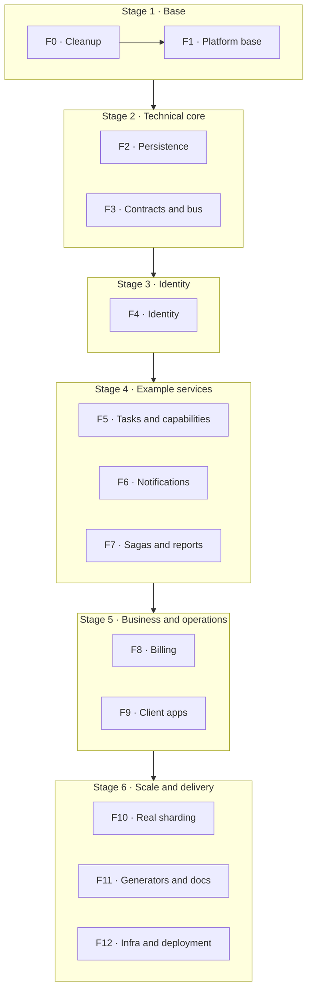

# Build plan

This file is the single entry point to the project plan: phases, execution order, status and decision log. The repository is the source of truth. The [executive summary in Claude Docs](https://claude.ai/artifact/Bn67Z4R16bLoevfodCcHiT) only summarizes it for reading outside the repository.

| File                                         | What it contains                                                                                                                       |
| -------------------------------------------- | -------------------------------------------------------------------------------------------------------------------------------------- |
| `docs/plan/README.md`                        | Vision, phases with their status, execution order by waves, how a wave runs and decisions                                              |
| [`docs/plan/backend.md`](backend.md)         | Backend packages WP-01 to WP-13: design decisions, completion criteria and risks                                                       |
| [`docs/plan/front.md`](front.md)             | Front packages P0.1 to P4.3: design decisions, acceptance commands and risks                                                           |
| [`docs/design/`](../design/)                 | Technical detail of each topic: [F4](../design/f4-identity.md) and [persistence and sagas](../design/typeorm-persistence-and-sagas.md) |
| [`docs/adr/`](../adr/README.md)              | Log of the architecture decisions                                                                                                      |
| [`docs/ARCHITECTURE.md`](../ARCHITECTURE.md) | What the platform is and how it is built                                                                                               |
| [`docs/plan/archive/`](archive/)             | Historical copies; not maintained                                                                                                      |

## Vision

A monorepo template for building microservice backends in NestJS with TypeORM on PostgreSQL, hexagonal architecture, deployment on AWS and clients in Flutter. You clone it, rename it and add services to it.

It ships with what every product needs already solved: identity with MFA, multitenancy, auditing, messaging with retries, recoverable sagas, files, notifications, usage-based billing and end-to-end traceability. The principles behind each decision are in the [architecture summary](../ARCHITECTURE.md#summary).

## Phases

The build advances in six stages. Each stage depends on the previous one and, within a stage, the phases advance in parallel.

The infrastructure of each piece is added in its own phase; F12 completes the per-service Terraform and the deployment pipeline. Real sharding goes last because the `ShardRouter` exists since F2 and adding shards later does not touch business code.

**Status as of November 24, 2026**, verified in the code and in `git log`:

| Phase                       | Status                                                                                                                                                                                                                                     | Reference                                                                                                                             |
| --------------------------- | ------------------------------------------------------------------------------------------------------------------------------------------------------------------------------------------------------------------------------------------ | ------------------------------------------------------------------------------------------------------------------------------------- |
| F0 · Cleanup                | Built. The 2022 Express with Sequelize was rewritten from scratch as an Nx monorepo                                                                                                                                                        | `df81442` (2026-11-11); findings from the original repository in the [archive](archive/plan-claude-docs-2026-11-14.md#starting-point) |
| F1 · Platform base          | Built: Nx monorepo, `kernel`, `config`, `observability`, `@contracts/platform`, local environment and CI                                                                                                                                   | `df81442`                                                                                                                             |
| F2 · Persistence            | Built together with F3, on the `pg` driver: `persistence`, `criteria` and `sharding`, with `cache`, `bloom`, `resilience` and the adapters in the same commit. Rebuilt on TypeORM in waves 2 and 3                                         | `9afa085` (2026-11-12), [persistence design](../design/typeorm-persistence-and-sagas.md)                                              |
| F3 · Contracts and bus      | Built together with F2: contracts with export to JSON and Dart, `messaging`, `internal-api` and `saga` with an in-memory log. Rebuilt by layers in waves 0 to 3                                                                            | `9afa085`, ADR 0007, 0008 and 0017                                                                                                    |
| F4 · Identity               | Design approved. Built `@platform/rate-limit` (WP3), `@platform/auth` (WP1), `@platform/service` (WP4) and the identity contract (WP5). Continues in waves 5 to 7                                                                          | `796d1bd` (2026-11-13), [F4 design](../design/f4-identity.md)                                                                         |
| F5 · Tasks and capabilities | Built in wave 7: `tasks` service, `@platform/flags`, `@platform/search` with text and hybrid search on pgvector, and `features` and `flags` in `auth` and `http`                                                                           | Wave 7, ADR 0029                                                                                                                      |
| F6 · Notifications          | Built in wave 7: `notifications` service, `@platform/realtime` with SSE and Socket.IO on a per-user Valkey stream, `apps/realtime`, SES and SMTP, and identity email through `notifications`                                               | Wave 7, ADR 0028 and 0030                                                                                                             |
| F7 · Sagas and reports      | Built in wave 8: `reports` service with event-driven projections and backfill from tasks and billing, and the `TenantOnboarding` and `DeleteAccount` sagas tested with `CrashingSagaStore`                                                 | Wave 8, ADR 0031                                                                                                                      |
| F8 · Billing                | Built in wave 8: `billing` service with plans, proration, invoices, charging through `PaymentProvider` and delinquency; `@platform/quotas` and `@platform/metering`                                                                        | Wave 8, ADR 0031                                                                                                                      |
| F9 · Client apps            | Business screens built in wave 9: `tasks`, `notifications` and `billing` with live repositories over the API (and their demo mode), SSE with `Last-Event-ID`, the `reports` microfrontend and the retry on 421                             | Wave 9, ADR 0034                                                                                                                      |
| F10 · Real sharding         | Built in wave 9: regions with `REGIONS` and `SERVICE_REGION` (421 `WRONG_REGION`), `@platform/tenant-move` with batch copy or logical replication, write barrier, the `MoveTenant` saga and its cleanup, and the move of the five services | Wave 9, ADR 0032                                                                                                                      |
| F11 · Generators and docs   | Built in wave 9: service and module generators with `generators:verify` and `generators:smoke`, OpenAPI from the contracts, ARCHITECTURE with the visual map, ADRs up to date and runbooks in `docs/runbooks`                              | Wave 9, ADR 0033 and 0035                                                                                                             |
| F12 · Infra and deployment  | Terraform by stacks with a selectable runtime per service, CI (`ci.yml`) and security (`security.yml`). The next step is the deployment pipeline with OIDC to AWS and the one that publishes the web and mobile apps                       | `13f606f` (2026-11-13), ADR 0019 and 0020                                                                                             |

After F12 come, on the same base: the business screens of each microfrontend; real charging and electronic invoicing with the DIAN through the `PaymentProvider` port; DPoP on all tokens; event export to a data lake; SLOs and alerts per service; cross-region disaster recovery with chaos tests; and automatic rebalancing of logical shards.

## Execution order by waves

Three plans run together, wave by wave: the [backend plan](backend.md), the [front plan](front.md) and the [F4 design](../design/f4-identity.md#61-waves-and-dependencies). The [persistence and sagas design](../design/typeorm-persistence-and-sagas.md) has no waves of its own: its packages P1, P2 and P3 are WP-09, WP-10 and WP-12 of the backend plan (decision D11).

| Wave | Backend                                                                                                                                                                                                                 | Front                                                                              | F4                                                                                                       | Status                                                                                                                                                                                                                      |
| ---- | ----------------------------------------------------------------------------------------------------------------------------------------------------------------------------------------------------------------------- | ---------------------------------------------------------------------------------- | -------------------------------------------------------------------------------------------------------- | --------------------------------------------------------------------------------------------------------------------------------------------------------------------------------------------------------------------------- |
| 0    | WP-01 foundations, WP-02 contract kit and tooling, WP-03 skills, ADRs and lint                                                                                                                                          | P0.1 clock and versions, P0.2 script and baseline, P0.3 front ADR                  |                                                                                                          | Done in `d34c16e`. Front ADR numbered 0027; NestJS 12.3.2 and TypeORM 1.1.2                                                                                                                                                 |
| 1    | WP-04 config and observability, WP-05 resilience, cache, rate-limit and bloom, WP-06 scheduling and sharding                                                                                                            | P1.1 ui, tokens and i18n, P1.2 shell_core and utils, P1.3 test_utils, auth and api |                                                                                                          | Done in `f05da6b`                                                                                                                                                                                                           |
| 2    | WP-07 messaging, WP-08 internal-api, WP-09 persistence on TypeORM (P1)                                                                                                                                                  | P2.1 shell_host, P2.2 account, P2.3 backoffice                                     |                                                                                                          | Done in `3dde07d`                                                                                                                                                                                                           |
| 3    | WP-10 platform tables and criteria (P2), WP-11 AWS and Valkey adapters, WP-12 sagas (P3)                                                                                                                                | P3.1 billing and notifications, P3.2 tasks and verifier, P3.3 assistant            |                                                                                                          | Done in `91ecc5e`                                                                                                                                                                                                           |
| 4    | WP-13 base closure                                                                                                                                                                                                      | P4.1 apps and scenarios, P4.2 legacy removal, P4.3 skills, ADRs and generator      | WP1 `@platform/auth`, WP4 `@platform/service`; WP5 identity contract and front in a separate light troop | Done in `a7f2820`                                                                                                                                                                                                           |
| 5    | Troop 2: contracts for tasks, notifications, reports and billing (F5 to F8) with their Dart. Troop 3: deployment pipeline with OIDC to AWS, publishing of the web and mobile apps, Lambda entry and SigV4 signing (F12) |                                                                                    | Troop 1, with Opus: WP2 `@platform/http` and WP6 identity skeleton                                       | Done. Three troops; the F5 to F11 design was approved                                                                                                                                                                       |
| 6    |                                                                                                                                                                                                                         |                                                                                    | Full F4: WP7 to WP15                                                                                     | Done. Builder, two reviews and two correction rounds; approved on the third review                                                                                                                                          |
| 7    | F5 and F6: tasks, notifications, flags, search, realtime with SSE and Socket.IO, SES                                                                                                                                    |                                                                                    |                                                                                                          | Done. Builder, two reviews and two correction rounds plus an extra round; approved on the fourth review                                                                                                                     |
| 8    | F7 and F8: reports, billing, quotas, metering and the example sagas                                                                                                                                                     |                                                                                    |                                                                                                          | Done. Builder, two reviews and one correction round plus an extra round; approved on the third review                                                                                                                       |
| 9    | F10 and F11: real sharding and `MoveTenant`, generators, OpenAPI, documentation and final visual map                                                                                                                    | F9: business screens and app scenarios                                             |                                                                                                          | Done in two cycles. Part A (F10 and F11) approved on the third review. Part B (F9, per-service tenant directory, end-to-end flow and documentation) approved on the third review. The end-to-end flow passes twice in a row |

The plan ends at wave 9. Wave 5 runs with three troops. From wave 6 on, each wave is a cycle with an Opus builder and an independent Opus reviewer, repeated until the reviewer approves ([F5 to F11 design, 11.2](../design/f5-f11-services.md#112-waves-6-to-9-build-and-review-cycles)). The general integrates, opens the PR and merges it with green checks, and moves on to the next cycle. The user reviews everything at the end, and their corrections run as one more cycle. F12 is completed in wave 5 and with the stack each service brings in its cycle.

- **Wave 5, contracts and common pieces.** A contract only depends on the contract kit, so those of the four services go in one troop. WP6 needs the code of WP2 and has it in the same copy of the repository. The deployment pipeline does not depend on the services' code.
- **Waves 6 to 9, cycles by phase group.** Services verify tokens locally with `@platform/auth` ([ADR 0022](../adr/0022-token-verification-shared-revocation-state.md)), so F5 to F8 do not wait for the identity modules. The order follows the dependencies: `notifications` consumes events from `tasks`, `reports` and the sagas span the first two services, `billing` metering spans all of them, the screens arrive with all the APIs, `MoveTenant` needs data in every service and the generators come from the services already built. Within a wave, if an agent needs something from the other, it programs against the port with its fake.

The F5 to F11 design is a single document with the format of the [F4 design](../design/f4-identity.md) (contracts, modules with facades and fakes, packages with exclusive folders). A Sonnet guide writes it while wave 4 runs, the general reviews it and the user approves its decisions before wave 5. In waves 5 to 7 the shared files (`nx.json`, `tsconfig.base.json`, `compose`, `docs/`) have a single owner: the general.

F4's WP3 does not appear: `@platform/rate-limit` already exists and its refactor goes in WP-05 and WP-11. The reasons for the backend order are in [section 4 of its plan](backend.md#4-order-and-start-of-f4), and the dependencies between front waves in [section 4.1 of its plan](front.md#41-dependencies-between-waves).

## How a wave runs

- Each package is built by a light troop: a Sonnet guide that plans and reviews, and two Haiku implementers. Troops that touch credentials and tokens (`@platform/auth`, `@platform/http` and identity) add an Opus captain who advises on the plan and audits the result. From wave 5 on they run with the `oleada-ligera` workflow, which enables the captain with `opus: true` in the troop. The agents are in `.claude/agents` (`backend-lead`, `front-lead`, `backend-implementer` and `front-implementer`).
- From wave 6 on, each wave is a cycle of the [`phase-cycle`](../../.claude/workflows/phase-cycle.js) workflow: an Opus builder plans, implements and tests; an independent Opus reviewer reviews without editing; the builder corrects, up to two rounds. The general integrates, verifies, opens and merges the PR, and starts the next cycle when the user asks for it. The script header explains its arguments and how to request an extra round of corrections.
- The guide first writes the skeletons: signatures with a body that throws a "not implemented" error and the port's contract test. Then it splits files between the two Haiku implementers, who follow literal instructions and never edit the same file.
- Each troop works in its own copy of the repository (branch `troop/<line>-<package>`) and only touches its package's exclusive folders. Shared files have a single owner per wave, set in each plan.
- A troop delivers when its package meets the completion criterion: the [backend standard](backend.md#31-common-rules) or the [front acceptance commands](front.md#23-acceptance-commands), plus the package's own criteria.
- The general integrates the wave's troops, runs the validation of the whole and only then opens the next wave. A wave starts when the previous one is integrated and green.

## Decision log

Each decision has its detail in the linked ADR or design. A new architecture decision is recorded first as an ADR and then as a row here.

| Date       | Decision                                                                                                                                                                                                                                                                                                        | Where                                                                                                                          |
| ---------- | --------------------------------------------------------------------------------------------------------------------------------------------------------------------------------------------------------------------------------------------------------------------------------------------------------------- | ------------------------------------------------------------------------------------------------------------------------------ |
| 2026-11-24 | Each service places the tenant in its own shard directory with `<service>.tenant-directory.place.v1`, which the onboarding saga calls before opening the account                                                                                                                                                | [ADR 0032](../adr/0032-tenant-moves-and-regions.md)                                                                            |
| 2026-11-24 | Live repositories in the front, SSE with `Last-Event-ID` and retry on 421                                                                                                                                                                                                                                       | [ADR 0034](../adr/0034-live-front-repositories-sse-region.md)                                                                  |
| 2026-11-24 | End-to-end flow of the five services in one process, with an in-memory bus and real databases                                                                                                                                                                                                                   | [ADR 0035](../adr/0035-end-to-end-platform-flow.md)                                                                            |
| 2026-11-26 | Before F12, cycle 3 speeds up the tests, adds a guard for every rule and closed finding, and has the reviewer map what the diff affects explicitly and implicitly                                                                                                                                               | [Cycle 3](cycle-3-test-speed-and-guards.md)                                                                                    |
| 2026-11-24 | Before F12, four correction cycles run on the general review                                                                                                                                                                                                                                                    | [General review](../audits/2026-11-24-general-review.md)                                                                       |
| 2026-11-24 | Wave 9 is split into two consecutive cycles (F10 and F11; then F9 with the closing documentation), because it combines backend and front and the build machine does not run two cycles at once                                                                                                                  | This file                                                                                                                      |
| 2026-11-24 | Regions by variable, tenant moves with a per-shard write barrier, two copy strategies, a final `FinishTenantMove` step and a cleanup that does not delete a source that is still routed                                                                                                                         | [ADR 0032](../adr/0032-tenant-moves-and-regions.md)                                                                            |
| 2026-11-24 | Service and module generators with their own templates, verification against `tasks` and a smoke test in CI; OpenAPI from the contracts                                                                                                                                                                         | [ADR 0033](../adr/0033-generators-and-openapi.md)                                                                              |
| 2026-11-23 | Reports with projections and backfill per source; billing with proration, idempotent charging, per-tenant delinquency and no credit invoices; quotas checked before creating accounts; identity sagas                                                                                                           | [ADR 0031](../adr/0031-reports-billing-identity-sagas.md)                                                                      |
| 2026-11-23 | Realtime recovers on a per-user Valkey stream, the same for SSE and Socket.IO, instead of the Socket.IO streams adapter; amends ADR 0011                                                                                                                                                                        | [ADR 0028](../adr/0028-real-time-one-stream-per-user.md)                                                                       |
| 2026-11-23 | Maintenance jobs that go through all the tenants of a shard use a maintenance RLS policy, with no role with `BYPASSRLS`; search lives in each shard                                                                                                                                                             | [ADR 0029](../adr/0029-cross-tenant-maintenance-search-per-shard.md)                                                           |
| 2026-11-23 | Identity sends its email through `notifications.messages.send.v1`, with a global email ledger by message id                                                                                                                                                                                                     | [ADR 0030](../adr/0030-identity-email-through-notifications.md)                                                                |
| 2026-11-16 | From wave 6 on, four cycles with an Opus builder and reviewer: F4; F5 and F6; F7 and F8; F9, F10 and F11. The general merges each PR without waiting for the user, who reviews at the end                                                                                                                       | [F5 to F11 design, 11.2](../design/f5-f11-services.md#112-waves-6-to-9-build-and-review-cycles)                                |
| 2026-11-16 | The template offers the alternatives the ADRs name as adapters swappable by configuration (SSE and Socket.IO, Fargate and Lambda, HMAC and SigV4, text and hybrid search, batch copy and logical replication); the user picks the default                                                                       | [F5 to F11 design, 2.1](../design/f5-f11-services.md#21-alternatives-the-template-ships)                                       |
| 2026-11-16 | Full plan, F4 to F12, by wave 7 with twelve troops: three in wave 5, six in wave 6 and three in wave 7. Light troops (Sonnet guide and two Haiku); the Opus captain only in those that touch credentials and tokens. A single design for F5 to F11, written during wave 4                                       | This file                                                                                                                      |
| 2026-11-14 | The plan lives in the repository with a single entry point, this file; the Claude Docs document becomes an executive summary                                                                                                                                                                                    | This file                                                                                                                      |
| 2026-11-14 | Per-endpoint step-up is declared in the contract route with `Access.authenticated({ mfaMaxAgeMinutes })`, not in the `@Endpoint` options                                                                                                                                                                        | [F4 design, 3.2.4 and 3.4.1](../design/f4-identity.md#324-authorization)                                                       |
| 2026-11-14 | The contract export is accepted, because it is implemented and used in CI                                                                                                                                                                                                                                       | [ADR 0017](../adr/0017-contract-export.md)                                                                                     |
| 2026-11-14 | Backend plan: thirteen packages in five waves, a NestJS layer per library, own jobs and F4 start on the new base                                                                                                                                                                                                | [Backend plan](backend.md)                                                                                                     |
| 2026-11-14 | Front plan: fifteen packages in five waves, controllers per screen, legacy code is removed at the end and the decisions in its section 8                                                                                                                                                                        | [Front plan](front.md)                                                                                                         |
| 2026-11-14 | Persistence on TypeORM with logical and physical sharding, and a saga log in the shard's `saga` schema; replaces ADR 0009                                                                                                                                                                                       | [ADR 0024](../adr/0024-typeorm-persistence-sharding-persistent-sagas.md), [design](../design/typeorm-persistence-and-sagas.md) |
| 2026-11-14 | The ten F4 decisions: new claims, `auth:*` in Valkey, `@Endpoint(route)`, OpenAPI without `@nestjs/swagger`, Node 24.22.2, channel by header, device code, 12-character password, WebAuthn in base64url and attempts without an account only in Valkey                                                          | [F4 design, section 11](../design/f4-identity.md#11-decisions-that-require-the-user)                                           |
| 2026-11-14 | Implement in-house on `node:crypto` and the standard library; a dependency comes in only when reimplementing it is unwise or costly                                                                                                                                                                             | [F4 design, section 9](../design/f4-identity.md#9-external-dependencies)                                                       |
| 2026-11-14 | Backend tests in `__tests__/` with utilities in `__tests__/utils/`; in the front, `test/utils/` and the `test_utils` package                                                                                                                                                                                    | `c6f6eed`, `0fdc015`, [ARCHITECTURE](../ARCHITECTURE.md#monorepo-with-nx)                                                      |
| 2026-11-13 | Terraform by stacks and API runtime chosen per service                                                                                                                                                                                                                                                          | [ADR 0020](../adr/0020-terraform-stacks-and-runtime-per-service.md)                                                            |
| 2026-11-13 | Valkey as the adapter for cache, routing, Bloom and invalidation                                                                                                                                                                                                                                                | [ADR 0021](../adr/0021-valkey-adapter.md)                                                                                      |
| 2026-11-13 | Local token verification and shared revocation state in `auth:*`                                                                                                                                                                                                                                                | [ADR 0022](../adr/0022-token-verification-shared-revocation-state.md)                                                          |
| 2026-11-13 | User data in the user's shard and tenant data in the tenant's shard                                                                                                                                                                                                                                             | [ADR 0023](../adr/0023-identity-data-routing.md)                                                                               |
| 2026-11-12 | Minimal root: `backend/` and `front/`, each application owns its libraries                                                                                                                                                                                                                                      | [ADR 0015](../adr/0015-repository-structure-and-shared-code.md)                                                                |
| 2026-11-12 | Internet egress with NAT only for the application subnets                                                                                                                                                                                                                                                       | [ADR 0016](../adr/0016-network-egress.md)                                                                                      |
| 2026-11-12 | Contracts in TypeScript with zod, exported to JSON and generated in Dart                                                                                                                                                                                                                                        | [ADR 0017](../adr/0017-contract-export.md)                                                                                     |
| 2026-11-12 | Microfrontend contract                                                                                                                                                                                                                                                                                          | [ADR 0018](../adr/0018-microfrontend-contract.md)                                                                              |
| 2026-11-12 | CI and toolchain                                                                                                                                                                                                                                                                                                | [ADR 0019](../adr/0019-ci-and-toolchain.md)                                                                                    |
| 2026-11-11 | Nx monorepo with pnpm and one microservice per app                                                                                                                                                                                                                                                              | [ADR 0001](../adr/0001-nx-monorepo-pnpm-microservices.md)                                                                      |
| 2026-11-11 | Hexagonal architecture and platform-agnostic design                                                                                                                                                                                                                                                             | [ADR 0002](../adr/0002-hexagonal-architecture-platform-agnostic.md)                                                            |
| 2026-11-11 | UUIDv7 everywhere, including the `traceId`                                                                                                                                                                                                                                                                      | [ADR 0003](../adr/0003-uuidv7-identifiers-traceid.md)                                                                          |
| 2026-11-11 | OpenTelemetry with OpenObserve                                                                                                                                                                                                                                                                                  | [ADR 0004](../adr/0004-observability-opentelemetry-openobserve.md)                                                             |
| 2026-11-11 | Own authentication with sessions and JWT                                                                                                                                                                                                                                                                        | [ADR 0005](../adr/0005-authentication-sessions-jwt.md)                                                                         |
| 2026-11-11 | MFA with a registered device and passkeys                                                                                                                                                                                                                                                                       | [ADR 0006](../adr/0006-mfa-registered-device-passkeys.md)                                                                      |
| 2026-11-11 | Messaging with typed topology, SNS and SQS, and CloudEvents                                                                                                                                                                                                                                                     | [ADR 0007](../adr/0007-messaging-typed-topology-sns-sqs-cloudevents.md)                                                        |
| 2026-11-11 | Orchestrated sagas with a persistent log                                                                                                                                                                                                                                                                        | [ADR 0008](../adr/0008-orchestrated-sagas-persistent-log.md)                                                                   |
| 2026-11-11 | Logical sharding by groups and residency by region                                                                                                                                                                                                                                                              | [ADR 0010](../adr/0010-logical-sharding-region-residency.md)                                                                   |
| 2026-11-11 | Realtime with Socket.IO and SSE                                                                                                                                                                                                                                                                                 | [ADR 0011](../adr/0011-real-time-socketio-sse.md)                                                                              |
| 2026-11-11 | Front in Flutter with shells and microfrontends                                                                                                                                                                                                                                                                 | [ADR 0012](../adr/0012-front-flutter-shells-microfrontends.md)                                                                 |
| 2026-11-11 | AI module with ports and Claude by default                                                                                                                                                                                                                                                                      | [ADR 0013](../adr/0013-ai-module-ports-claude.md)                                                                              |
| 2026-11-11 | Agreements and signed documents                                                                                                                                                                                                                                                                                 | [ADR 0014](../adr/0014-agreements-signed-documents.md)                                                                         |
| 2026-11-11 | `SERVICE.SUBMODULE.ERROR` errors with RFC 9457; major version in the URL and by header; auditing by triggers; hybrid search with pgvector; own resilience with Bloom filters; account lockout and token invalidation; metered billing with charging through a port; Jest with Testcontainers, k6 and LocalStack | Sections of [ARCHITECTURE](../ARCHITECTURE.md); no ADR of its own                                                              |

**Open decisions**

- **What wave 3 left for wave 4 (closed in WP-13).** The D3 table and the `backend-nestjs-composition` skill reflect that `SqsPoller` lives in `SqsConsumerModule`, which is not global, so it closes before `AwsModule`, and that `AwsModule` only implements `OnModuleDestroy`. The deprecated shims were removed from sharding, bloom, config, rate-limit, primitives, observability (static `RequestContext`, `RequestContextStore.shared`, `SharedTracing` and the index functions) and resilience (`ResiliencePolicyName` and `onEvent`), along with `kernel/src/result.ts`, which nobody used. The inherited loose functions were converted into classes or declared in `check-structure.mjs`. Still open: `UnitRollbackError` remains an internal error of the `UnitOfWorkRunner` as long as the kernel's `TransactionManager` port only rolls back when the function throws; `AwsErrorTranslator` and `ValkeyErrorTranslator` are `FailureClassifier` rules, but no module registers them until resilience exposes its rule registry; `CursorCodec` keeps the mode without a secret and persistence's `findByCriteria` and `toPage` take the codec as optional (requiring it means adjusting `ShardedRepository` and `CatalogRepository`); the SQS consumer does not open the envelope's tenant context before dispatching, and whoever runs it must do so (the smoke test does it with `runAs`).
- **Number of the front ADR.** P0.3 asks for an "ADR 0024" with the front decisions, but 0024 is already the persistence one (`b182447`) and numbers are not reused. Also, WP-03 asks for ADRs 0024 to 0026, and its troop started from `dff361c`, before 0024 existed. Resolved in `d34c16e`: the 0024 from `b182447` is kept with the new content from WP-03 merged in, and the next ones are 0025 (NestJS layer), 0026 (scheduled jobs) and 0027 (front).
- **What wave 4 leaves for wave 5.** WP5 made decisions where section 7 of the F4 design leaves a gap, and those decisions are reviewed together with the F5 to F11 design: `ConfirmEmailChange` and `AcceptInvitation` are authenticated and `AcceptInvitation` responds 204; `CreateApiKey` and `RotateApiKey` respond `CreatedApiKey` with 201; `PasskeyStepUp` uses `mfaToken` and `RegisterPasskey` does not ask for step-up; the `ApiKeySummary` prefix has 12 base32 characters; TOTP accepts 6 to 8 digits; `UserSuspendedPayload.reason` is free text. The `@platform/auth` verifier accepts a `pv` newer than the one in its cache and rejects only an older one, because the local cache can lag behind identity; table 3.2.2 of the design said "different" and is updated with WP6. `ShardedMigrationRunner` reports the database as `undefined` when the `DataSource` uses `replication.master`; the WP2 and WP6 troop fixes it, since it is the first to migrate with replicas.

- **What wave 5 leaves for wave 6.** The internal operations and the new identity routes (account deletion, sagas, tenant activation, push recipients, members by permission and the four move routes) respond as not implemented until their cycle. With `sharding.requireScope` enabled, identity's internal operations fail with `PLATFORM.SHARDING.KEY_MISSING` because the idempotency store queries a shard without a `ShardScope`; the wave 6 cycle closes it. The messaging topology recognizes topics and commands by name, to accept references to those of another service. Each internal call fits in the 25 s budget: long operations work in 6 s batches and the caller repeats. The microfrontends hide the contract names that clash with their demo types until F9. Deployment needs, on the user's side, a GitHub environment per stage with its variables (AWS roles, region, prefix and artifact bucket) and reviewers in production.
- **What wave 6 leaves for wave 7.** Identity implements full F4. Message deliveries and internal operations of a service with `requireScope` run in the shard of the envelope's tenant, and F5 onward uses that path. Three minor adjustments from the reviewer go into the next cycle: the unlock epoch expires at 24 h and must outlive any lockout; reads of tenant tables go to the primary and can return to the replica with a read-only transaction; `password_resets` needs its retention job. The identity Terraform stack has a provisional `listener_rule_priority = 100`, and deployment requires `fargate_api_enabled = true` in the environment's platform (or identity with the `lambda` runtime) and the ARNs of the `secrets` map.
- **What wave 7 leaves for wave 8.** Three minor items from the last reviewer: `TypeOrmEmailLedger.record` and `TypeOrmDeliveryRepository.save` do an UPDATE and then an INSERT, and two concurrent writes of the same new row collide on a duplicate key (go back to an `INSERT ... ON CONFLICT` that bumps `version`); per-tenant revocation in the heartbeat compares with `>` and leaves alive a connection opened in the same second as the revocation; `ValkeyRealtimeStream.resumePoint` accepts an id with a valid shape but in the future, and that session reads nothing until it reconnects. In a deployed environment, `tasks`, `notifications` and identity with `IDENTITY_MAILER=notifications` require the internal URL of the service they call in `INTERNAL_API_BASE_URLS`, and the stack cannot provide it yet: per-service internal routing is missing (internal ALB with host header or Cloud Map), which is resolved with F12. The ARNs of the `secrets` map (`INTERNAL_API_SHARED_SECRET` and `NOTIFICATIONS_EMAIL_PEPPER`) are also missing. The tenant move operations of `tasks` and `notifications` respond as not implemented until wave 9. The `sns-sqs.int-spec.ts` test of `adapters-aws` did not run on the Pi because the LocalStack image did not finish downloading; it runs in CI.
- **What wave 8 leaves for wave 9.** On sign-up with an invitation, identity checks the user quota before creating the account and again on acceptance; if another member takes the last slot between the two checks, the account is left without a membership and the retry responds that the email is already registered. It is closed by letting that retry accept the pending invitation. The `tasks` quotas only apply once a service account can authenticate there, because today it rejects API keys. The quota 403 publishes the code but not `metric`, `limit` or `used`, because the mapping to Problem Details discards the details. Still open for F12 is what wave 7 left: `INTERNAL_API_BASE_URLS` (now also billing and reports) and the secret ARNs.
- **What part A of wave 9 leaves for part B.** `processed_messages` stays in the source when a tenant is moved, so a message redelivered after the switch is processed again; it is closed as with `idempotency_keys` (a `tenant_id` column and the table in `PlatformTenantMoveManifest`). Idempotency keys from before their migration keep a null `tenant_id` and only cover until their TTL. With `TENANT_MOVE_STRATEGY=logical`, each part of the composite move has its own budget and a call can take twice `TENANT_MOVE_CALL_BUDGET_MS`. The cleanup job repeats without pause while it receives `RoundPending`. Identity only validates `IDENTITY_REGION` against `SERVICE_REGION` when the latter is declared.
- **What wave 9 leaves for the correction cycles.** The F5 to F11 plan is closed. Three minor items from the last reviewer: the group convention without `TENANT_MOVE_TARGETS` only has unit tests; `tenant-directory.remove.v1` removes an active tenant without checking its status; organization tenants from before the per-service directory have no load command. The [general review of November 24](../audits/2026-11-24-general-review.md) found 22 blockers on `main` at `249b0f3`; before F12 run, in this order, correction cycles 1a (money, data and messaging: B1 to B8 and B14 to B16), 1b (identity security: B9 to B13), 1c (front: B21 and B22) and 2 (structure), and then F12 starting with B17 to B20. Cycle 2 runs in two parts: 2a extracts the shared platform pieces, keeps one repository base, replaces the `useFactory` switches with selectors, fixes the dependency injection findings, decides `@Global` modules and domain events ([ADR 0037](../adr/0037-composition-shared-platform-pieces-and-domain-events.md)) and adds the structure checks and the generator verification to CI; 2b adds the application unit tests of section 4, the comment lint and the comment fixes of section 6. Part 2b turned the comment and documentation rules into lint errors in the backend and the front ([ADR 0038](../adr/0038-comment-and-documentation-rules-enforced-by-lint.md)), fixed the misleading comments of section 6, made the relocation verify converge with foreign keys, stopped a job that ignores its abort from overlapping the next run, and added unit specs for the subscription, invoice and report run use cases and dispatcher-level consumer specs. Its correction round closed the lint gaps (function-valued properties, inferred returns, JSDoc inside functions, vague and name-repeating docs, `///` inside Dart code, ignore directives without a reason, generated files by path, and the JavaScript tooling under `.claude` and `front/tools`), renewed the lease of a running exclusive job and bounded the wait of the scheduler at shutdown ([ADR 0026](../adr/0026-scheduled-jobs-scheduledjob-joblock.md)), pruned only the tables that still differ in the relocation verify, and added the identity sign-in specs, the remaining billing and reports specs, multi-tenant sharding specs and a move rehearsal of every service while its tenant keeps writing. The real `MoveTenant` saga runs against every participant in `platform-flow:e2e`, and the bootstrap specs of `@platform/service` still spy on `NestFactory`. Then [cycle 3](cycle-3-test-speed-and-guards.md) speeds up the tests, adds a guard for every rule and every closed finding, and makes the reviewer map the explicit and implicit impact of each diff; F12 starts after it.
- **Documentation owners in waves 0 and 4.** In wave 0, WP-03 and P0.3 both claim `docs/adr/`. In wave 4, WP-13 and P4.3 both claim `docs/adr/` and `docs/ARCHITECTURE.md`. The general's decision: in each wave, a single troop owns `docs/adr/` and `docs/ARCHITECTURE.md` (in wave 0, the WP-03 one, which also carries P0.3), and the general integrates those files.
- **`@Endpoint` options from later phases.** [ARCHITECTURE](../ARCHITECTURE.md) uses `deprecated`, `flag`, `entitlement`, `signature` and `agreements`, which the F4 `EndpointOptions` does not declare. The F4 design only leaves `agreements` for later (section 10); the others are set in the phase that uses them.
