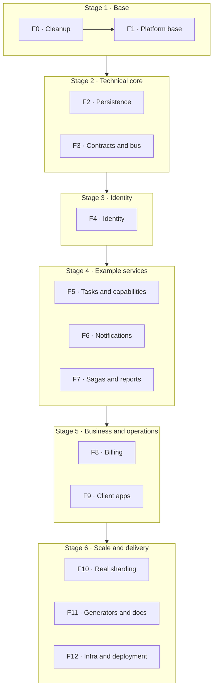

# Build plan

This file is the single entry point to the project plan: phases, execution order, status and decision log. The repository is the source of truth. The [executive summary in Claude Docs](https://claude.ai/artifact/Bn67Z4R16bLoevfodCcHiT) only summarizes it for reading outside the repository and is refreshed when a stage closes; when they differ, this file wins.

| File                                                                             | What it contains                                                                                                                       |
| -------------------------------------------------------------------------------- | -------------------------------------------------------------------------------------------------------------------------------------- |
| `docs/plan/README.md`                                                            | Vision, phases, cycle status, execution history by waves and decision log                                                              |
| [`docs/plan/cycle-3-test-speed-and-guards.md`](cycle-3-test-speed-and-guards.md) | Cycle 3: test speed, rule guards and impact review                                                                                     |
| [`docs/plan/f12-infra-and-deployment.md`](f12-infra-and-deployment.md)           | F12: inventory, decisions, definition of done, prerequisites, cycles and backlog                                                       |
| [`docs/plan/backend.md`](backend.md)                                             | Backend packages WP-01 to WP-13: design decisions, completion criteria and risks                                                       |
| [`docs/plan/front.md`](front.md)                                                 | Front packages P0.1 to P4.3: design decisions, acceptance commands and risks                                                           |
| [`docs/design/`](../design/)                                                     | Technical detail of each topic: [F4](../design/f4-identity.md) and [persistence and sagas](../design/typeorm-persistence-and-sagas.md) |
| [`docs/adr/`](../adr/README.md)                                                  | Log of the architecture decisions                                                                                                      |
| [`docs/ARCHITECTURE.md`](../ARCHITECTURE.md)                                     | What the platform is and how it is built                                                                                               |
| [`docs/plan/archive/`](archive/)                                                 | Historical copies; not maintained                                                                                                      |

## Vision

A monorepo template for building microservice backends in NestJS with TypeORM on PostgreSQL, hexagonal architecture, deployment on AWS and clients in Flutter. You clone it, rename it and add services to it.

It ships with what every product needs already solved: identity with MFA, multitenancy, auditing, messaging with retries, recoverable sagas, files, notifications, usage-based billing and end-to-end traceability. The principles behind each decision are in the [architecture summary](../ARCHITECTURE.md#summary).

## Phases

The build advances in six stages. Each stage depends on the previous one and, within a stage, the phases advance in parallel.

The infrastructure of each piece is added in its own phase; F12 makes it deployable and adds the deployment pipeline ([F12 plan](f12-infra-and-deployment.md)). Real sharding goes last because the `ShardRouter` exists since F2 and adding shards later does not touch business code.

**Status as of November 26, 2026**, verified in the code and in `git log`:

| Phase                       | Status                                                                                                                                                                                                                                       | Reference                                                                                                                             |
| --------------------------- | -------------------------------------------------------------------------------------------------------------------------------------------------------------------------------------------------------------------------------------------- | ------------------------------------------------------------------------------------------------------------------------------------- |
| F0 · Cleanup                | Built. The 2022 Express with Sequelize was rewritten from scratch as an Nx monorepo                                                                                                                                                          | `df81442` (2026-11-11); findings from the original repository in the [archive](archive/plan-claude-docs-2026-11-14.md#starting-point) |
| F1 · Platform base          | Built: Nx monorepo, `kernel`, `config`, `observability`, `@contracts/platform`, local environment and CI                                                                                                                                     | `df81442`                                                                                                                             |
| F2 · Persistence            | Built together with F3, on the `pg` driver: `persistence`, `criteria` and `sharding`, with `cache`, `bloom`, `resilience` and the adapters in the same commit. Rebuilt on TypeORM in waves 2 and 3                                           | `9afa085` (2026-11-12), [persistence design](../design/typeorm-persistence-and-sagas.md)                                              |
| F3 · Contracts and bus      | Built together with F2: contracts with export to JSON and Dart, `messaging`, `internal-api` and `saga` with an in-memory log. Rebuilt by layers in waves 0 to 3                                                                              | `9afa085`, ADR 0007, 0008 and 0017                                                                                                    |
| F4 · Identity               | Design approved. Built `@platform/rate-limit` (WP3), `@platform/auth` (WP1), `@platform/service` (WP4) and the identity contract (WP5). Continues in waves 5 to 7                                                                            | `796d1bd` (2026-11-13), [F4 design](../design/f4-identity.md)                                                                         |
| F5 · Tasks and capabilities | Built in wave 7: `tasks` service, `@platform/flags`, `@platform/search` with text and hybrid search on pgvector, and `features` and `flags` in `auth` and `http`                                                                             | Wave 7, ADR 0029                                                                                                                      |
| F6 · Notifications          | Built in wave 7: `notifications` service, `@platform/realtime` with SSE and Socket.IO on a per-user Valkey stream, `apps/realtime`, SES and SMTP, and identity email through `notifications`                                                 | Wave 7, ADR 0028 and 0030                                                                                                             |
| F7 · Sagas and reports      | Built in wave 8: `reports` service with event-driven projections and backfill from tasks and billing, and the `TenantOnboarding` and `DeleteAccount` sagas tested with `CrashingSagaStore`                                                   | Wave 8, ADR 0031                                                                                                                      |
| F8 · Billing                | Built in wave 8: `billing` service with plans, proration, invoices, charging through `PaymentProvider` and delinquency; `@platform/quotas` and `@platform/metering`                                                                          | Wave 8, ADR 0031                                                                                                                      |
| F9 · Client apps            | Business screens built in wave 9: `tasks`, `notifications` and `billing` with live repositories over the API (and their demo mode), SSE with `Last-Event-ID`, the `reports` microfrontend and the retry on 421                               | Wave 9, ADR 0034                                                                                                                      |
| F10 · Real sharding         | Built in wave 9: regions with `REGIONS` and `SERVICE_REGION` (421 `WRONG_REGION`), `@platform/tenant-move` with batch copy or logical replication, write barrier, the `MoveTenant` saga and its cleanup, and the move of the five services   | Wave 9, ADR 0032                                                                                                                      |
| F11 · Generators and docs   | Built in wave 9: service and module generators with `generators:verify` and `generators:smoke`, OpenAPI from the contracts, ARCHITECTURE with the visual map, ADRs up to date and runbooks in `docs/runbooks`                                | Wave 9, ADR 0033 and 0035                                                                                                             |
| F12 · Infra and deployment  | Planned. Stacks, tfvars, `deploy.yml`, OIDC, the image and the publish workflows exist but have never run against AWS, and B17 to B20 stop a first deploy. The [F12 plan](f12-infra-and-deployment.md) has the inventory and fourteen cycles | `13f606f` (2026-11-13), ADR 0019, 0020 and 0039 to 0045                                                                               |

After F12 come, on the same base: the business screens of each microfrontend; real charging and electronic invoicing with the DIAN through the `PaymentProvider` port; DPoP on all tokens; event export to a data lake; SLOs and alerts per service; cross-region disaster recovery with chaos tests; and automatic rebalancing of logical shards.

## Cycles

After wave 9 the work runs as cycles, one PR each, in this order. A cycle starts when the previous one is merged.

| Cycle  | Scope                                                                                                 | PR  | Status      |
| ------ | ----------------------------------------------------------------------------------------------------- | --- | ----------- |
| 1a     | Money, data and messaging: general review B1 to B8 and B14 to B16                                     | #25 | Merged      |
| 1b     | Identity security: B9 to B13                                                                          | #26 | Merged      |
| 1c     | Front: B21 and B22                                                                                    | #23 | Merged      |
| 2a     | Shared platform pieces, one repository base, selectors, DI findings, ADR 0037, structure checks in CI | #32 | Merged      |
| 2b     | Application unit tests, comment lint (ADR 0038) and comment fixes                                     | #34 | Merged      |
| 3      | [Test speed, rule guards and impact review](cycle-3-test-speed-and-guards.md)                         |     | In progress |
| F12-1  | Artifact that starts (B17)                                                                            |     | Planned     |
| F12-2  | Local smoke suite on LocalStack                                                                       |     | Planned     |
| F12-3  | Consistent Terraform (B18, `common.tfvars`, `global` stack, real tfvars in `terraform test`)          |     | Planned     |
| F12-4  | Configuration safeguards and Valkey failure policy                                                    |     | Planned     |
| F12-5  | Catalogs, regions and database access                                                                 |     | Planned     |
| F12-6  | Secrets (B20)                                                                                         |     | Planned     |
| F12-7  | Internal routing and authentication (B19)                                                             |     | Planned     |
| F12-8  | Runtime hardening for rolling deploys                                                                 |     | Planned     |
| F12-9  | Edge and real time                                                                                    |     | Planned     |
| F12-10 | Pipeline                                                                                              |     | Planned     |
| F12-11 | Front delivery                                                                                        |     | Planned     |
| F12-12 | Observability and recovery minimum                                                                    |     | Planned     |
| F12-13 | First deploy to `dev` (needs the user prerequisites)                                                  |     | Blocked     |
| F12-14 | Staging, rollback, restore drill and prod plan                                                        |     | Blocked     |

Each cycle runs with the [`phase-cycle`](../../.claude/workflows/phase-cycle.js) workflow on the pstack method of `CLAUDE.md`. Open items with no cycle are in the [F12 backlog](f12-infra-and-deployment.md#7-backlog). The hand-off notes of waves 3 to 9 and of cycle 2b are [archived](archive/wave-hand-off-notes.md).

## Execution order by waves

This section is history: the waves ended at wave 9.

Three plans run together, wave by wave: the [backend plan](backend.md), the [front plan](front.md) and the [F4 design](../design/f4-identity.md#61-waves-and-dependencies). The [persistence and sagas design](../design/typeorm-persistence-and-sagas.md) has no waves of its own: its packages P1, P2 and P3 are WP-09, WP-10 and WP-12 of the backend plan (decision D11).

| Wave | Backend                                                                                                                                                                                                                 | Front                                                                              | F4                                                                                                       | Status                                                                                                                                                                                                                      |
| ---- | ----------------------------------------------------------------------------------------------------------------------------------------------------------------------------------------------------------------------- | ---------------------------------------------------------------------------------- | -------------------------------------------------------------------------------------------------------- | --------------------------------------------------------------------------------------------------------------------------------------------------------------------------------------------------------------------------- |
| 0    | WP-01 foundations, WP-02 contract kit and tooling, WP-03 skills, ADRs and lint                                                                                                                                          | P0.1 clock and versions, P0.2 script and baseline, P0.3 front ADR                  |                                                                                                          | Done in `d34c16e`. Front ADR numbered 0027; NestJS 12.3.2 and TypeORM 1.1.2                                                                                                                                                 |
| 1    | WP-04 config and observability, WP-05 resilience, cache, rate-limit and bloom, WP-06 scheduling and sharding                                                                                                            | P1.1 ui, tokens and i18n, P1.2 shell_core and utils, P1.3 test_utils, auth and api |                                                                                                          | Done in `f05da6b`                                                                                                                                                                                                           |
| 2    | WP-07 messaging, WP-08 internal-api, WP-09 persistence on TypeORM (P1)                                                                                                                                                  | P2.1 shell_host, P2.2 account, P2.3 backoffice                                     |                                                                                                          | Done in `3dde07d`                                                                                                                                                                                                           |
| 3    | WP-10 platform tables and criteria (P2), WP-11 AWS and Valkey adapters, WP-12 sagas (P3)                                                                                                                                | P3.1 billing and notifications, P3.2 tasks and verifier, P3.3 assistant            |                                                                                                          | Done in `91ecc5e`                                                                                                                                                                                                           |
| 4    | WP-13 base closure                                                                                                                                                                                                      | P4.1 apps and scenarios, P4.2 legacy removal, P4.3 skills, ADRs and generator      | WP1 `@platform/auth`, WP4 `@platform/service`; WP5 identity contract and front in a separate light troop | Done in `a7f2820`                                                                                                                                                                                                           |
| 5    | Troop 2: contracts for tasks, notifications, reports and billing (F5 to F8) with their Dart. Troop 3: first pieces of F12 (deployment workflow with OIDC, web and mobile publishing, Lambda entry, SigV4 client signer) |                                                                                    | Troop 1, with Opus: WP2 `@platform/http` and WP6 identity skeleton                                       | Done for troops 1 and 2. Troop 3 left partial pieces that do not deploy; see the [F12 inventory](f12-infra-and-deployment.md#1-inventory-on-main-2026-11-26)                                                                |
| 6    |                                                                                                                                                                                                                         |                                                                                    | Full F4: WP7 to WP15                                                                                     | Done. Builder, two reviews and two correction rounds; approved on the third review                                                                                                                                          |
| 7    | F5 and F6: tasks, notifications, flags, search, realtime with SSE and Socket.IO, SES                                                                                                                                    |                                                                                    |                                                                                                          | Done. Builder, two reviews and two correction rounds plus an extra round; approved on the fourth review                                                                                                                     |
| 8    | F7 and F8: reports, billing, quotas, metering and the example sagas                                                                                                                                                     |                                                                                    |                                                                                                          | Done. Builder, two reviews and one correction round plus an extra round; approved on the third review                                                                                                                       |
| 9    | F10 and F11: real sharding and `MoveTenant`, generators, OpenAPI, documentation and final visual map                                                                                                                    | F9: business screens and app scenarios                                             |                                                                                                          | Done in two cycles. Part A (F10 and F11) approved on the third review. Part B (F9, per-service tenant directory, end-to-end flow and documentation) approved on the third review. The end-to-end flow passes twice in a row |

Wave 5 ran with three troops. From wave 6 on, each wave was a cycle with an Opus builder and an independent Opus reviewer, repeated until the reviewer approved ([F5 to F11 design, 11.2](../design/f5-f11-services.md#112-waves-6-to-9-build-and-review-cycles)). The general integrated, opened the PR and merged it with green checks. After wave 9 the work continues as the [cycles](#cycles) above; F12 needs the user mid-way, at the points its plan lists.

- **Wave 5, contracts and common pieces.** A contract only depends on the contract kit, so those of the four services go in one troop. WP6 needs the code of WP2 and has it in the same copy of the repository. Troop 3 did not depend on the services' code.
- **Waves 6 to 9, cycles by phase group.** Services verify tokens locally with `@platform/auth` ([ADR 0022](../adr/0022-token-verification-shared-revocation-state.md)), so F5 to F8 do not wait for the identity modules. The order follows the dependencies: `notifications` consumes events from `tasks`, `reports` and the sagas span the first two services, `billing` metering spans all of them, the screens arrive with all the APIs, `MoveTenant` needs data in every service and the generators come from the services already built. Within a wave, if an agent needs something from the other, it programs against the port with its fake.

The F5 to F11 design is a single document with the format of the [F4 design](../design/f4-identity.md) (contracts, modules with facades and fakes, packages with exclusive folders). A Sonnet guide writes it while wave 4 runs, the general reviews it and the user approves its decisions before wave 5. In waves 5 to 7 the shared files (`nx.json`, `tsconfig.base.json`, `compose`, `docs/`) have a single owner: the general.

F4's WP3 does not appear: `@platform/rate-limit` already exists and its refactor goes in WP-05 and WP-11. The reasons for the backend order are in [section 4 of its plan](backend.md#4-order-and-start-of-f4), and the dependencies between front waves in [section 4.1 of its plan](front.md#41-dependencies-between-waves).

## How a wave ran

History of waves 0 to 9. Cycles follow [the method above](#cycles).

- Each package is built by a light troop: a Sonnet guide that plans and reviews, and two Haiku implementers. Troops that touch credentials and tokens (`@platform/auth`, `@platform/http` and identity) add an Opus captain who advises on the plan and audits the result. From wave 5 on they run with the `oleada-ligera` workflow, which enables the captain with `opus: true` in the troop. The agents are in `.claude/agents` (`backend-lead`, `front-lead`, `backend-implementer` and `front-implementer`).
- From wave 6 on, each wave is a cycle of the [`phase-cycle`](../../.claude/workflows/phase-cycle.js) workflow: an Opus builder plans, implements and tests; an independent Opus reviewer reviews without editing; the builder corrects, up to two rounds. The general integrates, verifies, opens and merges the PR, and starts the next cycle when the user asks for it. The script header explains its arguments and how to request an extra round of corrections.
- The guide first writes the skeletons: signatures with a body that throws a "not implemented" error and the port's contract test. Then it splits files between the two Haiku implementers, who follow literal instructions and never edit the same file.
- Each troop works in its own copy of the repository (branch `troop/<line>-<package>`) and only touches its package's exclusive folders. Shared files have a single owner per wave, set in each plan.
- A troop delivers when its package meets the completion criterion: the [backend standard](backend.md#31-common-rules) or the [front acceptance commands](front.md#23-acceptance-commands), plus the package's own criteria.
- The general integrates the wave's troops, runs the validation of the whole and only then opens the next wave. A wave starts when the previous one is integrated and green.

## Open decisions

None. Every open item has an F12 cycle or a row in the [F12 backlog](f12-infra-and-deployment.md#7-backlog).

## Decision log

Each decision has its detail in the linked ADR or design. A new architecture decision is recorded first as an ADR and then as a row here.

| Date       | Decision                                                                                                                                                                                                                                                                                                        | Where                                                                                                                          |
| ---------- | --------------------------------------------------------------------------------------------------------------------------------------------------------------------------------------------------------------------------------------------------------------------------------------------------------------- | ------------------------------------------------------------------------------------------------------------------------------ |
| 2026-11-26 | Runtime matrix: Fargate APIs by default, `tasks` on Lambda in `dev`, an always-on Fargate worker for relay, jobs and consumers, computed listener priorities                                                                                                                                                    | [ADR 0039](../adr/0039-runtime-matrix-per-service.md)                                                                          |
| 2026-11-26 | Internal calls through VPC Lattice with SigV4 and IAM auth policies from the topology callees; HMAC only locally                                                                                                                                                                                                | [ADR 0040](../adr/0040-internal-routing-and-authentication.md)                                                                 |
| 2026-11-26 | Secrets inventory with owner stacks and delivery per runtime; IAM database auth with owner, app and reader roles                                                                                                                                                                                                | [ADR 0041](../adr/0041-secrets-and-database-credentials.md)                                                                    |
| 2026-11-26 | F12 is single region per environment, one catalog per service, region variables in `common.tfvars` and a `global` stack                                                                                                                                                                                         | [ADR 0042](../adr/0042-region-and-catalog-model.md)                                                                            |
| 2026-11-26 | One artifact per commit promoted by digest, saved plans applied after approval, expand and contract migrations, rollback by digest                                                                                                                                                                              | [ADR 0043](../adr/0043-deploy-migrations-and-rollback.md)                                                                      |
| 2026-11-26 | Valkey required outside `local`; security checks fail closed, caches and limits degrade                                                                                                                                                                                                                         | [ADR 0044](../adr/0044-valkey-failure-policy.md)                                                                               |
| 2026-11-26 | Real time behind CloudFront and WAF, bearer auth, domain scheme, web caching and mobile build only                                                                                                                                                                                                              | [ADR 0045](../adr/0045-edge-domains-and-real-time.md)                                                                          |
| 2026-11-26 | F12 runs as fourteen cycles after cycle 3, with a definition of done and user prerequisites                                                                                                                                                                                                                     | [F12 plan](f12-infra-and-deployment.md)                                                                                        |
| 2026-11-26 | Comment and documentation rules enforced by lint in the backend and the front                                                                                                                                                                                                                                   | [ADR 0038](../adr/0038-comment-and-documentation-rules-enforced-by-lint.md)                                                    |
| 2026-11-26 | Before F12, cycle 3 speeds up the tests, adds a guard for every rule and closed finding, and has the reviewer map what the diff affects explicitly and implicitly                                                                                                                                               | [Cycle 3](cycle-3-test-speed-and-guards.md)                                                                                    |
| 2026-11-25 | Composition rules, shared platform pieces and domain events                                                                                                                                                                                                                                                     | [ADR 0037](../adr/0037-composition-shared-platform-pieces-and-domain-events.md)                                                |
| 2026-11-25 | Identity security: factors, access and lifecycle                                                                                                                                                                                                                                                                | [ADR 0036](../adr/0036-identity-security-factors-access-lifecycle.md)                                                          |
| 2026-11-24 | Each service places the tenant in its own shard directory with `<service>.tenant-directory.place.v1`, which the onboarding saga calls before opening the account                                                                                                                                                | [ADR 0032](../adr/0032-tenant-moves-and-regions.md)                                                                            |
| 2026-11-24 | Live repositories in the front, SSE with `Last-Event-ID` and retry on 421                                                                                                                                                                                                                                       | [ADR 0034](../adr/0034-live-front-repositories-sse-region.md)                                                                  |
| 2026-11-24 | End-to-end flow of the five services in one process, with an in-memory bus and real databases                                                                                                                                                                                                                   | [ADR 0035](../adr/0035-end-to-end-platform-flow.md)                                                                            |
| 2026-11-24 | Before F12, four correction cycles run on the general review                                                                                                                                                                                                                                                    | [General review](../audits/2026-11-24-general-review.md)                                                                       |
| 2026-11-24 | Wave 9 is split into two consecutive cycles (F10 and F11; then F9 with the closing documentation), because it combines backend and front and the build machine does not run two cycles at once                                                                                                                  | This file                                                                                                                      |
| 2026-11-24 | Regions by variable, tenant moves with a per-shard write barrier, two copy strategies, a final `FinishTenantMove` step and a cleanup that does not delete a source that is still routed                                                                                                                         | [ADR 0032](../adr/0032-tenant-moves-and-regions.md)                                                                            |
| 2026-11-24 | Service and module generators with their own templates, verification against `tasks` and a smoke test in CI; OpenAPI from the contracts                                                                                                                                                                         | [ADR 0033](../adr/0033-generators-and-openapi.md)                                                                              |
| 2026-11-23 | Reports with projections and backfill per source; billing with proration, idempotent charging, per-tenant delinquency and no credit invoices; quotas checked before creating accounts; identity sagas                                                                                                           | [ADR 0031](../adr/0031-reports-billing-identity-sagas.md)                                                                      |
| 2026-11-23 | Realtime recovers on a per-user Valkey stream, the same for SSE and Socket.IO, instead of the Socket.IO streams adapter; amends ADR 0011                                                                                                                                                                        | [ADR 0028](../adr/0028-real-time-one-stream-per-user.md)                                                                       |
| 2026-11-23 | Maintenance jobs that go through all the tenants of a shard use a maintenance RLS policy, with no role with `BYPASSRLS`; search lives in each shard                                                                                                                                                             | [ADR 0029](../adr/0029-cross-tenant-maintenance-search-per-shard.md)                                                           |
| 2026-11-23 | Identity sends its email through `notifications.messages.send.v1`, with a global email ledger by message id                                                                                                                                                                                                     | [ADR 0030](../adr/0030-identity-email-through-notifications.md)                                                                |
| 2026-11-16 | From wave 6 on, four cycles with an Opus builder and reviewer: F4; F5 and F6; F7 and F8; F9, F10 and F11. The general merges each PR without waiting for the user, who reviews at the end                                                                                                                       | [F5 to F11 design, 11.2](../design/f5-f11-services.md#112-waves-6-to-9-build-and-review-cycles)                                |
| 2026-11-16 | The template offers the alternatives the ADRs name as adapters swappable by configuration (SSE and Socket.IO, Fargate and Lambda, HMAC and SigV4, text and hybrid search, batch copy and logical replication); the user picks the default                                                                       | [F5 to F11 design, 2.1](../design/f5-f11-services.md#21-alternatives-the-template-ships)                                       |
| 2026-11-16 | Full plan, F4 to F12, by wave 7 with twelve troops: three in wave 5, six in wave 6 and three in wave 7. Light troops (Sonnet guide and two Haiku); the Opus captain only in those that touch credentials and tokens. A single design for F5 to F11, written during wave 4                                       | This file                                                                                                                      |
| 2026-11-14 | NestJS layer per sub-entry point and ports as abstract classes                                                                                                                                                                                                                                                  | [ADR 0025](../adr/0025-nestjs-layer-per-sub-entry-abstract-ports.md)                                                           |
| 2026-11-14 | Scheduled jobs with `ScheduledJob`, `JobLock` and `@platform/scheduling`                                                                                                                                                                                                                                        | [ADR 0026](../adr/0026-scheduled-jobs-scheduledjob-joblock.md)                                                                 |
| 2026-11-14 | Screen patterns and shared front tests                                                                                                                                                                                                                                                                          | [ADR 0027](../adr/0027-front-screen-patterns-and-tests.md)                                                                     |
| 2026-11-14 | The plan lives in the repository with a single entry point, this file; the Claude Docs document becomes an executive summary                                                                                                                                                                                    | This file                                                                                                                      |
| 2026-11-14 | Per-endpoint step-up is declared in the contract route with `Access.authenticated({ mfaMaxAgeMinutes })`, not in the `@Endpoint` options                                                                                                                                                                        | [F4 design, 3.2.4 and 3.4.1](../design/f4-identity.md#324-authorization)                                                       |
| 2026-11-14 | The contract export is accepted, because it is implemented and used in CI                                                                                                                                                                                                                                       | [ADR 0017](../adr/0017-contract-export.md)                                                                                     |
| 2026-11-14 | Backend plan: thirteen packages in five waves, a NestJS layer per library, own jobs and F4 start on the new base                                                                                                                                                                                                | [Backend plan](backend.md)                                                                                                     |
| 2026-11-14 | Front plan: fifteen packages in five waves, controllers per screen, legacy code is removed at the end and the decisions in its section 8                                                                                                                                                                        | [Front plan](front.md)                                                                                                         |
| 2026-11-14 | Persistence on TypeORM with logical and physical sharding, and a saga log in the shard's `saga` schema; replaces ADR 0009                                                                                                                                                                                       | [ADR 0024](../adr/0024-typeorm-persistence-sharding-persistent-sagas.md), [design](../design/typeorm-persistence-and-sagas.md) |
| 2026-11-14 | The ten F4 decisions: new claims, `auth:*` in Valkey, `@Endpoint(route)`, OpenAPI without `@nestjs/swagger`, Node 24.22.2, channel by header, device code, 12-character password, WebAuthn in base64url and attempts without an account only in Valkey                                                          | [F4 design, section 11](../design/f4-identity.md#11-decisions-that-require-the-user)                                           |
| 2026-11-14 | Implement in-house on `node:crypto` and the standard library; a dependency comes in only when reimplementing it is unwise or costly                                                                                                                                                                             | [F4 design, section 9](../design/f4-identity.md#9-external-dependencies)                                                       |
| 2026-11-14 | Backend tests in `__tests__/` with utilities in `__tests__/utils/`; in the front, `test/utils/` and the `test_utils` package                                                                                                                                                                                    | `c6f6eed`, `0fdc015`, [ARCHITECTURE](../ARCHITECTURE.md#monorepo-with-nx)                                                      |
| 2026-11-13 | Terraform by stacks and API runtime chosen per service                                                                                                                                                                                                                                                          | [ADR 0020](../adr/0020-terraform-stacks-and-runtime-per-service.md)                                                            |
| 2026-11-13 | Valkey as the adapter for cache, routing, Bloom and invalidation                                                                                                                                                                                                                                                | [ADR 0021](../adr/0021-valkey-adapter.md)                                                                                      |
| 2026-11-13 | Local token verification and shared revocation state in `auth:*`                                                                                                                                                                                                                                                | [ADR 0022](../adr/0022-token-verification-shared-revocation-state.md)                                                          |
| 2026-11-13 | User data in the user's shard and tenant data in the tenant's shard                                                                                                                                                                                                                                             | [ADR 0023](../adr/0023-identity-data-routing.md)                                                                               |
| 2026-11-12 | Minimal root: `backend/` and `front/`, each application owns its libraries                                                                                                                                                                                                                                      | [ADR 0015](../adr/0015-repository-structure-and-shared-code.md)                                                                |
| 2026-11-12 | Internet egress with NAT only for the application subnets                                                                                                                                                                                                                                                       | [ADR 0016](../adr/0016-network-egress.md)                                                                                      |
| 2026-11-12 | Contracts in TypeScript with zod, exported to JSON and generated in Dart                                                                                                                                                                                                                                        | [ADR 0017](../adr/0017-contract-export.md)                                                                                     |
| 2026-11-12 | Microfrontend contract                                                                                                                                                                                                                                                                                          | [ADR 0018](../adr/0018-microfrontend-contract.md)                                                                              |
| 2026-11-12 | CI and toolchain                                                                                                                                                                                                                                                                                                | [ADR 0019](../adr/0019-ci-and-toolchain.md)                                                                                    |
| 2026-11-11 | Nx monorepo with pnpm and one microservice per app                                                                                                                                                                                                                                                              | [ADR 0001](../adr/0001-nx-monorepo-pnpm-microservices.md)                                                                      |
| 2026-11-11 | Hexagonal architecture and platform-agnostic design                                                                                                                                                                                                                                                             | [ADR 0002](../adr/0002-hexagonal-architecture-platform-agnostic.md)                                                            |
| 2026-11-11 | UUIDv7 everywhere, including the `traceId`                                                                                                                                                                                                                                                                      | [ADR 0003](../adr/0003-uuidv7-identifiers-traceid.md)                                                                          |
| 2026-11-11 | OpenTelemetry with OpenObserve                                                                                                                                                                                                                                                                                  | [ADR 0004](../adr/0004-observability-opentelemetry-openobserve.md)                                                             |
| 2026-11-11 | Own authentication with sessions and JWT                                                                                                                                                                                                                                                                        | [ADR 0005](../adr/0005-authentication-sessions-jwt.md)                                                                         |
| 2026-11-11 | MFA with a registered device and passkeys                                                                                                                                                                                                                                                                       | [ADR 0006](../adr/0006-mfa-registered-device-passkeys.md)                                                                      |
| 2026-11-11 | Messaging with typed topology, SNS and SQS, and CloudEvents                                                                                                                                                                                                                                                     | [ADR 0007](../adr/0007-messaging-typed-topology-sns-sqs-cloudevents.md)                                                        |
| 2026-11-11 | Orchestrated sagas with a persistent log                                                                                                                                                                                                                                                                        | [ADR 0008](../adr/0008-orchestrated-sagas-persistent-log.md)                                                                   |
| 2026-11-11 | Logical sharding by groups and residency by region                                                                                                                                                                                                                                                              | [ADR 0010](../adr/0010-logical-sharding-region-residency.md)                                                                   |
| 2026-11-11 | Realtime with Socket.IO and SSE                                                                                                                                                                                                                                                                                 | [ADR 0011](../adr/0011-real-time-socketio-sse.md)                                                                              |
| 2026-11-11 | Front in Flutter with shells and microfrontends                                                                                                                                                                                                                                                                 | [ADR 0012](../adr/0012-front-flutter-shells-microfrontends.md)                                                                 |
| 2026-11-11 | AI module with ports and Claude by default                                                                                                                                                                                                                                                                      | [ADR 0013](../adr/0013-ai-module-ports-claude.md)                                                                              |
| 2026-11-11 | Agreements and signed documents                                                                                                                                                                                                                                                                                 | [ADR 0014](../adr/0014-agreements-signed-documents.md)                                                                         |
| 2026-11-11 | `SERVICE.SUBMODULE.ERROR` errors with RFC 9457; major version in the URL and by header; auditing by triggers; hybrid search with pgvector; own resilience with Bloom filters; account lockout and token invalidation; metered billing with charging through a port; Jest with Testcontainers, k6 and LocalStack | Sections of [ARCHITECTURE](../ARCHITECTURE.md); no ADR of its own                                                              |
